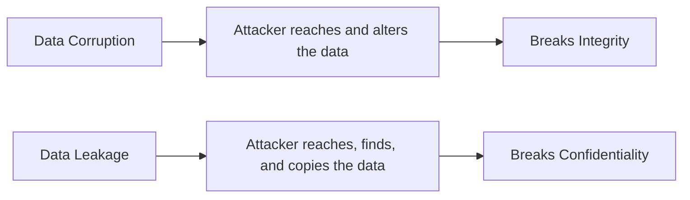
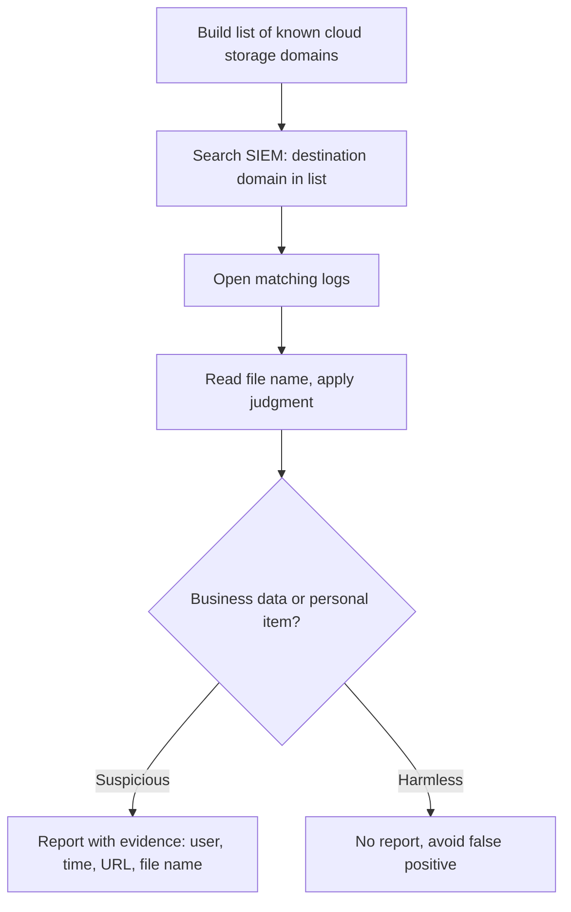
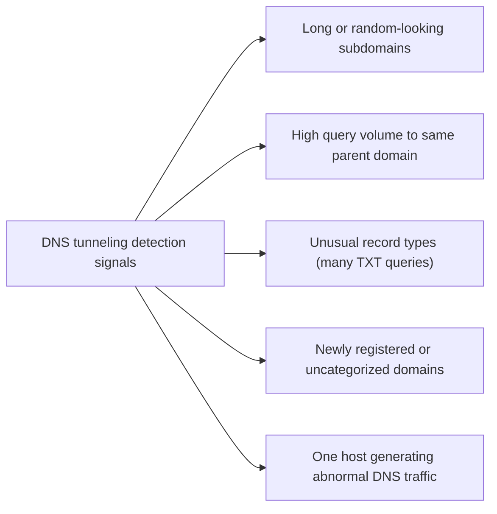
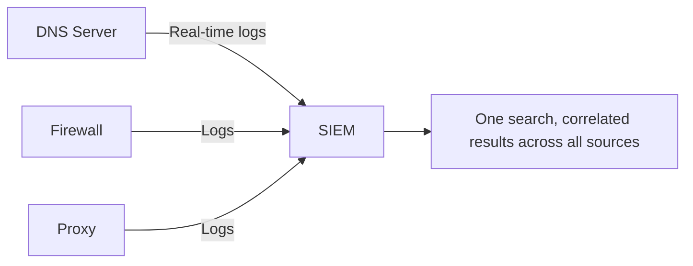

| Topic | Level | Reading Time | Prerequisites |
|---|---|---|---|
| Interview Questions Review: Data Loss and Exfiltration | Intermediate | ~10 min | Data Loss Fundamentals and DLP Operations, DLP Tools and SIEM Integration, Data Exfiltration and DNS Tunneling |

> **The goal of this section:**  
> A quick review in question-and-answer format of the most important points you may be asked about in an interview on DLP and exfiltration, as a practical summary of the concepts explained in detail in this category's files.

## Learning Objectives

By the end of this section, you will be able to:

- Answer, in your own words, the most common interview questions about data loss, DLP operations, and exfiltration.
- Explain the reasoning behind each answer, not just recite it, so you can adapt to follow-up questions.
- Identify which file in this category to revisit for deeper detail on any question you found difficult.

## Table of Contents

- [Learning Objectives](#learning-objectives)
- [Question 1: Data Corruption Versus Data Leakage](#question-1-data-corruption-versus-data-leakage)
- [Question 2: Detecting Cloud Storage Uploads](#question-2-detecting-cloud-storage-uploads)
- [Question 3: Why Attackers Use DNS Tunneling, and How to Detect It](#question-3-why-attackers-use-dns-tunneling-and-how-to-detect-it)
- [Question 4: Why Send DNS Logs to a SIEM Instead of Searching the DNS Server Directly](#question-4-why-send-dns-logs-to-a-siem-instead-of-searching-the-dns-server-directly)
- [Quick Reference Table](#quick-reference-table)
- [Career Path Connections](#career-path-connections)
- [Summary](#summary)

## Question 1: Data Corruption Versus Data Leakage

**The question: What's the difference between data corruption and data leakage?**

**The model answer:**

- **Data corruption** means the data **has been altered, encrypted, or deleted**, so it has become inaccurate, inconsistent, or unusable. The attacker **must reach the data** to modify it, and this breaks the **Integrity** property of the CIA triad.
- **Data leakage** means the data **has been exposed to people who aren't authorized to see it**. The attacker **must reach the data, find it, and copy it**, and this breaks the **Confidentiality** property.

> [!TIP]
> If the interviewer pushes further with "which is harder for the attacker?", the honest answer is leakage, because the attacker must find and exfiltrate the data stealthily without being detected, while corruption (like ransomware encryption) can be noisy and still succeed.

For full details, see the **Data Loss Fundamentals and DLP Operations** file.

## Question 2: Detecting Cloud Storage Uploads

**The question: How would you detect employees uploading sensitive data to cloud storage?**

**The model answer (practical steps):**

- Build a list of common file-sharing and cloud storage service domains (such as MediaFire and MEGA).
- In the SIEM, search for logs where the destination domain equals any domain on the list.
- Open the matching logs; they usually show you the domain, the URL, and the name of the file being uploaded.
- Read the file name and use your judgment (a file named `Salaries_2026.xlsx` is suspicious).
- Present the finding to the team lead with evidence: the user, the time, the URL, the file name.

Before you report, you need to make sure it isn't a **false positive**: is the file really business data, or something personal? Is the person even allowed to use this service for work? Is there a suspicious pattern (a large number of uploads, huge sizes, unusual times)?

For full details, see the **DLP Tools and SIEM Integration** file.

## Question 3: Why Attackers Use DNS Tunneling, and How to Detect It

**The question: Why do attackers use DNS tunneling, and how do you detect it?**

**The model answer:**

**Why DNS specifically:**

- DNS traffic is **almost always allowed outbound**.
- DNS is **essential for normal operation**; if it's blocked, nothing will work.
- Many organizations monitor **web traffic far more closely than DNS traffic**.

**How to detect it, signs in the logs:**

- Very long or random-looking subdomains (high **entropy**).
- A very large number of queries to the same parent domain, each with a different subdomain.
- Unusual record types, such as many **TXT queries**.
- Newly registered or uncategorized domains.
- A single device generating far more DNS traffic than its peers.

> [!TIP]
> If the interviewer asks "why not just block DNS entirely to stop this?", the answer is that DNS is required for basically everything to function. The real defenses are forcing all devices through company DNS servers, logging to the SIEM, and using tunneling-detection patterns, not blocking DNS itself.

For full details, see the **Data Exfiltration and DNS Tunneling** file.

## Question 4: Why Send DNS Logs to a SIEM Instead of Searching the DNS Server Directly

**The question: Why send DNS logs to the SIEM instead of searching the DNS server directly?**

**The model answer (five reasons):**

| # | Reason | Explanation |
|---|---|---|
| 1 | Centralization and least privilege | The analyst shouldn't have an account on every security device; every extra account is an extra path for the attacker to exploit |
| 2 | Multiple sources | Organizations usually have more than one DNS server, firewall, and proxy; searching each one separately is slow and error-prone |
| 3 | Correlation and context | If the same domain appears in DNS, proxy, and firewall logs, you can see what each device said in one place, and pivot on the IP |
| 4 | Reliability | The SIEM keeps the data even if the connection to the DNS server is lost |
| 5 | Real-time integration | The DNS server sends logs to the SIEM the moment they occur |

> [!IMPORTANT]
> A compromised DNS server with analyst accounts on it is a disaster. Centralizing access through the SIEM, rather than granting direct accounts on every security appliance, is itself a least-privilege control, connecting directly to the Access Control Models file from an earlier category.

For full details, see the **DLP Tools and SIEM Integration** file.

## Quick Reference Table

| # | Question | One-Line Answer |
|---|---|---|
| 1 | Corruption vs. leakage | Corruption breaks integrity (data altered), leakage breaks confidentiality (data exposed) |
| 2 | Detecting cloud uploads | Match destination domains in SIEM against known file-sharing services, verify before reporting |
| 3 | DNS tunneling | Hides data in DNS queries because DNS is always allowed; detect via entropy, volume, and record-type anomalies |
| 4 | SIEM vs. direct DNS server access | Centralization, least privilege, correlation across sources, reliability, and real-time integration |

## Career Path Connections

| Career Path | How This Topic Applies |
|---|---|
| SOC Analyst | These exact questions reflect daily Tier 1/Tier 2 DLP investigation work |
| Penetration Tester | Understanding detection logic helps design more evasive, realistic exfiltration simulations |
| GRC | Data classification and leakage definitions map directly to regulatory reporting obligations |
| Cloud Security | Cloud storage monitoring and DNS security concepts apply identically in cloud-native environments |

## Summary

- **Corruption breaks Integrity, leakage breaks Confidentiality:** the first question in any conversation about a security incident is "which CIA property was hit?"
- **Cloud upload detection is a SIEM search skill:** a list of domains, a search, checking for false positives, and presenting clear evidence.
- **DNS tunneling exploits DNS's always-allowed nature:** detection relies on anomalous patterns, not on blocking DNS itself.
- **SIEM centralization is a security control in itself:** it's not just an operational convenience; it's a direct application of the least privilege principle.

