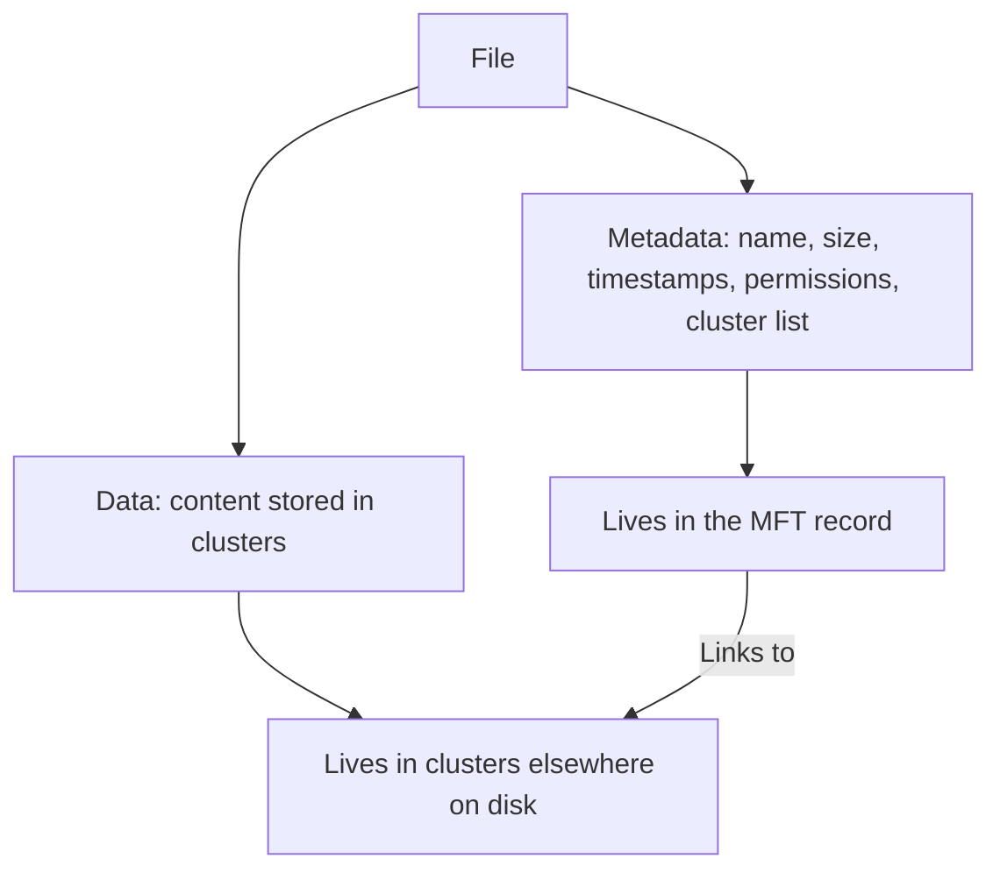
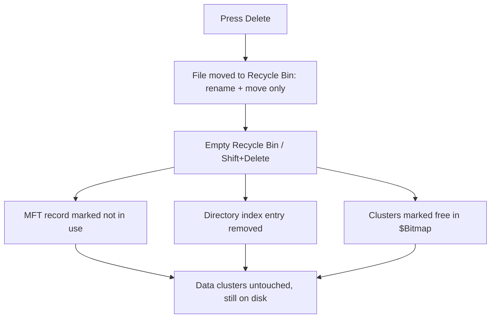
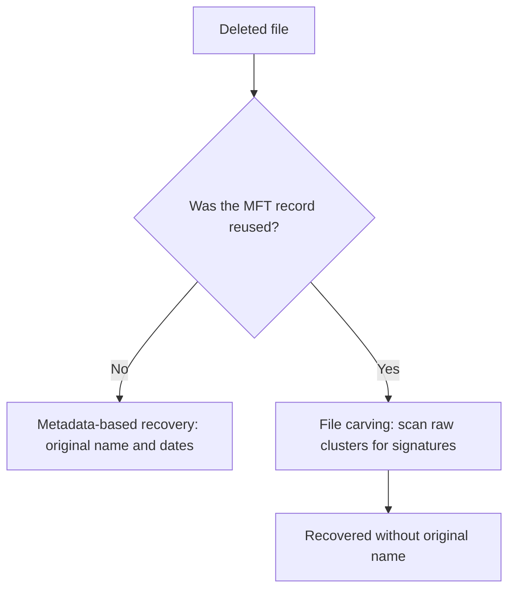
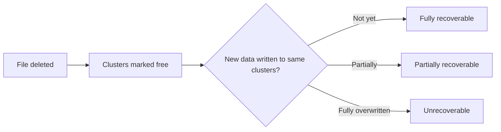
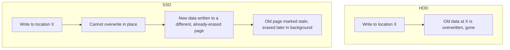
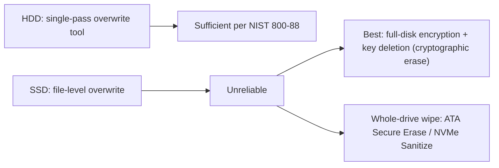

| Topic | Level | Reading Time | Prerequisites |
|---|---|---|---|
| Deleted Data, Forensics, and Secure Deletion | Intermediate | ~25 min | None |

> **Goal of this section:**
> You'll understand the truth that surprises most people: deleting a file doesn't actually erase its content. You'll see how NTFS stores files, how forensics recovers deleted data, the fundamental difference between HDDs and SSDs when it comes to deletion, and finally how to truly erase data forever.


## Learning Objectives

By the end of this section, you will be able to:

- Explain the surprising truth about file deletion: the content usually remains on disk after deletion.
- Describe how **NTFS** separates a file's **data** (clusters) from its **metadata** (the MFT record).
- Walk through what actually happens, step by step, when a file is deleted and the Recycle Bin is emptied.
- Differentiate between **metadata-based recovery** and **file carving** as forensic recovery methods.
- Explain why **HDDs** and **SSDs** require fundamentally different secure-deletion approaches.
- Apply **NIST SP 800-88**'s Clear/Purge/Destroy model to real disposal decisions.
- Use **SDelete** to securely delete a file and wipe free space on Windows.

## Table of Contents

- [Learning Objectives](#learning-objectives)
- [The Surprising Truth](#the-surprising-truth)
- [How a File System Stores a File (NTFS Example)](#how-a-file-system-stores-a-file-ntfs-example)
  - [Two Parts of a File](#two-parts-of-a-file)
  - [The Bitmap](#the-bitmap)
- [What Happens When You Delete](#what-happens-when-you-delete)
  - [Step 1: Pressing Delete](#step-1-pressing-delete)
  - [Step 2: Emptying the Recycle Bin](#step-2-emptying-the-recycle-bin)
  - [Why the OS Works This Way](#why-the-os-works-this-way)
- [Why "The Name Is No Longer Attached to the Data"](#why-the-name-is-no-longer-attached-to-the-data)
  - [Metadata-Based Recovery](#metadata-based-recovery)
  - [File Carving](#file-carving)
- [When Is the Data Really Gone](#when-is-the-data-really-gone)
- [Common Forensic Tools](#common-forensic-tools)
- [HDD Versus SSD: How Each Stores Data](#hdd-versus-ssd-how-each-stores-data)
  - [HDD: Overwrite in Place](#hdd-overwrite-in-place)
  - [SSD: Three Rules That Change Everything](#ssd-three-rules-that-change-everything)
- [How to Really Delete Information Forever](#how-to-really-delete-information-forever)
  - [For a Single File or Folder on an HDD](#for-a-single-file-or-folder-on-an-hdd)
  - [For SSDs and Flash](#for-ssds-and-flash)
- [Disposal, Reuse, and Forgotten Copies](#disposal-reuse-and-forgotten-copies)
  - [NIST 800-88: Clear, Purge, Destroy](#nist-800-88-clear-purge-destroy)
  - [Don't Forget the Copies](#dont-forget-the-copies)
- [SDelete (Sysinternals) in Windows](#sdelete-sysinternals-in-windows)
  - [How It Works](#how-it-works)
  - [Common Commands](#common-commands)
- [Career Path Connections](#career-path-connections)
- [Key Terms Glossary](#key-terms-glossary)
- [Summary](#summary)

## The Surprising Truth

When you delete a file, **and even if you empty the Recycle Bin**, the file's content **is usually still on the disk**. What gets removed is **the system's record that says where the file is**. Until something else **writes over** that space, a forensic tool can **read the data back**.

> [!IMPORTANT]
> This single fact is the foundation of the entire file: deletion removes the pointer, not the data. Every forensic recovery technique and every secure-deletion method covered below exists specifically because of this gap between "the file looks gone" and "the content is actually gone."

## How a File System Stores a File (NTFS Example)

### Two Parts of a File

| Part | What It Holds | Where It Lives |
|---|---|---|
| **Data** | The actual content, stored in **clusters** (usually 4 KB each) on the disk | Scattered clusters |
| **Metadata** | The file name, size, timestamps, permissions, and a list of which clusters hold the data | In NTFS, a record in the **Master File Table (MFT)**. The name also appears in a **directory index** |



**The name isn't stored with the data.** The name lives in the MFT and the folder index, and the content lives in clusters somewhere else. **The MFT record is the link between them.**

### The Bitmap

NTFS separately keeps a **`$Bitmap`**: one bit per cluster, indicating whether it's in use or free.

## What Happens When You Delete

### Step 1: Pressing Delete

Windows **doesn't erase** anything; it moves the file to the Recycle Bin. That's just a **rename and move** to `C:\$Recycle.Bin\<SID>\`. The file becomes `$R######.ext` (the data), and a small file `$I######.ext` records the original path, the size, and the deletion time. **Nothing has been destroyed yet**, and you can restore it from there.

### Step 2: Emptying the Recycle Bin

If you empty the Recycle Bin (or use Shift+Delete, which skips the bin), the file system now **actually deletes it**:

- The MFT record is marked **not in use**.
- The record **usually keeps most of its content** (the name, size, and cluster list) until it's reused.
- The entry in the directory index is removed, so Explorer no longer shows it.
- The clusters are marked **free** in the `$Bitmap`.

**That's the whole story. The data clusters aren't touched. The bits are still on the disk.**



### Why the OS Works This Way

**The reason: speed.** Erasing a 5 GB file would take as long as writing exactly 5 GB. Marking the records as free takes **milliseconds**.

## Why "The Name Is No Longer Attached to the Data"

After deletion, **the link between the name and the data** (the MFT record, or the pointer inside it) **disappears**. The content still sits in clusters, but **nothing officially says that those clusters belong to `report.docx`**.

This brings us to two recovery methods in forensics:

### Metadata-Based Recovery

If the MFT record **hasn't been reused**, the tool **can still read the old record** (the name, size, timestamps, and cluster list) and restores the file **with its original name and dates**. **This works best immediately after deletion.**

### File Carving

If the MFT record **has been reused**, the tool **ignores the file system** and scans the raw clusters looking for **known file signatures (magic numbers)**:

| File Type | Signature (Magic Number) |
|---|---|
| JPEG | Starts with `FF D8 FF` and ends with `FF D9` |
| PDF | Starts with `%PDF` |
| ZIP/DOCX/XLSX | Starts with `PK` (`50 4B 03 04`) |
| PNG | Starts with `89 50 4E 47` |

The tool copies **everything from the header to the footer**. The file comes back **without its original name** (you'll get it as `f1234567.jpg`, for example).



> [!TIP]
> This is a clean interview explanation: "Deletion breaks the link between a file's name and its content, not the content itself. If the link's record is intact, we recover it with its name. If not, we recover it by recognizing its signature instead."

## When Is the Data Really Gone

**Only when the clusters are overwritten with new data.** After deletion, the clusters are **free**, so any new file can land on them. How long recovery remains possible depends on:

- The amount of new data being written to the disk (a busy system overwrites quickly, a quiet one slowly).
- Whether the operating system reuses **exactly the same clusters**.
- Partial overwrites allow **partial recovery**.



## Common Forensic Tools

| Tool | Purpose |
|---|---|
| **Autopsy / The Sleuth Kit** | A complete, free forensic suite |
| **FTK Imager** | Creating a forensic image and browsing deleted files |
| **FTK, EnCase, X-Ways** | Commercial tools |
| **PhotoRec** | File carving and partition recovery, free |
| **Recuva** | A simple end-user tool |
| **Bulk Extractor, Volatility** | Memory and artifact analysis |

> [!IMPORTANT]
> Forensic best practice: never work on the original disk. Make a bit-for-bit image, use a write blocker so the original isn't modified, hash the image (SHA-256) to prove integrity, then analyze the copy. This chain of evidence matters legally, not just technically.

## HDD Versus SSD: How Each Stores Data

### HDD: Overwrite in Place

An **HDD (hard disk drive)** stores data **magnetically** on spinning platters, with a read/write head moving over them. The operating system can **write to exactly the same physical location again and again** (overwrite in place). If the operating system overwrites a specific location with new data, **the old data at that location is gone**.

### SSD: Three Rules That Change Everything

An **SSD (solid state drive)** stores data electronically in **NAND flash cells**, grouped into **pages** (about 4-16 KB), which in turn are grouped into **blocks** (hundreds of pages).

Three rules make the SSD very different:

1. **A page can only be written when it's empty (erased).**
2. **Erasing happens only on a whole block**, not a single page.
3. **Each cell wears out after a limited number of erase cycles.**

Because of these rules, the SSD **can't overwrite a page in place**. To change data, it writes the new version to **another page that's already empty**, and marks the old page as **stale (invalid)**. Later, it erases whole blocks in the background.



> [!WARNING]
> This is why file-level secure deletion on an SSD is fundamentally unreliable: the "deleted" data may still sit in a stale page somewhere on the drive, invisible to the file system but still physically present until the background erase cycle reaches it.

## How to Really Delete Information Forever

Your method depends on the storage type and the situation.

### For a Single File or Folder on an HDD

- Use a secure-delete tool that overwrites the data (**SDelete**, `cipher /w`, **Eraser**, `shred` on Linux).
- **A single overwrite pass is enough on modern drives.**
- **NIST SP 800-88** states that a single overwrite is sufficient for modern HDDs.

### For SSDs and Flash

- File-level overwriting is **unreliable** (because of wear leveling and remapping).
- **The best approach:** use **full-disk encryption** from the start (**BitLocker, FileVault, LUKS**). Then deleting the encryption key makes everything **unreadable**. This is called **cryptographic erase**.
- To wipe an entire SSD: use the manufacturer's tool or the drive's built-in commands: **ATA Secure Erase, NVMe Sanitize, or NVMe Format with secure erase**. These commands tell the controller itself to erase every cell, including the hidden areas.



## Disposal, Reuse, and Forgotten Copies

### NIST 800-88: Clear, Purge, Destroy

| Level | Meaning |
|---|---|
| **Clear** | A logical overwrite |
| **Purge** | Secure erasure, resistant to advanced laboratory techniques |
| **Destroy** | Physical destruction: shredding, disintegration, or incineration |

**For extremely sensitive data, or a failed disk that can't be wiped, destroy it physically.**

### Don't Forget the Copies

**Don't forget the copies:** backups, cloud storage, email, USB drives, shadow copies, other devices, printed copies. **If a single copy survives, the information isn't truly deleted.**

> [!IMPORTANT]
> Securely wiping the original device means nothing if a copy of the same sensitive file still exists in a backup, an email sent years ago, or a forgotten USB drive. True deletion requires accounting for every copy, not just the one you remembered.

## SDelete (Sysinternals) in Windows

### How It Works

**SDelete** is a free tool from **Microsoft Sysinternals** that securely deletes files by overwriting them before removal, and it can also overwrite free space.

- It overwrites the file's data clusters (once by default) with a specific pattern.
- It renames the file **several times** before deleting it, to wipe the name from the directory and the MFT record.
- Then it deletes the file.
- For free space, it creates a huge temporary file that fills the disk and then removes it, so the old data in the free clusters gets overwritten. It also fills small MFT-resident files.

### Common Commands

```bash
sdelete64 secret.docx              # securely delete one file
sdelete64 -p 3 secret.docx         # 3 overwrite passes
sdelete64 -s C:\Temp\OldProject    # recurse into a folder
sdelete64 -c C:                    # cleanse free space on drive C
sdelete64 -z C:                    # zero free space, used for VM disk shrinking
sdelete64 -r secret.docx           # remove read-only attribute if needed
```

**Always confirm the options with `sdelete64 -?`**, because they differ slightly between versions.

**The built-in alternative:** `cipher /w:C:\` overwrites the free space on the volume.

> [!NOTE]
> SDelete's rename-then-delete step is a small but important detail: overwriting the content alone is not enough if the file's name still sits in the MFT and directory index, so SDelete scrubs the name itself before the final delete.

## Career Path Connections

| Career Path | How This Topic Applies |
|---|---|
| SOC Analyst | Understanding what survives deletion informs how incident response teams handle evidence preservation |
| Penetration Tester | Knowledge of recovery techniques helps assess whether an organization's data disposal practices are actually secure |
| GRC | NIST 800-88's Clear/Purge/Destroy model is a standard, auditable requirement for data disposal policy |
| Cloud Security | Cloud providers implement cryptographic erase as the standard deletion model for virtualized storage |

## Key Terms Glossary

| Term | Definition |
|---|---|
| Cluster | A fixed-size block (typically 4 KB) on disk where file data is physically stored |
| MFT | Master File Table, the NTFS structure holding file metadata |
| Metadata-Based Recovery | Forensic recovery using an intact MFT record to restore a file with its original name |
| File Carving | Forensic recovery by scanning raw disk data for known file signatures, without relying on file system metadata |
| Magic Number | A file signature, a fixed byte sequence identifying a file type |
| Write Blocker | A forensic tool preventing any modification to the original evidence disk during analysis |
| Wear Leveling | An SSD technique spreading writes across cells to extend lifespan |
| Cryptographic Erase | Making encrypted data permanently unreadable by deleting its encryption key |
| NIST SP 800-88 | A NIST publication defining Clear, Purge, and Destroy levels of data sanitization |

## Summary

- **Deletion removes the pointer, not the content:** the data stays on the disk until it's overwritten.
- **NTFS separates data (clusters) from metadata (the MFT record):** and the link between them is the MFT record.
- **The Recycle Bin is just a rename and move:** actual deletion only happens when you empty it or use Shift+Delete.
- **Two recovery paths exist:** metadata-based recovery (the name is intact) and file carving (the signature only, without a name).
- **Data is truly gone only after the clusters are overwritten.**
- **HDDs overwrite in place; SSDs cannot:** which makes file-level secure deletion unreliable on an SSD.
- **Secure deletion differs by storage type:** a single overwrite for an HDD, and full-disk encryption + cryptographic erase or the manufacturer's commands for an SSD.
- **NIST 800-88 defines three disposal levels:** Clear, Purge, and Destroy, depending on the data's sensitivity.
- **Forgotten copies defeat secure deletion entirely:** backups, emails, USB drives, and printed copies.
- **SDelete overwrites content and scrubs the file name before deleting.**

