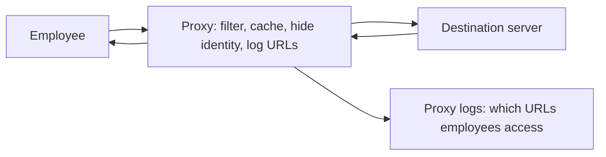
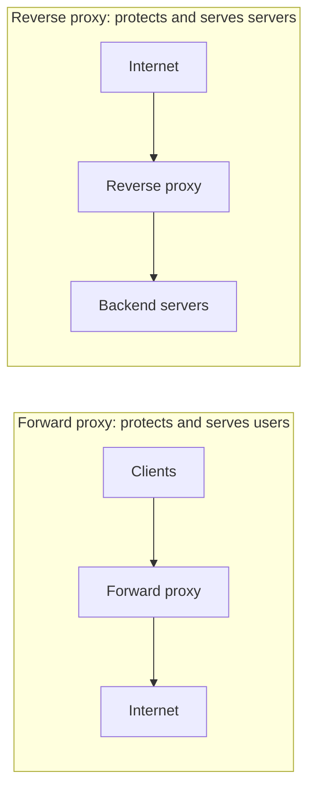
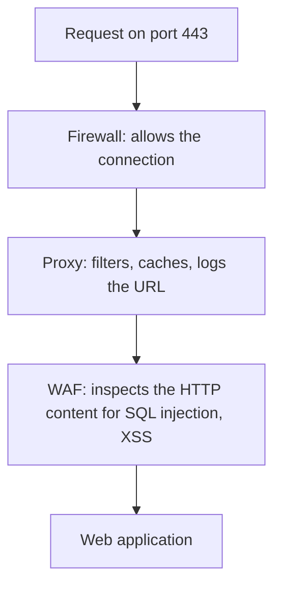
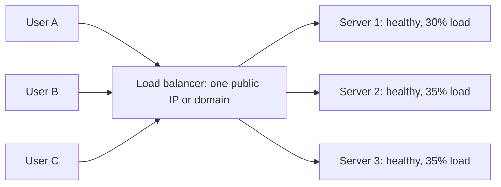
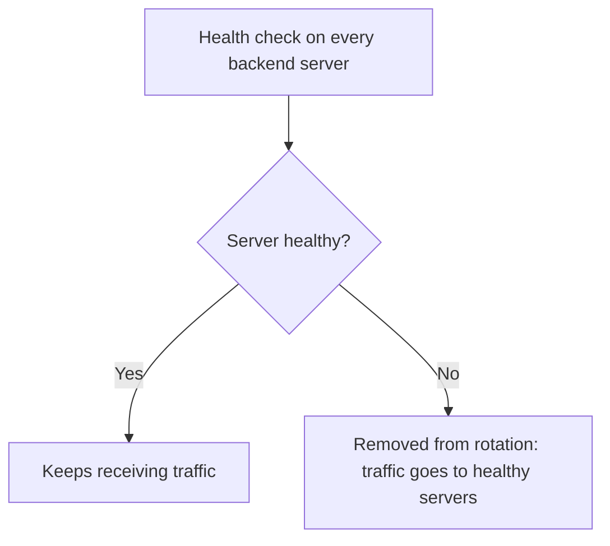

| Topic | Level | Reading Time | Prerequisites |
|---|---|---|---|
| Proxies and Load Balancers | Beginner | ~15 min | Firewalls and Network Placement |

> **The goal of this section:**  
> You'll understand what a proxy is and why companies buy one, the difference between a forward and a reverse proxy, how to tell a firewall, a proxy, and a WAF apart, and how a load balancer solves the single point of failure problem while providing availability, scalability, and security at the same time.


## Learning Objectives

By the end of this section, you will be able to:

- Define a **proxy server** and list the four reasons companies deploy one.
- Differentiate between **forward**, **reverse**, **elite (high-anonymity)**, and **transparent** proxies.
- Compare a **firewall**, a **proxy**, and a **WAF** across layer, protection target, function, and visibility into web content.
- Explain the problem a **load balancer** solves and its three benefits: availability, scalability, and security.
- Name the common load balancing algorithms and explain how health checks work.
- Explain why a proxy or load balancer in front of a web server affects what the server logs show.

## Table of Contents

- [Learning Objectives](#learning-objectives)
- [Proxy Servers](#proxy-servers)
  - [What a Proxy Is](#what-a-proxy-is)
  - [Why Companies Buy Them](#why-companies-buy-them)
- [Types of Proxies](#types-of-proxies)
- [Proxy Versus Firewall Versus WAF](#proxy-versus-firewall-versus-waf)
- [Load Balancer](#load-balancer)
  - [The Problem It Solves](#the-problem-it-solves)
  - [How It Works](#how-it-works)
  - [Three Benefits](#three-benefits)
  - [Common Algorithms](#common-algorithms)
- [Logging Considerations](#logging-considerations)
- [Career Path Connections](#career-path-connections)
- [Key Terms Glossary](#key-terms-glossary)
- [Summary](#summary)

## Proxy Servers

### What a Proxy Is

A **proxy** is an **intermediary** that sits between the client and the destination server.

```text
You  ->  Proxy  ->  Destination
```

The response comes back **the same way**. Some specialists classify it as a type of firewall (it is also called an **application gateway**).

### Why Companies Buy Them

| Reason | Detail |
|---|---|
| **Anonymity** | The destination sees the proxy's IP, not yours |
| **Access control** | Block specific sites or content categories |
| **Caching** | Store frequently requested content to save bandwidth and speed up access |
| **Filtering and monitoring** | Inspect traffic for security and compliance purposes |
| **Visibility** | The logs show which URLs employees visit, so the SOC can **detect suspicious web activity** (such as connections to malicious or newly registered domains) |



> [!NOTE]
> The visibility point is exactly what Network and Authentication Logs uses in practice: a proxy log is how an analyst finds the URL and the user behind a suspicious download, which started the five-log mini-investigation in that file.

## Types of Proxies

| Type | Description |
|---|---|
| **Forward proxy** | Sits **in front of the client**. Used for anonymity, filtering, and bypassing restrictions. **This is what most people mean by "proxy"** |
| **Reverse proxy** | Sits **in front of the server**. Clients **don't know which backend they reach**. Used for load balancing, SSL termination, caching, and DDoS protection. Examples: **Nginx** and **HAProxy** |
| **Elite (high-anonymity) proxy** | Hides your IP and **doesn't reveal that it is a proxy at all** |
| **Transparent proxy** | Intercepts traffic **without the client being configured**, and is widely used for filtering in organizations and public Wi-Fi networks |



> [!TIP]
> Easy way to remember: a forward proxy hides and controls the clients, a reverse proxy hides and protects the servers. The same word, opposite sides of the connection.

## Proxy Versus Firewall Versus WAF

| | Firewall | Proxy | WAF |
|---|---|---|---|
| **Works at** | The network and transport layers (IPs and ports); NGFWs go higher | The application layer, **on behalf of clients or servers** | The application layer (HTTP/HTTPS) |
| **Protects** | The network | Users (forward) or servers (reverse) | Web applications |
| **Typical function** | Allow or block connections | Filtering, caching, anonymity, URL logging | Block SQL injection, XSS, and other web attacks |
| **Sees web content?** | Basic firewalls: **no** | **Yes, for HTTP** | **Yes, in depth** |

**They complement each other; they are not substitutes.** The firewall will happily allow port 443, and **the WAF is the one that inspects what passes inside it.**



> [!IMPORTANT]
> This table restates, from the device point of view, the layer distinction first explained in Defense in Depth Model and covered in full in the WAF file. The key sentence is the same: the firewall decides whether the connection is allowed, the WAF decides whether the request inside it is safe.

## Load Balancer

### The Problem It Solves

**With a single server**, the traffic can **overload it** or make it a **single point of failure**.

### How It Works

A **load balancer** sits **in front of several servers** and distributes incoming traffic across them, so that **no single server carries more than it can handle**. Users connect to **one public IP or one domain**, and the load balancer distributes to the backend servers.

An example of distribution: Users A, B, and C send requests to the load balancer, and it distributes them to Server 1 (30% load), Server 2 (35%), and Server 3 (35%), all of them healthy.



> [!NOTE]
> Many load balancers, such as F5 BIG-IP, also offer WAF and traffic inspection features. A load balancer is therefore often both a traffic distributor and a security control, which is why it appears as one box in the defense-in-depth stack.

### Three Benefits

| Benefit | Detail |
|---|---|
| **Availability** | If a server fails, traffic goes to the **healthy** servers (through **health checks**) |
| **Scalability** | Add servers to handle growth |
| **Security** | Hides the backend servers, performs **SSL termination**, and absorbs **DDoS traffic** |



### Common Algorithms

| Algorithm | How It Distributes |
|---|---|
| **Round robin** | Requests are distributed to the servers **in turn** |
| **Least connections** | A new request goes to the server **with the fewest active connections** |
| **IP hash** | The client's IP determines the server, so the same client reaches the same server |

> [!TIP]
> IP hash is the algorithm to remember when a question mentions keeping one user on one server, for example so a session is not lost. Round robin and least connections spread load but do not guarantee that.

## Logging Considerations

When a **reverse proxy or load balancer** sits in front of the server, the web server log may **show the proxy's own IP** as the client, not the real visitor. **SSL termination** also means decryption happens at the proxy, which can change which device sees the content.

> [!WARNING]
> The real client IP is only recoverable if the X-Forwarded-For header is configured and logged. This is the same issue covered in Core Log Types and Web Server Logs, and it matters for security: blocking the "client IP" in a log that only shows the load balancer would block your own traffic.

> [!NOTE]
> SSL termination also connects to a limit from the WAF file: a WAF cannot inspect encrypted traffic unless it sits where traffic is decrypted. A reverse proxy or load balancer that terminates TLS is often exactly that place.

## Career Path Connections

| Career Path | How This Topic Applies |
|---|---|
| SOC Analyst | Uses proxy logs to trace user web activity, and must account for load balancers hiding the real client IP |
| Penetration Tester | Identifies reverse proxies and load balancers during reconnaissance, since they shape what is actually exposed |
| GRC | Web filtering and logging policies for employee browsing are common compliance and acceptable-use requirements |
| Cloud Security | Cloud load balancers and CDNs are managed reverse proxies, with the same availability, SSL termination, and DDoS benefits |

## Key Terms Glossary

| Term | Definition |
|---|---|
| Proxy | An intermediary between a client and a destination server |
| Application Gateway | Another name for a proxy classified as a type of firewall |
| Forward Proxy | A proxy in front of clients, used for anonymity, filtering, and bypassing restrictions |
| Reverse Proxy | A proxy in front of servers, hiding the backend and providing load balancing, SSL termination, caching, and DDoS protection |
| Elite Proxy | A high-anonymity proxy that hides the client IP and does not reveal that it is a proxy |
| Transparent Proxy | A proxy that intercepts traffic without client configuration |
| Load Balancer | A device distributing incoming traffic across multiple servers |
| Health Check | A periodic test used to detect failed servers and remove them from rotation |
| SSL Termination | Decrypting TLS traffic at an intermediary instead of at the backend server |
| Round Robin | A load balancing algorithm distributing requests in turn |
| Least Connections | A load balancing algorithm sending requests to the server with the fewest active connections |
| IP Hash | A load balancing algorithm choosing the server based on the client IP |

## Summary

- **A proxy is an intermediary between client and destination:** and it is bought for anonymity, access control, caching, filtering, and visibility.
- **Forward proxies sit in front of clients, reverse proxies in front of servers.**
- **Elite and transparent proxies are variations:** the first hides that it is a proxy, the second intercepts without any setup on the client.
- **Firewall, proxy, and WAF are complementary, not interchangeable:** the firewall for connections, the proxy for control and logging, and the WAF for web content.
- **A load balancer removes the single point of failure:** it distributes across several servers from one IP or domain.
- **It gives availability, scalability, and security:** health checks, adding servers, SSL termination, and absorbing DDoS.
- **Three algorithms to know:** round robin, least connections, and IP hash.
- **Proxies and load balancers change what logs show:** you need X-Forwarded-For to know the real IP.

