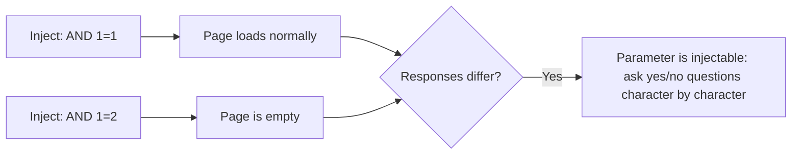
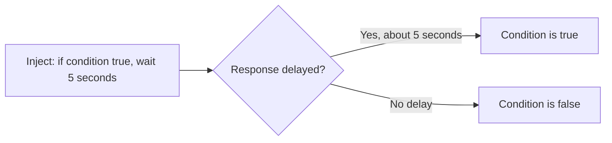
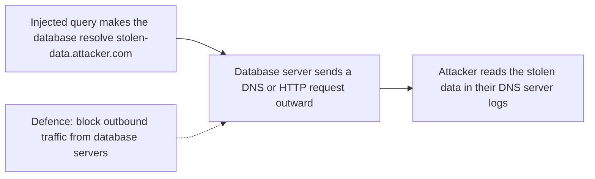
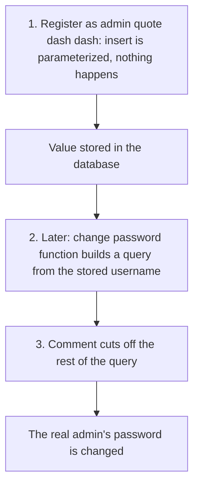
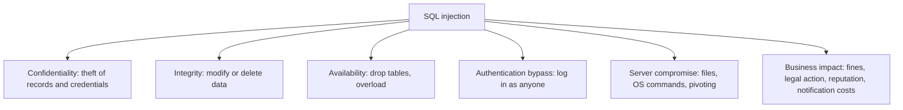
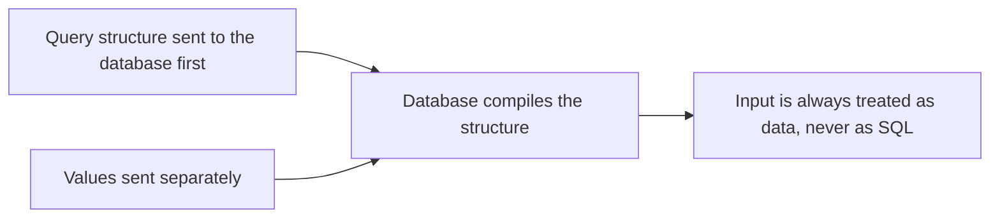
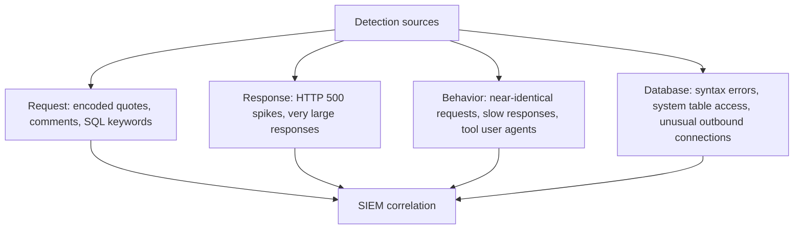

| Topic | Level | Reading Time | Prerequisites |
|---|---|---|---|
| Blind and Advanced SQL Injection with Defences | Intermediate | ~25 min | SQL Injection Basics and In-Band Attacks |

> **The goal of this section:**  
> You'll understand how an attacker leaks data even when the application shows no result and no error (blind), how they make the database itself send the data out (out-of-band), what second-order and stacked queries are, the full impact of the attack, how to defend with parameterized queries as the primary line plus supporting layers, and what the SOC should look for.


## Learning Objectives

By the end of this section, you will be able to:

- Explain **boolean-based blind** SQLi and the SOC clue of many near-identical requests.
- Explain **time-based blind** SQLi, list the delay payload idea per database, and recognize its SOC clue.
- Explain **out-of-band (OOB)** SQLi, its requirement, and the defence of blocking outbound traffic from database servers.
- Explain **second-order (stored)** SQLi and why it is hard to detect.
- Describe **stacked queries**, other injectable inputs and SQL contexts, and the related **NoSQL injection**.
- List the six impact areas of SQL injection.
- Apply the main defences (**parameterized queries**, ORMs, stored procedures) and the six supporting layers.
- Use the SOC cheat sheet to detect SQLi across web, WAF, application, and database logs.

## Table of Contents

- [Learning Objectives](#learning-objectives)
- [Boolean-Based Blind SQL Injection](#boolean-based-blind-sql-injection)
- [Time-Based Blind SQL Injection](#time-based-blind-sql-injection)
- [Out-of-Band (OOB) SQL Injection](#out-of-band-oob-sql-injection)
- [Second-Order (Stored) SQL Injection](#second-order-stored-sql-injection)
- [Stacked Queries and Other Variants](#stacked-queries-and-other-variants)
  - [Stacked (Batched) Queries](#stacked-batched-queries)
  - [Other Variants](#other-variants)
- [Impact of SQL Injection](#impact-of-sql-injection)
- [Preventing SQL Injection](#preventing-sql-injection)
  - [The Main Defences](#the-main-defences)
  - [Supporting Layers](#supporting-layers)
- [Detecting SQL Injection: SOC Cheat Sheet](#detecting-sql-injection-soc-cheat-sheet)
- [Blind Techniques Compared](#blind-techniques-compared)
- [Career Path Connections](#career-path-connections)
- [Key Terms Glossary](#key-terms-glossary)
- [Summary](#summary)

## Boolean-Based Blind SQL Injection

### How It Works

The application **shows no data and no errors**, but **its behaviour changes depending on** whether the injected condition is **true or false**: different content, a missing element, or a redirect.

```text
product.php?id=5 AND 1=1   -> page loads normally
product.php?id=5 AND 1=2   -> page is empty
```

If the two responses **differ**, the parameter **is injectable.** The attacker then **asks yes/no questions**, for example: **"Is the first character of the admin's password hash an a?"**, and builds the answer **from many requests.**

**It is slow**, so attackers **automate it** with tools such as **sqlmap**.



> [!TIP]
> SOC clue: hundreds of nearly identical requests from one IP address, with a single value changing slightly each time. That is the fingerprint of automated character-by-character extraction, and it is visible even when no single request looks alarming.

## Time-Based Blind SQL Injection

### How It Works

Used when **the page looks the same whether the condition is true or false.** The attacker **makes the database wait if the condition is true** and measures **the response time.**

**A 5-second delay = true. No delay = false.**

It works **almost anywhere**, even with no visible output, but it is **the slowest technique** and is affected by network latency.

### Delay Payloads by Database

| Database | Payload |
|---|---|
| MySQL | `' AND IF(1=1, SLEEP(5), 0)--` |
| SQL Server | `'; WAITFOR DELAY '0:0:5'--` |
| PostgreSQL | `'; SELECT pg_sleep(5)--` |
| Oracle | `' AND 1=DBMS_PIPE.RECEIVE_MESSAGE('a',5)--` |



> [!TIP]
> SOC clue: unusually slow requests, and the words `SLEEP`, `WAITFOR`, `pg_sleep`, or `BENCHMARK` in parameters. The same delay idea was used for blind command injection in OS Command Injection, which is a useful parallel: when output is hidden, attackers turn time itself into the signal.

## Out-of-Band (OOB) SQL Injection

### How It Works

The attacker **can't see the results in the response** and can't rely on timing, so they make **the database server itself send the data to a system they control**, usually through **DNS or HTTP requests.**

The idea of the example: the query makes the database resolve `stolen-data.attacker.com`. The attacker **reads the stolen data from their own DNS server logs.**

| Aspect | Detail |
|---|---|
| **Database features abused** | `xp_dirtree` and `xp_cmdshell` (SQL Server), `UTL_HTTP` and `UTL_INADDR` (Oracle), `LOAD_FILE` with UNC paths (MySQL on Windows) |
| **Requirement** | The database server **must be allowed to make outbound connections** |
| **Defence** | **Block outbound traffic from database servers** |
| **SOC clue** | **DNS queries or HTTP connections from a database server to unknown external domains** |



> [!IMPORTANT]
> A database server has almost no legitimate reason to start connections to the internet. Blocking that outbound path closes this whole technique, and monitoring for it gives a high-quality alert. This is the same data-smuggling-through-DNS idea covered in Data Exfiltration and DNS Tunneling, reached through a different door.

## Second-Order (Stored) SQL Injection

### How It Works

The malicious input **is stored safely the first time** (for example at registration) **and causes harm later** when another part of the application **reads it and uses it unsafely** in a different query.

| # | Step |
|---|---|
| 1 | The attacker registers with the username `admin'--`. The insert **is parameterized correctly**, so nothing happens |
| 2 | Later, a change-password function builds a query from the stored username: `UPDATE users SET password='newpass' WHERE username='admin'--'` |
| 3 | The comment **cuts off the rest of the query**, so the attacker **changes the real admin's password** |

**Why it is hard to detect:** **the injection point and the execution point are in different places.**



> [!WARNING]
> The defence is to treat data from your own database as untrusted too, and to use parameterized queries everywhere, not only on user-facing forms. A secure insert does not make the stored value safe; it only moves the danger to whichever code reads it next.

## Stacked Queries and Other Variants

### Stacked (Batched) Queries

The attacker **ends the original statement with a semicolon** and adds **an entirely new one**:

```sql
'; DROP TABLE users;--
'; INSERT INTO users(username,role) VALUES('hacker','admin');--
```

Support **depends on the database and the driver**: common on **SQL Server and PostgreSQL**, and **often blocked in MySQL with PHP.** It allows inserting, updating, and deleting, and sometimes **operating system commands** (`xp_cmdshell`).

### Other Variants

| Variant | Detail |
|---|---|
| **Other inputs** | Cookies, HTTP headers (User-Agent, X-Forwarded-For, and Referer), and JSON/XML fields in APIs |
| **Other SQL contexts** | `WHERE`, `ORDER BY`, `INSERT`, `UPDATE`, and `LIMIT` behave differently, and **numeric parameters don't need a quote at all** |
| **NoSQL injection** (related) | The same idea against MongoDB and similar databases, using operators such as `{"$ne": null}` |

> [!NOTE]
> The header list matters for detection: X-Forwarded-For and User-Agent are logged constantly, so an injection in a header is stored in the logs themselves. This is the same attacker-controlled-header point from Input Attacks Fundamentals and Core Log Types and Web Server Logs.

## Impact of SQL Injection

| Area | Impact |
|---|---|
| **Confidentiality** | Stealing customer records, credentials, credit card numbers, and personal data |
| **Integrity** | Modifying or deleting data, such as changing balances, grades, or prices |
| **Availability** | Dropping tables or flooding the database |
| **Authentication bypass** | Logging in as any user, including admins |
| **Server compromise** | Reading or writing files and running OS commands (`xp_cmdshell`), then pivoting through the network |
| **Business impact** | Regulatory fines, legal action, reputational damage, and breach notification costs |

**SQL injection has been behind many major breaches and is still one of the most common causes of data theft.**



## Preventing SQL Injection

### The Main Defences

| # | Defence | Detail |
|---|---|---|
| 1 | **Parameterized queries (prepared statements)** | **The primary defence.** The query structure is sent to the database first, and the values **are sent separately**, so the input **is always treated as data, never as SQL** |
| 2 | **ORMs and query builders** | SQLAlchemy, Hibernate, and Entity Framework **use parameters by default.** **Avoid raw string concatenation inside them** |
| 3 | **Stored procedures** | **Safe only if they use parameters inside.** A procedure that concatenates strings **is still vulnerable** |

```python
cursor.execute(
    "SELECT * FROM users WHERE name = %s",
    (username,))
```

A payload such as `admin'--` is now **just an ordinary string to search for.**



### Supporting Layers

| # | Layer | Detail |
|---|---|---|
| 4 | **Allowlist validation** | For anything that **can't be parameterized**, such as table and column names and the `ORDER BY` direction |
| 5 | **Least privilege** | The database account **must not be `sa` or `root`**, and can't drop tables or run OS commands |
| 6 | **Hide errors** | Generic messages for users, and detailed errors in logs for admins |
| 7 | **WAF and monitoring** | **Extra layers, not a replacement** for fixing the code |
| 8 | **Hash passwords** | **bcrypt or Argon2**, so a leak doesn't expose plaintext passwords |
| 9 | **Test regularly** | Code review, SAST, DAST, and authorized penetration tests |

> [!IMPORTANT]
> Parameterization cannot protect parts of a query that are not values, such as table names, column names, and ORDER BY direction. For those, the only safe approach is an allowlist of known-good names, which is the same allowlist-over-blocklist rule from Input Attacks Fundamentals.

> [!NOTE]
> Items 7 and 8 connect to earlier files: the WAF file explains why a WAF is a mitigation and not a fix, and Password Hashing, Salting, and Peppering explains why bcrypt or Argon2 decides whether a leaked hash is useful. Least privilege connects to Access Control Models.

## Detecting SQL Injection: SOC Cheat Sheet

| Source | What to Look For |
|---|---|
| **Web server, WAF, and application logs: characters** | Special characters and their URL-encoded forms: `'` (`%27`), `--`, `;`, `/*`, and `#` |
| **Keywords** | `UNION SELECT`, `OR 1=1`, `ORDER BY`, `information_schema`, `SLEEP(`, `WAITFOR DELAY`, `pg_sleep`, `xp_cmdshell`, `CONVERT(`, and `CAST(` |
| **Responses** | **Spikes in HTTP 500** (the query broke) or **very large responses** (the data was dumped) |
| **Behavior: blind extraction** | **Many near-identical requests from one IP, with a single value changing** |
| **Behavior: time-based** | Unusual response times |
| **Tools** | User-Agent strings of automated tools such as `sqlmap` |
| **Database logs** | Syntax errors, access to system tables, and unusual outbound connections from the database server |



> [!TIP]
> A single signal is weak and a combination is strong. A `%27` in a URL is only an attempt. The same request followed by an HTTP 200 with an unusually large response, or by an outbound DNS query from the database server, is evidence the injection worked. This is the same attempt-versus-success reasoning used in Core Log Types and Web Server Logs.

## Blind Techniques Compared

| Technique | Signal Used | Speed | Main SOC Clue |
|---|---|---|---|
| **Boolean-based** | Page content or behavior differs | Slow, automated | Many near-identical requests, one value changing |
| **Time-based** | Response delay | The slowest, affected by latency | Unusual slowness, and the words `SLEEP`, `WAITFOR`, and `pg_sleep` |
| **Out-of-band** | DNS or HTTP request to attacker | Faster when available | Outbound connections from the database server |

## Career Path Connections

| Career Path | How This Topic Applies |
|---|---|
| SOC Analyst | Uses the cheat sheet to detect blind extraction, time-based probing, and outbound database connections across log sources |
| Penetration Tester | Chooses the technique based on what the application reveals, and reports the real impact with evidence |
| GRC | Verifies that parameterized queries, least-privilege database accounts, and regular testing are enforced as controls |
| Cloud Security | Restricts egress from managed database instances and applies least-privilege database roles in cloud environments |

## Key Terms Glossary

| Term | Definition |
|---|---|
| Blind SQLi | SQLi where the application shows no data or errors, and results are inferred indirectly |
| Boolean-Based Blind | Inferring data from different page behavior for true and false conditions |
| Time-Based Blind | Inferring data from a deliberate delay in the response |
| Out-of-Band SQLi | Making the database server send data to an attacker-controlled system via DNS or HTTP |
| Second-Order SQLi | A payload stored safely first and triggered later when read unsafely elsewhere |
| Stacked Queries | Ending a statement with a semicolon and adding a completely new statement |
| NoSQL Injection | Injection against non-relational databases using their own operators |
| Parameterized Query | A query where structure and values are sent separately so input is always data |
| ORM | Object-Relational Mapper, a library that builds queries with parameters by default |
| SAST / DAST | Static and dynamic application security testing |
| `sqlmap` | An automated SQL injection tool whose user agent is a common detection signal |

## Summary

- **Boolean-based blind SQLi asks yes/no questions through page behavior:** and the SOC clue is many near-identical requests.
- **Time-based blind SQLi uses a deliberate delay as the answer:** the slowest, but it works almost anywhere.
- **Out-of-band SQLi makes the database send data outward:** and the defence is blocking outbound traffic from database servers.
- **Second-order SQLi stores the payload first and triggers it later:** and the defence is treating your own database's data as untrusted too.
- **Stacked queries add whole new statements:** this depends on the database and driver, and NoSQL injection is the same idea with other tools.
- **Impact spans six areas:** confidentiality, integrity, availability, authentication bypass, server compromise, and business impact.
- **Parameterized queries are the primary defence:** ORMs and stored procedures are safe only if they use parameters.
- **Six supporting layers complete the defence:** allowlist, least privilege, hiding errors, WAF, hashing, and testing.
- **SOC detection combines request, response, behavior, and database signals.**

