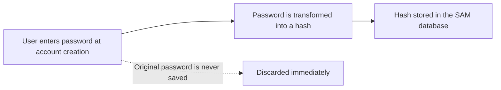
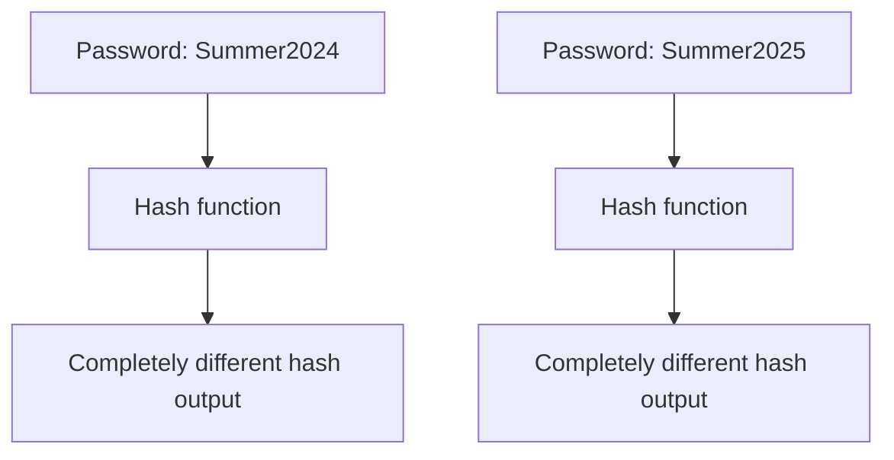
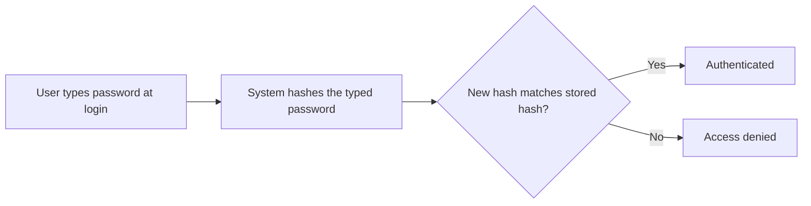
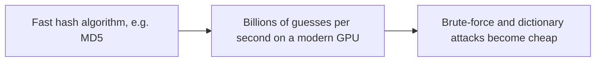
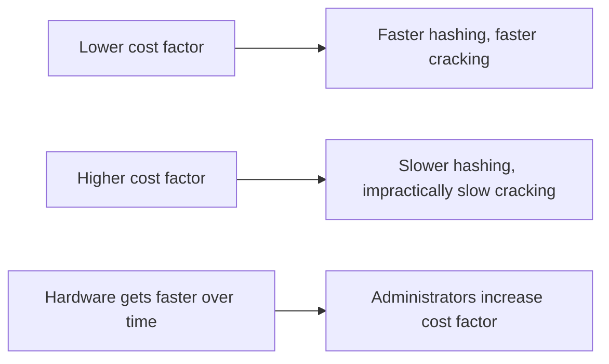
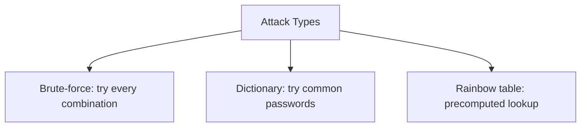
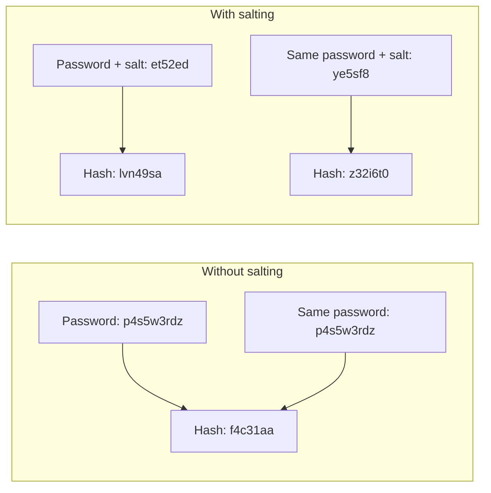
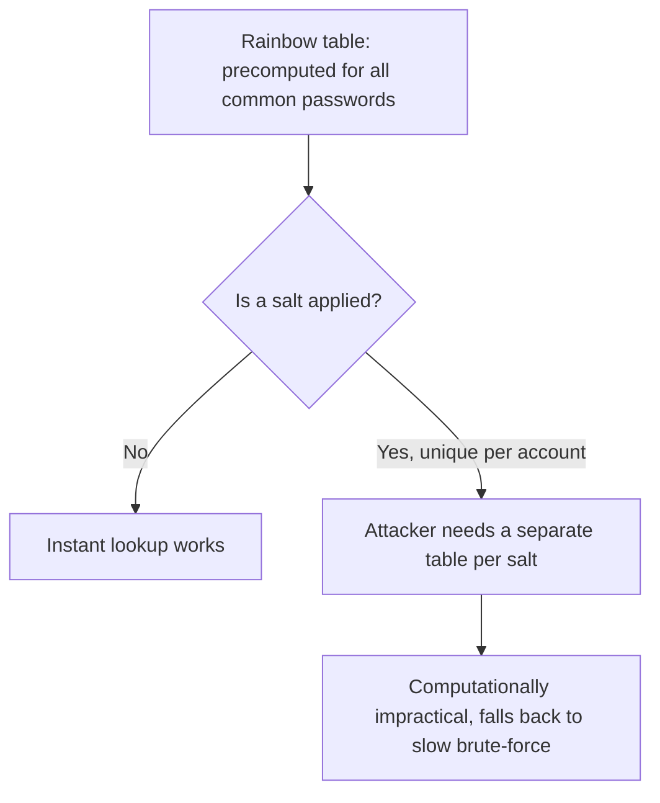
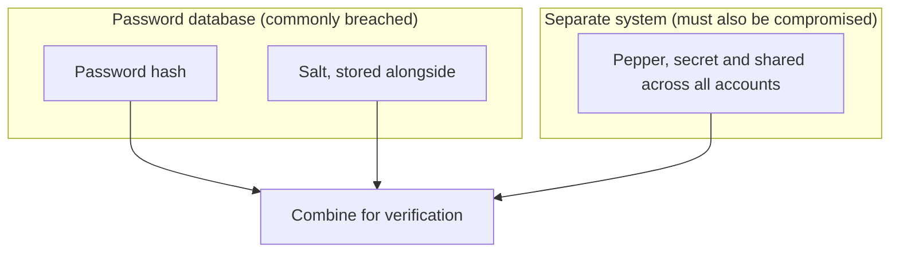

| Topic | Level | Reading Time | Prerequisites |
|---|---|---|---|
| Password Hashing, Salting, and Peppering | Intermediate | ~20 min | Group Policy and Credential Storage |

> **The goal of this section:**  
> You'll understand why passwords are stored as a hash rather than as plain text, what the fundamental difference between hashing and encryption is, why general-purpose algorithms like MD5 are dangerous for passwords specifically, and how salting and peppering solve real problems in the real world.


## Learning Objectives

By the end of this section, you will be able to:

- Explain why storing passwords in plain text is always a poor practice, and what happens instead when an account is created.
- List the four core properties every security hash function must have: **deterministic, one-way, avalanche effect, fixed output length**.
- Explain the fundamental difference between **hashing** and **encryption**, and why passwords must be hashed, never encrypted.
- Explain why fast general-purpose algorithms like **MD5** and **SHA-256** are a bad fit for passwords, and what **key stretching** means.
- Differentiate between **brute-force**, **dictionary**, and **rainbow table** attacks.
- Explain how **salting** defeats rainbow tables, and how **peppering** adds a second, independent layer of defense.

## Table of Contents

- [Learning Objectives](#learning-objectives)
- [Why Plaintext Is Dangerous](#why-plaintext-is-dangerous)
  - [The Assume-Breach Mindset](#the-assume-breach-mindset)
  - [What Happens Instead](#what-happens-instead)
- [Core Properties of a Security Hash Function](#core-properties-of-a-security-hash-function)
- [Hashing Versus Encryption](#hashing-versus-encryption)
  - [The Key Difference](#the-key-difference)
  - [Why Passwords Are Never Encrypted](#why-passwords-are-never-encrypted)
  - [How Login Actually Works](#how-login-actually-works)
- [Why Generic Algorithms Are a Bad Fit](#why-generic-algorithms-are-a-bad-fit)
  - [Speed Is the Problem](#speed-is-the-problem)
  - [Dedicated Password-Hashing Algorithms](#dedicated-password-hashing-algorithms)
  - [Key Stretching](#key-stretching)
- [Attack Types to Know](#attack-types-to-know)
- [Salting and Peppering: The Problem](#salting-and-peppering-the-problem)
  - [Identical Passwords, Identical Hashes](#identical-passwords-identical-hashes)
  - [The Salt Solution](#the-salt-solution)
  - [Salting Example Table](#salting-example-table)
- [Salting in Depth](#salting-in-depth)
  - [Why Salting Defeats Rainbow Tables](#why-salting-defeats-rainbow-tables)
  - [Salt Requirements and Storage](#salt-requirements-and-storage)
- [Peppering: The Second Layer](#peppering-the-second-layer)
  - [How a Pepper Differs from a Salt](#how-a-pepper-differs-from-a-salt)
  - [Where a Pepper Is Stored](#where-a-pepper-is-stored)
  - [Modern Best Practice](#modern-best-practice)
- [Career Path Connections](#career-path-connections)
- [Key Terms Glossary](#key-terms-glossary)
- [Summary](#summary)

## Why Plaintext Is Dangerous

### The Assume-Breach Mindset

Storing passwords as **plain text** is always **a weak security practice**.

The core principle here: **assume that any system will be breached someday**. When that happens, there must already be **controls** in place that make **lateral movement** to other systems **much harder**.

> [!NOTE]
> This "assume breach" mindset is the same principle underlying Zero Trust, covered in the Zero Trust Model file. Password hashing is one of the most basic, oldest practical applications of that same assumption.

### What Happens Instead

For all these reasons, passwords **aren't stored as plain text**; instead, they're transformed into **hashed values** before storage.

When an account is created, the password that was typed **is transformed into a hash**, and that's what gets stored in the **SAM** database. The original password **is never saved**.

```text
Path: C:\Windows\System32\config\SAM
```



> [!IMPORTANT]
> The original password is never saved, anywhere, under normal operation. Only the hash persists. This single fact is why even a full database leak does not hand an attacker the plaintext passwords directly.

## Core Properties of a Security Hash Function

Any hash function used for security purposes **must** have these four properties:

| Property | Meaning |
|---|---|
| **Deterministic** | The same input always produces the same output |
| **One-way** | It must be **computationally infeasible** to turn the hash back into the original password |
| **Avalanche effect** | Changing just one character in the password produces a **completely different** hash, which prevents the attacker from guessing patterns |
| **Fixed output length** | Regardless of the password's length, the size of the hash output stays **fixed** (for example, MD5 always produces 128 bits) |



> [!TIP]
> The avalanche effect is easy to verify yourself: hash two nearly identical strings (differing by one character) with any hash function online or in a terminal, and compare the outputs. They will look completely unrelated, with no visible pattern connecting them.

## Hashing Versus Encryption

### The Key Difference

**Encryption is reversible with a key**; **hashing isn't reversible at all**.

### Why Passwords Are Never Encrypted

Passwords **should never be encrypted** for storage; they should be hashed. The reason: **if an attacker steals the encryption key**, all the passwords **instantly revert** to their original form.

With hashing, **there's no key to steal in the first place**; the attacker is forced to **guess a password, hash it, and compare the result**.

| Approach | Reversible? | Risk If Stolen |
|---|---|---|
| Encryption | Yes, with a key | Stealing the key = recovering all the passwords instantly |
| Hashing | No, never | The attacker is forced to guess and hash every attempt |

### How Login Actually Works

When the user logs in, the system **doesn't compare** the typed password directly with a stored password. It hashes what was typed and compares that new hash with the stored hash. If they match, the user is authenticated.



Because of this, **even the administrators** of a given website **can't see a user's password**; they only see the hash.

> [!IMPORTANT]
> If a "customer support" process ever offers to "look up" or "resend" your original password instead of resetting it, that is a red flag. A system following proper hashing practice structurally cannot retrieve your original password, even if it wanted to.

## Why Generic Algorithms Are a Bad Fit

### Speed Is the Problem

Algorithms like **MD5** and **SHA-256** have known weaknesses (such as **hash collisions** in MD5), yet MD5 is still used for **integrity checksums**.

These algorithms are **designed to be fast**, which is useful for checksums and file integrity checks, but it's **very bad for passwords specifically**, because **speed helps the attacker**.

**A modern GPU** can compute **billions of MD5 hashes per second**, which makes **brute-force** and **dictionary attacks** fast and cheap.



### Dedicated Password-Hashing Algorithms

For this reason, there are algorithms **dedicated to storing passwords**:

| Algorithm | Note |
|---|---|
| **bcrypt** | Widely used, relatively older |
| **scrypt** | Designed to be memory-hard in addition to slow |
| **Argon2** | Currently considered **the strongest**; won the **2015 Password Hashing Competition** |

### Key Stretching

These algorithms are **deliberately slow**, and they use **a tunable cost factor**, a setting that controls the number of **computation rounds** performed.

As hardware gets faster over time, administrators increase the cost factor so that **cracking the hash stays impractically slow**. This concept is called **key stretching**.



> [!TIP]
> Key stretching is a moving target by design. A cost factor considered strong today will not stay strong forever as hardware improves; this is why dedicated password-hashing algorithms expose a tunable cost factor rather than a fixed one.

## Attack Types to Know

| Attack | How It Works |
|---|---|
| **Brute-force attack** | Trying every possible combination of characters until the hash matches |
| **Dictionary attack** | Trying a list of common passwords instead of random combinations, because most people use passwords that are easy to predict |
| **Rainbow table** | A precomputed table of hash values for huge sets of likely passwords, which lets the attacker **look up the hash instantly** instead of computing it live |



> [!IMPORTANT]
> The rainbow table is the direct motivation for salting, covered in the next section. Understanding why a precomputed lookup table works is the key to understanding why salting defeats it so effectively.

## Salting and Peppering: The Problem

### Identical Passwords, Identical Hashes

The question that opens this topic: **what happens if different accounts have exactly the same password?**

This is dangerous, because **if an attacker cracks one hash, they immediately know the password of every other user who shares that same hash**.

### The Salt Solution

The goal: make sure that **no two stored values are identical**, even if users chose exactly the same password. This is achieved by adding a **Salt**.

A **Salt** is a **random string value** added to the password **before** hashing; it's then stored **alongside** the hash value (and it can be stolen too, because it isn't secret in the first place).

> [!NOTE]
> If a salt is kept secret and stored in a secure location separately, it is called a **Pepper**. This distinction between a public salt and a secret pepper is explored in full later in this file.

### Salting Example Table

| | User (no salt) | Attacker (no salt) | User (salted) | Attacker (salted) |
|---|---|---|---|---|
| Password | `p4s5w3rdz` | `p4s5w3rdz` | `p4s5w3rdz` | `p4s5w3rdz` |
| Salt | – | – | `et52ed` | `ye5sf8` |
| Hash | `f4c31aa` | `f4c31aa` | `lvn49sa` | `z32i6t0` |

Without salting: **identical passwords produce identical hashes**, visible at a glance.

With salting: **identical passwords produce completely different hashes**, because each one was combined with a unique random value first.



## Salting in Depth

### Why Salting Defeats Rainbow Tables

A **rainbow table** is only useful **if the attacker can compute the hashes once and reuse them against many accounts**.

Once **every password has a unique random salt** before hashing, the attacker **needs a completely separate rainbow table for each salt value**, which is **computationally impractical**.

This forces the attacker back to **slow brute-forcing of each account individually**, instead of an instant lookup.



### Salt Requirements and Storage

| Requirement | Detail |
|---|---|
| Secrecy | Salts **don't need to be secret**; they're usually stored **alongside the hash** in the same record |
| Uniqueness | They must be **unique for each password/user** and **must never be reused** across accounts |
| Length | They should be **long enough** (common: **16 bytes / 128 bits**) |
| Generation | They must be generated using a **cryptographically secure random number generator**, not a predictable counter or an ordinary sequence |

> [!WARNING]
> Reusing a salt across accounts, or generating salts predictably (e.g., an incrementing counter), defeats the entire purpose of salting. A reused or predictable salt brings back exactly the rainbow table risk salting was designed to eliminate.

## Peppering: The Second Layer

### How a Pepper Differs from a Salt

Unlike the salt, the **pepper** is **the same secret value** applied to **all passwords** (not unique for each user).

| Aspect | Salt | Pepper |
|---|---|---|
| Uniqueness | Unique for each user | The same value for all accounts |
| Secrecy | Not secret; stored alongside the hash | **Secret**, and stored separately |
| Storage location | In the database record itself | Usually in the application code, an environment variable, or an **HSM** |

### Where a Pepper Is Stored

The pepper is stored **completely separately** from the password database, usually in the **application source code**, an **environment variable**, or a **Hardware Security Module (HSM)**.



**The purpose:** if an attacker steals **only the password database** (a very common scenario in breaches), they still **don't have the pepper**, so they can't mount a valid **offline cracking** attempt.

The pepper acts as **a second, independent secret** that requires compromising **a completely different system** to obtain.

> [!IMPORTANT]
> The pepper's value comes entirely from being stored somewhere structurally different from the password database. If the pepper sits in the same database as the hashes and salts, it provides no additional protection, because the same breach that exposes one exposes the other.

### Modern Best Practice

Modern practice: algorithms like **bcrypt** and **Argon2** **build salting in automatically** as part of the algorithm itself. **Peppering** is still something developers add **manually at the application level** as an extra layer of defense.

| Mechanism | Built Into Modern Algorithms? |
|---|---|
| Salting | Yes, automatic in bcrypt and Argon2 |
| Peppering | No, added manually at the application level |

## Career Path Connections

| Career Path | How This topic applies |
|---|---|
| SOC Analyst | Recognizes the severity difference between a leaked hash database with proper salting versus one without |
| Penetration Tester | Attempts rainbow table and dictionary attacks against captured hashes, where applicable and authorized |
| GRC | Password storage standards (algorithm choice, cost factor, salting) are a direct, auditable security control |
| Cloud Security | Cloud identity providers and secrets managers implement salting, peppering (via HSM-backed secrets), and key stretching natively |

## Key Terms Glossary

| Term | Definition |
|---|---|
| Hash | A one-way, fixed-length transformation of input data, used to store passwords without saving the original |
| Deterministic | A property where the same input always produces the same output |
| One-Way | A property where reversing a hash back to the original input is computationally infeasible |
| Avalanche Effect | A property where a tiny input change produces a completely different output |
| Encryption | A reversible transformation of data that requires a key to recover the original |
| Key Stretching | Deliberately slowing a hash algorithm via a configurable cost factor to resist brute-force attacks |
| Brute-Force Attack | Trying every possible character combination until a hash matches |
| Dictionary Attack | Trying a list of common passwords instead of random combinations |
| Rainbow Table | A precomputed table of hash values enabling instant lookup instead of live computation |
| Salt | A random value added to a password before hashing, stored alongside the hash, not secret |
| Pepper | A secret value applied to all passwords, stored separately from the password database |
| HSM | Hardware Security Module, a dedicated device for securely storing cryptographic secrets |

## Summary

- **Plaintext passwords are never acceptable:** the assume-breach mindset assumes the system will be breached someday, so hashing must already be in place.
- **A security hash must be deterministic, one-way, have an avalanche effect, and produce fixed-length output.**
- **Hashing and encryption solve different problems:** encryption is reversible with a key, while hashing isn't reversible at all, which is why passwords are hashed, not encrypted.
- **Fast algorithms like MD5 and SHA-256 are dangerous for passwords specifically:** the speed that's useful for checksums helps the attacker with brute-forcing.
- **Dedicated algorithms (bcrypt, scrypt, Argon2) are deliberately slow:** thanks to a tunable cost factor and the concept of key stretching.
- **Three core attacks threaten weak password storage:** brute-force, dictionary, and rainbow tables.
- **Salting makes identical passwords produce different hashes:** and forces the attacker into slow brute-forcing instead of an instant lookup.
- **Peppering adds a second, independent secret:** stored in a completely separate location, so stealing the password database alone isn't enough.

