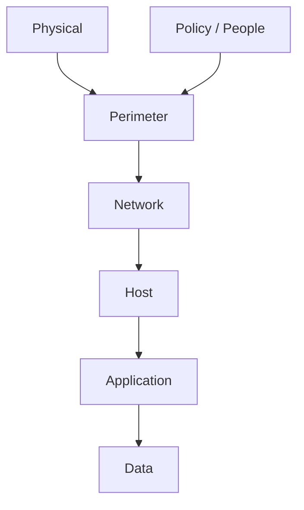
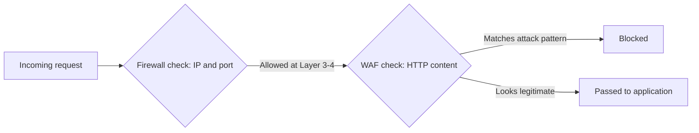
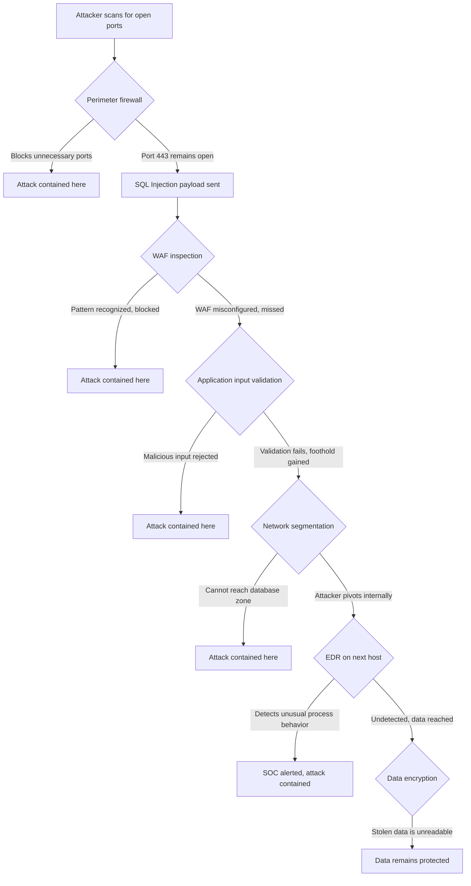

| Topic | Level | Reading Time | Prerequisites |
|---|---|---|---|
| Defense in Depth Model | Beginner | ~15 min | None |

> **Goal of this section:**  
> You'll understand the philosophy of Defense in Depth, the seven layers it's made of, and how each layer catches what slipped past the others.

## Learning Objectives

By the end of this section, you will be able to:

- Define **Defense in Depth (DiD)** and explain why the word *independent* is the core of the strategy.
- List the seven layers of a modern DiD model and describe the main controls in each one.
- Explain the difference between what a **firewall** sees and what a **WAF** sees, at the OSI layer level.
- Trace a single attack attempt through multiple layers and explain how each layer either stops it or hands off to the next.
- Explain why physical security and the human factor are layers that get overlooked, and why that is dangerous.

## Table of Contents

- [Learning Objectives](#learning-objectives)
- [What Is Defense in Depth](#what-is-defense-in-depth)
  - [The Core Definition](#the-core-definition)
  - [The Key Word Is Independent](#the-key-word-is-independent)
  - [Military Origin](#military-origin)
- [The Modern Layer Model](#the-modern-layer-model)
  - [Overview of the Layers](#overview-of-the-layers)
  - [Perimeter Security Layer](#perimeter-security-layer)
  - [Network Security Layer](#network-security-layer)
  - [Host Security Layer](#host-security-layer)
  - [Application Security Layer](#application-security-layer)
  - [Data Security Layer](#data-security-layer)
  - [Two Layers Often Left Out](#two-layers-often-left-out)
- [Firewalls Versus WAF: A Layer Distinction](#firewalls-versus-waf-a-layer-distinction)
- [Putting the Whole Model Together](#putting-the-whole-model-together)
  - [Attack Walk-Through](#attack-walk-through)
  - [Diagram of the Walk-Through](#diagram-of-the-walk-through)
- [Career Path Connections](#career-path-connections)
- [Key Terms Glossary](#key-terms-glossary)
- [Summary](#summary)

## What Is Defense in Depth

### The Core Definition

**Defense in Depth (DiD)** is a security strategy built on placing **multiple independent security controls** between the attacker and the asset you're protecting, so that if one control is bypassed, another control is still there to catch the attack.

The core idea: **no single control should be relied on completely**, no matter how strong it is.

### The Key Word Is Independent

The most important word in the definition is **independent**. Each layer should work at a **different point** in the system. If two layers are defeated by exactly the same technique, they aren't really two layers; **they're one layer repeated**.

DiD doesn't mean "buy more products." The idea is that it covers **different attack surfaces**:

- The network traffic.
- The operating system.
- The application code.
- The data itself.
- The people using the system.

> [!IMPORTANT]
> Buying five firewalls from five different vendors is not Defense in Depth. It is one layer duplicated five times, because all five can be defeated by the exact same technique: a network-layer bypass. Real depth means covering different attack surfaces, not multiplying the same control.

### Military Origin

The term comes from **military strategy**. Instead of stopping the enemy at a single line of defense, you build several defensive lines, so that even if the first line is breached, the attacker loses **momentum, time, and resources** at every line after it.

Cybersecurity borrowed this concept **literally**: instead of a single defensive line, there are successive layers, and each layer costs the attacker extra time and effort, even if they have the tools needed to get past a particular layer.

## The Modern Layer Model

### Overview of the Layers

The modern Defense in Depth model consists of layers, one behind the other:

The following table summarizes the layers and the main controls in each one:

| Layer | Main Controls | What It Protects |
|---|---|---|
| Perimeter | Firewall, reverse proxy, anti-DDoS, VPN gateway | The boundary with untrusted networks |
| Network | Segmentation, NAC, VLANs | Everything already allowed inside |
| Host | Hardening, application control, vulnerability scanning, EDR | Individual machines |
| Application | Authentication and authorization, input validation, overflow protection, secure coding | The software itself |
| Data | Encryption at rest, encryption in transit, classification, DLP | The data, even after every other layer fails |
| Physical | Locks, badges, cameras, server room access control | Physical access to hardware |
| Policy / People | Security awareness training, phishing simulations, clear policies | Human decision-making |

In addition, some controls work **across all the layers**, rather than in a single layer:

- **IDS and IPS:** they inspect traffic patterns for known signatures, and can block them in real time.
- **Logging and monitoring (SIEM):** collects evidence from every layer in one place, so an attack can be detected and investigated even if it wasn't blocked in real time.
- **Backups:** ensure that even a fully successful attack (such as ransomware) doesn't cause permanent, irreversible damage.

> [!NOTE]
> SIEM stands for Security Information and Event Management. Its role is not to stop an attack in real time like a firewall or WAF, but to give the SOC team the full picture across every layer, which is essential for investigation after the fact.

### Perimeter Security Layer

The **perimeter** is the **outer boundary** between your organization and untrusted networks (the internet, partner networks, guest Wi-Fi).

The main controls: **firewalls, reverse proxies, anti-DDoS appliances, VPN gateways**.

The perimeter's job **isn't to stop every attack**, because that's impossible. Its job is to **filter out the obvious, high-volume noise** (scans, junk traffic, known-bad IPs), so the inner layers only have to deal with the more sophisticated threats.

**Anti-DDoS** is especially important here, because **volumetric** attacks (huge amounts of traffic intended to flood the service) have to be absorbed or filtered **before they reach the actual servers**. No internal control can stop a flood that has already saturated the network link.

### Network Security Layer

This layer focuses on protecting **everything inside the perimeter** once traffic has been allowed in.

- **Network segmentation:** dividing the network into separate zones (such as a DMZ for public-facing servers, a separate zone for internal devices, and a separate zone for sensitive databases), so that compromising one zone doesn't expose all the other zones.
- **Network Access Control (NAC):** ensures that only authorized and compliant devices can join the network in the first place (for example, it checks whether the device has up-to-date antivirus before granting it access).
- **VLANs** are the practical technology usually used to implement segmentation; they let you separate traffic logically even on the same physical hardware.

> [!NOTE]
> This connects directly to the network segmentation and VLAN topics covered in the Network Security Foundations series. The same VLAN technology serves as the practical mechanism enforcing this DiD layer.

### Host Security Layer

This layer protects **individual machines**: servers, workstations, laptops.

- **Hardening:** removing or disabling anything you don't actually need, such as unused services, default accounts, and unnecessary open ports. Every unused feature is **a potential vulnerability with no real business value**.
- **Application control (allow-listing):** allows only pre-approved software to run, which automatically shuts out most malware, because malware is **by definition** not on the approved list.
- **Vulnerability scanning:** periodically scanning systems for known missing patches or misconfigurations **before** an attacker finds them first.
- **Anti-malware (EDR) agents:** detect and respond to malicious activity actually happening on the endpoint. This matters because some attacks **never touch the network in a detectable way**, such as malware that arrives via USB.

### Application Security Layer

This layer is about **making the software itself resistant to abuse**, not just monitoring it from the outside.

- **Authentication and authorization:** verifying the user's identity and, separately, determining what the verified user is allowed to do. **These are two different problems** — a system can identify the user correctly and still let them do something they shouldn't.
- **Input validation:** never trusting any data that comes from the user; every input must be checked against the expected format, length, and type before the application processes it. Most application-layer attacks (SQL Injection, Cross-Site Scripting, Command Injection) exist **precisely because the input wasn't validated**.
- **Overflow protections:** preventing the attacker from sending more data than the program expects, which in unsafe languages can let the attacker overwrite memory and run their own code.
- **Secure coding practices and code review:** catching these problems **before** the software is ever deployed, because fixing a vulnerability after release is far more expensive and dangerous than catching it during development.

### Data Security Layer

Even if every other layer fails and the attacker reaches the data, this layer determines **whether that data is actually useful to them or not**.

- **Encryption at rest:** data stored on disk is unreadable without the correct key, so stealing the raw files gives the attacker nothing useful.
- **Encryption in transit:** data moving across the network (such as HTTPS) can't be intercepted and read, even if an attacker sits on the same network path.
- **Data classification:** labeling data by sensitivity (public, internal, confidential, restricted), so stronger controls are applied automatically to the data that actually warrants them, instead of applying the same weak or strong protection to everything.
- **Data Loss Prevention (DLP):** tools that monitor and prevent sensitive data from leaving the organization improperly, such as an employee trying to email a file containing customers' credit card numbers outside the company.

### Two Layers Often Left Out

There are two layers that a lot of people forget:

- **Physical security:** locks, badges, cameras, controlling access to the server room. All the network security in the world is **worthless** if someone can walk into the server room and plug a device directly into the network, or simply steal the hardware itself.
- **Policy layer:** security awareness training, phishing simulations, and clear policies. **Humans remain the most exploited point of entry**, because it's often easier to trick someone into giving you their password than to break through five technical layers.

> [!WARNING]
> An organization can invest heavily in firewalls, WAFs, and EDR, and still be breached through a single employee clicking a phishing link, or a visitor plugging a device into an unlocked server room. Physical and human layers are not optional extras; they are as critical as the technical ones.

## Firewalls Versus WAF: A Layer Distinction

Networks are organized in layers (such as the **OSI model**). The difference between a **firewall** and a **WAF** is an excellent example of what "independent layers" actually means.

Firewalls traditionally operate at **Layer 3** (IP addressing) and **Layer 4** (ports and TCP/UDP behavior). At Layers 3-4, the firewall can only see things like "someone is trying to connect to port 443 from this IP." It has no visibility into the connection itself once it's been allowed.

A **WAF** operates at **Layer 7** (the application layer), meaning it can read the **actual content** of the HTTP request: the URL, the parameters, the headers, the cookies, and the request body.

| Aspect | Firewall | WAF |
|---|---|---|
| OSI Layer | Layer 3 and 4 | Layer 7 |
| What it sees | Source IP, destination port, protocol behavior | Full HTTP/HTTPS content |
| Example decision | "TCP 443 is ALLOWED" | Recognizes `GET /login.php?user=admin' OR '1'='1` as a SQL Injection attempt and blocks it |

> [!IMPORTANT]
> A firewall allowing a connection on port 443 tells you nothing about what is inside that encrypted, application-level conversation. This is exactly why the WAF exists as a separate, independent layer, not a redundant one.

For full details on the WAF (its types, how it decides what to block, and its limits), see the dedicated file: **WAF (Web Application Firewall)**.

## Putting the Whole Model Together

### Attack Walk-Through

The best way to understand Defense in Depth is to follow a single attack attempt and see how each layer **either stops it or hands it off to the next layer** if the previous one failed:

| Step | Attacker Action | Layer Response |
|---|---|---|
| 1 | Scans the internet for open ports | Perimeter firewall blocks unnecessary ports; only 443 remains open |
| 2 | Sends an SQL Injection payload through the web form | Firewall does not understand HTTP content and lets it pass, but the WAF recognizes the SQLi pattern and blocks the request |
| 3 | Suppose the WAF is misconfigured and misses it | The application itself has input validation, so the malicious input is rejected before it reaches the database |
| 4 | Suppose that fails too and the attacker gets a foothold on one server | Network segmentation prevents them from reaching the internal database zone directly |
| 5 | Suppose they still pivot internally | EDR on the next host detects the unusual process behavior and alerts the SOC team |
| 6 | Suppose everything above somehow fails and data is stolen | Data was encrypted, so the stolen data is useless without the key |

> [!IMPORTANT]
> This is the entire point of Defense in Depth: no single failure is catastrophic on its own. Each layer buys time or fully stops the attack, and the layer after it is designed to catch exactly what the previous one might miss.

### Diagram of the Walk-Through

## Career Path Connections

| Career Path | How This Topic Applies |
|---|---|
| SOC Analyst | Monitors alerts across every layer through the SIEM, and understands which layer generated a given signal |
| Penetration Tester | Tests each layer independently to check whether it truly adds an obstacle, or duplicates a control already defeated elsewhere |
| GRC | Defense in Depth maps directly to control frameworks such as ISO 27001 and NIST 800-53, which require layered, documented controls |
| Cloud Security | Cloud environments implement the same layers through security groups, WAF services, IAM, and encryption features offered by the provider |

## Key Terms Glossary

| Term | Definition |
|---|---|
| Defense in Depth (DiD) | A strategy of placing multiple independent security controls between an attacker and an asset |
| Attack Surface | The different points a system exposes that could be targeted, such as network, OS, application, data, or people |
| Perimeter | The outermost boundary between an organization and untrusted networks |
| Anti-DDoS | Controls designed to absorb or filter volumetric traffic floods before they reach protected servers |
| Network Segmentation | Dividing a network into separate zones so a breach in one zone does not expose the others |
| NAC | Network Access Control, ensures only authorized and compliant devices can join the network |
| Hardening | Reducing a system's attack surface by disabling unused services, accounts, and ports |
| Application Control | Allow-listing, permitting only pre-approved software to run |
| EDR | Endpoint Detection and Response, monitors and responds to malicious activity on a host |
| Input Validation | Checking that user-supplied data matches the expected format, length, and type before processing |
| Encryption at Rest | Protecting stored data so it is unreadable without the correct key |
| Encryption in Transit | Protecting data moving across a network from interception |
| DLP | Data Loss Prevention, tools that monitor and block sensitive data from leaving an organization improperly |
| SIEM | Security Information and Event Management, centralizes logs and alerts from every layer |
| WAF | Web Application Firewall, inspects Layer 7 HTTP and HTTPS content for application-layer attacks |

## Summary

- **Defense in Depth relies on independence:** if two layers are defeated the same way, they're one layer repeated, not two real layers.
- **The strategy covers different attack surfaces:** network, OS, application code, data, and people, not just buying more products.
- **The origin is military:** every defensive line costs the attacker time and resources, even if the first line is breached.
- **Seven layers to remember:** Perimeter, Network, Host, Application, Data, plus Physical and Policy/People.
- **Firewall versus WAF is a clean example of independence:** the firewall operates at Layer 3/4 and the WAF at Layer 7, and each one sees something completely different.
- **Physical and human layers are commonly overlooked:** but they're far more dangerous than they seem, because humans are the easiest point of entry for an attacker.
- **The attack walk-through proves the point:** no single failure was catastrophic on its own, because each layer was designed to catch what slipped past the one before it.

