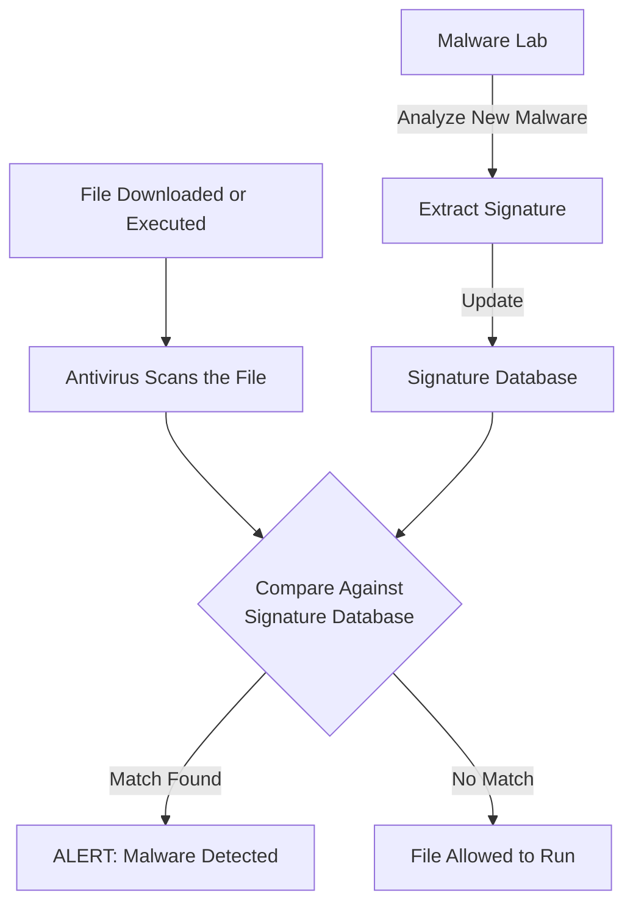
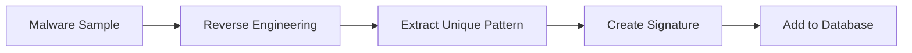
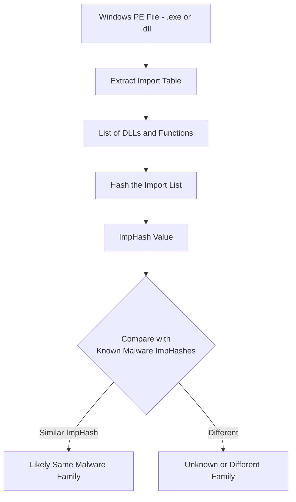
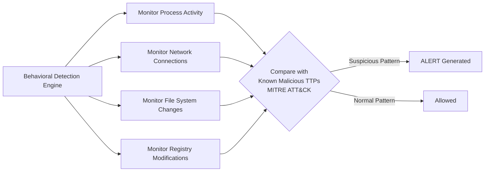
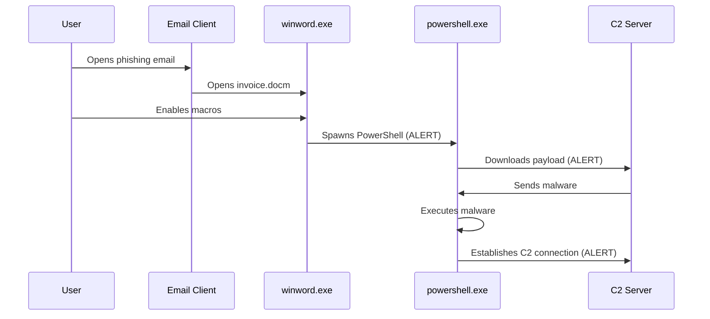
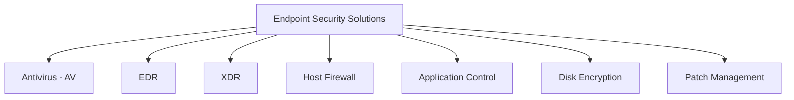
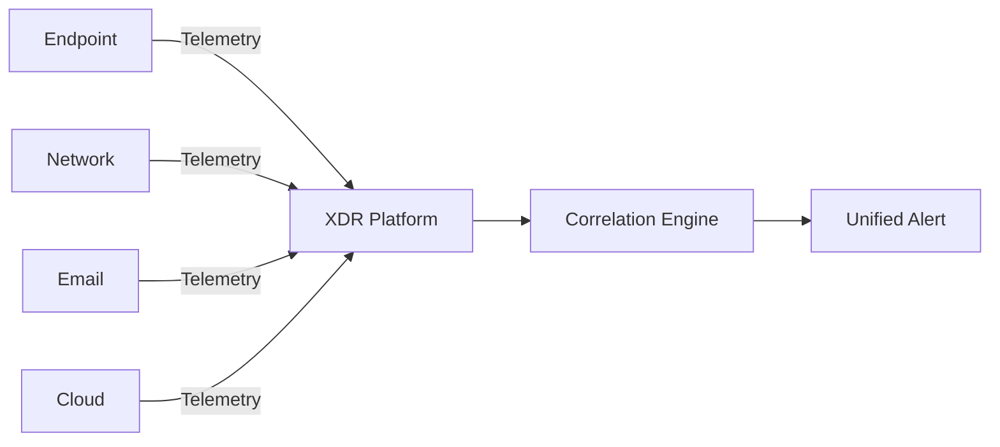
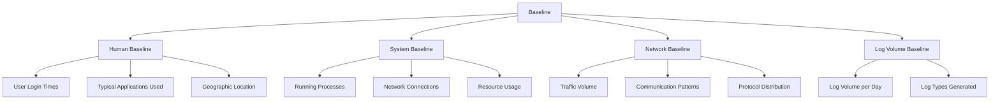
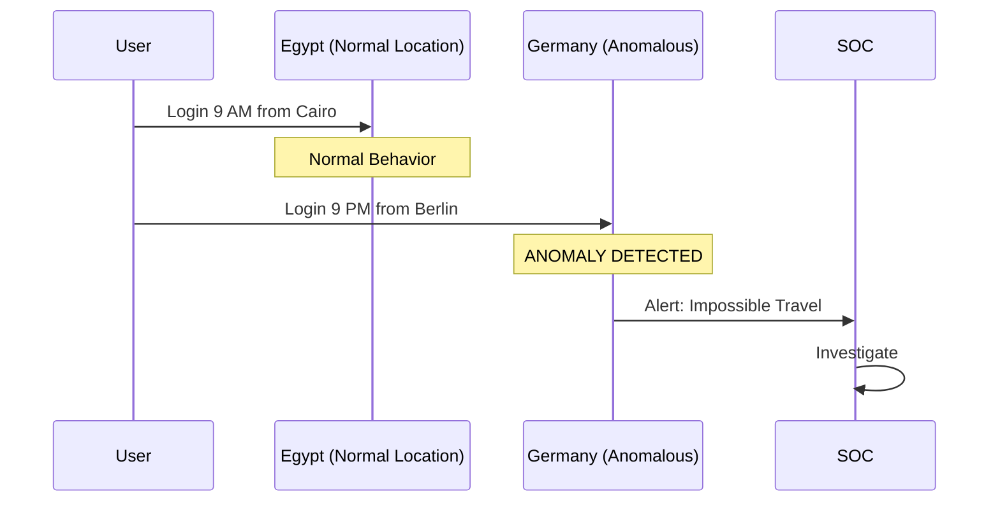

> **Goal of this section:**
> You'll learn what an Endpoint is and why protecting it matters in any Organization, and you'll understand the difference between Signature-based and Behavioral Detection. You'll also see how EDR detects threats and protects devices from advanced attacks, and you'll get to know the concept of a Baseline and how it helps the SOC Team tell normal activity apart from any suspicious behavior.
---


## Table of Contents

- [What is an Endpoint](#what-is-an-endpoint)
- [Signature-based Detection](#signature-based-detection)
- [Import Hashing - ImpHash](#import-hashing---imphash)
- [Behavioral Detection](#behavioral-detection)
- [Endpoint Security Solutions](#endpoint-security-solutions)
- [Baselines](#6-baselines)
- [Summary](#summary)

---

## What is an Endpoint

An **Endpoint** is any Device that connects to the Network, whether it's:
- A Laptop or Desktop
- A Mobile Phone or Tablet
- Server
- A Printer or IoT Device

In other words, anything that has an IP Address and communicates on the network is an Endpoint.

### Why Does Endpoint Security Matter?

```
Attacker → [Internet] → Endpoint (First Point of Entry) → Network
```

The Endpoint is the attacker's **first point of entry** in most incidents, whether through:
- A Phishing Email that reaches the User
- Malicious USB
- Vulnerable Software on the device

> [!IMPORTANT]
> Endpoint Security isn't only about preventing attacks; it also gives the SOC Team full **Visibility** into what's happening on every device in the network, and it helps identify the Root Cause in most incidents.

> [!WARNING]
> Endpoint Security relies heavily on **Employee Awareness**, because the User is often the weakest link in the chain.

---

## Signature-based Detection

### The Core Idea

Signature-based Detection works like a Wanted List — you have a database of the "fingerprints" of known Malware, and every File that comes in is compared against that database.



### What Is a Signature?

A Signature can be:

| Signature Type | Example |
|---|---|
| **File Hash** (MD5 / SHA256) | `d41d8cd98f00b204e9800998ecf8427e` |
| **Byte Sequence** | `A1 B2 C3 D4 E5` at a specific location in the File |
| **Malicious String** | A known URL or Registry Key used by Malware |
| **Code Pattern** | A specific sequence of Instructions |

### How Is a Signature Created?



Security Researchers take a sample of the Malware, Reverse Engineer it, extract its unique pattern, and add it to the Database.

### Limitations of Signature-based Detection

> [!WARNING]
> Antivirus updates its Database constantly, but it has two fundamental problems:
> 1. **Zero-Day Attacks**: if the Malware is new and nobody has seen it before, there's no Signature for it in the Database.
> 2. **Easy Evasion**: the smallest change to the File (even a single byte) changes the Hash completely, which means the Malware simply slips past detection.

```
Original Malware Hash:  d41d8cd98f00b204e9800998ecf8427e  → DETECTED
Modified Malware Hash:  a87ff679a2f3e71d9181a67b7542122c  → NOT DETECTED
```

> [!TIP]
> Even so, Antivirus is still important and we still use it, because it's **very fast and efficient** at detecting Known Threats, and it provides an additional layer of defense.

---

## Import Hashing - ImpHash

### The Problem ImpHash Solves

Since any small change to the code changes the Hash completely, attackers did something very simple — they changed a single byte or added a Comment, and the File became completely different as far as the Antivirus was concerned.

The solution was to come up with a Hash method based on something **harder to change**.

### What Is ImpHash?

**ImpHash (Import Hash)** is a Hash that isn't calculated over the entire File; instead it's calculated over:
- The **DLLs** the Program uses (such as `kernel32.dll`, `user32.dll`)
- The **Functions** it imports (such as `CreateFile`, `VirtualAlloc`)



### An Illustrative Example

Suppose we have Malware that uses these Functions:
```
kernel32.dll: CreateProcess, VirtualAlloc, WriteProcessMemory
wininet.dll: InternetOpen, InternetConnect
```

Even if the attacker changes other bytes in the File, as long as these Functions are present in this order, the ImpHash will stay the same.

### Pros and Cons of ImpHash

| Aspect | Details |
|---|---|
| **Pros** | Resistant to small changes in the code |
| **First drawback** | Only works on **Windows PE Files** (.exe, .dll) |
| **Second drawback** | Easy for Advanced Attackers to get around (but harder than a regular Hash) |
| **SOC use** | Used by the SOC Team in Threat Hunting |

> [!IMPORTANT]
> **A very important SOC Notice:** If you detect Malware, **don't start Incident Response immediately** without doing Analysis and Validation first. Find out the full Scope of the incident first — "Scope First". Moving fast without understanding can lead to wrong conclusions and make the situation even more complicated.

---

## Behavioral Detection

### A Different Philosophy

Signature-based Detection asks: **"Who is this File?"**
Behavioral Detection asks: **"What is this File doing?"**



### Example of a Behavioral Chain

```
winword.exe
    └─ spawns → powershell.exe
                    └─ downloads → payload.exe  (HTTP to external IP)
                                       └─ connects to → C2 Server
```

This chain is a classic example of Malicious Behavior — even if the Hash is new and there's no Signature for it, the Behavior itself is what triggers the Alert.

### Connecting to MITRE ATT&CK

Behavioral Detection is fundamentally built on the **TTPs (Tactics, Techniques, and Procedures)** documented by the MITRE ATT&CK Framework:

| Tactic | Example in a Phishing Scenario |
|---|---|
| **Initial Access** | Phishing Email |
| **Execution** | Macros in a Word Document |
| **Defense Evasion** | Obfuscated PowerShell Command |
| **Command & Control** | Connection to External C2 Server |

### A Real Scenario, Step by Step



### Why Is Behavioral Detection Stronger?

> [!IMPORTANT]
> Behavioral Detection:
> - **Detects Zero-Day Malware** — even when there's no Signature for it
> - **Detects Fileless Attacks** — which run in Memory without writing a File to the Disk
> - **Is much harder to evade** — because the attacker has to change their attack method completely

### The Main Solution That Uses Behavioral Detection

**EDR (Endpoint Detection & Response)** is the best-known Solution that relies on Behavioral Detection.

Most Organizations use both together:
- **Antivirus**: for Known Threats (fast and lightweight)
- **EDR**: for Zero-Day and Advanced Attacks (deeper and more detailed)

---

## Endpoint Security Solutions



### The Solutions in Detail

#### Antivirus (AV)
- Type: **Signature-based**
- What it does: compares Files against a Database of Known Malware Signatures
- Strength: fast, lightweight, effective against Known Threats
- Weakness: not effective against Zero-Day and Fileless Attacks

---

#### EDR (Endpoint Detection & Response)
- Type: **Behavior-based**
- What it does:
  - Monitors Endpoint activity in Real-Time
  - Records Telemetry (all processes and connections)
  - Detects Suspicious Behavior based on TTPs
- Strength: detects Advanced Attacks and Zero-Days
- Examples: CrowdStrike Falcon, Microsoft Defender for Endpoint, SentinelOne

---

#### XDR (Extended Detection & Response)
- Type: **Correlated Multi-source Detection**
- What it does: collects Telemetry from multiple sources and analyzes it together



- Strength: **Broader Visibility** — sees the complete attack from start to finish across all Layers

---

#### Host Firewall
- Type: **Traffic Control**
- What it does: controls Inbound and Outbound Traffic at the Device level
- Strength: prevents Unauthorized Access and reduces Lateral Movement

---

#### Application Control
- Type: **Whitelisting**
- What it does: allows only Approved Applications to run
- Strength: even if Malware gets in, it can't execute if it isn't on the Whitelist

---

#### Disk Encryption
- Type: **Data Protection at Rest**
- What it does: Encrypts all the data on the Disk
- Strength: if the device is stolen or lost, the data can't be read without the Key
- Examples: BitLocker (Windows), FileVault (macOS)

---

#### Patch Management
- Type: **Vulnerability Remediation**
- What it does: ensures all Systems and Applications are up to date with the latest Security Patches
- Strength: closes the Known Vulnerabilities that attackers could exploit

> [!TIP]
> These Solutions aren't substitutes for one another; they're **Complementary** — each one covers a different Layer in the Defense-in-Depth Strategy.

---

## Baselines

### What Is a Baseline?

A **Baseline** is a clear picture of what's "Normal" in your environment — know what's normal so you can recognize what's strange.

> [!IMPORTANT]
> The core principle of a Baseline: **"Know what normal looks like → detect what's abnormal"**

### Types of Baselines



### The Human Baseline

The SOC Team is lucky, because there are usually **IT Administrators** with long experience in the environment who know everything that's normal in it.

These people are a **very valuable Asset** — in any investigation, you can go back to them and ask:
- "Is it normal for this Server to do this?"
- "Does this User usually use PowerShell?"

> [!TIP]
> From practical experience: you'll go back to the IT Admin a lot in SOC Work — treat them as an essential part of the Investigation Process.

### Building the Baseline

To build a proper Baseline, you need to collect data over a long enough period and determine:

| Element | Questions You Should Answer |
|---|---|
| **Login Patterns** | When does the user log in? From where? On which Device? |
| **Applications** | Which Applications do they open regularly? |
| **Network Traffic** | Which Domains do they connect to? How much data passes through? |
| **Log Volume** | How many Logs come in from each System per day? |
| **System Access** | Which Servers do they connect to? At what times? |

### Practical Example - Volume-based Anomaly

```
Normal:     100 Login Events / Day    ✓
Anomaly:   5000 Login Events / Day    ← INVESTIGATE
```

If you see 5000 Logins in a single day instead of the normal 100, that's a clear indicator that something isn't normal — it could be a Brute Force Attack.

### Practical Example - Geographic Anomaly



The user logs in from Egypt in the morning, and at 9 PM logs in from Germany — that's geographically impossible and is known as **Impossible Travel**.

### How EDR Uses Baselines

EDR builds a Baseline for every User and every Endpoint:

**Learning phase:**
```
User: Ahmed
- Login Time: 9 AM - 5 PM
- Applications: outlook.exe, chrome.exe, excel.exe
- Network: mail.company.com, internal servers
```

**Detection phase:**
```
Ahmed logs in at 3 AM           → ALERT (Time Anomaly)
Runs powershell.exe -enc ...    → ALERT (Encoded Command)
Connects to 45.33.22.11         → ALERT (Unknown External IP)
```

### Baseline Challenges

> [!WARNING]
> **False Positives and Alert Fatigue** are the two biggest challenges in Baseline Detection:
> - If the Thresholds are too tight, you'll get a huge number of Alerts on normal things
> - Alert Fatigue causes SOC Analysts to start ignoring Alerts — and that's very dangerous
> - Creating an accurate, stable Baseline is a difficult and complex process in itself

> [!IMPORTANT]
> **Tuning** Detection Sensitivity is an essential part of the SOC Team's work — you don't just build the Baseline and leave it; you need to review and adjust it continuously.

---

## Summary

### Summary

- **An Endpoint** is any Device connected to the network; it's the first point of entry for attackers, and EDR gives the SOC Team full Visibility into it.

- **Signature-based Detection** works by comparing Files against a Database of Known Malware — fast and effective against Known Threats, but easy to evade with any small change to the File.

- **ImpHash** is an improvement on the regular Hash that relies on the Imported DLLs and Functions instead of the entire File Content — it makes Evasion harder but not impossible, and it only works on Windows PE Files.

- **Behavioral Detection** is the stronger Approach — instead of asking "Who is this File?" it asks "What is it doing?" — it detects Zero-Day and Fileless Attacks and is harder to evade.

- **Endpoint Security Solutions** are many and complementary: AV for Known Threats, EDR for Advanced Threats, XDR for Correlation across all Layers, alongside Host Firewall, Application Control, Disk Encryption, and Patch Management.

- **Baselines** are the picture of "Normal" in your environment — they help you detect Anomalies, whether Volume-based, Time-based, or Geographic. Their biggest challenge is False Positives and Alert Fatigue.

> [!TIP]
> **Takeaway for the SOC Analyst:** The golden formula is AV + EDR + Baselines. AV for speed, EDR for depth, and Baselines for Context — the three together give you a complete picture of any Endpoint in your network.
