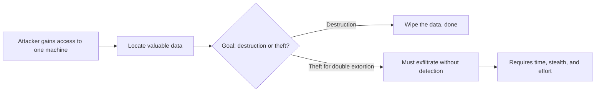
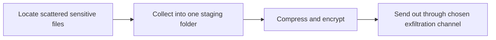
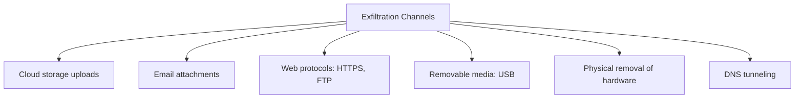
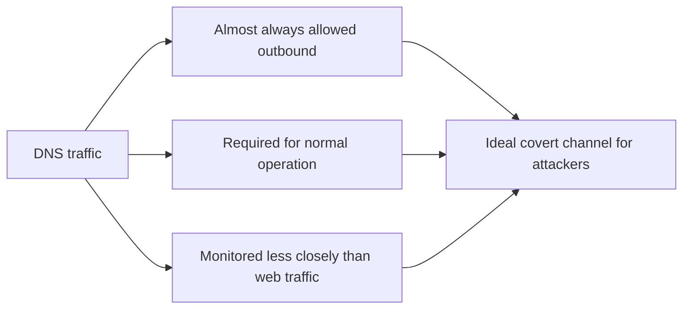
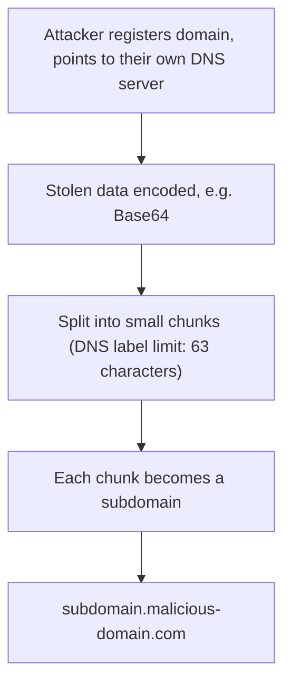
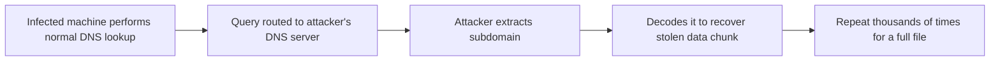
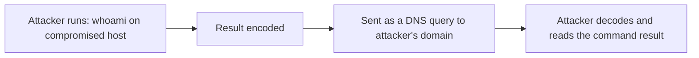
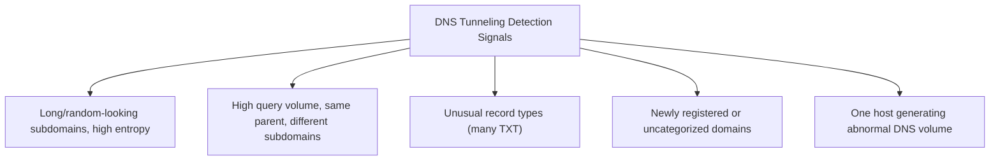
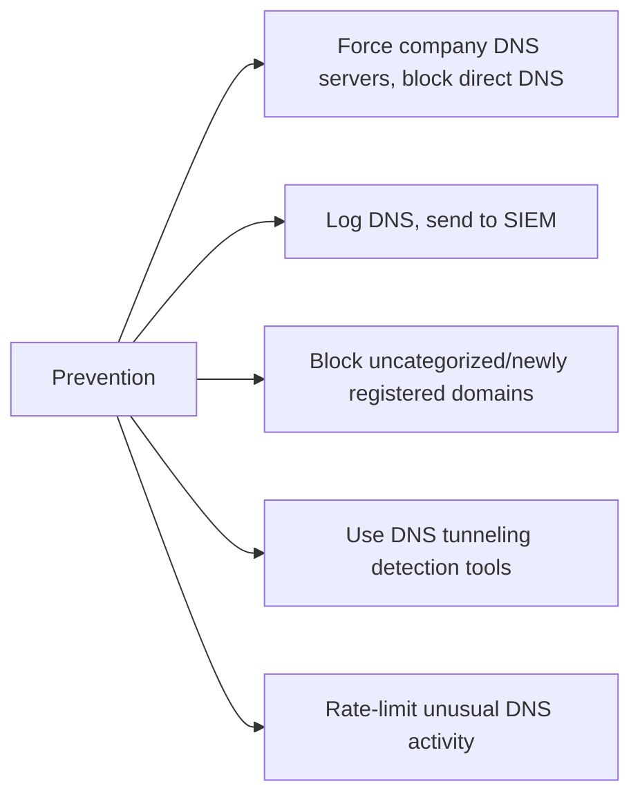

| Topic | Level | Reading Time | Prerequisites |
|---|---|---|---|
| Data Exfiltration and DNS Tunneling | Intermediate | ~20 min | DLP Tools and SIEM Integration |

> **الهدف من الـ Section ده:**  
> هتفهم إيه معنى الـ data exfiltration ولماذا هو أصعب خطوة في أي هجوم ابتزاز مزدوج، هتشوف القنوات المختلفة اللي بيستخدمها المهاجمين، وهتفهم بالتفصيل إزاي الـ DNS tunneling بيهرّب الداتا من غير ما يبان، وإزاي تكتشفه وتمنعه.


## Learning Objectives

By the end of this section, you will be able to:

- Define **data exfiltration** and explain why it is harder for an attacker than encryption alone.
- List the common exfiltration channels and a detection idea for each.
- Explain, step by step, how **DNS tunneling** encodes and smuggles data inside DNS queries.
- Explain how an attacker receives the exfiltrated data on their own DNS server.
- List concrete detection signals and preventive measures against DNS tunneling.

## Table of Contents

- [Learning Objectives](#learning-objectives)
- [Data Exfiltration](#data-exfiltration)
  - [Definition](#definition)
  - [Why Exfiltration Is Harder Than Destruction](#why-exfiltration-is-harder-than-destruction)
  - [Staging the Data](#staging-the-data)
- [Common Exfiltration Channels](#common-exfiltration-channels)
- [DNS Tunneling: Why and How (Part 1)](#dns-tunneling-why-and-how-part-1)
  - [Why DNS Specifically](#why-dns-specifically)
  - [Attack Steps: Setting Up the Channel](#attack-steps-setting-up-the-channel)
- [DNS Tunneling: Receiving the Data (Part 2)](#dns-tunneling-receiving-the-data-part-2)
  - [Completing the Round Trip](#completing-the-round-trip)
  - [Command Output Over DNS](#command-output-over-dns)
- [Detecting and Preventing DNS Tunneling](#detecting-and-preventing-dns-tunneling)
  - [What to Look For in DNS Logs](#what-to-look-for-in-dns-logs)
  - [Prevention Measures](#prevention-measures)
- [Career Path Connections](#career-path-connections)
- [Key Terms Glossary](#key-terms-glossary)
- [Summary](#summary)

## Data Exfiltration

### Definition

**Data exfiltration** هو **النقل غير المصرح بيه للداتا لبرّه المؤسسة**.

### Why Exfiltration Is Harder Than Destruction

الوصول لجهاز واحد هو **بس أول خطوة** من سلسلة هجوم طويلة. المهاجم لازم **يحدد مكان الداتا القيّمة**، وده صعب حتى على الشركة نفسها اللي بتملك الداتا.

| Goal | What the Attacker Must Do |
|---|---|
| **التدمير (Destruction)** | شغل المهاجم بيخلص بمجرد ما يلاقي الداتا ويمسحها |
| **الابتزاز المزدوج (Double extortion)** | المهاجم لازم **كمان** ينقل مئات الجيجابايت أو التيرابايت **من غير ما يتكشف**. ده بياخد وقت وتخفي ومجهود |



> [!IMPORTANT]
> This is why exfiltration detection matters so much for a SOC: it is the hardest, slowest, and most detectable step for the attacker in a double-extortion ransomware chain. Catching exfiltration early can stop the leak threat even if encryption still happens.

### Staging the Data

المهاجمين عادةً بيعملوا **staging** للداتا الأول: يجمعوها في فولدر واحد، وبعدين يضغطوها ويشفّروها **قبل** ما يبعتوها.



## Common Exfiltration Channels

| Channel | How It Works | Detection Idea |
|---|---|---|
| Cloud storage | Upload لمواقع file-sharing | مراقبة الـ category والـ domain |
| Email | Attachments مرسلة للخارج | Email security وDLP |
| Web protocols (HTTPS, FTP) | نقل حجم كبير للخارج | حجم غير معتاد، وجهات مجهولة |
| Removable media | USB drives | Endpoint DLP |
| Physical removal | Insider بياخد الـ disk فيزيائياً | Physical security وaccess logs |
| DNS tunneling | داتا مخفية جوه DNS queries | تحليل DNS logs |

**إزالة الـ disk فيزيائياً من insider** هي **الطريقة الأبسط**، و**DNS tunneling** من **أكتر الطرق تخفياً**.



> [!NOTE]
> This connects directly to the Causes of Data Leakage section in Data Loss Fundamentals and DLP Operations: an insider with no internet access can only exfiltrate by physically removing a drive, which is exactly why the "Physical removal" channel exists on this list.

## DNS Tunneling: Why and How (Part 1)

### Why DNS Specifically

الـ **DNS tunneling** بيخفي داتا تحكيمية (arbitrary data) جوه DNS queries وresponses، عشان يخلق **قناة تواصل سرية**.

| Reason | Explanation |
|---|---|
| مسموح بيه خارجي تقريباً دايماً | الـ DNS traffic نادراً ما بيتحجب بالكامل |
| ضروري للتشغيل العادي | لو اتحجب، مفيش حاجة هتشتغل في الشبكة |
| أقل مراقبة | كتير من المؤسسات بتراقب الـ web traffic **أدق بكتير** من الـ DNS traffic |



### Attack Steps: Setting Up the Channel

- المهاجم بيسجّل domain (مثلاً `malicious-domain[.]com`) ويوجّهه لـ DNS server بيتحكم فيه هو.
- الداتا المسروقة بتتعمل لها **encode** (مثلاً بـ **Base64**).
- الداتا بتتقسم لـ **chunks صغيرة**، لأن الـ DNS label ليه حد أقصى **63 حرف**.
- كل chunk بيتحول لـ **subdomain**، مثلاً:

```text
dGhpcy1pcy1zdG9sZW4tZGF0YQ.malicious-domain[.]com
```

الجزء الأول ده هو الداتا المشفرة بالـ encode. (المثال ده بيتفك لنص بريء: `"this-is-stolen-data"`)



## DNS Tunneling: Receiving the Data (Part 2)

### Completing the Round Trip

- الجهاز المصاب بيعمل **DNS lookup عادي** للـ subdomain ده.
- بما إن المهاجم بيتحكم في DNS server الـ domain، الـ query **بتوصله هو**، حاملة الـ chunk المشفر.
- المهاجم بيستخرج الـ subdomain ويفك تشفيره (**decode**) عشان يسترجع الداتا المسروقة. تكرار ده لآلاف الـ queries بينقل ملف كامل للخارج.



### Command Output Over DNS

نفس التقنية بتستخدم لنقل **مخرجات أوامر (command output)**: المهاجم بيشغّل أمر زي `whoami`، والنتيجة (مثلاً `corp\administrator`) بتتعمل لها encode وتتبعت كـ query، زي:

```text
mnxw24dmmuwwk3tbnr2a.attacker-domain[.]com
```

ده إزاي المهاجم بيشوف نتايج من جهاز **مايقدرش يتواصل للخارج إلا عن طريق DNS بس**.



> [!WARNING]
> This is not limited to stealing files. An attacker can run an entire command-and-control conversation purely through DNS queries, which is why DNS tunneling is considered dangerous beyond just large file exfiltration.

## Detecting and Preventing DNS Tunneling

### What to Look For in DNS Logs

| Signal | Why It Matters |
|---|---|
| Subdomains طويلة جداً أو شكلها عشوائي (**entropy** عالي) | نص عادي قابل للقراءة مختلف جداً عن داتا base64 مشفرة |
| عدد كبير جداً من queries لنفس الـ parent domain، كل واحد بـ subdomain مختلف | نمط typical لنقل chunks كتيرة |
| أنواع records غير معتادة، زي كتير من **TXT queries** | TXT records بتشيل داتا أكتر، وبتستخدم كتير في tunneling |
| Domains جديدة التسجيل أو غير مصنّفة | مؤشر عام على نشاط مش موثوق |
| جهاز واحد بيولّد DNS traffic أكتر بكتير من أقرانه | انحراف واضح عن الـ baseline الطبيعي |



> [!NOTE]
> This detection list applies the exact same baselining principle covered in Asset Awareness and Traffic Flow from Network Security Foundations: you cannot spot an anomaly without first knowing what normal DNS traffic looks like for a given host.

### Prevention Measures

- فرض استخدام **DNS servers المؤسسة** على كل الأجهزة، وحجب أي DNS مباشر للإنترنت.
- تسجيل الـ DNS وبعته للـ SIEM.
- حجب الـ domains غير المصنّفة أو الجديدة التسجيل حيث ممكن.
- استخدام أدوات أمان DNS بتكتشف أنماط الـ tunneling.
- Rate-limit للنشاط الـ DNS غير المعتاد.



> [!TIP]
> If asked in an interview "why can't you just block all DNS to stop tunneling?", the answer is the same reason tunneling works in the first place: DNS is required for normal operation. The defenses target the behavior pattern (forcing centralized DNS, logging, rate-limiting), not DNS itself.

## Career Path Connections

| Career Path | How This Topic Applies |
|---|---|
| SOC Analyst | Directly applies the DNS log detection signals covered here when investigating suspected exfiltration |
| Penetration Tester | DNS tunneling is a realistic covert channel technique used in authorized red team data-exfiltration simulations |
| GRC | Exfiltration risk assessments inform data classification and network monitoring policy requirements |
| Cloud Security | Cloud-native DNS firewall services apply the same tunneling-detection logic to cloud workloads |

## Key Terms Glossary

| Term | Definition |
|---|---|
| Data Exfiltration | The unauthorized transfer of data out of an organization |
| Staging | Collecting and preparing data (compressing, encrypting) before exfiltrating it |
| DNS Tunneling | Hiding arbitrary data inside DNS queries and responses to create a covert communication channel |
| Base64 | An encoding scheme used to convert binary data into text-safe characters |
| DNS Label | A single segment of a domain name, limited to 63 characters |
| Entropy | A measure of randomness; high entropy in a subdomain suggests encoded rather than human-readable data |
| TXT Record | A DNS record type that can carry arbitrary text, commonly abused in tunneling |

## Summary

- **Exfiltration is the hardest step for an attacker pursuing double extortion:** محتاج وقت وتخفي ومجهود، على عكس التدمير اللي بيخلص بمجرد مسح الداتا.
- **Attackers stage data before sending it out:** تجميع، ضغط، وتشفير قبل النقل.
- **Six common channels exist, each with its own detection idea:** cloud storage، email، web protocols، removable media، physical removal، وDNS tunneling.
- **DNS tunneling exploits DNS's always-allowed, lightly-monitored nature:** encode، تقسيم لـ chunks، وتحويلها لـ subdomains.
- **The attacker's own DNS server receives and decodes the data:** عن طريق queries عادية بتوصله هو بالتحديد.
- **The same technique carries command output, not just files:** command-and-control كامل ممكن يمر عن طريق DNS بس.
- **Detection relies on baselining DNS behavior:** entropy، حجم الـ queries، أنواع records، وDomains جديدة أو غير مصنّفة.
- **Prevention targets the pattern, not DNS itself:** مركزية الـ DNS servers، logging، rate-limiting، وأدوات كشف متخصصة.


