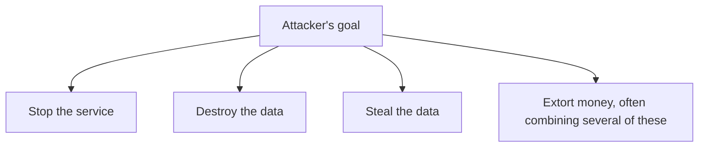
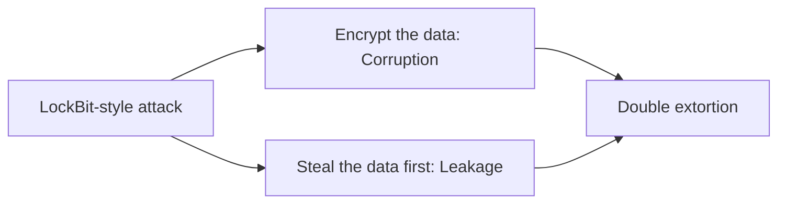
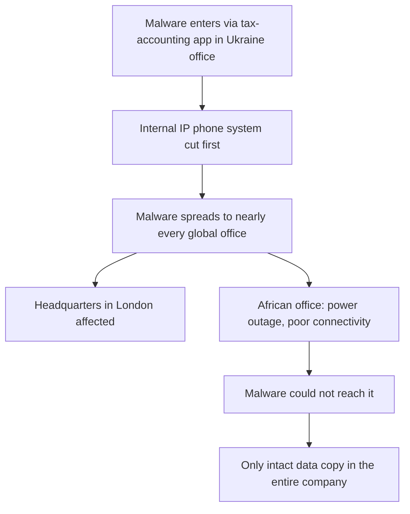
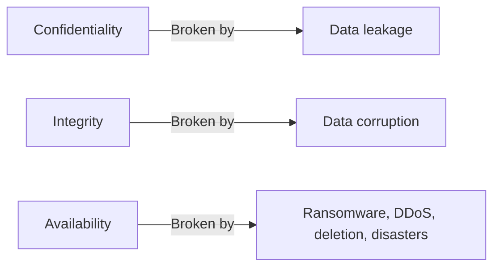
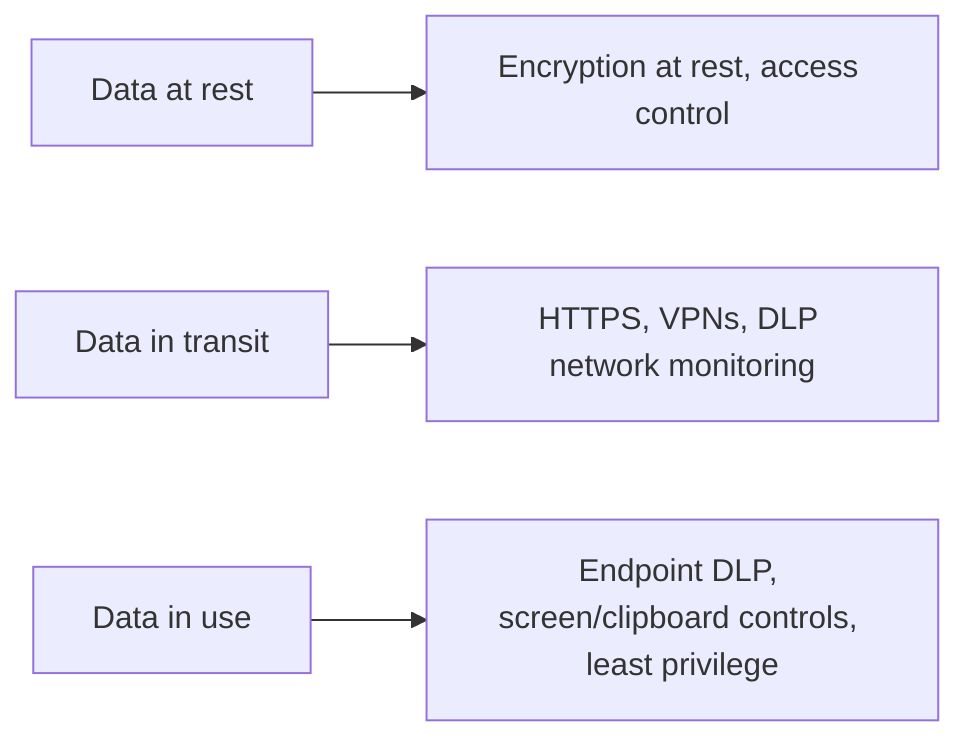
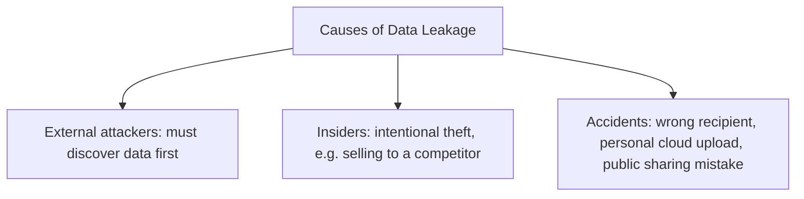
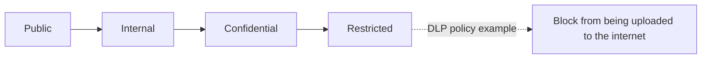
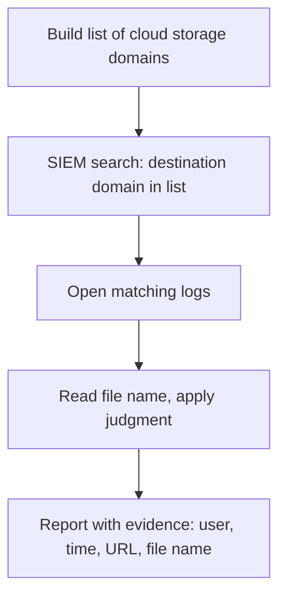

| Topic | Level | Reading Time | Prerequisites |
|---|---|---|---|
| Data Loss Fundamentals and DLP Operations | Beginner | ~20 min | None |

> **الهدف من الـ Section ده:**  
> الهدف من الـ Section هتفهم إيه معنى "فقدان الداتا" بكل أشكاله، وإزاي كل شكل منهم بيضرب خاصية مختلفة من الـ CIA triad، وهتشوف دور الـ SOC analyst اليومي في مراقبة واكتشاف تسريب الداتا، بأمثلة عملية من داخل الـ SIEM.

## Learning Objectives

By the end of this section, you will be able to:

- Explain what **data loss** means and differentiate between **corruption**, **leakage**, and **accidental/environmental loss**.
- Map each type of data loss to the **CIA triad** property it breaks.
- Describe the **three states of data** and the protection appropriate for each.
- List the common causes of data leakage, from external attackers to insiders to accidents.
- Explain the role of **data classification** in making DLP policies possible.
- Describe a practical SIEM workflow for detecting unauthorized cloud uploads and email leakage, while avoiding false positives.

## Table of Contents

- [Learning Objectives](#learning-objectives)
- [What Is Data Loss](#what-is-data-loss)
  - [Three Main Ways Data Is Lost](#three-main-ways-data-is-lost)
  - [The Attacker's Goal Decides the Outcome](#the-attackers-goal-decides-the-outcome)
- [Corruption Versus Leakage Versus Service Disruption](#corruption-versus-leakage-versus-service-disruption)
  - [Comparing the Three](#comparing-the-three)
  - [Attacks Often Combine These](#attacks-often-combine-these)
- [Case Study: A Data Destruction Attack (Maersk)](#case-study-a-data-destruction-attack-maersk)
  - [What Happened](#what-happened)
  - [The Single Surviving Office](#the-single-surviving-office)
  - [Lessons](#lessons)
- [Mapping Data Loss to the CIA Triad](#mapping-data-loss-to-the-cia-triad)
- [The Three States of Data](#the-three-states-of-data)
- [Causes of Data Leakage](#causes-of-data-leakage)
  - [External Attackers](#external-attackers)
  - [Insiders](#insiders)
  - [Accidental Leaks](#accidental-leaks)
- [Data Classification](#data-classification)
  - [Why Classification Comes First](#why-classification-comes-first)
  - [Classification Levels](#classification-levels)
- [The SOC Analyst's Role in Stopping Leakage](#the-soc-analysts-role-in-stopping-leakage)
- [Practical Task: Finding Cloud Uploads in the SIEM](#practical-task-finding-cloud-uploads-in-the-siem)
- [Avoiding False Positives](#avoiding-false-positives)
- [Finding Leakage Through Email](#finding-leakage-through-email)
- [Go Beyond the Alerts](#go-beyond-the-alerts)
- [Career Path Connections](#career-path-connections)
- [Key Terms Glossary](#key-terms-glossary)
- [Summary](#summary)

## What Is Data Loss

### Three Main Ways Data Is Lost

**Data loss** معناها إن المؤسسة **مابقتش تقدر توصل لداتاها، أو تثق فيها، أو تتحكم فيها**. ده بيحصل بتلات طرق أساسية:

| # | Type | What Happens |
|---|---|---|
| 1 | **Data corruption** | الداتا اتغيّرت أو اتشفرت أو اتمسحت، فبقت غير دقيقة أو غير متسقة أو مش قابلة للاستخدام |
| 2 | **Data leakage** | الداتا اتكشفت لناس مش مصرحلهم يشوفوها |
| 3 | **Accidental/environmental loss** | حد مسح حاجة بالغلط، أو حريق/فيضان/انقطاع كهرباء دمّر الأنظمة |

### The Attacker's Goal Decides the Outcome

**هدف المهاجم هو اللي بيحدد أنهي سيناريو هيحصل**. بعض المهاجمين عايزين يوقفوا الخدمة، بعضهم عايز يدمّر الداتا، بعضهم عايز يسرقها، وبعضهم عايز فلوس من عدة طرق دول مجتمعة.

## Corruption Versus Leakage Versus Service Disruption

### Comparing the Three

| | Service Disruption | Data Corruption | Data Leakage |
|---|---|---|---|
| إيه اللي بيحصل | الأنظمة بتبقى غير متاحة | الداتا بتتشفر أو تتعدّل أو تتمسح | الداتا بتتنسخ أو تتعرض لناس برّه |
| مثال هجوم | DDoS | Ransomware، wiper malware | سرقة داتا، رفع من insider |
| المهاجم لمس الداتا نفسها؟ | لأ | آه، لازم يوصلها | آه، لازم يلاقيها وينسخها |
| خاصية CIA المتأثرة | Availability | Integrity وAvailability | Confidentiality |
| الصعوبة على المهاجم | منخفضة | متوسطة | عالية: محتاج وقت إضافي وتخفي ومجهود |

### Attacks Often Combine These

بعض الهجمات **بتجمع أكتر من نوع**. مجموعات ransomware زي **LockBit** بتشفّر (corruption) **وكمان بتسرّب** (leakage) الداتا.

> [!NOTE]
> This double-layer attack pattern (corruption + leakage together) is covered in full detail, including the LockBit business model, in the Ransomware and the LockBit Case Study file in the Ransomware and Backup Resilience category.

## Case Study: A Data Destruction Attack (Maersk)

### What Happened

**Maersk** واحدة من أكبر شركات الشحن في العالم، ومقرها لندن. حوالي وقت الصراع الروسي-الأوكراني، مهاجمين استهدفوا البنية التحتية بتاعة أوكرانيا عن طريق **تطبيق محاسبة ضريبي** كانت كل شركة شغالة في أوكرانيا **مجبرة تثبته**. Maersk كان عندها مكتب في أوكرانيا، فالـ malware دخل عن طريق التطبيق ده. الهجوم ده بقى معروف باسم **NotPetya**.

هدف الـ malware كان **التدمير، مش المال**. هو **مسح الداتا في كل نظام وصله**.

مكتب Maersk الأوكراني كان متوصل بفروعها حول العالم، فالـ malware **انتشر لتقريباً كل مكتب**، بما فيهم المقر الرئيسي.

**قبل ما ينتشر**، المهاجمين **قطعوا نظام تليفونات الـ IP الداخلي** بتاع الشركة. الموظفين **مقدروش يحذّروا بعض بسرعة**.

### The Single Surviving Office

**مكتب واحد بس نجا**: مكتب في **إفريقيا** كان فيه انقطاع كهرباء واتصال ضعيف، فالـ malware **مقدرش يوصله**. المكتب ده كان بيحمل **النسخة السليمة الوحيدة** من الداتا اللازمة لإعادة بناء الشركة كلها.

### Lessons

- **احتفظ بنسخ backup في عدة مناطق جغرافية مختلفة.**
- **خلّي الـ backups معزولة عن الشبكة.**
- **وفّر وسيلة تواصل احتياطية أثناء الحادث.**

> [!IMPORTANT]
> The fact that the only surviving copy of Maersk's data existed by pure accident, an office that happened to have a power outage, is the strongest possible argument for deliberate geographic backup distribution. Luck is not a disaster recovery strategy.

## Mapping Data Loss to the CIA Triad

الـ **CIA triad** هو النموذج الأساسي لأمن المعلومات:

| Property | Meaning | Broken By |
|---|---|---|
| **Confidentiality** | بس الأشخاص المصرح لهم يقدروا يشوفوا الداتا | Data leakage |
| **Integrity** | الداتا دقيقة ومش متغيرة | Data corruption |
| **Availability** | الداتا والأنظمة متاحة وقت الحاجة | Ransomware، DDoS، deletion، disasters |

> [!IMPORTANT]
> Whenever you see an alert, ask: which of the three CIA properties is being attacked? That single question tells you how serious the alert is and what to do next. This is the same triage mindset covered in the Asset Awareness file from Network Security Foundations, applied specifically to data loss events.

## The Three States of Data

الداتا لازم تتحمي **في كل حالة من حالاتها الثلاث**:

| State | Where It Lives | Protection |
|---|---|---|
| **Data at rest** | مخزّنة على disks، servers، databases، laptops، USB drives، أو backups | Encryption at rest وaccess control |
| **Data in transit** | بتتحرك عبر الشبكة، زي الإيميل ورفع الملفات ونقلها | HTTPS، VPNs، DLP network monitoring |
| **Data in use** | مفتوحة في تطبيق أو بيتم تعديلها من مستخدم | Endpoint DLP، التحكم في الشاشة والـ clipboard، least privilege |

> [!NOTE]
> DLP tools are designed to watch all three states together, not just one. A policy that only covers data at rest, for example, would miss an employee copying sensitive data from an open application (data in use) straight into a personal email (data in transit).

## Causes of Data Leakage

مش كل تسريب جاي من هاكر خارجي.

### External Attackers

المهاجمين الخارجيين بيخترقوا، يلاقوا الداتا القيّمة، وينسخوها بره. **قبل السرقة، لازم يكتشفوا الداتا القيّمة فين أصلاً**، وده ممكن ياخد وقت طويل حتى في الشركات الكبيرة.

### Insiders

الـ insiders ممكن يسرقوا **عن قصد**، مثلاً ببيع سر لمنافس. الأسرار التجارية (زي تركيبة دوائية) بتساوي أموال ضخمة، وبعضها بيتخزن على **أنظمة معزولة بدون اتصال إنترنت** لهذا السبب بالتحديد. لما النظام يكون offline، **الطريقة الوحيدة للسرقة هي إزالة الـ hard disk فعلياً**، وده غالباً محتاج insider.

### Accidental Leaks

بتحصل لما موظفين يرفعوا ملفات حساسة لـ cloud storage شخصي، أو يبعتوا إيميل لشخص غلط، أو يشاركوا مستند بالخطأ بشكل عام.

## Data Classification

### Why Classification Comes First

**الـ DLP مايقدرش يحمي حاجة مش عارف يتعرف عليها**. المؤسسات الأول بتوسم الداتا حسب حساسيتها.

### Classification Levels

| Level | Meaning | Example |
|---|---|---|
| **Public** | آمن تشاركه مع أي حد | بروشورات تسويقية |
| **Internal** | للموظفين بس | دليل تليفونات داخلي |
| **Confidential** | ضرر لو اتسرب | المرتبات، العقود، قوائم العملاء |
| **Restricted** | ضرر جسيم لو اتسرب | كود مصدري، أسرار تجارية، بيانات دفع، سجلات صحية |

سياسات الـ DLP بتتكتب حول المستويات دي، مثلاً: **امنع أي ملف موسوم Restricted من الرفع للإنترنت**.

## The SOC Analyst's Role in Stopping Leakage

كـ **SOC analyst**، إنت عادةً **مش اللي بتبني policies الـ DLP**. إنت **بتقرا الـ alerts وتحقق**. أداة الـ DLP بتاعتك متوصلة بالـ **SIEM**، فـ alerts الـ DLP بتظهر فيه.

عشان تعمل الشغل ده، لازم تفهم:

- **معنى الـ alert**.
- **إيه اللي الأداة كانت بتدور عليه**.
- **فين تدور بعد كده**.

> [!WARNING]
> If you do not understand the concept of data loss prevention, you cannot investigate its alerts. Tier 1 analysts often struggle here specifically because they try to memorize alert responses without understanding the underlying concepts this file covers.

## Practical Task: Finding Cloud Uploads in the SIEM

**السيناريو:** مديرك بيقولك "وريني مين بيرفع داتا الشركة لمواقع cloud storage".

**الخطوات:**

- اعمل قايمة بـ domains خدمات file-sharing وcloud storage (زي MediaFire وMEGA وما شابه). تقدر تستخدم معرفتك أو تسأل أداة AI تقترح أكتر.
- في الـ SIEM، دوّر على logs الـ destination domain فيها بيساوي أي domain من القايمة.
- افتح الـ logs المطابقة. كل log بيوريك الـ domain والـ URL، وغالباً اسم الملف اللي بيترفع.
- اقرا اسم الملف واستخدم حكمك (ملف اسمه `Salaries_2026.xlsx` مريب).
- قدّم النتيجة لـ team lead بتاعك مع دليل: المستخدم، الوقت، الـ URL، اسم الملف.

## Avoiding False Positives

مش كل رفعة انتهاك. قبل ما تبلّغ، اسأل نفسك:

- الملف ده **business data**، ولا **حاجة شخصية** (زي صورة الهوية بتاعة الشخص نفسه)؟
- الشخص **مسموحله يستخدم الخدمة دي للشغل**؟
- فيه **نمط** (رفعات كتير، أحجام كبيرة، أوقات غير معتادة)؟

> [!WARNING]
> If you report a harmless personal upload as a data leak, you lose credibility (a false positive). Read the logs as carefully as you can and collect as much evidence as possible before you escalate.

## Finding Leakage Through Email

الموظفين ممكن كمان يبعتوا ملفات حساسة كـ **email attachments** لعناوين خارجية.

- دوّر في email security logs في الـ SIEM على رسائل مرسلة لـ domains خارجية فيها attachments.
- دوّر في أسماء ومحتوى الـ attachments باستخدام كلمات مفتاحية حساسة زي **salaries**, **plan**, **contract**, **confidential**، أو اسم عميل.
- لو مش عارف أنهي كلمات تستخدم، اسأل أداة AI عن كلمات شائعة في المستندات الحساسة.
- النتيجة هتوريك مين من الموظفين بيبعت أنهي ملفات للخارج.

> [!TIP]
> Notice that this is the same underlying skill as the cloud-upload task: search, filter, and read logs carefully. The channel changes (cloud storage versus email), but the investigative method is identical.

## Go Beyond the Alerts

معظم الـ analysts بيقفلوا بس الـ alerts اللي بتوصلهم. تقدر تتميز عن طريق **threat hunting استباقي**.

لما تخلّص الـ alerts بتاعتك، اعمل **cases من عندك**. مثلاً اسأل "مين في الشركة بيرفع على مواقع file-sharing؟"، لاقي الدليل، وبلّغ.

المدراء بيلاحظوا المبادرة، وده بيسرّع الترقية.

> [!NOTE]
> A real-world example from this lecture: a manager's own promotion was delayed because he uploaded confidential data to an external service. He did not mean harm, but it violated company policy. Awareness of policy protects you as well, not just the people you investigate.

## Career Path Connections

| Career Path | How This Topic Applies |
|---|---|
| SOC Analyst | This entire file describes core daily responsibilities: triaging DLP alerts, searching SIEM logs, and avoiding false positives |
| Penetration Tester | Understanding classification and detection logic helps design realistic data-theft scenarios for authorized engagements |
| GRC | Data classification levels and the CIA mapping are the foundation for compliance reporting and risk assessments |
| Cloud Security | Cloud storage monitoring is a direct extension of the cloud-upload detection task covered here |

## Key Terms Glossary

| Term | Definition |
|---|---|
| Data Loss | A state where an organization can no longer access, trust, or control its data |
| Data Corruption | Data that has been changed, encrypted, or deleted, breaking Integrity |
| Data Leakage | Data exposed to unauthorized people, breaking Confidentiality |
| CIA Triad | The core model of information security: Confidentiality, Integrity, Availability |
| Data at Rest | Data stored on disks, servers, databases, or backups |
| Data in Transit | Data moving across a network |
| Data in Use | Data open in an application or being actively edited |
| Data Classification | Labeling data by sensitivity level to determine appropriate protection |
| False Positive | A legitimate activity mistakenly reported as a security violation |
| Threat Hunting | Proactively searching for security issues beyond the alerts that arrive automatically |

## Summary

- **Data loss takes three forms:** corruption، leakage، وaccidental/environmental loss، وهدف المهاجم هو اللي بيحدد أيهم هيحصل.
- **Each type breaks a different CIA property:** corruption ≈ Integrity، leakage ≈ Confidentiality، service disruption ≈ Availability.
- **Maersk/NotPetya shows destruction without ransom intent:** وأهمية التوزيع الجغرافي للـ backups والعزل عن الشبكة.
- **Data needs protection in three states:** at rest، in transit، وin use، وكل حالة ليها وسائل حماية مختلفة.
- **Leakage comes from three sources:** external attackers، insiders، وaccidents، مش هاكر خارجي بس.
- **Classification enables DLP:** الأداة مايقدرش يحمي حاجة مش متعرف عليها كحساسة أصلاً.
- **The SOC analyst's job is investigation, not policy-building:** فهم الـ alert، إيه اللي الأداة بتدور عليه، وفين تدور بعد كده.
- **Practical SIEM searches follow a repeatable pattern:** قايمة domains أو كلمات مفتاحية، بحث، تحقق من false positives، وتقديم دليل.
- **Proactive threat hunting distinguishes strong analysts:** من غير ما تستنى الـ alerts توصلك.

