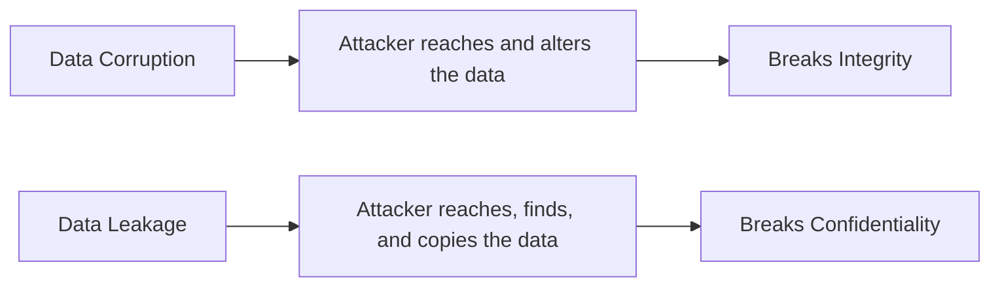
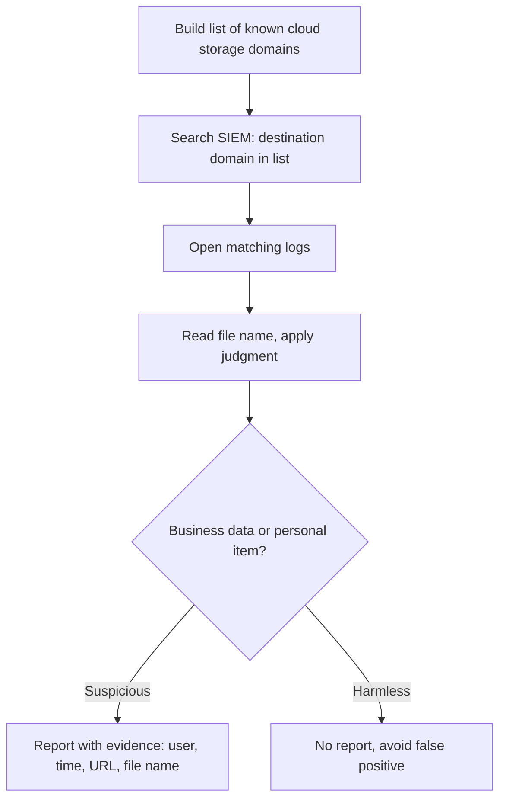
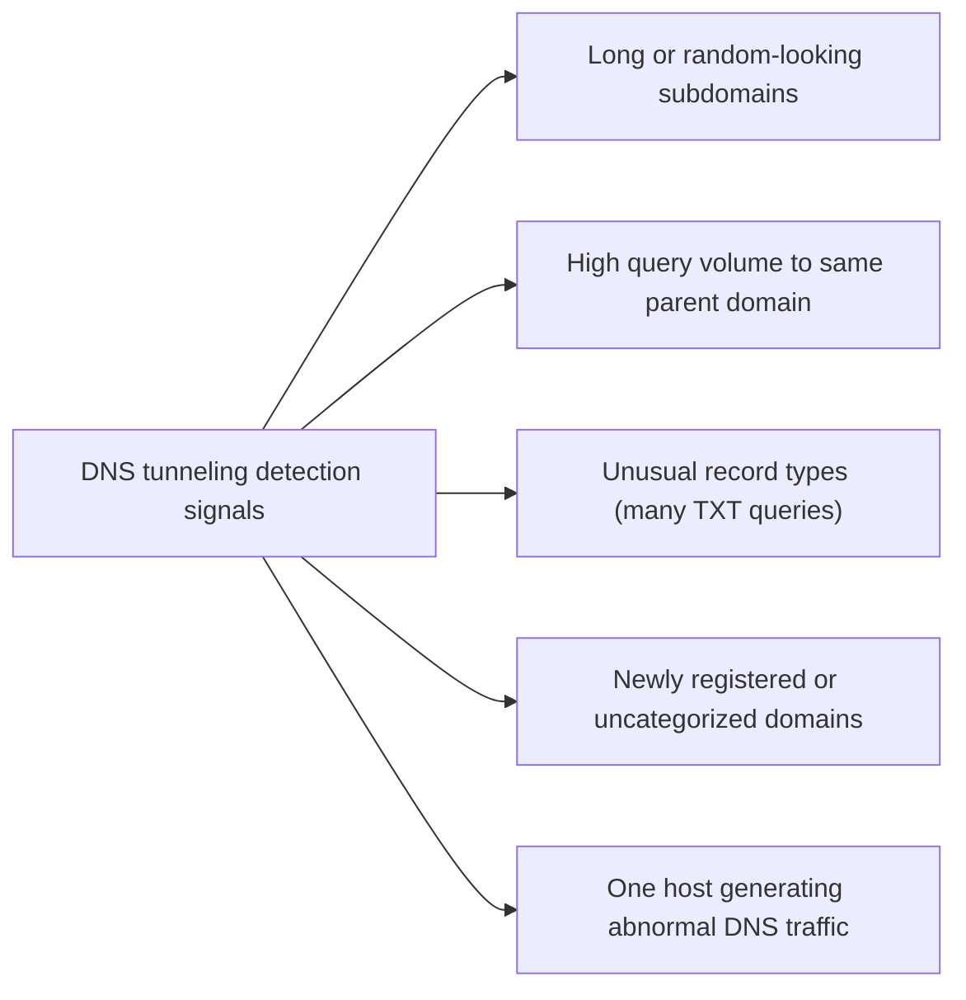
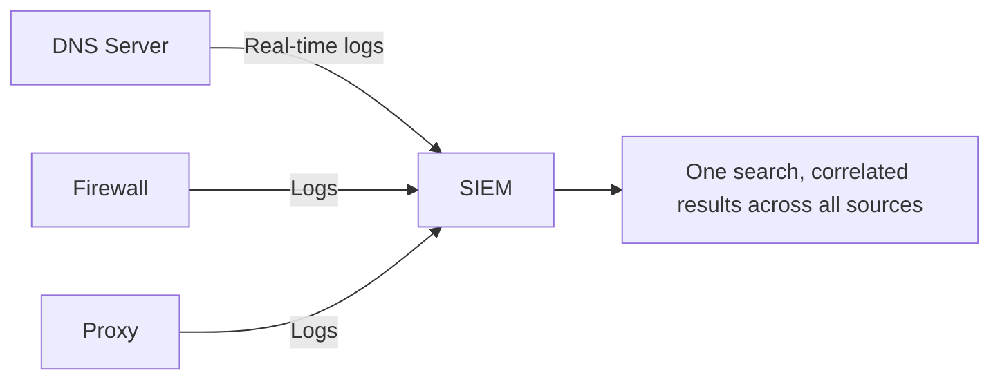

| Topic | Level | Reading Time | Prerequisites |
|---|---|---|---|
| Interview Questions Review: Data Loss and Exfiltration | Intermediate | ~10 min | Data Loss Fundamentals and DLP Operations, DLP Tools and SIEM Integration, Data Exfiltration and DNS Tunneling |

> **الهدف من الـ Section ده:**  
> مراجعة سريعة بصيغة أسئلة وأجوبة لأهم النقط اللي ممكن تتسأل عنها في interview عن الـ DLP والـ exfiltration، كتلخيص عملي للمفاهيم اللي اتشرحت بالتفصيل في ملفات الكاتيجوري دي.

## Learning Objectives

By the end of this section, you will be able to:

- Answer, in your own words, the most common interview questions about data loss, DLP operations, and exfiltration.
- Explain the reasoning behind each answer, not just recite it, so you can adapt to follow-up questions.
- Identify which file in this category to revisit for deeper detail on any question you found difficult.

## Table of Contents

- [Learning Objectives](#learning-objectives)
- [Question 1: Data Corruption Versus Data Leakage](#question-1-data-corruption-versus-data-leakage)
- [Question 2: Detecting Cloud Storage Uploads](#question-2-detecting-cloud-storage-uploads)
- [Question 3: Why Attackers Use DNS Tunneling, and How to Detect It](#question-3-why-attackers-use-dns-tunneling-and-how-to-detect-it)
- [Question 4: Why Send DNS Logs to a SIEM Instead of Searching the DNS Server Directly](#question-4-why-send-dns-logs-to-a-siem-instead-of-searching-the-dns-server-directly)
- [Quick Reference Table](#quick-reference-table)
- [Career Path Connections](#career-path-connections)
- [Summary](#summary)

## Question 1: Data Corruption Versus Data Leakage

**السؤال: إيه الفرق بين data corruption وdata leakage؟**

**الإجابة النموذجية:**

- **Data corruption** معناها الداتا **اتغيرت أو اتشفرت أو اتمسحت**، فبقت غير دقيقة أو غير متسقة أو غير قابلة للاستخدام. المهاجم **لازم يوصل للداتا** عشان يعدّل عليها، وده بيضرب خاصية **Integrity** من الـ CIA triad.
- **Data leakage** معناها الداتا **اتكشفت لناس مش مصرحلهم يشوفوها**. المهاجم **لازم يوصل للداتا ويلاقيها وينسخها**، وده بيضرب خاصية **Confidentiality**.

> [!TIP]
> If the interviewer pushes further with "which is harder for the attacker?", the honest answer is leakage, because the attacker must find and exfiltrate the data stealthily without being detected, while corruption (like ransomware encryption) can be noisy and still succeed.

للتفصيل الكامل، شوف ملف **Data Loss Fundamentals and DLP Operations**.

## Question 2: Detecting Cloud Storage Uploads

**السؤال: إزاي هتكتشف موظفين بيرفعوا داتا حساسة لـ cloud storage؟**

**الإجابة النموذجية (خطوات عملية):**

- اعمل قايمة بـ domains خدمات file-sharing وcloud storage الشائعة (زي MediaFire وMEGA).
- في الـ SIEM، دوّر على logs الـ destination domain فيها بيساوي أي domain من القايمة.
- افتح الـ logs المطابقة؛ عادةً بتوريك الـ domain والـ URL واسم الملف اللي بيترفع.
- اقرا اسم الملف واحكم بمنطقك (ملف اسمه `Salaries_2026.xlsx` مريب).
- قدّم النتيجة للـ team lead مع دليل: المستخدم، الوقت، الـ URL، اسم الملف.

قبل ما تبلّغ، لازم تتأكد إنها مش **false positive**: هل الملف فعلاً business data ولا حاجة شخصية؟ هل الشخص مسموحله يستخدم الخدمة دي أصلاً للشغل؟ فيه نمط مريب (عدد كبير من الرفعات، أحجام ضخمة، أوقات غير معتادة)؟

للتفصيل الكامل، شوف ملف **DLP Tools and SIEM Integration**.

## Question 3: Why Attackers Use DNS Tunneling, and How to Detect It

**السؤال: ليه المهاجمين بيستخدموا DNS tunneling، وإزاي تكتشفه؟**

**الإجابة النموذجية:**

**ليه DNS تحديداً:**

- الـ DNS traffic **مسموح بيه خارجي تقريباً دايماً**.
- الـ DNS **ضروري للتشغيل العادي**؛ لو اتحجب، مفيش حاجة هتشتغل.
- كتير من المؤسسات بتراقب **web traffic أدق بكتير من DNS traffic**.

**إزاي تكتشفه، علامات في الـ logs:**

- Subdomains طويلة جداً أو شكلها عشوائي (**entropy** عالي).
- عدد كبير جداً من الـ queries لنفس الـ parent domain، كل واحدة بـ subdomain مختلف.
- أنواع records غير معتادة، زي كتير من **TXT queries**.
- domains جديدة التسجيل أو غير مصنّفة.
- جهاز واحد بيولّد DNS traffic أكتر بكتير من أقرانه.

> [!TIP]
> If the interviewer asks "why not just block DNS entirely to stop this?", the answer is that DNS is required for basically everything to function. The real defenses are forcing all devices through company DNS servers, logging to the SIEM, and using tunneling-detection patterns, not blocking DNS itself.

للتفصيل الكامل، شوف ملف **Data Exfiltration and DNS Tunneling**.

## Question 4: Why Send DNS Logs to a SIEM Instead of Searching the DNS Server Directly

**السؤال: ليه نبعت DNS logs للـ SIEM بدل ما ندور مباشرة على الـ DNS server؟**

**الإجابة النموذجية (خمس أسباب):**

| # | Reason | Explanation |
|---|---|---|
| 1 | Centralization والـ least privilege | الـ analyst مش المفروض يكون عنده account على كل جهاز أمني؛ كل account إضافي هو مسار إضافي للمهاجم يستغله |
| 2 | مصادر متعددة | المؤسسات غالباً عندها أكتر من DNS server وfirewall وproxy؛ البحث في كل واحد لوحده بطيء ومعرّض للأخطاء |
| 3 | Correlation والسياق | لو نفس الـ domain ظهر في DNS وproxy وfirewall logs، تقدر تشوف كل جهاز قاله إيه في مكان واحد، وتعمل pivot على الـ IP |
| 4 | Reliability | الـ SIEM بيحتفظ بالداتا حتى لو الاتصال بالـ DNS server اتقطع |
| 5 | Real-time integration | الـ DNS server بيبعت logs للـ SIEM لحظة حدوثها |

> [!IMPORTANT]
> A compromised DNS server with analyst accounts on it is a disaster. Centralizing access through the SIEM, rather than granting direct accounts on every security appliance, is itself a least-privilege control, connecting directly to the Access Control Models file from an earlier category.

للتفصيل الكامل، شوف ملف **DLP Tools and SIEM Integration**.

## Quick Reference Table

| # | Question | One-Line Answer |
|---|---|---|
| 1 | Corruption vs. leakage | Corruption breaks integrity (data altered), leakage breaks confidentiality (data exposed) |
| 2 | Detecting cloud uploads | Match destination domains in SIEM against known file-sharing services, verify before reporting |
| 3 | DNS tunneling | Hides data in DNS queries because DNS is always allowed; detect via entropy, volume, and record-type anomalies |
| 4 | SIEM vs. direct DNS server access | Centralization, least privilege, correlation across sources, reliability, and real-time integration |

## Career Path Connections

| Career Path | How This Topic Applies |
|---|---|
| SOC Analyst | These exact questions reflect daily Tier 1/Tier 2 DLP investigation work |
| Penetration Tester | Understanding detection logic helps design more evasive, realistic exfiltration simulations |
| GRC | Data classification and leakage definitions map directly to regulatory reporting obligations |
| Cloud Security | Cloud storage monitoring and DNS security concepts apply identically in cloud-native environments |

## Summary

- **Corruption breaks Integrity, leakage breaks Confidentiality:** السؤال الأول في أي محادثة عن حادث أمني هو "أنهي خاصية من CIA اتضربت؟"
- **Cloud upload detection is a SIEM search skill:** قايمة domains، بحث، تحقق من false positives، وتقديم دليل واضح.
- **DNS tunneling exploits DNS's always-allowed nature:** الكشف بيعتمد على أنماط شاذة، مش على حجب DNS نفسه.
- **SIEM centralization is a security control in itself:** مش بس راحة تشغيلية، هو تطبيق مباشر لمبدأ least privilege.

