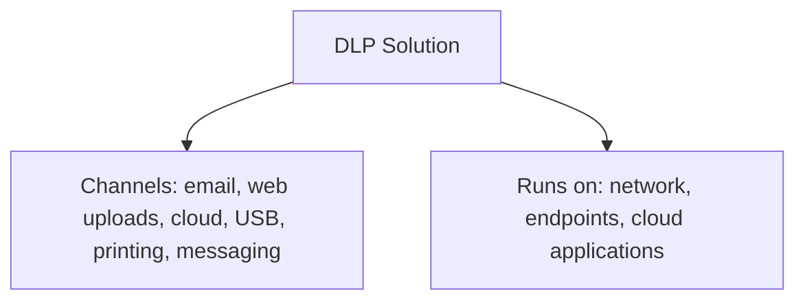
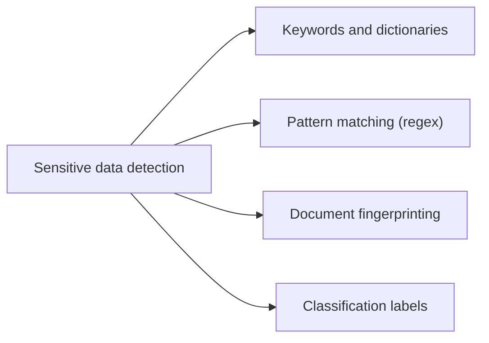
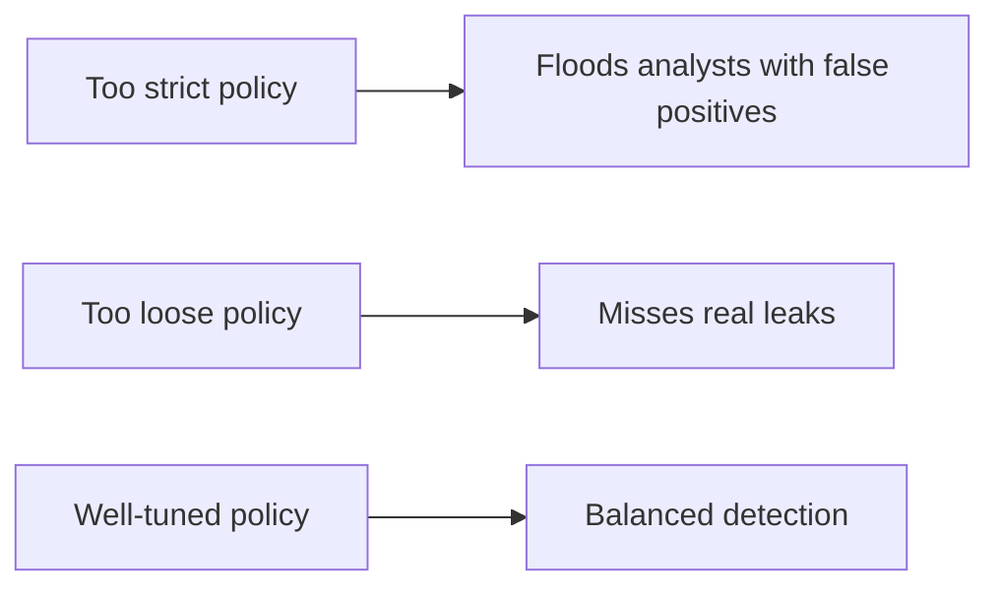
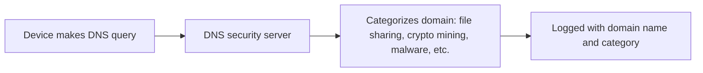
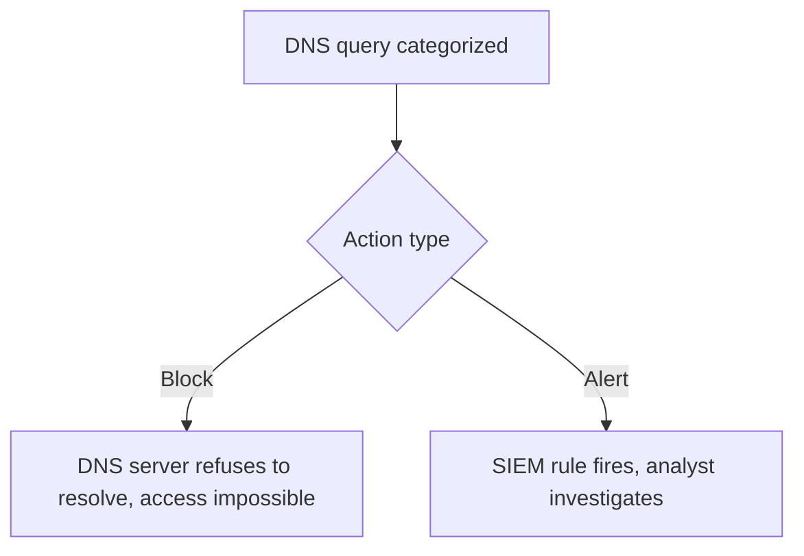
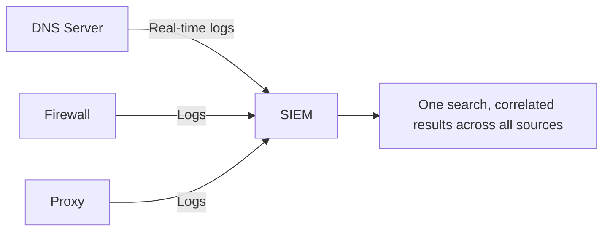
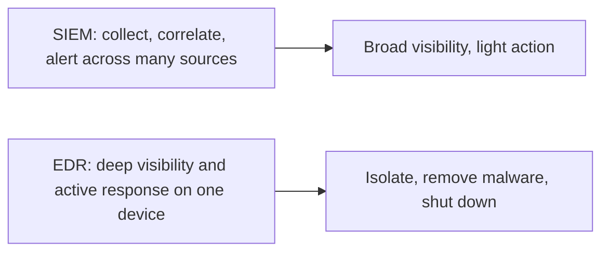
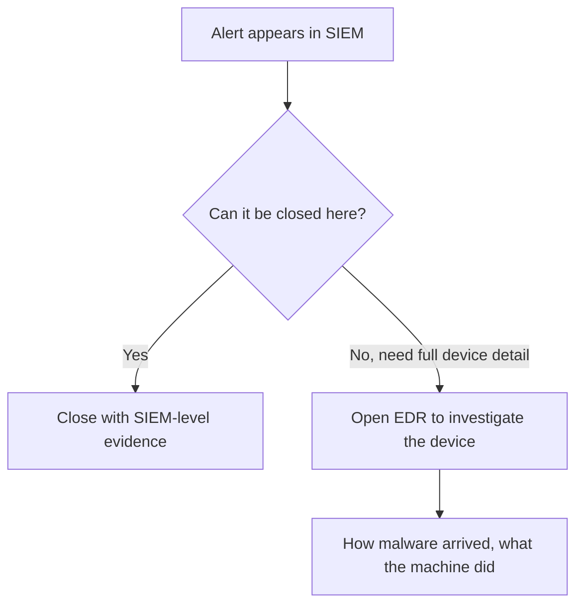

| Topic | Level | Reading Time | Prerequisites |
|---|---|---|---|
| DLP Tools and SIEM Integration | Intermediate | ~20 min | Data Loss Fundamentals and DLP Operations |

> **الهدف من الـ Section ده:**  
> هتفهم إزاي أدوات الـ DLP بتكتشف الداتا الحساسة وبتتصرف معاها، وإزاي أدوات أمان الـ DNS بتصنّف المواقع وبتحجبها أو تنبّهك عنها، وليه مركزية الـ SIEM أهم من البحث المباشر في كل أداة أمنية، وإيه الفرق العملي بين SIEM وEDR.

## Learning Objectives

By the end of this section, you will be able to:

- Explain what a **DLP solution** monitors, where it runs, and how policies decide its actions.
- List the detection methods DLP tools use: **keywords**, **pattern matching**, **document fingerprinting**, and **classification labels**.
- Explain how **DNS security servers** categorize domains, and the trade-offs between blocking a category and alerting on it.
- Explain, with five concrete reasons, why organizations route DNS logs through a **SIEM** instead of searching the DNS server directly.
- Differentiate between **SIEM** and **EDR**, and describe the typical workflow that moves between them.

## Table of Contents

- [Learning Objectives](#learning-objectives)
- [DLP Tools](#dlp-tools)
  - [What a DLP Solution Does](#what-a-dlp-solution-does)
  - [Channels and Where It Runs](#channels-and-where-it-runs)
  - [Policies and SIEM Integration](#policies-and-siem-integration)
- [How DLP Detects Sensitive Data and What It Does](#how-dlp-detects-sensitive-data-and-what-it-does)
  - [Detection Methods](#detection-methods)
  - [Actions It Can Take](#actions-it-can-take)
  - [Tuning Matters](#tuning-matters)
- [DNS Security Servers and Website Categories](#dns-security-servers-and-website-categories)
  - [Every Visit Starts with DNS](#every-visit-starts-with-dns)
  - [How Categorization Works](#how-categorization-works)
  - [Why a Dedicated Appliance](#why-a-dedicated-appliance)
- [Acting on Categories: Blocking and Alerts](#acting-on-categories-blocking-and-alerts)
  - [Two Ways to Use Categories](#two-ways-to-use-categories)
  - [Why Not Just Block Everything](#why-not-just-block-everything)
- [Why Use a SIEM Instead of Searching the DNS Server Directly](#why-use-a-siem-instead-of-searching-the-dns-server-directly)
  - [Five Reasons](#five-reasons)
  - [A Realistic Scenario](#a-realistic-scenario)
- [SIEM Versus EDR](#siem-versus-edr)
  - [What Each One Does](#what-each-one-does)
  - [Typical Workflow](#typical-workflow)
  - [Why Not Send Everything from EDR to the SIEM](#why-not-send-everything-from-edr-to-the-siem)
  - [Sysmon](#sysmon)
- [Career Path Connections](#career-path-connections)
- [Key Terms Glossary](#key-terms-glossary)
- [Summary](#summary)

## DLP Tools

### What a DLP Solution Does

حل **Data Loss Prevention** بيراقب ويكتشف، وممكن **يمنع نقل الداتا الحساسة** بشكل غير مصرح بيه.

### Channels and Where It Runs

| Aspect | Coverage |
|---|---|
| القنوات اللي بيراقبها | الإيميل، رفع الملفات على الويب، خدمات الـ cloud، الوسائط القابلة للإزالة (USB)، الطباعة، والمراسلة |
| أماكن تشغيله | على الشبكة، على الـ endpoints (اللابتوبات)، وفي تطبيقات الـ cloud |

### Policies and SIEM Integration

**الـ policies** هي القواعد اللي بتحدد إيه اللي حساس وإيه الإجراء المناسب. **التصنيف (classification) شرط أساسي**: الـ policies بتعتمد على معرفة إيه اللي حساس أصلاً (شرحناه بالتفصيل في ملف Data Loss Fundamentals and DLP Operations).

**تكامل الـ SIEM**: alerts الـ DLP بتظهر في الـ SIEM بتاعك. الـ logs غالباً محتاجة **parsing**، يعني تحويل الرسائل الخام لصيغة قابلة للقراءة عشان الـ Tier 1 analysts يفهموا إيه اللي أداة الـ DLP بتبلّغ عنه.

> [!NOTE]
> This connects directly to the asset and data classification work covered in the previous file. Without classification, a DLP policy has nothing concrete to check against.

## How DLP Detects Sensitive Data and What It Does

### Detection Methods

| Method | How It Works |
|---|---|
| **Keywords and dictionaries** | كلمات زي "confidential" |
| **Pattern matching (regular expressions)** | بنيات زي أرقام كروت الائتمان أو أرقام الهوية الوطنية |
| **Document fingerprinting** | توقيع فريد (unique signature) لمستند حساس محدد، بحيث حتى **أجزاء منه** بتتعرف عليها الأداة |
| **Classification labels** | ملفات متوسمة مسبقاً زي "Restricted" |

### Actions It Can Take

- Alert فقط.
- Block النقل.
- Quarantine الملف.
- Encrypt الملف.
- يحذّر المستخدم ويطلب **سبب عمل (business reason)**.

### Tuning Matters

**ضبط الدقة (tuning) مهم جداً**. policy **صارمة جداً** بتغرق الـ analysts بـ false positives، وpolicy **فضفاضة جداً** بتفوّت تسريبات حقيقية.

## DNS Security Servers and Website Categories

### Every Visit Starts with DNS

كل زيارة لموقع **بتبدأ بـ DNS query**. سيرفر أمان DNS (زي **Infoblox**) يقدر يشوف **كل domain** كل جهاز في الشركة بيستعلم عنه.

### How Categorization Works

كتير من منتجات أمان الـ DNS بتصنّف الـ domains كمان. كل log يقدر يوضح اسم الـ domain (الـ query) وفئته (category)، مثلاً **file sharing**، **crypto mining**، أو **malware**.

قواعد بيانات الـ category بتُبنى من المزودين (vendors)، غالباً أوتوماتيكياً عن طريق scripts بتفحص المواقع وتطابق أنماط. بعض مزودي الـ firewalls، زي **Fortinet**، معروفين بقواعد بيانات تصنيف قوية جداً.

### Why a Dedicated Appliance

الشركات الكبيرة غالباً بتستخدم **جهاز DNS security مخصص**، منفصل عن الـ firewall، لأن **عدد استعلامات الـ domain كبير جداً** على إن الـ firewall يتعامل معاه بكفاءة.

> [!NOTE]
> This DNS categorization approach is conceptually related to the DNS sinkhole technique covered in the Defense in Depth and Evasion Techniques category, but the goal here is broader: monitoring and classifying all DNS activity, not just blocking a specific known-malicious domain list.

## Acting on Categories: Blocking and Alerts

### Two Ways to Use Categories

| Method | How It Works |
|---|---|
| **Block at the DNS server** | تقول للسيرفر ماتردش على queries لفئة معينة (زي file sharing أو crypto mining). المستخدم مايقدرش يوصل للموقع خالص. ده شبيه بالـ DNS sinkhole |
| **Alert in the SIEM** | تعمل rule بتقول لو DNS log وصل بـ category = file sharing، أطلق alert |

### Why Not Just Block Everything

- **احتياجات العمل**: فرق الأعمال أحياناً محتاجة خدمات file-sharing تشتغل مع شركات تانية. الحجب ممكن يوقف شغل شرعي.
- **التصنيف مش مثالي**: domain ممكن يتصنف غلط، وحجب فئة ممكن يحجب موقع بريء بالغلط. مثلاً لو خدمة cache أو redirect اتوسمت "file sharing"، مواقع بتستخدمها ممكن تتحجب بالغلط.

**الحجب أأمن** للفئات اللي إنت متأكد منها تماماً، زي **crypto mining**. غير كده، ابعت المعلومة للـ SIEM واسيب الـ analysts يتحققوا.

> [!IMPORTANT]
> Always verify: when an alert says a site belongs to a category, confirm the category is really correct before you report a violation. Blocking confidently misclassified categories is how legitimate business workflows get disrupted.

## Why Use a SIEM Instead of Searching the DNS Server Directly

سؤال منطقي: **لو الـ DNS server أصلاً عنده الداتا، ليه نبعتها للـ SIEM؟**

### Five Reasons

| # | Reason | Explanation |
|---|---|---|
| 1 | **Centralization والـ least privilege** | الـ analyst مش المفروض يحتاج accounts على كل جهاز أمني. كل account إضافي هو مسار إضافي يقدر المهاجم يستغله. لو مهاجم سيطر على الـ DNS server، هتكون كارثة |
| 2 | **مصادر متعددة** | المؤسسات غالباً عندها عدة DNS servers وfirewalls وproxies. البحث في كل واحد لوحده بطيء ومعرّض للخطأ. في الـ SIEM، بحث واحد بيرجّع نتايج من الكل |
| 3 | **Correlation والسياق** | لو نفس الـ domain ظهر في DNS وproxy وfirewall logs، تقدر تشوف كل جهاز قاله إيه في مكان واحد. تقدر تعمل pivot: تاخد الـ IP وتدوّر على إيه اللي الجهاز ده عمله قبل وبعد |
| 4 | **Reliability** | الـ SIEM بيحتفظ بالداتا حتى لو الاتصال بالـ DNS server اتقطع |
| 5 | **Real-time integration** | الـ DNS server بيبعت logs للـ SIEM لحظة حدوثها |

> [!IMPORTANT]
> Reason 1 is the one worth remembering most: centralizing access through the SIEM, rather than granting direct accounts on every security appliance, is itself a least-privilege control. This is the same principle covered in Access Control Models, applied specifically to security tooling access.

### A Realistic Scenario

أحياناً المستخدم **مختارش الموقع السيء بنفسه**. موقع حكومي مخترق ممكن **يعمل redirect** للزوار. فلازم تتتبع إيه اللي المستخدم كان بيعمله **قبل** الزيارة، وده بالظبط النوع من الـ pivoting اللي الـ SIEM بيسهّله.

## SIEM Versus EDR

### What Each One Does

| Tool | Role |
|---|---|
| **SIEM** | بيجمع ويربط (correlate) logs من مصادر كتير، وبيطلع alerts. ممكن ياخد بعض الإجراءات الخفيفة، لكن ده مش شغله الأساسي |
| **EDR (Endpoint Detection and Response)** | بيشتغل **على الجهاز نفسه**. يقدر يشوف تفاصيل عميقة، ويقدر **يتصرف**: يعزل الجهاز عن الشبكة، يشيل الـ malware، أو يطفي الجهاز |

### Typical Workflow

### Why Not Send Everything from EDR to the SIEM

الـ EDR ممكن **ينتج عدد هائل من الـ alerts وfalse positives**، وده ممكن **يغرق الـ SIEM**. لذلك بس المعلومات المهمة والمختصرة هي اللي بتتبعت، مش كل تفصيلة.

### Sysmon

أداة ذات صلة: **Sysmon** بيسجّل أحداث تفصيلية على أجهزة Windows. بيدي فرق الـ digital forensics **رؤية دقيقة جداً** لإيه اللي حصل، وده أحد الأسباب اللي فرق الـ forensics محتاجة access مُتحكم فيه ليه بعناية.

> [!TIP]
> A clean way to summarize SIEM vs EDR in an interview: "SIEM answers 'what happened across the organization', EDR answers 'exactly what happened on this one machine, and I can act on it directly'."

## Career Path Connections

| Career Path | How This Topic Applies |
|---|---|
| SOC Analyst | Daily work moves between SIEM triage and EDR deep-dives, exactly as described in the typical workflow above |
| Penetration Tester | Understanding DLP detection methods and DNS categorization helps design evasive techniques during authorized engagements |
| GRC | DLP policy tuning and category-blocking decisions are documented, auditable risk-management choices |
| Cloud Security | Cloud-native SIEM and DLP integrations follow the exact same centralization and correlation principles |

## Key Terms Glossary

| Term | Definition |
|---|---|
| DLP Solution | A tool that monitors, detects, and can block unauthorized transfer of sensitive data |
| Document Fingerprinting | A unique signature of a specific sensitive document, recognized even in partial form |
| DNS Security Server | An appliance that logs and categorizes every DNS query made by devices on the network |
| Category Database | A vendor-maintained classification of domains by type (file sharing, malware, crypto mining, etc.) |
| SIEM | Security Information and Event Management, a tool that centralizes and correlates logs from many sources |
| EDR | Endpoint Detection and Response, a tool that monitors and acts directly on an individual device |
| Pivoting | Using one piece of evidence (such as an IP address) to search related activity across other log sources |
| Sysmon | A Windows logging tool providing detailed, forensic-level visibility into system events |

## Summary

- **DLP tools monitor multiple channels across network, endpoint, and cloud:** email، web uploads، cloud، USB، printing، messaging.
- **Four detection methods power DLP:** keywords، pattern matching، document fingerprinting، وclassification labels.
- **Tuning is critical:** policy صارمة جداً بتغرق الـ analysts، وفضفاضة جداً بتفوّت تسريبات.
- **DNS security servers see and categorize every domain lookup:** بس كل زيارة موقع بتبدأ بـ DNS query.
- **Blocking a category is safest when certainty is high (e.g. crypto mining), alerting is safer otherwise:** عشان تجنب تعطيل شغل شرعي أو حجب مواقع بالغلط.
- **Five reasons justify routing DNS logs through a SIEM:** centralization/least privilege، تعدد المصادر، correlation، reliability، وreal-time integration.
- **SIEM and EDR solve different problems:** SIEM بيجمع ويربط عبر مصادر كتير، EDR بيشوف ويتصرف بعمق على جهاز واحد.
- **The typical workflow moves from SIEM triage to EDR investigation when needed.**

