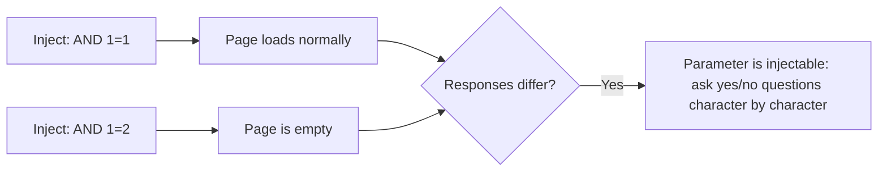
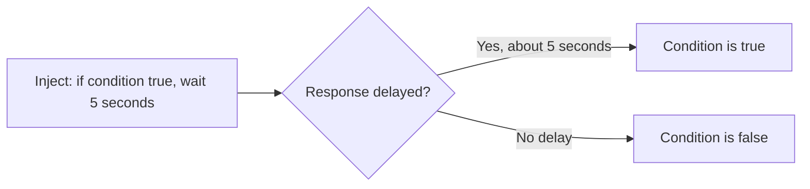
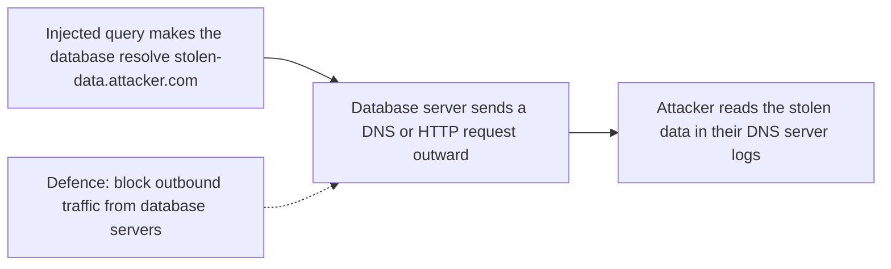
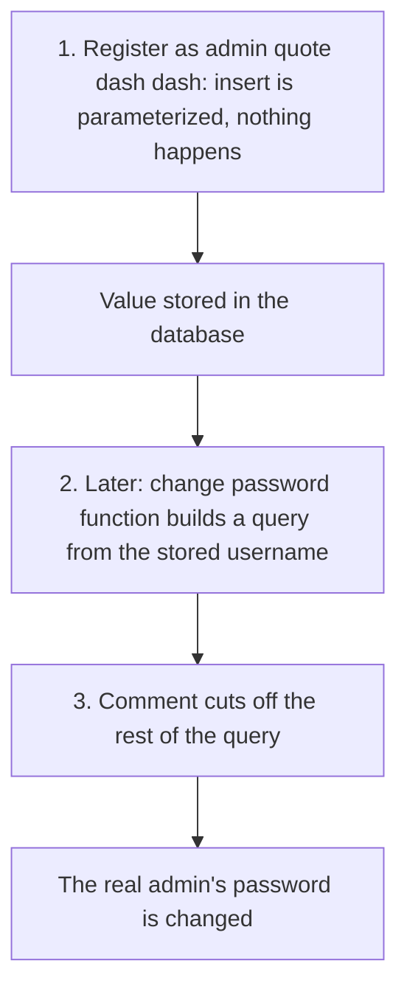
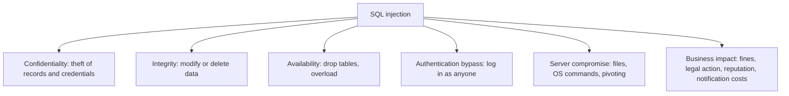
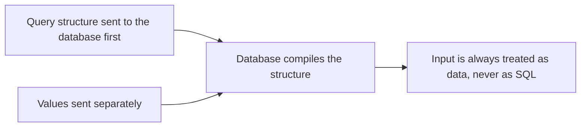
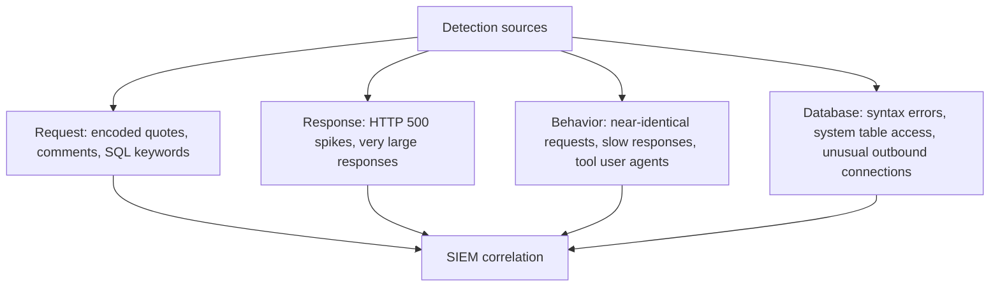

| Topic | Level | Reading Time | Prerequisites |
|---|---|---|---|
| Blind and Advanced SQL Injection with Defences | Intermediate | ~25 min | SQL Injection Basics and In-Band Attacks |

> **الهدف من الـ Section ده:**  
> هتفهم إزاي المهاجم بيسرّب داتا حتى لما التطبيق مابيعرضش أي نتيجة ولا أي خطأ (blind)، وإزاي بيخلي قاعدة البيانات نفسها تبعت الداتا برّه (out-of-band)، وإيه الـ second-order والـ stacked queries، وإيه أثر الهجوم الكامل، وإزاي تدافع بالـ parameterized queries كخط أساسي مع طبقات الدعم، وإيه اللي الـ SOC يدوّر عليه.


## Learning Objectives

By the end of this section, you will be able to:

- Explain **boolean-based blind** SQLi and the SOC clue of many near-identical requests.
- Explain **time-based blind** SQLi, list the delay payload idea per database, and recognize its SOC clue.
- Explain **out-of-band (OOB)** SQLi, its requirement, and the defence of blocking outbound traffic from database servers.
- Explain **second-order (stored)** SQLi and why it is hard to detect.
- Describe **stacked queries**, other injectable inputs and SQL contexts, and the related **NoSQL injection**.
- List the six impact areas of SQL injection.
- Apply the main defences (**parameterized queries**, ORMs, stored procedures) and the six supporting layers.
- Use the SOC cheat sheet to detect SQLi across web, WAF, application, and database logs.

## Table of Contents

- [Learning Objectives](#learning-objectives)
- [Boolean-Based Blind SQL Injection](#boolean-based-blind-sql-injection)
- [Time-Based Blind SQL Injection](#time-based-blind-sql-injection)
- [Out-of-Band (OOB) SQL Injection](#out-of-band-oob-sql-injection)
- [Second-Order (Stored) SQL Injection](#second-order-stored-sql-injection)
- [Stacked Queries and Other Variants](#stacked-queries-and-other-variants)
  - [Stacked (Batched) Queries](#stacked-batched-queries)
  - [Other Variants](#other-variants)
- [Impact of SQL Injection](#impact-of-sql-injection)
- [Preventing SQL Injection](#preventing-sql-injection)
  - [The Main Defences](#the-main-defences)
  - [Supporting Layers](#supporting-layers)
- [Detecting SQL Injection: SOC Cheat Sheet](#detecting-sql-injection-soc-cheat-sheet)
- [Blind Techniques Compared](#blind-techniques-compared)
- [Career Path Connections](#career-path-connections)
- [Key Terms Glossary](#key-terms-glossary)
- [Summary](#summary)

## Boolean-Based Blind SQL Injection

### How It Works

التطبيق **مابيعرضش داتا ولا أخطاء**، لكن **سلوكه بيتغير حسب** هل الشرط المحقون **true أو false**: محتوى مختلف، أو عنصر ناقص، أو redirect.

```text
product.php?id=5 AND 1=1   -> page loads normally
product.php?id=5 AND 1=2   -> page is empty
```

لو الرديّن **مختلفين**، يبقى الـ parameter **قابل للحقن.** المهاجم بعد كده **بيسأل أسئلة yes/no**، مثلاً: **"هل أول حرف من password hash بتاع الـ admin هو a؟"**، وبيبني الإجابة **من طلبات كتيرة.**

**بطيء**، فالمهاجمين **بيأتمتوه** بأدوات زي **sqlmap**.



> [!TIP]
> SOC clue: hundreds of nearly identical requests from one IP address, with a single value changing slightly each time. That is the fingerprint of automated character-by-character extraction, and it is visible even when no single request looks alarming.

## Time-Based Blind SQL Injection

### How It Works

بيتستخدم لما **الصفحة شكلها واحد سواء الشرط true أو false.** المهاجم **بيخلي قاعدة البيانات تستنى لو الشرط true** وبيقيس **وقت الرد.**

**تأخير 5 ثواني = true. من غير تأخير = false.**

بيشتغل **تقريباً في أي مكان**، حتى لو مفيش output ظاهر، لكنه **أبطأ تقنية** ومتأثر بالـ network latency.

### Delay Payloads by Database

| Database | Payload |
|---|---|
| MySQL | `' AND IF(1=1, SLEEP(5), 0)--` |
| SQL Server | `'; WAITFOR DELAY '0:0:5'--` |
| PostgreSQL | `'; SELECT pg_sleep(5)--` |
| Oracle | `' AND 1=DBMS_PIPE.RECEIVE_MESSAGE('a',5)--` |



> [!TIP]
> SOC clue: unusually slow requests, and the words `SLEEP`, `WAITFOR`, `pg_sleep`, or `BENCHMARK` in parameters. The same delay idea was used for blind command injection in OS Command Injection, which is a useful parallel: when output is hidden, attackers turn time itself into the signal.

## Out-of-Band (OOB) SQL Injection

### How It Works

المهاجم **مايقدرش يشوف النتايج في الرد** ومايقدرش يعتمد على التوقيت، فبيخلي **سيرفر قاعدة البيانات نفسه يبعت الداتا لنظام بيتحكم فيه**، غالباً عن طريق **DNS أو HTTP requests.**

فكرة المثال: الـ query تخلي قاعدة البيانات تعمل resolve لـ `stolen-data.attacker.com`. المهاجم **بيقرا الداتا المسروقة من DNS server logs بتاعه.**

| Aspect | Detail |
|---|---|
| **Database features abused** | `xp_dirtree` و`xp_cmdshell` (SQL Server)، `UTL_HTTP` و`UTL_INADDR` (Oracle)، `LOAD_FILE` مع UNC paths (MySQL على Windows) |
| **Requirement** | سيرفر قاعدة البيانات **لازم يكون مسموحله يعمل outbound connections** |
| **Defence** | **احجب الـ outbound traffic من سيرفرات قواعد البيانات** |
| **SOC clue** | **DNS queries أو HTTP connections من database server لـ domains خارجية مجهولة** |



> [!IMPORTANT]
> A database server has almost no legitimate reason to start connections to the internet. Blocking that outbound path closes this whole technique, and monitoring for it gives a high-quality alert. This is the same data-smuggling-through-DNS idea covered in Data Exfiltration and DNS Tunneling, reached through a different door.

## Second-Order (Stored) SQL Injection

### How It Works

الـ input الخبيث **بيتخزن بأمان في المرة الأولى** (مثلاً وقت التسجيل) **وبيعمل ضرر بعدين** لما جزء تاني من التطبيق **يقراه ويستخدمه بشكل غير آمن** في query مختلفة.

| # | Step |
|---|---|
| 1 | المهاجم بيسجّل باسم مستخدم `admin'--`. الـ insert **متعمل له parameterization صح**، فمفيش حاجة بتحصل |
| 2 | بعدين، دالة change password بتبني query من الـ username المخزّن: `UPDATE users SET password='newpass' WHERE username='admin'--'` |
| 3 | الـ comment **بيقطع باقي الـ query**، فالمهاجم **بيغيّر password الـ admin الحقيقي** |

**ليه صعب يتكتشف:** **نقطة الحقن ونقطة التنفيذ في أماكن مختلفة.**



> [!WARNING]
> The defence is to treat data from your own database as untrusted too, and to use parameterized queries everywhere, not only on user-facing forms. A secure insert does not make the stored value safe; it only moves the danger to whichever code reads it next.

## Stacked Queries and Other Variants

### Stacked (Batched) Queries

المهاجم **بيخلص الـ statement الأصلي بـ semicolon** وبيضيف **واحد جديد تماماً**:

```sql
'; DROP TABLE users;--
'; INSERT INTO users(username,role) VALUES('hacker','admin');--
```

الدعم **بيعتمد على قاعدة البيانات والـ driver**: شائع على **SQL Server وPostgreSQL**، و**غالباً محجوب في MySQL مع PHP.** بيسمح بالإدخال والتعديل والحذف، وأحياناً **أوامر نظام التشغيل** (`xp_cmdshell`).

### Other Variants

| Variant | Detail |
|---|---|
| **Other inputs** | cookies وHTTP headers (User-Agent وX-Forwarded-For وReferer) وحقول JSON/XML في الـ APIs |
| **Other SQL contexts** | `WHERE` و`ORDER BY` و`INSERT` و`UPDATE` و`LIMIT` بتتصرف بشكل مختلف، والـ **numeric parameters مش محتاجة quote خالص** |
| **NoSQL injection** (ذات صلة) | نفس الفكرة ضد MongoDB وقواعد مشابهة، باستخدام operators زي `{"$ne": null}` |

> [!NOTE]
> The header list matters for detection: X-Forwarded-For and User-Agent are logged constantly, so an injection in a header is stored in the logs themselves. This is the same attacker-controlled-header point from Input Attacks Fundamentals and Core Log Types and Web Server Logs.

## Impact of SQL Injection

| Area | Impact |
|---|---|
| **Confidentiality** | سرقة سجلات العملاء والـ credentials وأرقام كروت الائتمان والداتا الشخصية |
| **Integrity** | تعديل أو حذف داتا، زي تغيير أرصدة أو درجات أو أسعار |
| **Availability** | حذف جداول أو إغراق قاعدة البيانات |
| **Authentication bypass** | تسجيل الدخول كأي مستخدم، بما فيهم الـ admins |
| **Server compromise** | قراءة أو كتابة ملفات وتنفيذ أوامر OS (`xp_cmdshell`)، وبعدين pivoting في الشبكة |
| **Business impact** | غرامات تنظيمية، وإجراءات قانونية، وضرر سمعي، وتكاليف الإخطار بالاختراق |

**الـ SQL injection كان ورا اختراقات كبيرة كتير ولسه من أكتر أسباب سرقة الداتا شيوعاً.**



## Preventing SQL Injection

### The Main Defences

| # | Defence | Detail |
|---|---|---|
| 1 | **Parameterized queries (prepared statements)** | **الدفاع الأساسي.** بنية الـ query بتتبعت لقاعدة البيانات الأول، والقيم **بتتبعت منفصلة**، فالمدخل **دايماً بيتعامل كداتا، مش SQL** |
| 2 | **ORMs وquery builders** | SQLAlchemy وHibernate وEntity Framework **بتستخدم parameters افتراضياً.** **تجنب string concatenation الخام جواهم** |
| 3 | **Stored procedures** | **آمنة بس لو بتستخدم parameters جواها.** procedure بتلزق strings **لسه معرضة** |

```python
cursor.execute(
    "SELECT * FROM users WHERE name = %s",
    (username,))
```

الـ payload زي `admin'--` دلوقتي **مجرد string عادية بيدوّر عليها.**



### Supporting Layers

| # | Layer | Detail |
|---|---|---|
| 4 | **Allowlist validation** | لأي حاجة **مابتتعملهاش parameterization**، زي أسماء الجداول والأعمدة واتجاه `ORDER BY` |
| 5 | **Least privilege** | حساب قاعدة البيانات **ماينفعش يكون `sa` أو `root`**، ومايقدرش يحذف جداول أو يشغّل أوامر OS |
| 6 | **Hide errors** | رسايل عامة للمستخدمين، والأخطاء المفصلة في logs للـ admins |
| 7 | **WAF and monitoring** | **طبقات إضافية، مش بديل** عن إصلاح الكود |
| 8 | **Hash passwords** | **bcrypt أو Argon2**، فالتسريب مايكشفش passwords صريحة |
| 9 | **Test regularly** | code review وSAST وDAST، واختبارات اختراق مصرح بيها |

> [!IMPORTANT]
> Parameterization cannot protect parts of a query that are not values, such as table names, column names, and ORDER BY direction. For those, the only safe approach is an allowlist of known-good names, which is the same allowlist-over-blocklist rule from Input Attacks Fundamentals.

> [!NOTE]
> Items 7 and 8 connect to earlier files: the WAF file explains why a WAF is a mitigation and not a fix, and Password Hashing, Salting, and Peppering explains why bcrypt or Argon2 decides whether a leaked hash is useful. Least privilege connects to Access Control Models.

## Detecting SQL Injection: SOC Cheat Sheet

| Source | What to Look For |
|---|---|
| **Web server, WAF, and application logs: characters** | علامات خاصة وأشكالها المشفرة في الـ URL: `'` (`%27`) و`--` و`;` و`/*` و`#` |
| **Keywords** | `UNION SELECT` و`OR 1=1` و`ORDER BY` و`information_schema` و`SLEEP(` و`WAITFOR DELAY` و`pg_sleep` و`xp_cmdshell` و`CONVERT(` و`CAST(` |
| **Responses** | **ارتفاعات في HTTP 500** (الـ query اتكسرت) أو **ردود كبيرة جداً** (الداتا اتفرّغت) |
| **Behavior: blind extraction** | **طلبات كتيرة شبه متطابقة من IP واحد، وقيمة واحدة بتتغير** |
| **Behavior: time-based** | أوقات رد غير معتادة |
| **Tools** | User-Agent strings لأدوات آلية زي `sqlmap` |
| **Database logs** | syntax errors، ووصول لجداول النظام، واتصالات outbound غير معتادة من سيرفر قاعدة البيانات |



> [!TIP]
> A single signal is weak and a combination is strong. A `%27` in a URL is only an attempt. The same request followed by an HTTP 200 with an unusually large response, or by an outbound DNS query from the database server, is evidence the injection worked. This is the same attempt-versus-success reasoning used in Core Log Types and Web Server Logs.

## Blind Techniques Compared

| Technique | Signal Used | Speed | Main SOC Clue |
|---|---|---|---|
| **Boolean-based** | Page content or behavior differs | بطيء، بيتأتمت | طلبات كتيرة شبه متطابقة، قيمة واحدة بتتغير |
| **Time-based** | Response delay | الأبطأ، وبيتأثر بالـ latency | بطء غير معتاد، وكلمات `SLEEP` و`WAITFOR` و`pg_sleep` |
| **Out-of-band** | DNS or HTTP request to attacker | أسرع لما يكون متاح | اتصالات outbound من الـ database server |

## Career Path Connections

| Career Path | How This Topic Applies |
|---|---|
| SOC Analyst | Uses the cheat sheet to detect blind extraction, time-based probing, and outbound database connections across log sources |
| Penetration Tester | Chooses the technique based on what the application reveals, and reports the real impact with evidence |
| GRC | Verifies that parameterized queries, least-privilege database accounts, and regular testing are enforced as controls |
| Cloud Security | Restricts egress from managed database instances and applies least-privilege database roles in cloud environments |

## Key Terms Glossary

| Term | Definition |
|---|---|
| Blind SQLi | SQLi where the application shows no data or errors, and results are inferred indirectly |
| Boolean-Based Blind | Inferring data from different page behavior for true and false conditions |
| Time-Based Blind | Inferring data from a deliberate delay in the response |
| Out-of-Band SQLi | Making the database server send data to an attacker-controlled system via DNS or HTTP |
| Second-Order SQLi | A payload stored safely first and triggered later when read unsafely elsewhere |
| Stacked Queries | Ending a statement with a semicolon and adding a completely new statement |
| NoSQL Injection | Injection against non-relational databases using their own operators |
| Parameterized Query | A query where structure and values are sent separately so input is always data |
| ORM | Object-Relational Mapper, a library that builds queries with parameters by default |
| SAST / DAST | Static and dynamic application security testing |
| `sqlmap` | An automated SQL injection tool whose user agent is a common detection signal |

## Summary

- **Boolean-based blind SQLi asks yes/no questions through page behavior:** والـ SOC clue هو طلبات كتيرة شبه متطابقة.
- **Time-based blind SQLi uses a deliberate delay as the answer:** الأبطأ، لكنه بيشتغل تقريباً في أي مكان.
- **Out-of-band SQLi makes the database send data outward:** والدفاع حجب الـ outbound من سيرفرات قواعد البيانات.
- **Second-order SQLi stores the payload first and triggers it later:** والدفاع معاملة داتا قاعدة بياناتك كغير موثوقة كمان.
- **Stacked queries add whole new statements:** وده بيعتمد على قاعدة البيانات والـ driver، والـ NoSQL injection نفس الفكرة بأدوات تانية.
- **Impact spans six areas:** confidentiality وintegrity وavailability وauthentication bypass وserver compromise وbusiness impact.
- **Parameterized queries are the primary defence:** ORMs وstored procedures آمنين بس لو بيستخدموا parameters.
- **Six supporting layers complete the defence:** allowlist وleast privilege وإخفاء الأخطاء وWAF وhashing وtesting.
- **SOC detection combines request, response, behavior, and database signals.**

