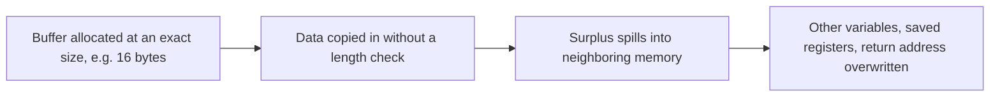
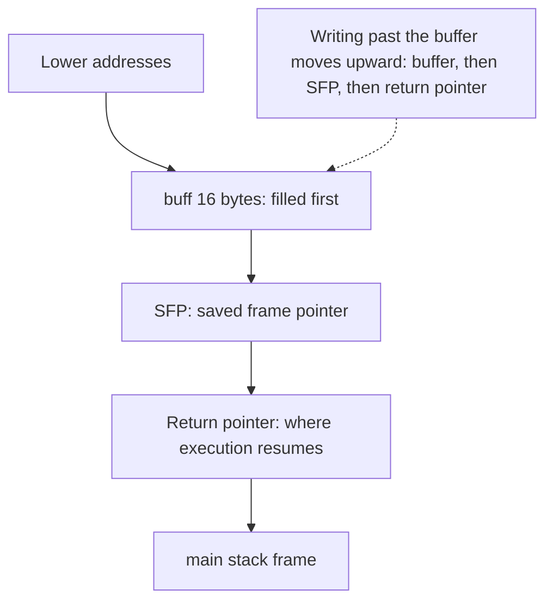
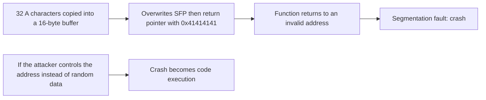
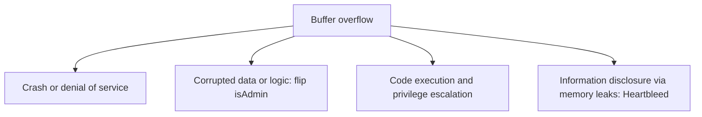
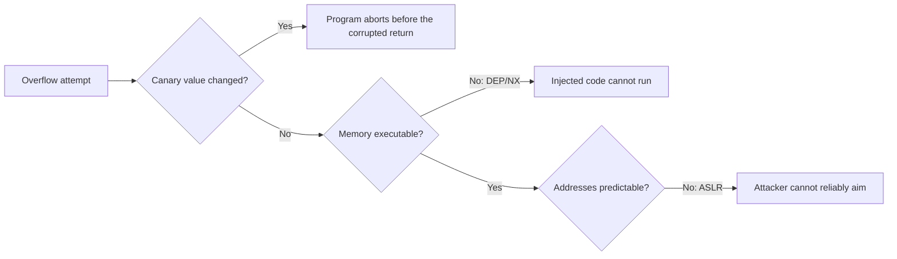

| Topic | Level | Reading Time | Prerequisites |
|---|---|---|---|
| Buffer Overflow | Intermediate | ~20 min | Input Attacks Fundamentals |

> **الهدف من الـ Section ده:**  
> هتفهم إيه اللي بيحصل لما برنامج يكتب داتا أكتر من المساحة اللي حجزها في الذاكرة، وإزاي الـ stack frame بيتكوّن وليه الـ return pointer هو الهدف، وإيه أنواع الـ buffer overflow ونتايجها، وإيه الدفاعات (من اللغات الآمنة لحد stack canaries وASLR) وإيه اللي الـ SOC يلاحظه.


## Learning Objectives

By the end of this section, you will be able to:

- Define a **buffer overflow** and explain how unchecked copying lets surplus data overwrite adjacent memory.
- Name the **unsafe C/C++ functions** that commonly cause it.
- Describe a **stack frame** and why an overflow reaches the **saved frame pointer** and **return pointer**.
- Follow the four-step overflow example and explain why a crash can become code execution.
- List the types of overflow and their consequences, including **Heartbleed** as an over-read.
- Explain the defences: bounded functions, memory-safe languages, **stack canaries**, **DEP/NX**, and **ASLR**.
- List the SOC signals that suggest overflow attempts.

## Table of Contents

- [Learning Objectives](#learning-objectives)
- [What Is a Buffer Overflow](#what-is-a-buffer-overflow)
  - [Definition](#definition)
  - [Why It Is an Input Problem](#why-it-is-an-input-problem)
  - [Typical Cause](#typical-cause)
- [The Stack: Where the Danger Lives](#the-stack-where-the-danger-lives)
  - [A Stack Frame](#a-stack-frame)
  - [Vulnerable Code](#vulnerable-code)
- [The Overflow, Step by Step](#the-overflow-step-by-step)
- [Types and Consequences](#types-and-consequences)
  - [Types](#types)
  - [Consequences](#consequences)
- [Defending Against Buffer Overflows](#defending-against-buffer-overflows)
  - [Prevention](#prevention)
  - [SOC Detection](#soc-detection)
- [Career Path Connections](#career-path-connections)
- [Key Terms Glossary](#key-terms-glossary)
- [Summary](#summary)

## What Is a Buffer Overflow

### Definition

الـ **buffer overflow** هي ثغرة بتحصل لما برنامج **يكتب داتا في memory buffer أكتر من اللي يتسع**، فالداتا الزيادة **بتكتب فوق الذاكرة المجاورة.**

### Why It Is an Input Problem

الـ validation الضعيف **مش بس بيسمح للمهاجم ينفذ أوامر**، ده كمان **ممكن يعمل crash للنظام أو denial of service.** string مكتوبة في حقل "age" ممكن **تعمل crash لتطبيق مابيعملش validate.**

لما buffer بيتحجز، البرنامج بيقول للنظام محتاج كام byte، والـ buffer بيتعمل **بالحجم ده بالظبط.** لو الداتا اتنسخت من غير فحص الحجم، **الزيادة بتتسرب للذاكرة المجاورة**: متغيرات تانية، وsaved registers، وـ **return address.**

تشبيه: كوباية بتسع 200 مل، وإنت بتصب فيها لتر من غير ما تبص. الزيادة مابتختفيش، بتنزل على الترابيزة وعلى الورق اللي جنبها.

### Typical Cause

دوال C/C++ غير آمنة زي **`strcpy` و`gets` و`sprintf`**، **بتنسخ من غير ما تفحص الطول.**



## The Stack: Where the Danger Lives

### A Stack Frame

| Element | Role |
|---|---|
| `buff[16]` | الـ buffer ذو الـ 16 byte |
| **SFP** | Saved frame pointer |
| **Return pointer** | **المكان اللي التنفيذ هيكمّل منه** |
| `main()`'s stack frame | الـ frame بتاع الدالة المستدعية |

الداتا المكتوبة في الـ buffer **بتتملي ناحية العناوين الأعلى**، فالـ overflow بيجري في **الـ SFP وبعدين الـ return pointer.**

### Vulnerable Code

```c
int overflow(char* input1) {
    char buff[16];
    strcpy(buff, input1);
    return 0;
}

int main(int argc, char* argv[]) {
    overflow(argv[1]);
}
```

الـ `strcpy` **بينسخ لحد نهاية الـ input**، من غير أي فحص للطول مقابل الـ buffer ذو الـ 16 byte.



> [!NOTE]
> The stack frame order matters because of direction: the buffer sits below the saved frame pointer and the return pointer, and writes move upward. An overflow therefore does not randomly corrupt memory, it walks straight into the two values that control where the function returns.

## The Overflow, Step by Step

| # | Input | What Happens |
|---|---|---|
| 1 | **Normal input** | string قصيرة بتتسع في الـ 16 byte، والبرنامج شغال |
| 2 | **Input بيملا الـ buffer** | الـ 16 byte كلها مستخدمة ومفيش حاجة وراها اتكتب فوقها |
| 3 | **Oversized input** (32 × `A`) | `strcpy` بيكمّل نسخ بعد الـ 16 byte: الـ A's الزيادة **بتكتب فوق الـ SFP وبعدين الـ return pointer** |
| 4 | **الدالة بترجع** | الـ return pointer دلوقتي فيه `0x41414141` (ASCII لـ "AAAA")، فالـ CPU **بيقفز لعنوان غير صالح**: **segmentation fault** |

**ليه ده مهم:** لو المهاجم **زوّد عنوان بيتحكم فيه** بدل داتا عشوائية، **الـ crash بيتحول لـ code execution.**



> [!WARNING]
> The lecture's small numeric example is illustrative. In practice the input must exceed the buffer plus the saved frame pointer to reach the return pointer, and the exact distance depends on the architecture and compiler. The point to remember is the principle: oversized input can reach the return pointer, and control of that value is control of execution.

## Types and Consequences

### Types

| Type | Description |
|---|---|
| **Stack-based** | بيكتب فوق الـ stack (return address، saved registers). **النوع الكلاسيكي** المشروح في المحاضرة |
| **Heap-based** | بيكتب فوق الذاكرة المحجوزة ديناميكياً (`malloc`, `new`)، زي objects مجاورة أو heap metadata |
| **Integer overflow** | حساب الحجم **بيلف (wraps around)**، فبيتحجز buffer أصغر من اللازم وبعدين بيتملي زيادة |
| **Off-by-one error** | كتابة **byte واحد بس** بعد نهاية الـ buffer |
| **Format string flaws** (ذات صلة) | مدخل المستخدم بيتستخدم كـ `printf` format string، وده بيسمح بقراءة أو كتابة الذاكرة |

### Consequences

| Consequence | Example |
|---|---|
| **Crash أو denial of service** | البرنامج بيقع |
| **Corrupted data أو logic** | قلب متغير زي `isAdmin` |
| **Arbitrary code execution وprivilege escalation** | shellcode، return-to-libc، ROP |
| **Information disclosure** | تسريب من الذاكرة، زي **Heartbleed** (over-read) |



> [!IMPORTANT]
> Heartbleed shows that the same bug family does not only write: an over-read returns more memory than it should, leaking secrets without any code being run. Both directions are "the program trusted a length it never checked".

## Defending Against Buffer Overflows

### Prevention

| Defence | How It Helps |
|---|---|
| **Secure coding** | فحص طول المدخل. استخدم دوال بتحدد الطول (`fgets`, `snprintf`, `strncpy` بحذر) و**ماتستخدمش `gets` ولا `strcpy` من غير فحص** |
| **Memory-safe languages** | **Rust وGo وJava وPython وC#** بتفحص الحدود أوتوماتيك |
| **Stack canaries** | قيمة عشوائية قبل الـ return address؛ **لو اتغيرت، البرنامج بيوقف نفسه** |
| **DEP / NX bit** | بيعلّم الـ stack والـ heap كذاكرة **غير قابلة للتنفيذ** |
| **ASLR** | بيعشّوي تخطيط الذاكرة فالعناوين **صعب تتوقع** |
| **Testing and patching** | fuzzing، وstatic analysis (SAST)، وAddressSanitizer، وتحديث الـ libraries |



> [!TIP]
> Each defence breaks a different step of an exploit: canaries catch the overwrite, DEP/NX stops injected code from running, and ASLR makes the target address unpredictable. This is defense in depth inside a single process, and it is why a bare overflow rarely gives an attacker code execution on a modern, well-built system.

### SOC Detection

| Signal | What It Suggests |
|---|---|
| **Service crashes متكررة** وسجلات **segmentation fault** | محاولات overflow فاشلة |
| **EDR alerts** على child processes غير طبيعية | استغلال ناجح |
| **سلاسل طويلة من حروف مكررة** (`AAAA…`) أو **NOP sleds** في الـ requests | payload بيحاول يوصل للـ return pointer |

> [!NOTE]
> Unlike the injection attacks in this category, a buffer overflow is not specific to web applications: it affects any program written in an unsafe language, including network services, drivers, and desktop software. The web is only one place the oversized input can arrive from, which is why this topic sits in Input Attacks and Injection rather than a web-only category.

## Career Path Connections

| Career Path | How This Topic Applies |
|---|---|
| SOC Analyst | Correlates repeated service crashes and EDR child-process alerts with suspicious oversized requests |
| Penetration Tester | Uses fuzzing to find crashes in services, then analyzes whether control of the return pointer is achievable |
| GRC | Memory-safety and secure-coding requirements appear in software assurance and vendor risk assessments |
| Cloud Security | Native-code components, containers, and agents carry the same risk, and patching base images is the defence |

## Key Terms Glossary

| Term | Definition |
|---|---|
| Buffer Overflow | Writing more data into a memory buffer than it can hold, overwriting adjacent memory |
| Stack Frame | The memory region holding a function's local variables, saved registers, and return address |
| SFP | Saved Frame Pointer, stored in the stack frame |
| Return Pointer | The saved address where execution resumes after a function returns |
| Segmentation Fault | A crash caused by accessing invalid memory |
| Stack Canary | A random value placed before the return address and checked before returning |
| DEP / NX | Data Execution Prevention, marking memory regions as non-executable |
| ASLR | Address Space Layout Randomization, randomizing memory layout |
| NOP Sled | A long run of no-operation instructions used to make a jump target easier to hit |
| Over-Read | Reading beyond a buffer's bounds, leaking memory contents |
| Heartbleed | A well-known over-read vulnerability that leaked memory from affected servers |

## Summary

- **A buffer overflow writes more data than a buffer holds:** والزيادة بتكتب فوق الذاكرة المجاورة.
- **Unsafe C/C++ functions are the typical cause:** `strcpy` و`gets` و`sprintf` من غير فحص طول.
- **The stack layout makes the return pointer reachable:** buffer ثم SFP ثم return pointer، والكتابة بتتحرك لفوق.
- **A crash can become code execution:** لو المهاجم تحكم في العنوان اللي بيتكتب في الـ return pointer.
- **Five related types exist:** stack-based وheap-based وinteger overflow وoff-by-one وformat string.
- **Consequences range from a crash to code execution and data leaks:** Heartbleed مثال على الـ over-read.
- **Defences stack up:** دوال محددة الطول، لغات آمنة، canaries، DEP/NX، ASLR، وtesting.
- **SOC signals are crashes, EDR child-process alerts, and repeated-character or NOP-sled payloads.**

