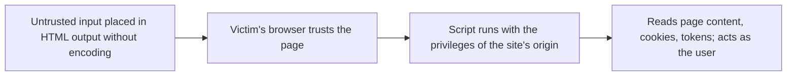
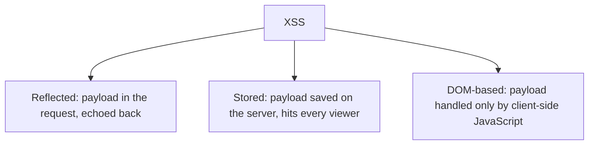
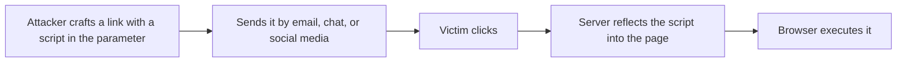
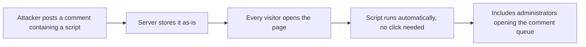
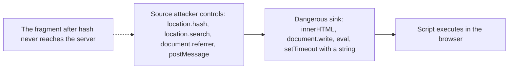
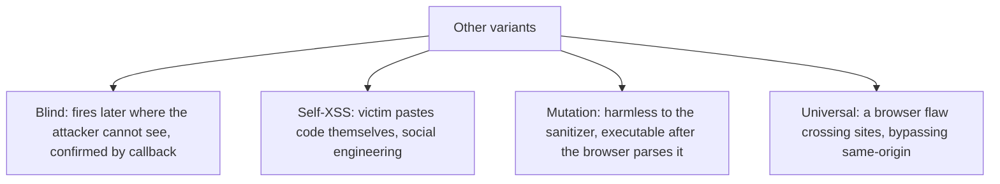
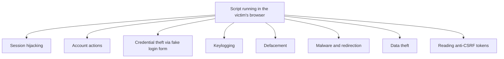
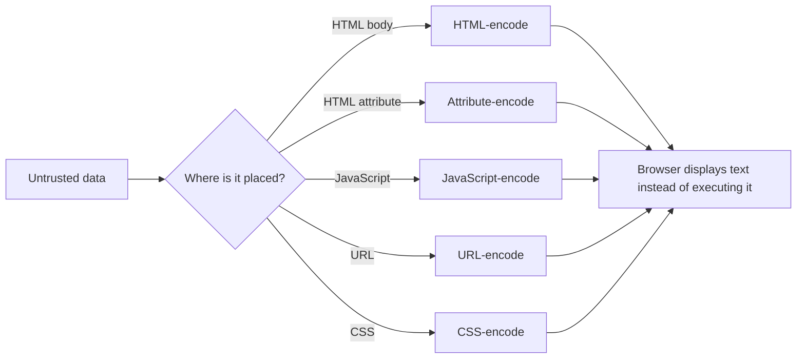
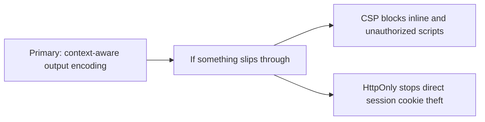

| Topic | Level | Reading Time | Prerequisites |
|---|---|---|---|
| Cross-Site Scripting (XSS) | Intermediate | ~25 min | Input Attacks Fundamentals |

> **الهدف من الـ Section ده:**  
> هتفهم إزاي الـ XSS بيهاجم مستخدمي التطبيق مش السيرفر، وإيه الفرق بين الأنواع التلاتة الأساسية (reflected وstored وDOM-based) والأنواع الخاصة، وإيه اللي المهاجم يقدر يعمله بسكربت شغال في متصفح الضحية، وإزاي الـ output encoding هو الدفاع الأساسي، وإزاي الـ CSP والـ HttpOnly بيحدّوا الضرر لو حاجة فلتت.


## Learning Objectives

By the end of this section, you will be able to:

- Define **XSS**, state its root cause, and contrast it with SQL injection.
- Compare **reflected**, **stored**, and **DOM-based** XSS by payload location, who is affected, and persistence.
- Explain why **stored XSS** is usually the most dangerous and why DOM-based XSS can bypass server-side filters.
- Describe the special variants: **blind XSS**, **self-XSS**, **mutation XSS**, and **universal XSS**.
- List what an attacker can do with XSS.
- Apply the defences: **context-aware output encoding**, auto-escaping frameworks, sanitization, **HttpOnly cookies**, safe DOM APIs, and **Content Security Policy**.
- Recognize SOC clues for reflected XSS in request URLs.

## Table of Contents

- [Learning Objectives](#learning-objectives)
- [What Is XSS](#what-is-xss)
  - [Definition and Root Cause](#definition-and-root-cause)
  - [SQLi Versus XSS](#sqli-versus-xss)
  - [Proof of Concept](#proof-of-concept)
- [Types of XSS: Overview](#types-of-xss-overview)
- [Reflected XSS](#reflected-xss)
- [Stored (Persistent) XSS](#stored-persistent-xss)
- [DOM-Based XSS](#dom-based-xss)
- [Other XSS Variants](#other-xss-variants)
- [What Can an Attacker Do with XSS](#what-can-an-attacker-do-with-xss)
- [Preventing XSS](#preventing-xss)
  - [Encode the Output](#encode-the-output)
  - [Validate, Sanitize, and Limit Access](#validate-sanitize-and-limit-access)
  - [Content Security Policy](#content-security-policy)
- [Career Path Connections](#career-path-connections)
- [Key Terms Glossary](#key-terms-glossary)
- [Summary](#summary)

## What Is XSS

### Definition and Root Cause

الـ **Cross-Site Scripting (XSS)** هي ثغرة فيها المهاجم **بيحقن client-side script خبيث** (غالباً JavaScript) في صفحة ويب **المستخدمين التانيين بيشوفوها.**

**متصفح الضحية بيثق في الصفحة**، فبيشغّل الـ script **بصلاحيات الـ origin بتاع الموقع ده.** الـ script يقدر **يقرا محتوى الصفحة والـ cookies والـ tokens**، ويتصرف **نيابة عن المستخدم.**

**السبب الجذري:** التطبيق **بيحط مدخل غير موثوق في HTML output من غير ما يعمله encoding** لسياقه.

### SQLi Versus XSS

| Attack | Target |
|---|---|
| **SQLi** | **قاعدة بيانات السيرفر** |
| **XSS** | **مستخدمي التطبيق** |

### Proof of Concept

```html
<script>alert(1)</script>
```

**لو الـ popup ظهر، يبقى كود المهاجم بيشتغل.**



> [!NOTE]
> This is the same data-versus-instructions root cause as every other attack in this category, but with a different victim. In SQL injection the input becomes part of a query run by the database; in XSS it becomes part of a page run by the browser. The output-encoding defence below is the XSS version of the parameterized query.

## Types of XSS: Overview

| Type | Where the Payload Lives | Who Is Affected | Persistence |
|---|---|---|---|
| **Reflected** | في الـ request (URL أو form)، والسيرفر بيرجّعه في الرد | الضحية اللي بتدوس على اللينك المصنوع | Non-persistent |
| **Stored** | **محفوظ على السيرفر**، زي قاعدة البيانات | **كل مستخدم بيشوف الصفحة** | Persistent |
| **DOM-based** | بيتعالج بـ **client-side JavaScript بس** | الضحية اللي بتفتح اللينك المصنوع | Non-persistent؛ **الـ URL fragment مابيوصلش للسيرفر** |

الأنواع الخاصة (Blind وSelf وMutation وUniversal) بتتشرح بعد الأنواع التلاتة.



## Reflected XSS

### How It Works

التطبيق **بياخد مدخل من الـ request وبيحطه في الرد فوراً من غير encoding.** صفحة بحث زي `shop.example/search?q=shoes` بتعرض "Results for: shoes".

المهاجم **بيصنع لينك الـ parameter فيه script** وبيبعته بالإيميل أو الشات أو السوشيال ميديا. لما الضحية تدوس عليه، **السيرفر بيعكس الـ script في الصفحة والمتصفح بينفذه.**

```text
https://shop.example/search?q=<script>/* attacker code */</script>
```

### Needs Social Engineering

**الضحية لازم تدوس على اللينك.** المهاجمين **بيخبّوا الـ payload** بـ URL shorteners أو encoding. الأماكن المعتادة: search boxes ورسايل الأخطاء وlogin redirects.

### SOC Clue

دوّر على `<script` و`%3Cscript` و`onerror=` و`javascript:` **جوه الـ request URLs.**



> [!TIP]
> The SOC clue is simple but effective: the encoded form `%3Cscript` is the same attack as `<script`, so a rule that only matches the raw angle bracket misses most real requests. This mirrors the encoded-quote point in the SQL injection files.

## Stored (Persistent) XSS

### How It Works

الـ script الخبيث **بيتحفظ على السيرفر** (في قاعدة بيانات أو log أو ملف) **وبيتسلم لكل مستخدم بيشوف المحتوى المتأثر.**

**أماكن معتادة:** التعليقات وposts المنتديات وreviews المنتجات وبروفايلات المستخدمين وأسماء العرض وتذاكر الدعم ورسايل الشات.

**مثال:** المهاجم بينشر تعليق فيه script. الموقع بيحفظه كما هو. **كل زائر بيفتح الصفحة بيشغّل الـ script أوتوماتيك، من غير أي click.**

### The Most Dangerous Type

**بيوصل لضحايا كتير**، بما فيهم **الـ administrators اللي بيفتحوا قايمة التعليقات**، وممكن يتحول لـ **worm.**

### Defence Emphasis

**اعمل encode على الـ output في كل مرة الداتا المخزنة بتتعرض**: ممكن تكون اتخزنت من زمان أو جت من نظام تاني.



> [!IMPORTANT]
> Stored XSS is dangerous precisely because of who it reaches. A reflected attack needs one victim to click one link; a stored attack waits on a page and fires for everyone, including the highest-privileged user who reviews content. This is also why the output-encoding rule applies to data read back from your own database, the same lesson as second-order SQL injection.

## DOM-Based XSS

### How It Happens

العيب في **JavaScript الـ client-side، مش في رد السيرفر.** **السيرفر ممكن مايشوفش الـ payload أبداً.**

الداتا بتجري من **source بيتحكم فيه المهاجم** (`location.hash` و`location.search` و`document.referrer` و`postMessage`) لـ **dangerous sink** (`innerHTML` و`document.write` و`eval` و`setTimeout` مع string).

```javascript
el.innerHTML = location.hash.substring(1);
```

### Attack and Fix

```text
https://example.com/page#
```

**الجزء اللي بعد `#` مابيتبعتش للسيرفر أبداً**، فـ **فلاتر الـ server-side وكتير من الـ WAFs مايقدروش يشوفوه.**

| Fix | Detail |
|---|---|
| استخدم `textContent` بدل `innerHTML` | بيعامل النص كنص |
| تجنب `eval` | |
| نضّف بمكتبة زي **DOMPurify** | لما HTML لازم يتحط |



> [!WARNING]
> DOM-based XSS is the case where server-side defences are structurally blind. A WAF inspects requests that arrive at the server, but the fragment after `#` is never sent, so the payload never appears in any server or WAF log. The fix has to be in the client-side code itself, which is a limit of the WAF noted in the WAF file.

## Other XSS Variants

| Variant | Description |
|---|---|
| **Blind XSS** | stored XSS **الـ payload بتاعه بيشتغل بعدين، في مكان المهاجم مايقدرش يشوفه**، زي admin dashboard أو log viewer. **callback لسيرفر المهاجم بيأكد التنفيذ** |
| **Self-XSS** | الضحية **بتتخدع تلزق كود خبيث في الـ console بتاع متصفحها** أو في form. **هندسة اجتماعية صرفة**، والمتصفحات بتعرض تحذيرات عنه |
| **Mutation XSS (mXSS)** | payload **شكله بريء للـ sanitizer** لكن **الـ HTML parser بتاع المتصفح بيغيّره (mutate) لكود قابل للتنفيذ**، فبيتخطى الفلتر |
| **Universal XSS (UXSS)** | عيب **في المتصفح نفسه** بيسمح لسكربتات تشتغل **عبر مواقع مختلفة**، متخطياً حماية same-origin |



## What Can an Attacker Do with XSS

| Goal | What Happens |
|---|---|
| **Session hijacking** | سرقة session cookies (إلا لو `HttpOnly`) وانتحال المستخدم |
| **Account actions** | التصرف كالضحية، مثلاً تغيير الإيميل أو الـ password أو تحويل فلوس |
| **Credential theft** | حقن login form مزيف في الصفحة الحقيقية |
| **Keylogging** | التقاط كل اللي الضحية بتكتبه في الصفحة |
| **Defacement** | تغيير المحتوى المعروض لنشر معلومات مضللة |
| **Malware and redirection** | توجيه المستخدمين لمواقع خبيثة |
| **Data theft** | قراءة المعلومات الشخصية الظاهرة في الصفحة |
| **Pivoting** | قراءة **anti-CSRF tokens** لتخطي حماية CSRF |



> [!NOTE]
> Session hijacking is where this connects to identity investigations. A stolen session cookie lets an attacker act as the user without ever knowing the password, which is the kind of token theft that produces an impossible-travel alert, as covered in Impossible Travel and VPN Detection.

## Preventing XSS

### Encode the Output

| # | Defence | Detail |
|---|---|---|
| 1 | **Context-aware output encoding** (الدفاع الأساسي) | اعمل encode حسب مكان الداتا: HTML body أو HTML attribute أو JavaScript أو URL أو CSS. **كل سياق محتاج encoding مختلف** |
| 2 | **Auto-escaping frameworks** | React وAngular وVue وDjango وJinja2 **بتعمل escape افتراضياً.** **تجنب الـ bypasses** زي `dangerouslySetInnerHTML` أو الـ `\|safe` filter |

مثال في الـ HTML body:

```text
<script>   becomes   &lt;script&gt;
```

**المتصفح بعدها بيعرض النص بدل ما ينفذه.**



### Validate, Sanitize, and Limit Access

| # | Defence | Detail |
|---|---|---|
| 3 | **Input validation** | بالـ allowlist. **مفيدة، لكن مش كافية لوحدها** |
| 4 | **Sanitize rich HTML** | لما المستخدمين لازم يبعتوا HTML، نضّفه بمكتبة معتمدة زي **DOMPurify** |
| 5 | **HttpOnly cookies** | **JavaScript مايقدرش يقراها**، فالـ XSS **مايقدرش يسرق الـ session مباشرة** |
| 6 | **Safe DOM APIs** | استخدم `textContent`، واستخدم `setAttribute` بحذر، واعتمد **Trusted Types** |

### Content Security Policy

| # | Defence | Detail |
|---|---|---|
| 7 | **Content Security Policy (CSP)** | **response header بيحدد أنهي أماكن السكربتات تتحمّل منها.** سياسة قوية **بتحجب inline scripts**، فـ script tag محقون **مابيشتغلش** |
| 8 | **Avoid risky placements** | متحطش داتا غير موثوقة في script blocks أو event handlers أو `javascript:` URLs |

```text
Content-Security-Policy: default-src 'self'; script-src 'self'
```

**Defence in depth:** الـ output encoding هو **التحكم الأساسي.** الـ CSP والـ HttpOnly **بيحدّوا الضرر لو حاجة فلتت.**



> [!IMPORTANT]
> Notice the shape of this defence: encoding prevents the injection, while CSP and HttpOnly are damage-limiting layers for when prevention fails. Relying on either damage limiter instead of encoding leaves the vulnerability in place. CSP and HttpOnly are covered further in HTTP Requests, Responses, and Headers and Cookies and Session Security.

## Career Path Connections

| Career Path | How This Topic Applies |
|---|---|
| SOC Analyst | Searches request URLs for `<script`, `%3Cscript`, `onerror=`, and `javascript:`, and correlates XSS with later session misuse |
| Penetration Tester | Tests every reflected parameter and stored field, and checks DOM sinks, since server-side tools miss DOM-based cases |
| GRC | Output encoding, CSP, and secure cookie flags are standard web application security requirements |
| Cloud Security | Cloud-hosted web apps and admin consoles are common stored and blind XSS targets, so headers like CSP are part of the baseline |

## Key Terms Glossary

| Term | Definition |
|---|---|
| XSS | Cross-Site Scripting, injecting a client-side script into a page that other users view |
| Origin | The combination of scheme, host, and port that defines a site's security boundary in the browser |
| Reflected XSS | XSS where the payload is in the request and echoed back immediately |
| Stored XSS | XSS where the payload is saved on the server and delivered to every viewer |
| DOM-Based XSS | XSS caused by client-side JavaScript moving attacker data from a source to a dangerous sink |
| Source / Sink | Where attacker-controlled data enters client-side code, and where it is dangerously used |
| Blind XSS | A stored XSS that fires later somewhere the attacker cannot see |
| Output Encoding | Converting special characters so the browser treats them as text, chosen per output context |
| HttpOnly | A cookie flag preventing JavaScript from reading the cookie |
| CSP | Content Security Policy, a response header restricting where scripts can load from |
| DOMPurify | A maintained library for sanitizing HTML |
| Trusted Types | A browser feature restricting dangerous DOM sink usage |

## Summary

- **XSS injects client-side script into a page other users view:** السبب الجذري عدم encode المدخل لسياق الـ output.
- **SQLi attacks the database, XSS attacks the users.**
- **Reflected XSS needs a click; stored XSS fires for everyone; DOM-based XSS lives in client-side code.**
- **Stored XSS is usually the most dangerous:** بيوصل لضحايا كتير بما فيهم الـ admins، وممكن يتحول لـ worm.
- **DOM-based XSS can bypass server-side filters:** لأن الـ fragment بعد `#` مابيوصلش للسيرفر.
- **Four special variants exist:** blind وself وmutation وuniversal.
- **XSS enables session hijacking, credential theft, keylogging, and more.**
- **Output encoding is the primary defence:** حسب السياق، مع frameworks بتعمل auto-escape.
- **CSP and HttpOnly limit the damage when something slips through.**


