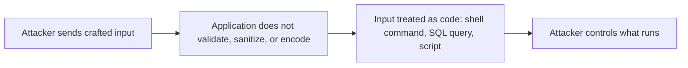
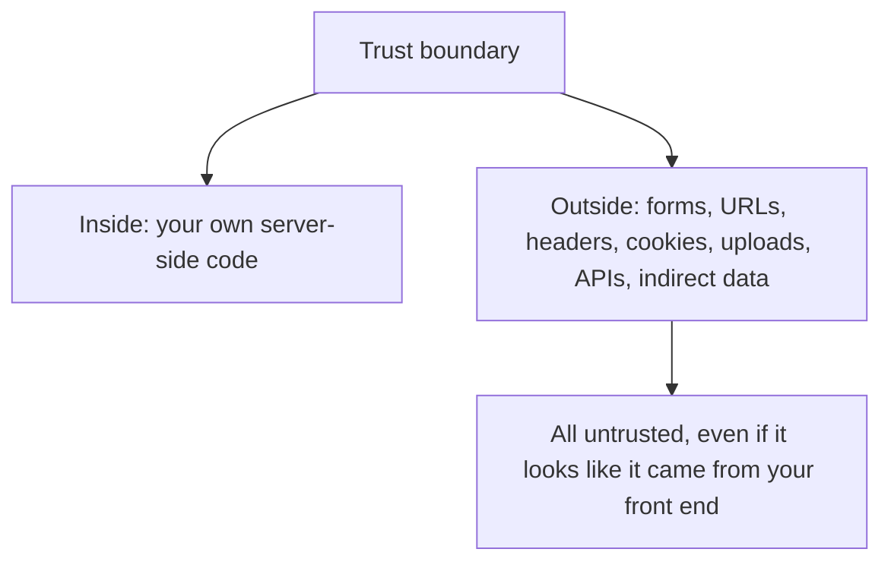
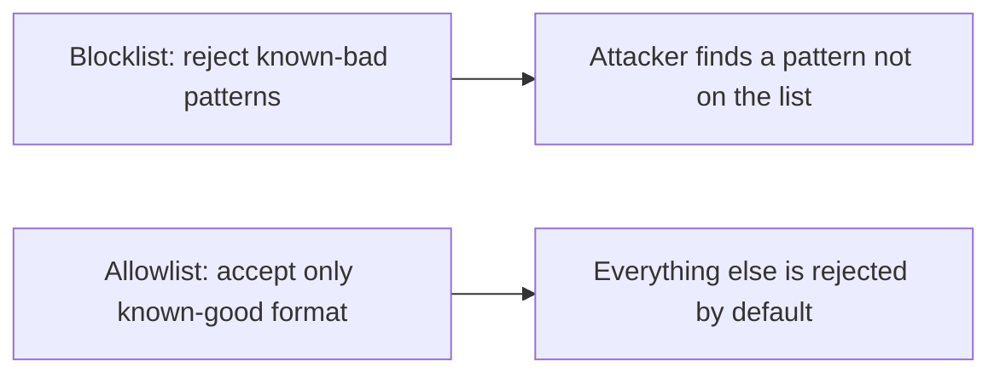
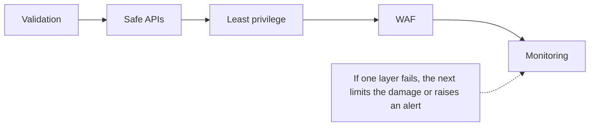

| Topic | Level | Reading Time | Prerequisites |
|---|---|---|---|
| Input Attacks Fundamentals | Beginner | ~15 min | None |

> **الهدف من الـ Section ده:**  
> هتفهم الجذر المشترك ورا معظم هجمات التطبيقات: إن المطور بيثق في اللي المستخدم بيبعته، وإزاي الداتا بتتحول لتعليمات، وهتشوف كل المصادر اللي ممكن تيجي منها مدخلات (حتى اللي بننساها)، وإيه خطوط الدفاع الأساسية اللي بتتكرر في كل نوع هجوم هتدرسه بعد كده.

## Learning Objectives

By the end of this section, you will be able to:

- Define an **input attack** and state its root cause: mixing data with instructions.
- List both the obvious and the easily forgotten **sources of input**.
- Apply the golden rule: anything outside your **trust boundary** is untrusted.
- Differentiate between **validation**, **sanitization**, and **encoding/escaping**, and explain why an allowlist beats a blocklist.
- Explain why **server-side enforcement**, **safe APIs**, and **least privilege** remove whole classes of vulnerability.
- Explain what **fuzzing** is and why a **layered defence** is required.

## Table of Contents

- [Learning Objectives](#learning-objectives)
- [What Are Input Attacks](#what-are-input-attacks)
  - [Definition](#definition)
  - [The Root Cause](#the-root-cause)
  - [One Cause, Many Attacks](#one-cause-many-attacks)
- [Where Inputs Come From](#where-inputs-come-from)
  - [Everyday Inputs](#everyday-inputs)
  - [Easy to Forget](#easy-to-forget)
  - [The Golden Rule](#the-golden-rule)
- [How to Mitigate Input Attacks](#how-to-mitigate-input-attacks)
  - [Check and Clean the Input](#check-and-clean-the-input)
  - [Make the System Safe by Design](#make-the-system-safe-by-design)
- [Fuzzing and Layered Defence](#fuzzing-and-layered-defence)
  - [Fuzzing](#fuzzing)
  - [Layered Defence](#layered-defence)
- [Career Path Connections](#career-path-connections)
- [Key Terms Glossary](#key-terms-glossary)
- [Summary](#summary)

## What Are Input Attacks

### Definition

الـ **input attack** هو أي هجوم فيه المهاجم **بيتلاعب بالداتا اللي التطبيق بيستقبلها** عشان التطبيق **يتصرف بشكل غير مقصود أو خبيث.**

المهاجم بيبعت **input مصنوع خصيصاً** بدل داتا مستخدم عادية، والتطبيق **بيعالجه من غير validation مناسب.**

### The Root Cause

**السبب الجذري:** المطورين **بيثقوا في مدخلات المستخدم زيادة عن اللزوم.** التطبيق مابيعملش **validate أو sanitize أو encode** للمدخل قبل ما يستخدمه.

**المشكلة الأساسية هي خلط الداتا بالتعليمات.** لما المدخل **بيتعامل معاه كـ code** (shell command أو SQL query أو script)، **المهاجم هو اللي بيتحكم في اللي بيتنفذ.**

تشبيه: لو سكرتيرة بتكتب أي حاجة العميل يمليها عليها حرفياً في خطاب رسمي بتوقّعه المدير، فالعميل يقدر يملي "وأضف إن المدير وافق على صرف مليون جنيه". الخطأ إن النص اللي المفروض يكون **داتا** اتعامل معاه كـ **تعليمات.**

### One Cause, Many Attacks

نفس الجذر ورا **injection وXSS وbuffer overflow وpath traversal.** ومعظم الـ **OWASP Top 10** بيبدأ بمعالجة غير آمنة للمدخلات.

| Attack | What the Input Becomes |
|---|---|
| OS command injection | A shell command |
| SQL injection | A database query |
| Cross-site scripting (XSS) | A script running in a victim's browser |
| Buffer overflow | Data that spills into adjacent memory |
| Path traversal | A file path escaping the intended folder |

> [!IMPORTANT]
> Each of the next files in this category is one row of this table in detail. They look different on the surface, but the question to ask is always the same: where does this application mix data and instructions, and who controls the data?

> [!NOTE]
> Log4Shell, covered in the Log4Shell Case Study file, is the same root cause in a logging library: text that should have been plain data was processed as an instruction. Input attacks are not an old topic; they produced the maximum-severity vulnerability of the decade.

## Where Inputs Come From

### Everyday Inputs

| Input Source | Detail |
|---|---|
| **Login forms وsearch bars** | أوضح المدخلات |
| **URL parameters** زي `?id=123` | سهل تتعدّل من address bar |
| **HTTP headers** زي User-Agent وReferer وX-Forwarded-For | **بتتسجّل كتير ونادراً بتتعمل لها validation** |
| **Cookies وhidden fields** | **عايشين على الـ client**، فالمهاجم بيتحكم فيهم |

### Easy to Forget

| Input Source | Detail |
|---|---|
| **File uploads** | اسم الملف ونوعه ومحتواه **كلهم ممكن يكونوا خبيثين** |
| **APIs** (JSON/XML bodies) | مدخلات machine-to-machine **لسه تحت سيطرة المهاجم** |
| **مصادر غير مباشرة** | داتا من database أو طرف تالت أو إيميل **المستخدم هو اللي كتبها أصلاً** |

### The Golden Rule

**أي حاجة جاية من بره الـ trust boundary بتعتبر untrusted**، حتى الداتا اللي شكلها جاية من الـ front end بتاعك. **المهاجم يقدر يتخطى الـ browser ويبعت requests مباشرة.**

> [!WARNING]
> HTTP headers deserve special attention because they are logged constantly and validated rarely. An attacker-controlled header such as User-Agent or X-Forwarded-For flows straight into log files, databases, and sometimes dashboards, where it can be processed as something more than text.

## How to Mitigate Input Attacks

### Check and Clean the Input

| Technique | What It Does |
|---|---|
| **Validation** | افحص النوع والطول والصيغة والمدى. **فضّل allowlist** (اقبل المعروف إنه سليم بس) **على blocklist** (سهل يتخطى) |
| **Sanitization** | شيل أو عطّل الحروف الخطرة |
| **Encoding / escaping** | حوّل الحروف الخاصة بحيث تتعامل كـ **داتا مش code**، حسب سياق الإخراج (HTML أو URL أو SQL أو shell) |

### Make the System Safe by Design

| Technique | What It Does |
|---|---|
| **Server-side enforcement** | فحوصات الـ client **بتحسّن تجربة المستخدم بس، مابتديش أمان** |
| **Safe APIs** | parameterized queries، وargument arrays بدل shell strings، وauto-escaping في الـ frameworks **بتشيل أنواع كاملة من الثغرات** |
| **Least privilege** | لو الـ injection نجح، **الضرر بيتحدد بصلاحيات حساب التطبيق** |

> [!TIP]
> The allowlist-over-blocklist rule is the single most reusable idea in this whole category. A blocklist has to anticipate every attack; an allowlist only has to describe what valid input looks like, which the developer already knows.

> [!NOTE]
> Least privilege here is the same principle from the Access Control Models file, applied to the application's own service account: if an injection succeeds, a low-privilege account limits what the attacker can reach.

## Fuzzing and Layered Defence

### Fuzzing

**Fuzzing:** المختبرين **بيبعتوا تلقائياً كميات كبيرة من مدخلات مشوّهة أو غير متوقعة** لحقول الإدخال: strings طويلة جداً، حروف خاصة، أنواع بيانات غلط، وقيم فاضية. وبعدين **بيراقبوا الـ crashes والأخطاء والسلوك الغريب.** الـ fuzzing **بيتأكد من شغل المطور** وبيلاقي فجوات اتفوّتت.

### Layered Defence

**اجمع** الـ validation مع الـ safe APIs والـ least privilege وـ **WAF** والـ monitoring. **مفيش control واحد كافي**: لو طبقة فشلت، اللي بعدها **بتحد الضرر أو بتطلّع alert.**

> [!IMPORTANT]
> Remember: developers must never trust user input. This is the application-layer version of the Defense in Depth Model: the WAF described in the WAF file is one valuable layer, but it is a mitigation, not a substitute for fixing the code that mishandles input.

## Career Path Connections

| Career Path | How This Topic Applies |
|---|---|
| SOC Analyst | Recognizes that attacker-controlled input appears in URLs, headers, and parameters in the logs being reviewed |
| Penetration Tester | Maps every input source of an application first, including headers, APIs, and uploads, then fuzzes and manipulates each one |
| GRC | Secure coding standards and input validation requirements appear in application security policies and audits |
| Cloud Security | APIs and serverless functions are input surfaces too, and every one needs the same validation discipline |

## Key Terms Glossary

| Term | Definition |
|---|---|
| Input Attack | An attack where the attacker manipulates data an application receives so it behaves in an unintended way |
| Trust Boundary | The line separating data you control from data you must treat as untrusted |
| Validation | Checking input type, length, format, and range |
| Allowlist | Accepting only known-good input |
| Blocklist | Rejecting only known-bad input, which is easy to bypass |
| Sanitization | Removing or neutralizing dangerous characters |
| Encoding / Escaping | Converting special characters so they are treated as data in the output context |
| Parameterized Query | A query where user input is passed separately from the SQL command |
| Fuzzing | Automatically sending large volumes of malformed or unexpected input to find crashes and flaws |
| Layered Defence | Combining several independent controls so no single failure is decisive |

## Summary

- **Input attacks manipulate the data an application receives:** والتطبيق بيعالجها من غير validation.
- **The root cause is mixing data with instructions:** لما المدخل بيتعامل كـ code، المهاجم بيتحكم في اللي بيتنفذ.
- **One cause sits behind many attacks:** injection وXSS وbuffer overflow وpath traversal.
- **Inputs come from everywhere:** forms وURLs وheaders وcookies، وكمان uploads وAPIs ومصادر غير مباشرة.
- **Anything outside the trust boundary is untrusted:** حتى لو شكلها جاية من الـ front end.
- **Validate with an allowlist, sanitize, and encode for the output context.**
- **Enforce on the server, use safe APIs, and apply least privilege.**
- **Fuzzing finds what developers missed, and no single control is enough:** لازم layered defence.

