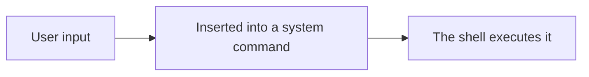
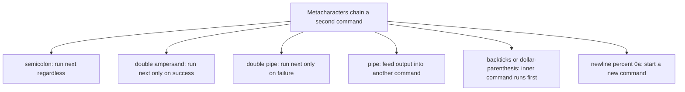
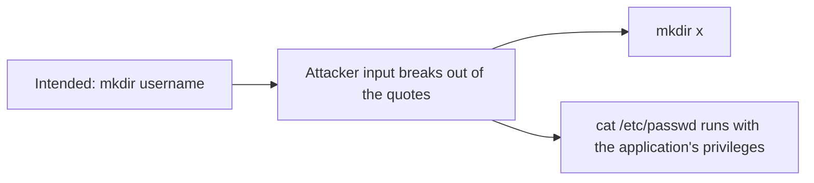
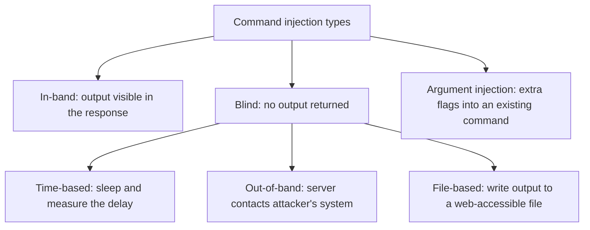
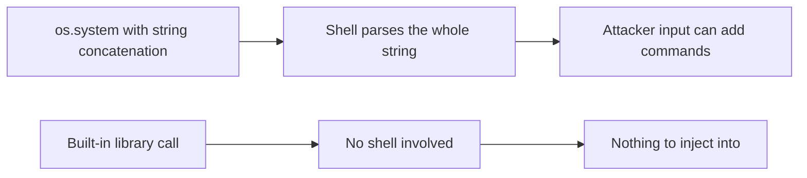
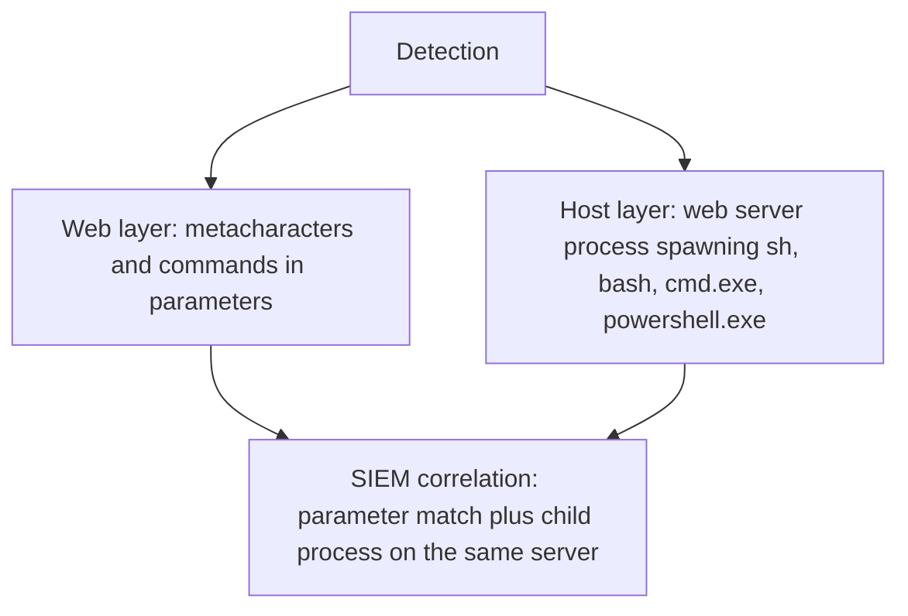

| Topic | Level | Reading Time | Prerequisites |
|---|---|---|---|
| OS Command Injection | Intermediate | ~20 min | Input Attacks Fundamentals |

> **الهدف من الـ Section ده:**  
> هتفهم إزاي حقل نص عادي ممكن يتحول لـ shell على السيرفر، وإيه هي الـ shell metacharacters اللي بتخلي المهاجم يلزق أمر تاني على أمر المطور، وإزاي تفرّق بين الأنواع (in-band وblind وargument injection)، وإزاي تكتب الكود بطريقة آمنة، وإيه اللي الـ SOC يدوّر عليه.


## Learning Objectives

By the end of this section, you will be able to:

- Define **OS command injection** and explain the three-step path from user input to shell execution.
- List the **shell metacharacters** and what each one does.
- Walk through the **mailbox application** example and explain why the attacker needs metacharacters.
- Differentiate between **in-band**, **blind** (time-based, out-of-band, file-based), and **argument injection**.
- Contrast vulnerable code that launches a shell with safer alternatives: built-in libraries, argument lists with `shell=False`, and allowlist validation.
- List prevention measures and the SOC detection signals, including a web server process spawning a shell.

## Table of Contents

- [Learning Objectives](#learning-objectives)
- [What Is OS Command Injection](#what-is-os-command-injection)
  - [Definition](#definition)
  - [The Three-Step Path](#the-three-step-path)
  - [Impact](#impact)
  - [Why Applications Use System Commands](#why-applications-use-system-commands)
- [How the Attack Works: Shell Metacharacters](#how-the-attack-works-shell-metacharacters)
- [Example: The Mailbox Application](#example-the-mailbox-application)
- [Types of Command Injection](#types-of-command-injection)
  - [In-Band (Classic)](#in-band-classic)
  - [Blind (No Output Returned)](#blind-no-output-returned)
  - [Argument Injection](#argument-injection)
- [Vulnerable Code Versus a Built-In Library](#vulnerable-code-versus-a-built-in-library)
- [If System Calls Are the Only Option](#if-system-calls-are-the-only-option)
- [Preventing and Detecting Command Injection](#preventing-and-detecting-command-injection)
  - [Prevention](#prevention)
  - [SOC Detection](#soc-detection)
- [Career Path Connections](#career-path-connections)
- [Key Terms Glossary](#key-terms-glossary)
- [Summary](#summary)

## What Is OS Command Injection

### Definition

الـ **OS command injection** هي ثغرة بتسمح للمهاجم **ينفّذ أوامر نظام تشغيل تحكيمية (arbitrary) على السيرفر** عن طريق تطبيق معرّض للثغرة. بتحصل لما **مدخل المستخدم بيتمرر لأمر shell من غير validation أو sanitization.**

### The Three-Step Path



### Impact

قراءة ملفات حساسة، إنشاء مستخدمين، تثبيت malware أو backdoors، الـ pivoting جوه الشبكة الداخلية، وسيطرة كاملة على السيرفر. **الأوامر بتتنفذ بصلاحيات حساب تطبيق الويب.**

### Why Applications Use System Commands

عمل ping لـ host، تحويل ملفات، إنشاء مجلدات، إرسال mail، توليد PDFs، أو استدعاء admin utilities. **الاستخدام نفسه مش غلط، الغلط في بناء الأمر من مدخل غير موثوق.**

> [!NOTE]
> The impact line is why the least-privilege advice in Input Attacks Fundamentals matters so much here: the injected command runs with exactly the privileges of the web application account, so a low-privilege service account turns a full server compromise into a much smaller incident.

## How the Attack Works: Shell Metacharacters

الـ **shell metacharacters** بتسمح للمهاجم **يلزّق أمر تاني** على الأمر اللي المطور كان قاصده.

| Character | Effect |
|---|---|
| `;` | ينفّذ الأمر التالي **بغض النظر عن نتيجة الأول** |
| `&&` | ينفّذ الأمر التالي **بس لو الأول نجح** |
| `\|\|` | ينفّذ الأمر التالي **بس لو الأول فشل** |
| `\|` | يمرر ناتج أمر لأمر تاني (pipe) |
| `` ` ` `` أو `$( )` | **Command substitution**: الأمر الداخلي بيتنفذ الأول |
| newline (`%0a`) | يبدأ أمر جديد في السطر اللي بعده |



## Example: The Mailbox Application

**السيناريو:** تطبيق mailbox بيعمل **مجلد باسم المستخدم** وبيخزن فيه الـ attachments. بيشغّل أمر زي:

```text
mkdir "username"
```

لو الـ username **مش متعمله sanitize**، المهاجم يقدر يختار username **بيخرج بره الـ quotes** وبيضيف أمر من عنده.

| Item | Value |
|---|---|
| **Attacker's username** | `x"; cat /etc/passwd; "` |
| **Command that actually runs** | `mkdir "x"; cat /etc/passwd; ""` |

الأمر التاني (`cat /etc/passwd`) **بيتنفذ بصلاحيات التطبيق.**



> [!IMPORTANT]
> Teaching note: simply naming the user `cat /etc/passwd` would only create a folder with that name. The attacker must use shell metacharacters to escape the intended command. The vulnerability is not "the text contains a command", it is "the text changes the structure of the command".

## Types of Command Injection

### In-Band (Classic)

**ناتج الأمر بيظهر مباشرة في رد التطبيق.** ده **الأسهل في الاستغلال والاكتشاف.**

### Blind (No Output Returned)

المهاجم **مايقدرش يشوف الناتج** ولازم يستنتج النجاح بشكل غير مباشر:

| Sub-type | How It Works |
|---|---|
| **Time-based** | حقن تأخير زي `; sleep 10`. **رد بطيء بيأكد التنفيذ** |
| **Out-of-band** | يخلي السيرفر **يتصل بنظام بيتحكم فيه المهاجم**، مثلاً DNS lookup أو HTTP request بيشيل داتا |
| **File-based** | يكتب الناتج في **ملف متاح من الويب**، وبعدين يطلب الملف ده |

### Argument Injection

المهاجم **مايقدرش يضيف أوامر جديدة**، لكن يقدر **يحقن options أو flags إضافية** في أمر موجود، مثلاً flag بيخلي الأداة تكتب في ملف تحكيمي.



> [!NOTE]
> Out-of-band blind injection leaves a DNS or HTTP request from the server to an unfamiliar destination. That is the same kind of unexpected outbound connection that gave away Log4Shell exploitation, and it is why outbound traffic and DNS logs, covered in Network and Authentication Logs, are useful for detecting this class of attack.

## Vulnerable Code Versus a Built-In Library

| Vulnerable: a shell is launched | Safer: a built-in language library |
|---|---|
| `import os` | `from datetime import datetime` |
| `time = os.popen("date").read()` | `now = datetime.now()` |
| `os.system("mkdir " + username)` | `print(now)` |

**الأول:** Python بيشغّل **system shell**، والـ shell بينفّذ الـ string، والناتج بيرجع للبرنامج. جلب التاريخ **مش خطر**، لكن **النمط خطر**: السطر التاني **بيبني أمر من مدخل بيتحكم فيه المهاجم.**

**التاني:** **مفيش shell** ومفيش system call بتتنفذ، فمفيش حاجة للمهاجم يحقن فيها. ده **تنفيذ أأمن.** معظم المهام الشائعة (تواريخ، ملفات، ضغط، DNS، HTTP) **ليها library جاهزة.**



## If System Calls Are the Only Option

| Technique | Example |
|---|---|
| **Pass arguments as a list, with no shell** | يتمرر الـ username كـ argument واحد وماتتفسرش كـ shell syntax، فالـ semicolons والـ pipes **بتفقد معناها الخاص** |
| **Strict allowlist validation** | اقبل بس الحروف والطول المتوقعين. **ارفض كل حاجة تانية بدل ما تحاول تنضّفها** |

```python
import subprocess

subprocess.run(["mkdir", username], shell=False, check=True)
```

مثال على allowlist لـ username:

```text
^[a-zA-Z0-9_]{3,20}$
```

> [!WARNING]
> Filtering and sanitization help, but escaping alone should never be the only defence. Escaping rules differ between shells and operating systems, and a single missed character reopens the hole. Argument lists with `shell=False` remove the problem at its source instead of cleaning up after it.

## Preventing and Detecting Command Injection

### Prevention

| Measure | Detail |
|---|---|
| **Avoid direct system calls** | خصوصاً اللي بتتبني من مدخل المستخدم |
| **Use built-in libraries and APIs** | بدل أوامر نظام التشغيل |
| **If you must call the OS** | argument arrays مع `shell=False`، وallowlist validation صارم، **ومتعتمدش على الـ escaping لوحده** |
| **Minimal privileges** | حساب خدمة **non-root** وصلاحيات ملفات مقيّدة |
| **SELinux** | عشان الـ injection الناجح **مايلاقيش حاجة كتير يوصلها** |

### SOC Detection

| Signal | What to Look For |
|---|---|
| **Request parameters** | `;` `\|` `&&` وbackticks و`$(` و`%0a`، أو أوامر زي `cat` و`whoami` و`wget` و`curl` و`nc` |
| **Process behavior** | **تنبيه لما web-server process يشغّل shell**: `sh` أو `bash` أو `cmd.exe` أو `powershell.exe` |



> [!IMPORTANT]
> The second detection signal is the stronger one. A metacharacter in a parameter shows an attempt, but a web server process spawning a shell shows that a command actually ran. This is the same child-process evidence used in the Log4Shell detection, and in both cases correlating web logs with endpoint telemetry separates an attempt from a success.

## Career Path Connections

| Career Path | How This Topic Applies |
|---|---|
| SOC Analyst | Hunts for metacharacters in parameters and, more importantly, web server processes spawning shells |
| Penetration Tester | Tests every parameter that could reach a system call, including blind variants confirmed through delays or outbound requests |
| GRC | Secure coding standards should require libraries over shell calls and allowlist validation |
| Cloud Security | Serverless functions and containers that call out to the OS are exposed to the same flaw, with the function role as the privilege boundary |

## Key Terms Glossary

| Term | Definition |
|---|---|
| OS Command Injection | A vulnerability letting an attacker run arbitrary operating system commands through an application |
| Shell Metacharacter | A character with special meaning to the shell, such as `;` or `\|`, used to chain commands |
| Command Substitution | Running an inner command first and using its output, written with backticks or `$( )` |
| In-Band Injection | Injection where command output appears in the application's response |
| Blind Injection | Injection where no output is returned and success is inferred indirectly |
| Argument Injection | Injecting extra options or flags into an existing command |
| `shell=False` | A subprocess setting that passes arguments directly without a shell interpreting them |
| SELinux | A Linux security module limiting what a compromised process can access |

## Summary

- **Command injection happens when user input reaches a shell:** والأوامر بتتنفذ بصلاحيات حساب التطبيق.
- **Metacharacters chain a second command:** `;` و`&&` و`||` و`|` وcommand substitution وnewline.
- **The attacker must change the structure of the command:** مش مجرد كتابة اسم أمر في حقل نص.
- **Three families exist:** in-band وblind (time-based وout-of-band وfile-based) وargument injection.
- **The safest fix is no shell at all:** built-in libraries تشيل المشكلة من جذرها.
- **If the OS call is unavoidable, use argument lists with `shell=False` plus an allowlist:** الـ escaping لوحده مش كفاية.
- **Least privilege and SELinux limit the damage of a successful injection.**
- **SOC detection pairs web signals with host signals:** metacharacters في الـ parameters، وweb server process بيشغّل shell.

