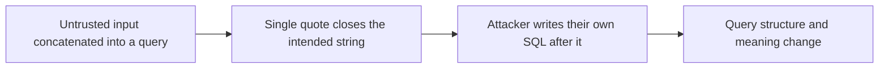
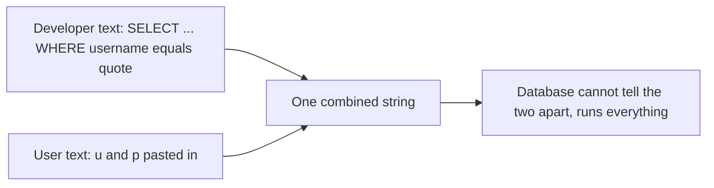
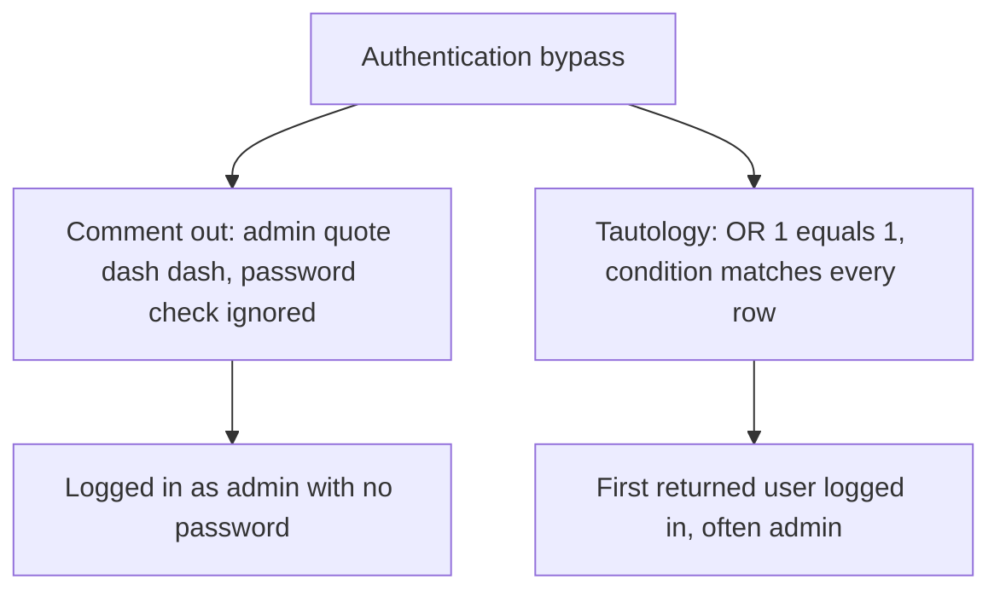
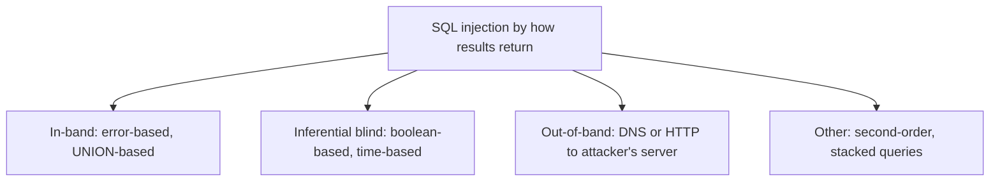
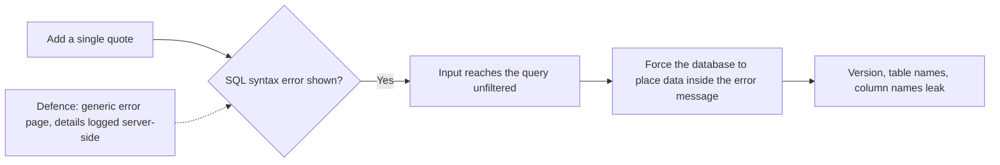
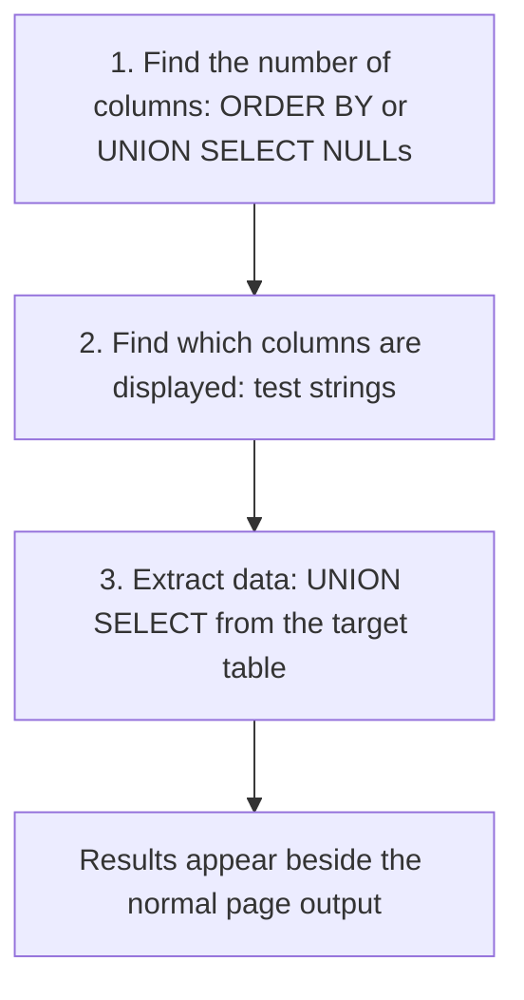

| Topic | Level | Reading Time | Prerequisites |
|---|---|---|---|
| SQL Injection Basics and In-Band Attacks | Intermediate | ~20 min | Input Attacks Fundamentals |

> **الهدف من الـ Section ده:**  
> هتفهم إزاي علامة التنصيص الواحدة (') كفاية تغيّر معنى query كاملة، وإزاي تقرا الـ query العادية والـ query المبنية بشكل غير آمن، وإيه أنواع الـ SQL injection حسب طريقة رجوع النتيجة، وإزاي الـ in-band attacks (error-based وUNION-based) بتسرّب الداتا مباشرة في رد التطبيق.


## Learning Objectives

By the end of this section, you will be able to:

- Define **SQL injection (SQLi)** and explain why the single quote is the key to the classic attack.
- Read a normal **login query** and the vulnerable code that builds it by concatenation.
- Explain two basic **authentication bypass** attacks: commenting out the password check and the tautology.
- Classify SQLi by **how the attacker gets results back**: in-band, inferential (blind), out-of-band, and other.
- Describe **error-based** SQLi, what it leaks, and the defence.
- Describe the three steps of **UNION-based** SQLi: count columns, find displayed columns, extract data.

## Table of Contents

- [Learning Objectives](#learning-objectives)
- [What Is SQL Injection](#what-is-sql-injection)
  - [Definition](#definition)
  - [The Role of the Single Quote](#the-role-of-the-single-quote)
  - [Where It Can Be Found](#where-it-can-be-found)
- [Understanding the Query](#understanding-the-query)
  - [A Normal Login Query](#a-normal-login-query)
  - [How the Vulnerable Code Builds It](#how-the-vulnerable-code-builds-it)
- [Basic Attacks: Authentication Bypass](#basic-attacks-authentication-bypass)
  - [Comment Out the Password Check](#comment-out-the-password-check)
  - [Tautology: Always True](#tautology-always-true)
  - [Comment Syntax Varies](#comment-syntax-varies)
- [Types of SQL Injection: Overview](#types-of-sql-injection-overview)
- [Error-Based SQL Injection](#error-based-sql-injection)
  - [How It Works](#how-it-works)
  - [What Leaks](#what-leaks)
  - [Defence](#defence)
- [UNION-Based SQL Injection](#union-based-sql-injection)
  - [The Idea](#the-idea)
  - [The Three Steps](#the-three-steps)
- [Career Path Connections](#career-path-connections)
- [Key Terms Glossary](#key-terms-glossary)
- [Summary](#summary)

## What Is SQL Injection

### Definition

الـ **SQL injection (SQLi)** هي ثغرة فيها المهاجم **بيحقن SQL code خبيث** في query قاعدة بيانات التطبيق، وده بيسمحله **يتلاعب بقاعدة البيانات.**

التطبيق **بيبني الـ queries بتلزيق (concatenation) مدخل غير موثوق**، ومدخل المهاجم **بيغيّر بنية الـ query ومعناها.**

### The Role of the Single Quote

**مفتاح الهجوم الكلاسيكي هو القدرة على إدخال علامة تنصيص واحدة (`'`).** هي **بتقفل الـ string اللي المطور كان قاصدها** وبتسمح للمهاجم **يكتب SQL بتاعه بعدها.**

### Where It Can Be Found

الـ SQLi ممكن يتلاقى في **URL parameters وPOST bodies وcookies وHTTP headers.** **أي قيمة بتوصل لـ query هي مرشحة.**

مثال من المحاضرة:

```text
http://www.example.com/login.php?passwd=' or userID='admin';--
```



> [!NOTE]
> This is the database version of the mix-data-with-instructions root cause from Input Attacks Fundamentals. The input was meant to be a value to compare against, but the quote lets it become part of the query's grammar.

## Understanding the Query

### A Normal Login Query

```sql
SELECT * FROM users
WHERE username = 'admin'
AND password = '1234';
```

| Part | Meaning |
|---|---|
| `SELECT` | بتجيب داتا من قاعدة البيانات |
| `*` | كل الأعمدة |
| `users` | اسم الجدول |
| `WHERE ... AND ...` | فلتر: رجّع **بس الصف** اللي username بتاعه admin وpassword بتاعه 1234 |

### How the Vulnerable Code Builds It

```python
query = ("SELECT * FROM users "
         "WHERE username='" + u +
         "' AND password='" + p + "'")
```

الـ username (`u`) والـ password (`p`) **اللي المستخدم كتبهم بيتلزقوا مباشرة في نص الـ SQL.** **قاعدة البيانات مابتقدرش تفرّق أنهي جزء المطور كتبه وأنهي جزء المستخدم كتبه.** هي ببساطة **بتنفذ الـ string كله.**



## Basic Attacks: Authentication Bypass

### Comment Out the Password Check

| Field | Value |
|---|---|
| Username | `admin'--` |
| Password | `anything` |

```sql
SELECT * FROM users
WHERE username='admin'--'
AND password='x';
```

الـ quote **بيقفل الـ string بتاعة الـ username.** الـ `--` **بيبدأ comment**، فـ **فحص الـ password بيتتجاهل.** المهاجم **بيسجل دخول كـ admin من غير password.**

### Tautology: Always True

| Field | Value |
|---|---|
| Password | `' OR '1'='1` |

```sql
SELECT * FROM users
WHERE username='admin'
AND password='' OR '1'='1';
```

الشرط `'1'='1'` **صحيح دايماً**، فالشرط **بيطابق كل الصفوف.** التطبيق غالباً **بيسجل دخول أول مستخدم بيرجع**، وده **غالباً admin.**



### Comment Syntax Varies

> [!WARNING]
> Comment syntax varies by database: `--` (needs a trailing space in MySQL), `#` (MySQL), and `/* */` (most databases). A payload that works against one database can fail against another, which is why attackers first fingerprint the database and why detection rules should cover all the comment styles, not just `--`.

## Types of SQL Injection: Overview

الـ SQLi بيتصنّف حسب **إزاي المهاجم بيرجّع النتايج.**

| Category | Type | How Data Comes Back |
|---|---|---|
| **In-band** | Error-based | رسايل أخطاء قاعدة البيانات بتسرّب الداتا |
| **In-band** | UNION-based | النتايج بتتضاف لمخرجات الصفحة العادية |
| **Inferential (blind)** | Boolean-based | سلوك الصفحة بيتغير (true مقابل false) |
| **Inferential (blind)** | Time-based | تأخير الرد بيكشف true أو false |
| **Out-of-band** | DNS / HTTP | الداتا بتتبعت لسيرفر بيتحكم فيه المهاجم |
| **Other** | Second-order | الـ payload بيتخزن الأول ويتفعّل بعدين |
| **Other** | Stacked queries | عدة statements بتتنفذ مع بعض |



> [!TIP]
> The classification is a ladder of difficulty for the attacker. In-band is easiest because the answer shows up on the page. Each step down (blind, then out-of-band) is for situations where the application reveals less, so the attacker works harder and the techniques get slower. This file covers the in-band pair; the next file covers the rest.

## Error-Based SQL Injection

### How It Works

المهاجم **بيعمل أخطاء في قاعدة البيانات عن قصد** وبيقرا **معلومات حساسة من رسالة الخطأ المفصّلة** اللي التطبيق بيعرضها.

| Step | Action |
|---|---|
| 1 | أضف علامة تنصيص واحدة (`'`). لو الصفحة عرضت خطأ زي `"You have an error in your SQL syntax"`، يبقى **المدخل بيوصل للـ query من غير فلترة** |
| 2 | اجبر قاعدة البيانات **تحط داتا جوه الخطأ**. مثال لـ Microsoft SQL Server: |

```sql
' AND 1=CONVERT(int, (SELECT @@version))--
```

قاعدة البيانات **بتحاول تحوّل قيمة نصية (version string) لـ integer، بتفشل، وبتطبع النص ده جوه رسالة الخطأ.**

### What Leaks

**نوع قاعدة البيانات وإصدارها، وأسماء الجداول والأعمدة.** وهو **سريع وفعّال** للمهاجم.

### Defence

**متعرضش أخطاء قاعدة البيانات الخام للمستخدمين أبداً.** رجّع **صفحة خطأ عامة** وسجّل التفاصيل **على السيرفر.**



> [!IMPORTANT]
> Error-based injection only works because the application is helpful to the attacker. Showing a raw database error to a user is an information leak by itself, even without a vulnerability. Generic error pages with detailed server-side logging remove the attacker's easiest feedback channel.

## UNION-Based SQL Injection

### The Idea

الـ **`UNION`** operator **بيدمج نتايج `SELECT` statements اتنين**، فالداتا المسروقة **بتظهر في مخرجات الصفحة العادية.** **الـ queries الاتنين لازم يرجّعوا نفس عدد الأعمدة وبأنواع بيانات متوافقة.**

### The Three Steps

| # | Step | Example |
|---|---|---|
| 1 | **اعرف عدد الأعمدة**: زوّد `ORDER BY` لحد ما يحصل خطأ، أو ضيف `NULL`s لـ `UNION` | `' ORDER BY 4--` (خطأ: يعني 3 أعمدة)، `' UNION SELECT NULL,NULL,NULL--` |
| 2 | **اعرف أنهي أعمدة بتتعرض**: حط test strings في كل عمود وشوف أنهي بيظهر في الصفحة | `' UNION SELECT 'a','b','c'--` |
| 3 | **استخرج الداتا**: الصفحة بتعرض usernames وpassword hashes جنب النتايج العادية. `information_schema` بيكشف أسماء الجداول والأعمدة | `' UNION SELECT username, password, NULL FROM users--` |



> [!NOTE]
> The stolen password hashes in step 3 are exactly the material discussed in Password Hashing, Salting, and Peppering and Password Cracking Techniques. A strong, salted, slow hash does not stop the injection, but it decides whether the leaked hashes are usable afterward. That is why the next file lists hashing passwords as one of the supporting defences.

> [!NOTE]
> A basic example of this attack as it appears in a web server log, including the `sqlmap` user agent, is shown in Core Log Types and Web Server Logs.

## Career Path Connections

| Career Path | How This Topic Applies |
|---|---|
| SOC Analyst | Recognizes encoded quotes, UNION SELECT, and ORDER BY probing in web, WAF, and application logs |
| Penetration Tester | Probes parameters with a quote, reads error messages, then enumerates columns and tables to demonstrate impact |
| GRC | SQL injection prevention is a baseline requirement in secure development standards and PCI DSS-style audits |
| Cloud Security | Managed databases and cloud-hosted apps are equally exposed, and the database account's permissions limit the blast radius |

## Key Terms Glossary

| Term | Definition |
|---|---|
| SQL Injection (SQLi) | Injecting malicious SQL into an application's database query to manipulate the database |
| Concatenation | Building a query by joining strings, mixing developer text with user input |
| Tautology | A condition that is always true, such as `'1'='1'` |
| Comment Injection | Using `--`, `#`, or `/* */` to make the database ignore the rest of a query |
| In-Band SQLi | SQLi where results come back through the same channel as the request |
| Error-Based SQLi | In-band SQLi that reads data from verbose database error messages |
| UNION-Based SQLi | In-band SQLi that appends stolen data to the normal results with the `UNION` operator |
| `information_schema` | A standard database schema describing table and column names |

## Summary

- **SQLi injects SQL into a query built by concatenation:** مفتاحه علامة التنصيص الواحدة اللي بتقفل الـ string.
- **The database cannot tell developer text from user text:** هي بتنفذ الـ string كله.
- **Two basic bypasses exist:** comment out الـ password check، وtautology زي `OR '1'='1'`.
- **Comment syntax differs by database:** `--` وـ`#` وـ`/* */`.
- **SQLi is classified by how results return:** in-band وblind وout-of-band وأنواع تانية (second-order وstacked).
- **Error-based SQLi reads data from verbose error messages:** والدفاع صفحة خطأ عامة مع logging على السيرفر.
- **UNION-based SQLi follows three steps:** عدد الأعمدة، الأعمدة المعروضة، واستخراج الداتا.

