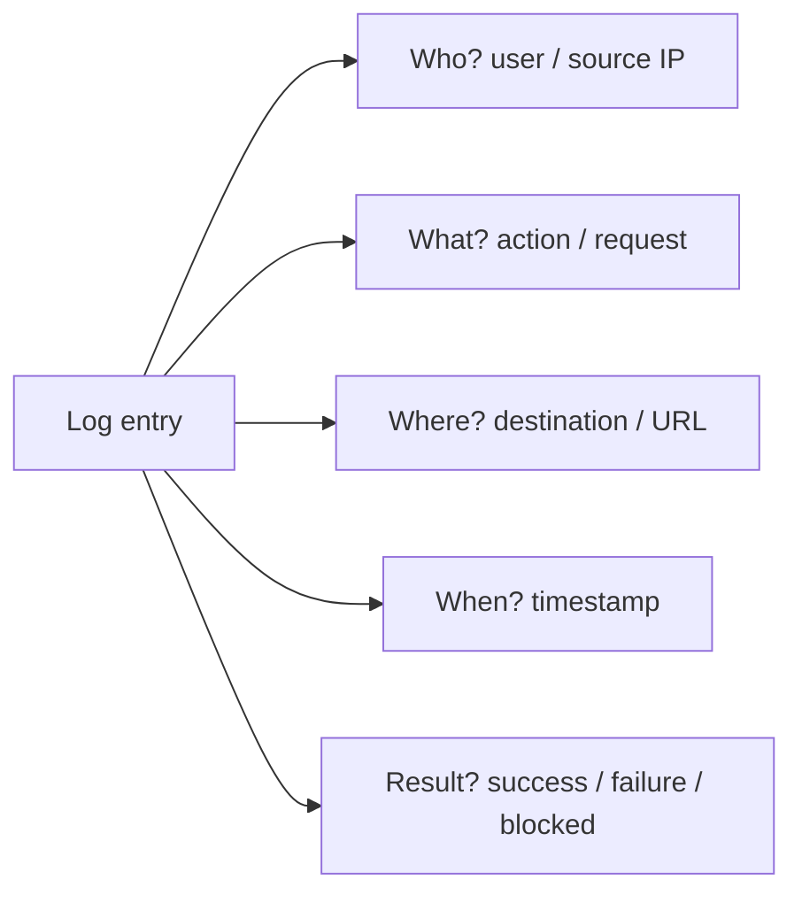
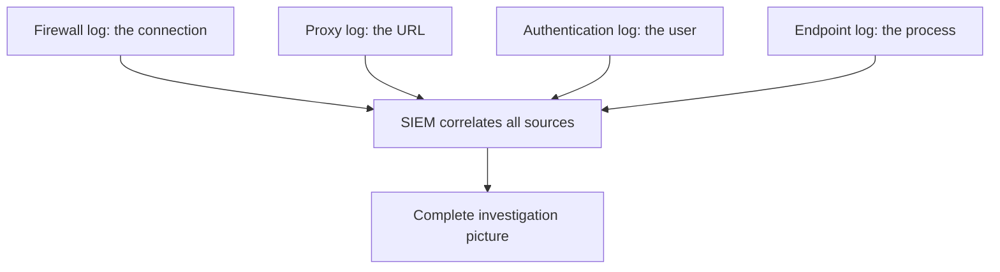
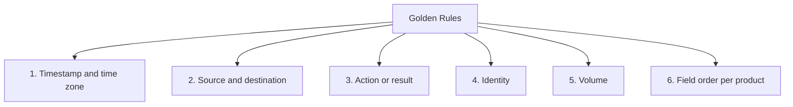
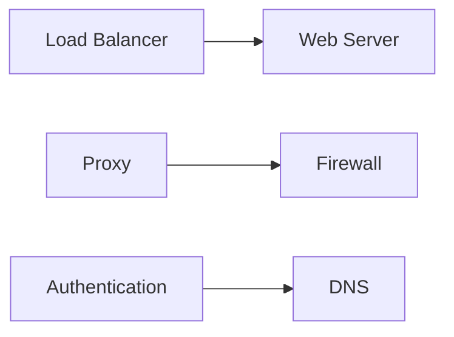
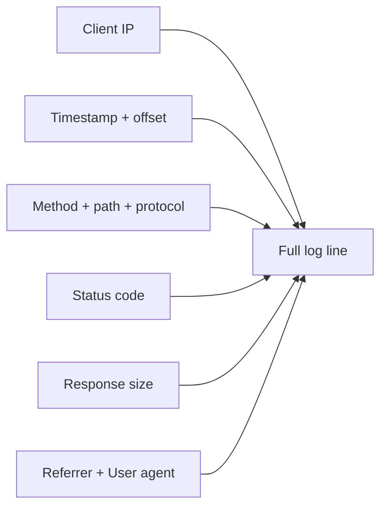
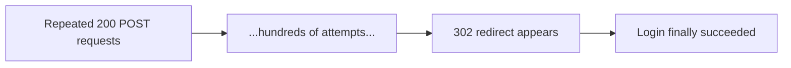
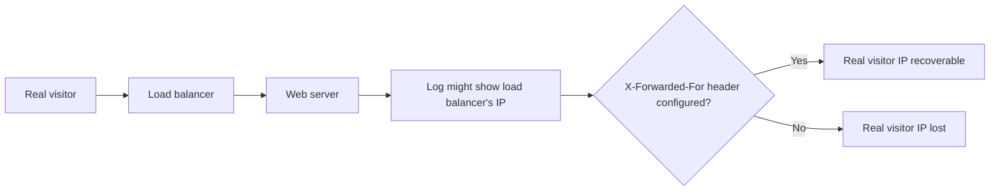

| Topic | Level | Reading Time | Prerequisites |
|---|---|---|---|
| Core Log Types and Web Server Logs | Beginner | ~20 min | None |

> **الهدف من الـ Section ده:**  
> هتفهم إيه هو الـ log ولماذا الـ SOC analyst بيقضي معظم يومه معاه، وهتتعلم القواعد الذهبية لقراءة أي log بغض النظر عن مصدره، وهتشوف بالتفصيل إزاي تقرا web server logs وتكتشف فيها هجمات حقيقية زي الـ scanning وSQL injection وbrute force.

## Learning Objectives

By the end of this section, you will be able to:

- Define a **log** and explain the five questions every investigation needs it to answer.
- Explain why no single log tells the whole story, and the role of the **SIEM** in correlation.
- Apply the **six golden rules** for reading any log, regardless of its format.
- Identify the six core log types and the main question each one answers.
- Read an **Apache web server log** line field by field, including the HTTP status code cheat sheet.
- Recognize three common web attacks in raw log lines: **directory scanning**, **SQL injection**, and **brute force**.
- Explain why a load balancer or reverse proxy can hide the real client IP, and how to recover it.

## Table of Contents

- [Learning Objectives](#learning-objectives)
- [What Is a Log, and Why Do We Care](#what-is-a-log-and-why-do-we-care)
  - [Core Definition](#core-definition)
  - [The Five Investigation Questions](#the-five-investigation-questions)
  - [No Single Log Tells the Whole Story](#no-single-log-tells-the-whole-story)
- [Golden Rules When Reading Any Log](#golden-rules-when-reading-any-log)
- [Overview of Log Types and Where They Sit](#overview-of-log-types-and-where-they-sit)
- [Web Server Logs (Apache)](#web-server-logs-apache)
  - [Anatomy of a Log Line](#anatomy-of-a-log-line)
  - [HTTP Status Code Cheat Sheet](#http-status-code-cheat-sheet)
- [Attack Examples in a Web Server Log](#attack-examples-in-a-web-server-log)
  - [Directory and File Scanning](#directory-and-file-scanning)
  - [SQL Injection Attempt](#sql-injection-attempt)
  - [Brute Force on a Login Page](#brute-force-on-a-login-page)
  - [Other Patterns to Recognize](#other-patterns-to-recognize)
- [Load Balancers and the Real Client IP](#load-balancers-and-the-real-client-ip)
- [Career Path Connections](#career-path-connections)
- [Key Terms Glossary](#key-terms-glossary)
- [Summary](#summary)

## What Is a Log, and Why Do We Care

### Core Definition

**Log** هو سجل **مرتب زمنياً (time-ordered)** لحاجة حصلت على نظام: حد عمل login، اتصال اتسمح بيه، صفحة اتطلبت، ملف اتغيّر.

**SOC analyst بيشتغل مع الـ logs تقريباً طول اليوم.**

### The Five Investigation Questions

الـ logs بتجاوب على أسئلة التحقيق الأساسية:

| Question | Answered By |
|---|---|
| **Who?** | المستخدم، الـ source IP |
| **What?** | الـ action، الـ request، الـ event |
| **Where?** | الوجهة، النظام، الـ URL |
| **When?** | الـ timestamp |
| **Result?** | نجاح، فشل، blocked، allowed |



### No Single Log Tells the Whole Story

**بنربط (correlate) بين الـ logs**: الـ firewall log بيوريك الاتصال، الـ proxy log بيوريك الـ URL، الـ authentication log بيوريك المستخدم، والـ endpoint log بيوريك الـ process.

الـ **SIEM** (زي Splunk، QRadar، Sentinel، Elastic) بيجمع ويربط كل دول مع بعض.



> [!NOTE]
> This connects directly to the SIEM centralization principles covered in the DLP Tools and SIEM Integration file: a single search across correlated sources is far more powerful than checking each source individually.

## Golden Rules When Reading Any Log

| # | Rule | Why |
|---|---|---|
| 1 | **دوّر على الـ timestamp والـ time zone بتاعته** | استنتاجات غلط كتير بتيجي من خلط UTC بالـ local time، فلازم توحّد الوقت دايماً |
| 2 | **حدد الـ source والـ destination** | مين بدأ الاتصال، ومين استقبله |
| 3 | **حدد الـ action أو النتيجة** | allowed, denied, success, failure, status code |
| 4 | **حدد الـ identity** | المستخدم، hostname، الجهاز |
| 5 | **دوّر على الحجم (volume)** | زي bytes sent وreceived؛ رفعات كبيرة ممكن تعني exfiltration |
| 6 | **اتعلم ترتيب حقول الـ log** | كل منتج مختلف عن التاني |



> [!WARNING]
> Mixing UTC and local time is one of the most common causes of wrong conclusions in log analysis. Always normalize the timezone before comparing timestamps across different log sources, especially when correlating logs from systems in different regions.

## Overview of Log Types and Where They Sit

| Log | Where It Sits | Main Question It Answers |
|---|---|---|
| **Load balancer** | قدام الـ web servers | مين اتصل بالـ app بتاعي وإزاي استجاب؟ |
| **Web server** | على الـ web server نفسه | إيه اللي اتطلب من موقعي؟ |
| **Proxy** | بين المستخدمين والإنترنت | الموظفين بيتصفحوا وينزلوا إيه؟ |
| **Firewall** | حدود الشبكة أو الـ segments | أنهي اتصالات اتسمح بيها أو اتمنعت؟ |
| **Authentication** | servers, domain controllers, IdPs, VPN | مين عمل login، من فين، ونجح ولا لأ؟ |
| **DNS** | DNS server | أنهي أسماء بتتترجم؟ |



## Web Server Logs (Apache)

### Anatomy of a Log Line

الـ web server log بيسجّل **كل طلب وصل للـ application**.

```text
203.0.113.45 - - [03/Oct/2026:09:14:22 +0000] "GET /login HTTP/1.1" 200 5120
"https://shop.example.com/" "Mozilla/5.0 (Windows NT 10.0; Win64; x64)"
```

| Field | Meaning |
|---|---|
| `203.0.113.45` | عنوان IP العميل |
| `[03/Oct/2026:09:14:22 +0000]` | الـ timestamp والـ offset |
| `GET /login HTTP/1.1` | الـ method، المسار المطلوب، الـ protocol |
| `200` | HTTP status code |
| `5120` | حجم الاستجابة بالـ bytes |
| `"https://shop.example.com/"` | الـ referrer (الصفحة اللي وصل منها اللينك) |
| `"Mozilla/5.0 ..."` | الـ user agent |



### HTTP Status Code Cheat Sheet

| Range | Meaning |
|---|---|
| **2xx** | نجاح |
| **3xx** | إعادة توجيه (redirect) |
| **4xx** | أخطاء من جانب الـ client: `400` bad request، `401` unauthorized، `403` forbidden، `404` not found |
| **5xx** | أخطاء من جانب الـ server: `500` internal error، `502` bad gateway، `503` unavailable |

## Attack Examples in a Web Server Log

### Directory and File Scanning

```text
198.51.100.77 - - [03/Oct/2026:09:20:01 +0000] "GET /admin HTTP/1.1" 404 196 "-" "Nikto/2.1.6"
198.51.100.77 - - [03/Oct/2026:09:20:01 +0000] "GET /phpmyadmin/ HTTP/1.1" 404 196 "-" "Nikto/2.1.6"
198.51.100.77 - - [03/Oct/2026:09:20:02 +0000] "GET /.env HTTP/1.1" 404 196 "-" "Nikto/2.1.6"
```

**المؤشر:** عدد كبير من `404`s من IP واحد، غالباً بـ user agent أداة scanning معروفة (زي `Nikto`).

### SQL Injection Attempt

```text
198.51.100.77 - - [03/Oct/2026:09:22:40 +0000] "GET /products?id=1%27%20OR%20%271%27=%271 HTTP/1.1"
200 8450 "-" "sqlmap/1.7"
```

لو فككت الـ URL encoding: `id=1' OR '1'='1`.

> [!WARNING]
> A 200 status code with an unusual response size on an SQL injection attempt can mean it worked. A normal failed request would usually look very different in size from a successful injection that returned extra database content.

### Brute Force on a Login Page

```text
203.0.113.99 - - [03/Oct/2026:09:25:11 +0000] "POST /wp-login.php HTTP/1.1" 200 4012 "-" "Mozilla/5.0"
203.0.113.99 - - [03/Oct/2026:09:25:12 +0000] "POST /wp-login.php HTTP/1.1" 200 4012 "-" "Mozilla/5.0"
(... 500 times, then ...)
203.0.113.99 - - [03/Oct/2026:09:27:30 +0000] "POST /wp-login.php HTTP/1.1" 302 0 "-" "Mozilla/5.0"
```

**القراءة:** عدد كبير من POSTs متطابقة متبوعة بـ redirect (`302`) بيوحي إن الـ login نجح في النهاية. WordPress بيرجّع `200` مع نموذج الـ login عند الفشل، ويعمل redirect عند النجاح.



### Other Patterns to Recognize

| Pattern | Example |
|---|---|
| **Path traversal** | `GET /download?file=../../../../etc/passwd` |
| **Web shell access** | `POST /uploads/images/shell.php 200` |

> [!IMPORTANT]
> A web shell is a malicious script, usually written in PHP, ASP, or JSP, that an attacker uploads to a compromised web server to execute commands remotely. It lets the attacker interact with the server through a web browser, run OS commands, browse files, upload or download data, and potentially maintain access to the compromised system.

## Load Balancers and the Real Client IP

لما **load balancer** أو **reverse proxy** يكون قدام السيرفر، الـ web server log ممكن **يوري IP الـ load balancer نفسه كـ client**، مش الزائر الحقيقي.

**الحل:** الـ IP الحقيقي موجود في header اسمه **`X-Forwarded-For`**. لازم تتأكد إن الـ server متظبط إنه يسجّله.



## Career Path Connections

| Career Path | How This Topic Applies |
|---|---|
| SOC Analyst | Reading web server and correlated logs is core, daily Tier 1 and Tier 2 investigative work |
| Penetration Tester | Understanding what shows up in logs helps design engagements that avoid or deliberately trigger specific detection patterns |
| GRC | Log retention and the ability to answer who/what/where/when/result are direct audit requirements |
| Cloud Security | Cloud-native load balancers and web application logs follow the same fields and the same X-Forwarded-For consideration |

## Key Terms Glossary

| Term | Definition |
|---|---|
| Log | A time-ordered record of something that happened on a system |
| SIEM | A tool that collects and correlates logs from multiple sources |
| Correlation | Combining evidence from several logs to reconstruct a full event |
| HTTP Status Code | A three-digit code indicating the result of an HTTP request |
| User Agent | A string identifying the client software making a request |
| Referrer | The page that linked to the current request |
| Web Shell | A malicious script uploaded to a server to allow remote command execution |
| X-Forwarded-For | An HTTP header carrying the original client IP when a proxy or load balancer sits in front |

## Summary

- **A log is a time-ordered record answering who, what, where, when, and result.**
- **No single log source tells the whole story:** الـ SIEM بيربط بين firewall وproxy وauthentication وendpoint logs.
- **Six golden rules apply to any log:** timestamp/timezone، source/destination، action/result، identity، volume، وترتيب الحقول.
- **Six core log types cover most investigations:** load balancer، web server، proxy، firewall، authentication، وDNS.
- **Apache web server logs follow a predictable field order:** IP، timestamp، request line، status، size، referrer، user agent.
- **Three attack patterns are recognizable directly in raw logs:** directory scanning (404s مع scanning tool)، SQL injection (encoded payloads)، وbrute force (محاولات متكررة ثم redirect).
- **Load balancers can hide the real client IP:** الحل هو الـ X-Forwarded-For header.

