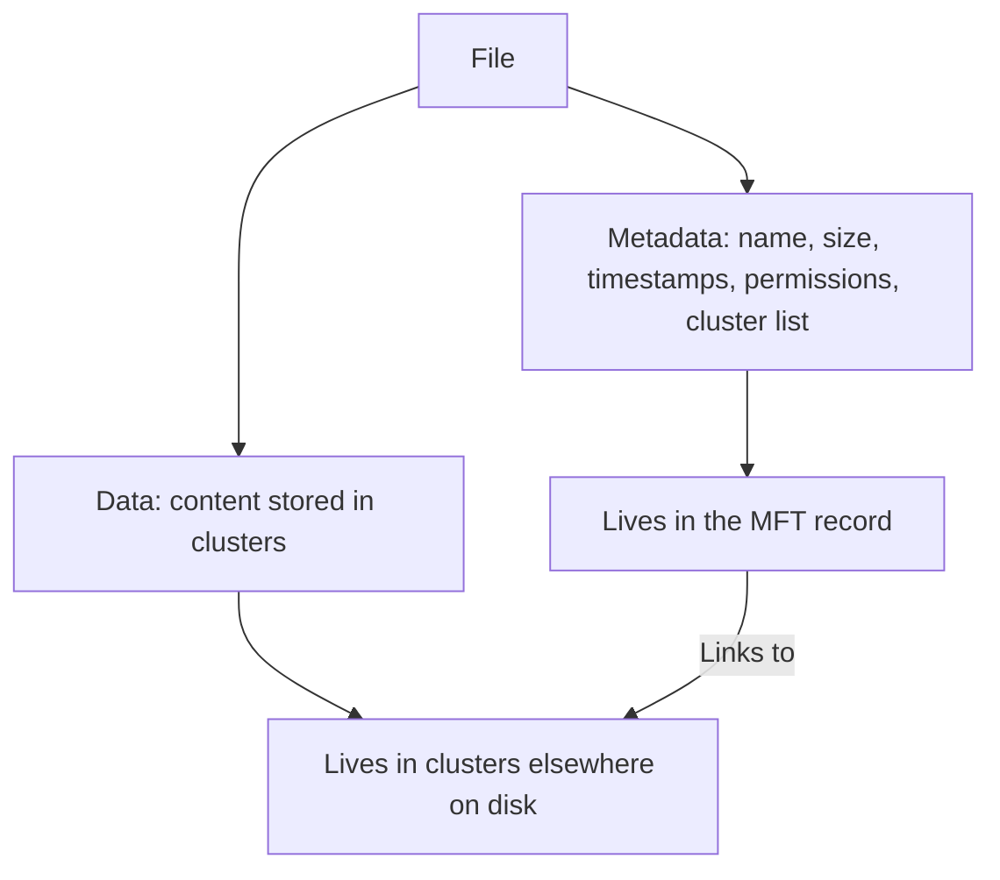
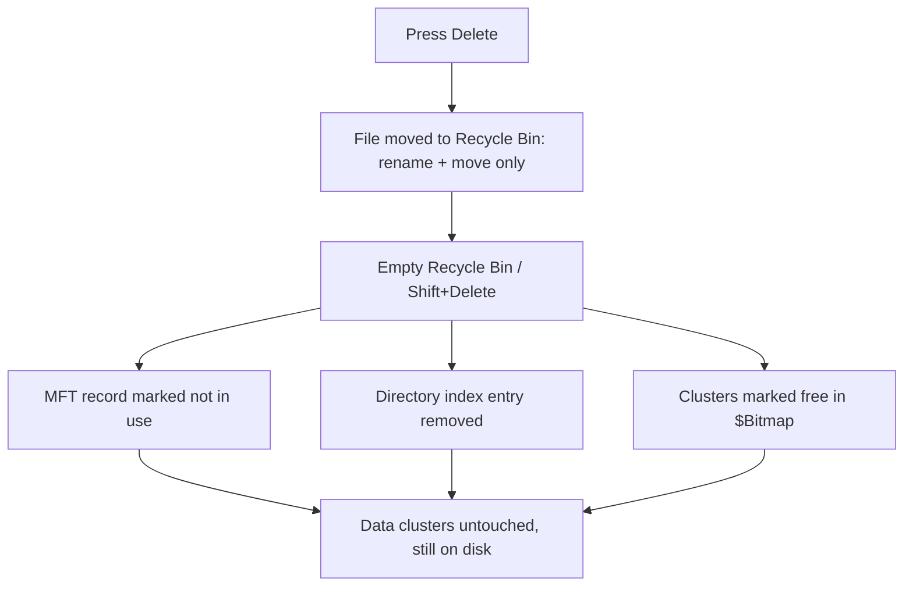
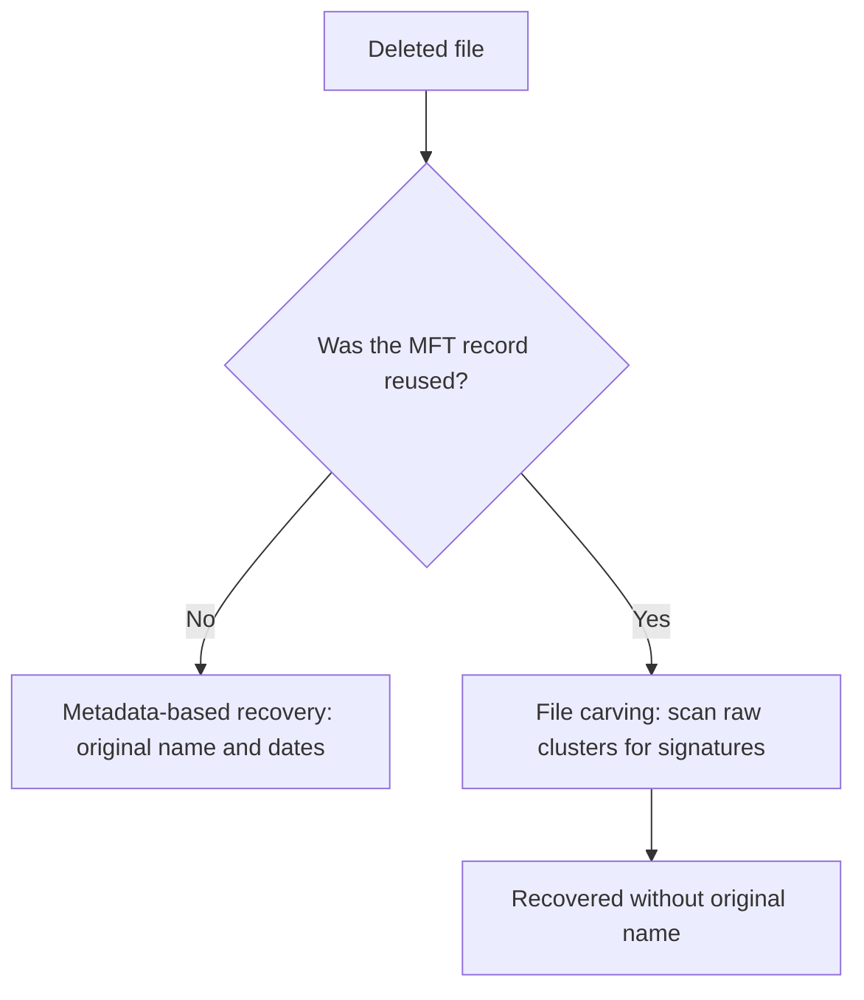
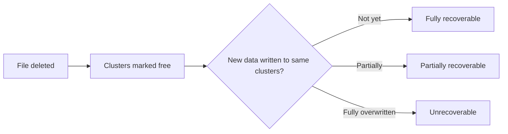
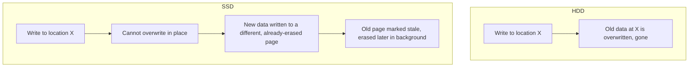
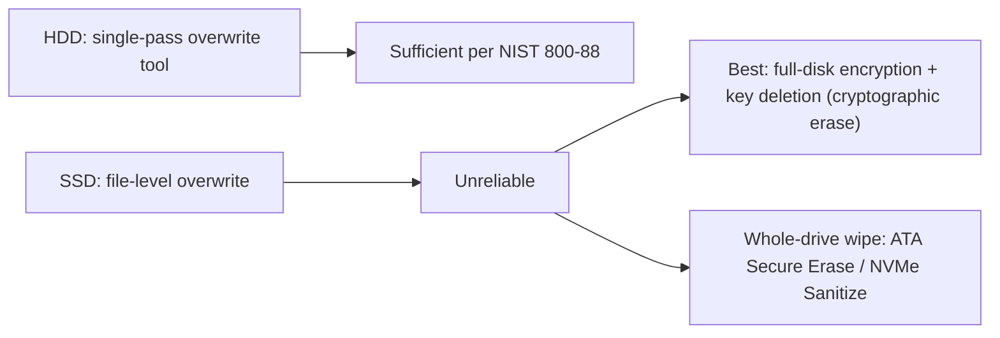

| Topic | Level | Reading Time | Prerequisites |
|---|---|---|---|
| Deleted Data, Forensics, and Secure Deletion | Intermediate | ~25 min | None |

> **الهدف من الـ Section ده:**  
> هتفهم الحقيقة اللي بتفاجئ معظم الناس: إن حذف ملف مش بيمسح محتواه فعلياً، وهتشوف إزاي NTFS بيخزن الملفات، وإزاي الـ forensics بيسترجع داتا محذوفة، والفرق الجوهري بين الـ HDD والـ SSD في الحذف، وأخيراً إزاي تمسح داتا فعلاً للأبد.


## Learning Objectives

By the end of this section, you will be able to:

- Explain the surprising truth about file deletion: the content usually remains on disk after deletion.
- Describe how **NTFS** separates a file's **data** (clusters) from its **metadata** (the MFT record).
- Walk through what actually happens, step by step, when a file is deleted and the Recycle Bin is emptied.
- Differentiate between **metadata-based recovery** and **file carving** as forensic recovery methods.
- Explain why **HDDs** and **SSDs** require fundamentally different secure-deletion approaches.
- Apply **NIST SP 800-88**'s Clear/Purge/Destroy model to real disposal decisions.
- Use **SDelete** to securely delete a file and wipe free space on Windows.

## Table of Contents

- [Learning Objectives](#learning-objectives)
- [The Surprising Truth](#the-surprising-truth)
- [How a File System Stores a File (NTFS Example)](#how-a-file-system-stores-a-file-ntfs-example)
  - [Two Parts of a File](#two-parts-of-a-file)
  - [The Bitmap](#the-bitmap)
- [What Happens When You Delete](#what-happens-when-you-delete)
  - [Step 1: Pressing Delete](#step-1-pressing-delete)
  - [Step 2: Emptying the Recycle Bin](#step-2-emptying-the-recycle-bin)
  - [Why the OS Works This Way](#why-the-os-works-this-way)
- [Why "The Name Is No Longer Attached to the Data"](#why-the-name-is-no-longer-attached-to-the-data)
  - [Metadata-Based Recovery](#metadata-based-recovery)
  - [File Carving](#file-carving)
- [When Is the Data Really Gone](#when-is-the-data-really-gone)
- [Common Forensic Tools](#common-forensic-tools)
- [HDD Versus SSD: How Each Stores Data](#hdd-versus-ssd-how-each-stores-data)
  - [HDD: Overwrite in Place](#hdd-overwrite-in-place)
  - [SSD: Three Rules That Change Everything](#ssd-three-rules-that-change-everything)
- [How to Really Delete Information Forever](#how-to-really-delete-information-forever)
  - [For a Single File or Folder on an HDD](#for-a-single-file-or-folder-on-an-hdd)
  - [For SSDs and Flash](#for-ssds-and-flash)
- [Disposal, Reuse, and Forgotten Copies](#disposal-reuse-and-forgotten-copies)
  - [NIST 800-88: Clear, Purge, Destroy](#nist-800-88-clear-purge-destroy)
  - [Don't Forget the Copies](#dont-forget-the-copies)
- [SDelete (Sysinternals) in Windows](#sdelete-sysinternals-in-windows)
  - [How It Works](#how-it-works)
  - [Common Commands](#common-commands)
- [Career Path Connections](#career-path-connections)
- [Key Terms Glossary](#key-terms-glossary)
- [Summary](#summary)

## The Surprising Truth

لما تحذف ملف، **وحتى لو فضّيت الـ Recycle Bin**، محتوى الملف **عادةً لسه موجود على الـ disk**. اللي بيتشال هو **سجل النظام اللي بيقول الملف فين**. لحد ما حاجة تانية **تكتب فوق** المساحة دي، أداة forensic تقدر **تقرا الداتا ترجع**.

> [!IMPORTANT]
> This single fact is the foundation of the entire file: deletion removes the pointer, not the data. Every forensic recovery technique and every secure-deletion method covered below exists specifically because of this gap between "the file looks gone" and "the content is actually gone."

## How a File System Stores a File (NTFS Example)

### Two Parts of a File

| Part | What It Holds | Where It Lives |
|---|---|---|
| **الداتا (Data)** | المحتوى الفعلي، مخزّن في **clusters** (عادةً 4 KB لكل واحد) على الـ disk | Clusters متفرقة |
| **الـ Metadata** | اسم الملف، الحجم، الـ timestamps، الصلاحيات، وقايمة بأنهي clusters بتحمل الداتا | في NTFS، سجل في **Master File Table (MFT)**. الاسم كمان بيظهر في **directory index** |



**الاسم مش مخزّن مع الداتا.** الاسم موجود في الـ MFT والـ folder index، والمحتوى موجود في clusters في مكان تاني. **سجل الـ MFT هو الرابط بينهم.**

### The Bitmap

NTFS بيحتفظ منفصل بـ **`$Bitmap`**: bit واحد لكل cluster، بيوضح هل هو مستخدم ولا فاضي.

## What Happens When You Delete

### Step 1: Pressing Delete

Windows **مابيمسحش** أي حاجة؛ هو بينقل الملف للـ Recycle Bin. ده مجرد **rename و move** لـ `C:\$Recycle.Bin\<SID>\`. الملف بيبقى `$R######.ext` (الداتا)، وملف صغير `$I######.ext` بيسجّل المسار الأصلي والحجم ووقت الحذف. **مفيش حاجة اتدمرت لسه**، وتقدر تسترجعه من هناك.

### Step 2: Emptying the Recycle Bin

لو فضّيت الـ Recycle Bin (أو عملت Shift+Delete، اللي بيتخطى الـ bin)، دلوقتي الـ file system **فعلياً بيحذفه**:

- سجل الـ MFT بيتعلّم إنه **not in use**.
- السجل **غالباً بيحتفظ بمعظم محتواه** (الاسم، الحجم، قايمة الـ clusters) لحد ما يتعاد استخدامه.
- الـ entry في الـ directory index بيتشال، فـ Explorer مابيعرضوش تاني.
- الـ clusters بتتعلّم **free** في الـ `$Bitmap`.

**دي كل القصة. الـ data clusters مابتتلمسش. البتات لسه على الـ disk.**



### Why the OS Works This Way

**السبب: السرعة.** مسح ملف 5 GB هياخد وقت زي ما تكتب 5 GB بالظبط. تعليم السجلات إنها فاضية بياخد **مللي ثانية**.

## Why "The Name Is No Longer Attached to the Data"

بعد الحذف، **الرابط بين الاسم والداتا** (سجل الـ MFT أو الـ pointer جواه) **بيختفي**. المحتوى لسه قاعد في clusters، لكن **مفيش حاجة رسمياً بتقول إن الـ clusters دي بتاعة `report.docx`**.

ده بيوصلنا لطريقتين استرجاع في الـ forensics:

### Metadata-Based Recovery

لو سجل الـ MFT **ماتعادش استخدامه**، الأداة **لسه بتقرا السجل القديم** (الاسم، الحجم، الـ timestamps، قايمة الـ clusters) وبترجّع الملف **باسمه وتواريخه الأصلية**. **ده أفضل ما يشتغل مباشرة بعد الحذف.**

### File Carving

لو سجل الـ MFT **اتعاد استخدامه**، الأداة **بتتجاهل الـ file system** وتفحص الـ clusters الخام بحثاً عن **توقيعات ملفات معروفة (magic numbers)**:

| File Type | Signature (Magic Number) |
|---|---|
| JPEG | بتبدأ بـ `FF D8 FF` وبتخلص بـ `FF D9` |
| PDF | بتبدأ بـ `%PDF` |
| ZIP/DOCX/XLSX | بتبدأ بـ `PK` (`50 4B 03 04`) |
| PNG | بتبدأ بـ `89 50 4E 47` |

الأداة بتنسخ **كل حاجة من الـ header للـ footer**. الملف بيرجع **من غير اسمه الأصلي** (هتاخده كـ `f1234567.jpg` مثلاً).



> [!TIP]
> This is a clean interview explanation: "Deletion breaks the link between a file's name and its content, not the content itself. If the link's record is intact, we recover it with its name. If not, we recover it by recognizing its signature instead."

## When Is the Data Really Gone

**بس لما الـ clusters تتكتب فوقها بداتا جديدة.** بعد الحذف، الـ clusters بتبقى **فاضية**، فأي ملف جديد يقدر ينزل عليها. مدة احتمالية الاسترجاع بتعتمد على:

- كمية الداتا الجديدة اللي بتتكتب على الـ disk (نظام مشغول بيكتب فوق بسرعة، نظام هادئ ببطء).
- هل نظام التشغيل بيعيد استخدام **نفس الـ clusters** بالظبط.
- الكتابة الجزئية بتدّي **استرجاع جزئي**.



## Common Forensic Tools

| Tool | Purpose |
|---|---|
| **Autopsy / The Sleuth Kit** | مجموعة forensic كاملة ومجانية |
| **FTK Imager** | إنشاء صورة forensic وتصفح الملفات المحذوفة |
| **FTK, EnCase, X-Ways** | أدوات تجارية |
| **PhotoRec** | file carving واسترجاع الـ partitions، مجاني |
| **Recuva** | أداة مستخدم بسيطة |
| **Bulk Extractor, Volatility** | تحليل الذاكرة والـ artifacts |

> [!IMPORTANT]
> Forensic best practice: never work on the original disk. Make a bit-for-bit image, use a write blocker so the original isn't modified, hash the image (SHA-256) to prove integrity, then analyze the copy. This chain of evidence matters legally, not just technically.

## HDD Versus SSD: How Each Stores Data

### HDD: Overwrite in Place

الـ **HDD (hard disk drive)** بيخزن الداتا **مغناطيسياً** على أقراص دوّارة، ومحتوى الكتابة والقراءة بيتحرك فوقها. نظام التشغيل يقدر **يكتب على نفس الموقع الفيزيائي تماماً مرة بعد مرة** (overwrite in place). لو نظام التشغيل كتب فوق موقع معين بداتا جديدة، **الداتا القديمة في الموقع ده راحت**.

### SSD: Three Rules That Change Everything

الـ **SSD (solid state drive)** بيخزن الداتا إلكترونياً في **NAND flash cells**، مجمّعة في **pages** (حوالي 4-16 KB)، واللي بدورها مجمّعة في **blocks** (مئات الـ pages).

تلات قواعد بتخلي الـ SSD مختلف جداً:

1. **الـ page ممكن تتكتب بس لما تكون فاضية (erased).**
2. **الـ erasing بيحصل على block كامل بس**، مش page واحدة.
3. **كل cell بتتلف بعد عدد محدود من دورات الـ erase.**

بسبب القواعد دي، الـ SSD **مايقدرش يكتب فوق page في مكانها**. عشان يغيّر الداتا، بيكتب النسخة الجديدة على **page تانية فاضية بالفعل**، ويعلّم الـ page القديمة إنها **stale (غير صالحة)**. بعدين بيمسح الـ blocks كاملة في الخلفية.



> [!WARNING]
> This is why file-level secure deletion on an SSD is fundamentally unreliable: the "deleted" data may still sit in a stale page somewhere on the drive, invisible to the file system but still physically present until the background erase cycle reaches it.

## How to Really Delete Information Forever

طريقتك بتعتمد على نوع التخزين والموقف.

### For a Single File or Folder on an HDD

- استخدم أداة secure-delete بتكتب فوق الداتا (**SDelete**, `cipher /w`, **Eraser**, `shred` على Linux).
- **pass واحد من الكتابة فوق كافي على الأقراص الحديثة.**
- **NIST SP 800-88** بيقول إن overwrite واحد كافي للـ HDDs الحديثة.

### For SSDs and Flash

- الكتابة فوق على مستوى الملف **مش موثوقة** (بسبب wear leveling وremapping).
- **أفضل أسلوب:** استخدم **full-disk encryption** من البداية (**BitLocker, FileVault, LUKS**). بعدين حذف مفتاح التشفير بيخلي كل حاجة **غير قابلة للقراءة**. ده بيتسمى **cryptographic erase**.
- لمسح SSD كامل: استخدم أداة الشركة المصنعة أو أوامر الـ drive المدمجة: **ATA Secure Erase, NVMe Sanitize, أو NVMe Format with secure erase**. الأوامر دي بتقول للـ controller نفسه يمسح كل خلية، بما فيها المناطق المخفية.



## Disposal, Reuse, and Forgotten Copies

### NIST 800-88: Clear, Purge, Destroy

| Level | Meaning |
|---|---|
| **Clear** | مسح منطقي (logical overwrite) |
| **Purge** | مسح آمن، مقاوم لتقنيات المعامل المتقدمة |
| **Destroy** | تدمير فيزيائي: تقطيع، تفكيك، أو حرق |

**للداتا بالغة الحساسية، أو disk فشل ومايقدرش يتمسح، دمّره فيزيائياً.**

### Don't Forget the Copies

**متنساش النسخ:** backups، cloud storage، الإيميل، USB drives، shadow copies، أجهزة تانية، نسخ مطبوعة. **لو نسخة واحدة نجت، المعلومة مش محذوفة فعلياً.**

> [!IMPORTANT]
> Securely wiping the original device means nothing if a copy of the same sensitive file still exists in a backup, an email sent years ago, or a forgotten USB drive. True deletion requires accounting for every copy, not just the one you remembered.

## SDelete (Sysinternals) in Windows

### How It Works

**SDelete** أداة مجانية من **Microsoft Sysinternals** بتحذف الملفات بأمان عن طريق الكتابة فوقها قبل الإزالة، وتقدر تكتب فوق المساحة الفاضية كمان.

- بيكتب فوق clusters البيانات بتاعة الملف (مرة واحدة افتراضياً) بنمط معين.
- بيعيد تسمية الملف **عدة مرات** قبل حذفه، عشان يمحي الاسم من الـ directory وسجل الـ MFT.
- بعدين بيحذف الملف.
- للمساحة الفاضية، بيعمل ملف مؤقت ضخم يملأ الـ disk وبعدين يشيله، فالداتا القديمة في الـ clusters الفاضية بتتكتب فوقها. كمان بيملأ ملفات MFT-resident الصغيرة.

### Common Commands

```bash
sdelete64 secret.docx              # securely delete one file
sdelete64 -p 3 secret.docx         # 3 overwrite passes
sdelete64 -s C:\Temp\OldProject    # recurse into a folder
sdelete64 -c C:                    # cleanse free space on drive C
sdelete64 -z C:                    # zero free space, used for VM disk shrinking
sdelete64 -r secret.docx           # remove read-only attribute if needed
```

**دايماً تأكد من الخيارات بـ `sdelete64 -?`**، لأنها بتختلف شوية بين الإصدارات.

**البديل الأصلي:** `cipher /w:C:\` بيكتب فوق المساحة الفاضية في الـ volume.

> [!NOTE]
> SDelete's rename-then-delete step is a small but important detail: overwriting the content alone is not enough if the file's name still sits in the MFT and directory index, so SDelete scrubs the name itself before the final delete.

## Career Path Connections

| Career Path | How This Topic Applies |
|---|---|
| SOC Analyst | Understanding what survives deletion informs how incident response teams handle evidence preservation |
| Penetration Tester | Knowledge of recovery techniques helps assess whether an organization's data disposal practices are actually secure |
| GRC | NIST 800-88's Clear/Purge/Destroy model is a standard, auditable requirement for data disposal policy |
| Cloud Security | Cloud providers implement cryptographic erase as the standard deletion model for virtualized storage |

## Key Terms Glossary

| Term | Definition |
|---|---|
| Cluster | A fixed-size block (typically 4 KB) on disk where file data is physically stored |
| MFT | Master File Table, the NTFS structure holding file metadata |
| Metadata-Based Recovery | Forensic recovery using an intact MFT record to restore a file with its original name |
| File Carving | Forensic recovery by scanning raw disk data for known file signatures, without relying on file system metadata |
| Magic Number | A file signature, a fixed byte sequence identifying a file type |
| Write Blocker | A forensic tool preventing any modification to the original evidence disk during analysis |
| Wear Leveling | An SSD technique spreading writes across cells to extend lifespan |
| Cryptographic Erase | Making encrypted data permanently unreadable by deleting its encryption key |
| NIST SP 800-88 | A NIST publication defining Clear, Purge, and Destroy levels of data sanitization |

## Summary

- **Deletion removes the pointer, not the content:** الداتا بتفضل على الـ disk لحد ما تتكتب فوقها.
- **NTFS separates data (clusters) from metadata (the MFT record):** والرابط بينهم هو سجل الـ MFT.
- **The Recycle Bin is just a rename and move:** الحذف الفعلي بيحصل بس لما تفضّيه أو تستخدم Shift+Delete.
- **Two recovery paths exist:** metadata-based recovery (الاسم سليم) وfile carving (التوقيع بس، من غير اسم).
- **Data is truly gone only after the clusters are overwritten.**
- **HDDs overwrite in place; SSDs cannot:** وده بيخلي secure deletion على مستوى الملف غير موثوق على الـ SSD.
- **Secure deletion differs by storage type:** overwrite واحد للـ HDD، وfull-disk encryption + cryptographic erase أو أوامر المصنّع للـ SSD.
- **NIST 800-88 defines three disposal levels:** Clear، Purge، وDestroy، حسب حساسية الداتا.
- **Forgotten copies defeat secure deletion entirely:** backups، إيميلات، USB drives، ونسخ مطبوعة.
- **SDelete overwrites content and scrubs the file name before deleting.**

