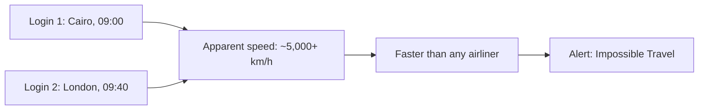
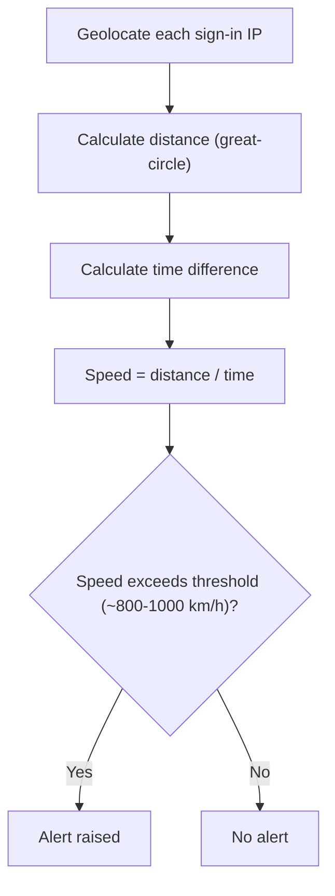
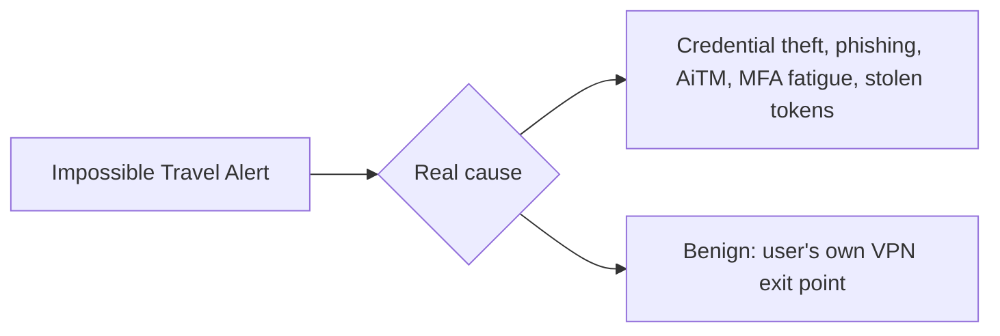
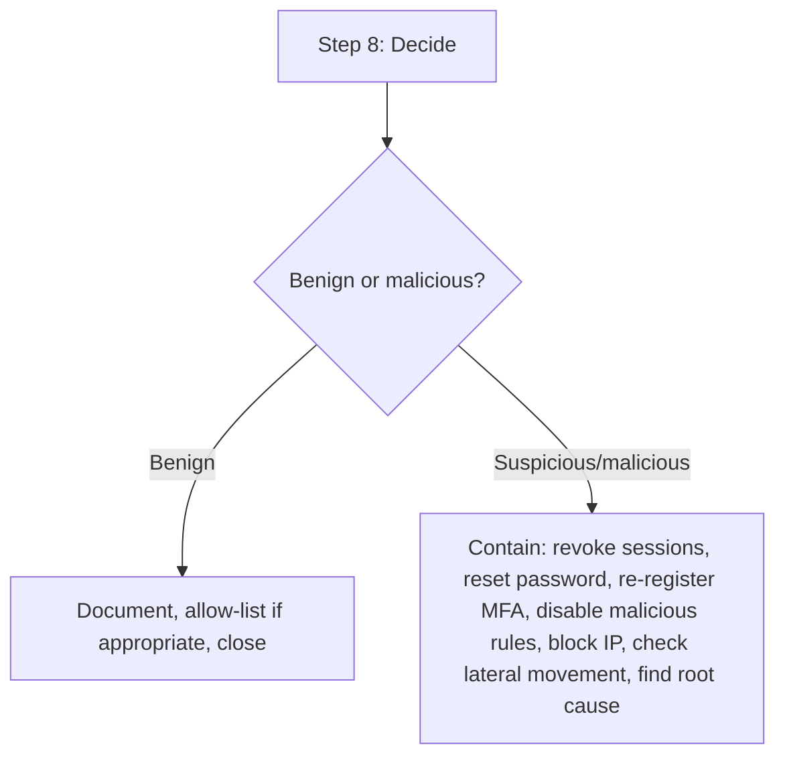
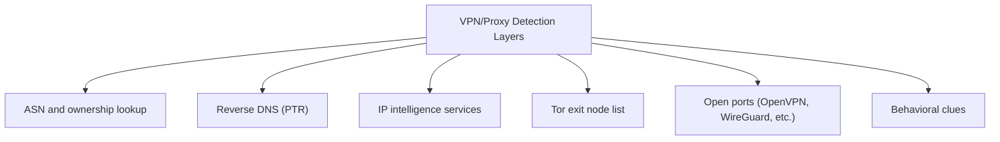

| Topic | Level | Reading Time | Prerequisites |
|---|---|---|---|
| Impossible Travel and VPN Detection | Intermediate | ~25 min | Zero Trust Model |

> **الهدف من الـ Section ده:**  
> هتفهم إزاي أنظمة الهوية بتكتشف "السفر المستحيل" كإشارة قوية على اختراق حساب، وهتتعلم خطوات التحقيق الثمانية كاملة من استلام الـ alert لحد اتخاذ القرار، وأخيراً هتعرف إزاي تحدد هل IP معين بتاع VPN أو proxy باستخدام عدة طبقات من الأدلة.


## Learning Objectives

By the end of this section, you will be able to:

- Define **impossible travel** and calculate the apparent speed between two sign-ins to judge plausibility.
- Describe the five-step detection algorithm systems use to raise an impossible travel alert.
- Differentiate between **real malicious causes** and **common benign causes** (especially VPN usage) of an impossible travel alert.
- Walk through the full **eight-step investigation process**, from collecting alert details to deciding and acting.
- Identify several independent layers of evidence (ASN, reverse DNS, IP intelligence, Tor lists, behavior) used to determine whether a source IP belongs to a VPN or proxy.

## Table of Contents

- [Learning Objectives](#learning-objectives)
- [What Is Impossible Travel](#what-is-impossible-travel)
  - [A Concrete Example](#a-concrete-example)
  - [Why It Matters](#why-it-matters)
- [How the Detection Works](#how-the-detection-works)
  - [The Five-Step Algorithm](#the-five-step-algorithm)
  - [Products That Do This Out of the Box](#products-that-do-this-out-of-the-box)
- [Why It Happens: Real Attack Versus False Positive](#why-it-happens-real-attack-versus-false-positive)
  - [Real Malicious Causes](#real-malicious-causes)
  - [Benign Causes](#benign-causes)
- [Investigation Step by Step](#investigation-step-by-step)
  - [Step 1: Collect the Alert Details](#step-1-collect-the-alert-details)
  - [Step 2: Calculate and Sanity Check](#step-2-calculate-and-sanity-check)
  - [Step 3: Enrich Both IPs](#step-3-enrich-both-ips)
  - [Step 4: Compare With the User's Baseline](#step-4-compare-with-the-users-baseline)
  - [Step 5: Look at the Authentication Details](#step-5-look-at-the-authentication-details)
  - [Step 6: Ask the User, Carefully](#step-6-ask-the-user-carefully)
  - [Step 7: Look at What the Second Session Did](#step-7-look-at-what-the-second-session-did)
  - [Step 8: Decide and Act](#step-8-decide-and-act)
- [How Do I Know a Source IP Belongs to a VPN or Proxy](#how-do-i-know-a-source-ip-belongs-to-a-vpn-or-proxy)
  - [ASN and Ownership Lookup](#asn-and-ownership-lookup)
  - [Reverse DNS (PTR)](#reverse-dns-ptr)
  - [Commercial and Free IP Intelligence Services](#commercial-and-free-ip-intelligence-services)
  - [Tor Exit Node List](#tor-exit-node-list)
  - [Open Ports and Services](#open-ports-and-services)
  - [Behavioral Clues](#behavioral-clues)
- [Career Path Connections](#career-path-connections)
- [Key Terms Glossary](#key-terms-glossary)
- [Summary](#summary)

## What Is Impossible Travel

**Impossible travel** هو alert بيتطلق لما **نفس الحساب** يسجّل دخول من **موقعين بعيدين جداً** عن بعض بحيث مستحيل إنسان يسافر بينهم في الوقت اللي مر.

### A Concrete Example

`jsmith` بيعمل login من القاهرة الساعة 09:00، ومن لندن الساعة 09:40. المسافة حوالي **3,500 كم في 40 دقيقة**، يعني سرعة ظاهرية **أكتر من 5,000 كم/ساعة**، أسرع من أي طائرة ركاب. **أحد تسجيلي الدخول على الأرجح مش `jsmith`.**

### Why It Matters

ده **من أوضح علامات سرقة الحساب**، وحسابات الـ cloud (**Microsoft 365, Google, VPN, SaaS**) هدف أساسي للمهاجمين.



## How the Detection Works

### The Five-Step Algorithm

لكل مستخدم، النظام بيبص على عمليات الدخول الناجحة المتتالية وبيعمل التالي:

| # | Step | What It Does |
|---|---|---|
| 1 | **Geolocate** كل source IP | الدولة، المدينة، خط العرض والطول، باستخدام **GeoIP database** |
| 2 | **احسب المسافة** بين النقطتين | Great-circle distance |
| 3 | **احسب فرق الوقت** بين عمليتي الدخول | |
| 4 | **السرعة = المسافة ÷ الوقت** | |
| 5 | لو السرعة **تعدّت حد معين** (عادةً حوالي 800-1,000 كم/ساعة، تقريباً سرعة طائرة ركاب)، **أطلق alert** | |



### Products That Do This Out of the Box

**Microsoft Entra ID Protection, Microsoft Defender for Cloud Apps, Okta, Splunk, Sentinel, Google Workspace, وVPN gateways.**

مثال **pseudo-query** في SIEM:

```text
For each user:
   sort successful logins by time
   compare each login with the previous one
   if distance_km / hours > 900 → alert
```

> [!NOTE]
> This detection mechanism is a direct practical implementation of the trust scoring and continuous verification principles from the Zero Trust Model file: the system is not trusting a session just because the login succeeded once, it keeps evaluating context (here, location and time) across the session's lifetime.

## Why It Happens: Real Attack Versus False Positive

### Real Malicious Causes

| Cause | Detail |
|---|---|
| **Credential theft** | عن طريق phishing، تسريب password معاد استخدامه، infostealer malware، أو password spray |
| **Adversary-in-the-middle phishing** | بيسرق الـ session cookie ويتخطى الـ MFA |
| **MFA fatigue (push bombing)** | طلبات MFA متكررة لحد ما المستخدم المنهك يوافق |
| **Stolen tokens أو OAuth app مستغل** | |

### Benign Causes

**(شائعة جداً!)**

- **الـ VPN بتاع المستخدم نفسه**: بيسجّل دخول بـ VPN exit point في أمريكا بينما عادةً بيظهر في مصر.



> [!WARNING]
> Benign causes, especially employee VPN use, are very common. Jumping straight to "this account is compromised" without investigation produces frequent false positives and erodes trust in the alert system. The eight-step process below exists specifically to separate the two cases reliably.

## Investigation Step by Step

### Step 1: Collect the Alert Details

المستخدم، عمليتي الدخول (الوقت، الـ IP، الدولة، المدينة)، الـ application، الجهاز، النتيجة.

### Step 2: Calculate and Sanity Check

تحقق من المسافة والوقت، افحص الـ time zones (UTC مقابل local)، وتأكد من دقة الـ GeoIP بالاستعلام عن الـ IP في مصدر ثاني.

### Step 3: Enrich Both IPs

- مين مالك الـ IP؟ (**ASN, ISP**) هل ده hosting/data-centre network، residential ISP، أو mobile carrier؟
- هل ده **VPN, proxy, أو Tor exit node** معروف؟ (التفصيل في القسم التالي)
- **Threat intelligence**: VirusTotal, AbuseIPDB, Cisco Talos, blocklists داخلية.
- هل الـ IP في قايمة الشركة المعروفة (مكتب، VPN gateway، cloud proxy)؟

### Step 4: Compare With the User's Baseline

- هل المستخدم ده عمل login قبل كده من الدولة دي أو range الـ IP أو الـ ISP ده؟
- أنهي جهاز وbrowser وOS وuser agent بيستخدم عادةً؟
- هل الجهاز **مسجّل/مُدار** (معروف device ID، متوافق حسب MDM) أو غير معروف؟
- هل المستخدم بيشتغل عادةً في الساعة دي؟

### Step 5: Look at the Authentication Details

- طريقة الـ authentication: password بس ولا MFA؟ أنهي MFA method؟
- هل فيه محاولات فاشلة كتير قبل النجاح (spray/brute force)؟
- هل فيه MFA fatigue (رفض/timeouts كتير، وبعدين موافقة واحدة)؟
- هل الـ session بدأت بـ **refresh token أو cookie** بدل إدخال password جديد (علامة على سرقة token)؟
- نتيجة الـ Conditional Access ومستوى الخطورة.

### Step 6: Ask the User, Carefully

اتصل بيهم عن طريق **قناة موثوقة** (مكالمة تليفونية، مش الإيميل اللي ممكن يكون مخترق): **"هل كنت في لندن الساعة 09:40؟ هل وافقت على طلب MFA؟"** كتير من الحالات بتتحل هنا باعتبارها **غير خبيثة**. **خلّي التحقق خارج القناة المشبوهة (out-of-band).**

### Step 7: Look at What the Second Session Did

ده اللي بيحدد **درجة الخطورة**:

| Area | What to Check |
|---|---|
| **Mailbox** | قواعد inbox جديدة (auto-forward، نقل لـ RSS/Deleted folders، حذف security alerts)، عناوين forwarding، إيميلات مرسلة، بحث جماعي عن "invoice", "password", "wire" |
| **OAuth** | موافقات تطبيقات جديدة |
| **MFA** | طريقة authentication جديدة أو رقم تليفون مسجّل، جهاز جديد مسجّل |
| **Files** | تنزيل أو مشاركة جماعية من SharePoint/OneDrive/Drive |
| **Privilege** | تغييرات في الـ roles، حسابات admin جديدة |
| **Phishing داخلي** | مرسل من الحساب نفسه |
| **VPN** | اتصالات بموارد داخلية |

### Step 8: Decide and Act

| Verdict | Action |
|---|---|
| **Benign** | وثّق السبب، ضيفه للـ allow-list لو مناسب (زي corporate egress معروف)، أقفل الحالة |
| **مشبوه أو خبيث** | احتوي أولاً: 1) ألغِ كل الـ sessions النشطة وrefresh tokens، 2) اعمل reset للـ password، 3) راجع وأعد تسجيل طرق الـ MFA (شيل أي حاجة ضافها المهاجم)، 4) عطّل أي inbox rules أو OAuth grants خبيثة، 5) امنع الـ attacker IP/range، 6) افحص حسابات تانية دخلت من نفس الـ IP، 7) افحص lateral movement وفقدان الداتا، أبلغ المالك وفريق الـ IR، 8) لاقِ السبب الجذري (phishing email؟ malware على جهاز المستخدم؟ إعادة استخدام password؟) |



> [!IMPORTANT]
> Step 7 is often the step that actually decides severity, not step 5 or 6. A session that logged in from a VPN but touched nothing sensitive is very different from one that registered a new MFA method and created a mail-forwarding rule within minutes of logging in.

## How Do I Know a Source IP Belongs to a VPN or Proxy

**مفيش طريقة مثالية، لكن الـ SOC بيستخدم عدة طبقات.**

### ASN and Ownership Lookup

كل IP بيخص **Autonomous System (ASN)**. افحصه بـ `whois`، **ipinfo.io**, **Team Cymru**, أو **Hurricane Electric BGP Toolkit**.

- المستخدمين العاديين عادةً جايين من **residential أو mobile ISPs** (زي Telecom Egypt, Vodafone, Orange).
- مستخدمي الـ VPN جايين من **hosting/data-centre providers** (زي M247, DataCamp/CDN77, OVH, DigitalOcean, Hetzner, Amazon AWS, Choopa/Vultr, Leaseweb).

**"مستخدم منزلي" بيسجّل دخول من ASN بتاع data-centre هو أمر مريب.**

### Reverse DNS (PTR)

```bash
nslookup 185.220.101.9
```

ممكن يطلّع أسماء زي `vpn-node-12.provider.com`, `exit-node.tor...`, أو `ec2-...amazonaws.com`.

### Commercial and Free IP Intelligence Services

خدمات بتحتفظ بقواعد بيانات ضخمة لـ VPN وproxy وhosting وTor IPs، وبتدّي flag زي **"is_vpn / is_proxy / is_tor / is_hosting"**:

| Category | Examples |
|---|---|
| Commercial | MaxMind GeoIP2 Anonymous IP database, IPQualityScore, IP2Proxy, Spur, IPinfo Privacy Detection, Neustar, Digital Element |
| Free | AbuseIPDB, VirusTotal, GreyNoise, Shodan |

**معظم الـ SIEMs وmudzvdi الهوية (Entra ID, Okta) عندهم detections مدمجة للـ "anonymous IP" بتستخدم الـ feeds دي.**

### Tor Exit Node List

**Tor Project** بتنشر قايمة exit nodes (**bulk exit list**). طابق الـ IP مقابلها.

### Open Ports and Services

افحص أو دوّر على الـ IP في **Shodan/Censys**. ports شائعة لسيرفرات الـ VPN:

| Protocol | Port |
|---|---|
| OpenVPN | 1194 (UDP/TCP) |
| WireGuard | 51820 (UDP) |
| IPsec | 500 و4500 (UDP) |
| PPTP | 1723 |
| SSTP أو OpenVPN | over 443 |
| Proxies | 3128, 8080, 1080 (SOCKS) |

### Behavioral Clues

- مستخدمين أو حسابات مختلفة كتير جايين من نفس الـ IP في وقت قصير.
- القفز في الموقع بين دول بينما الجهاز/الـ browser ثابت.
- الـ time zone أو لغة الـ browser مش متطابقة مع دولة الـ IP (لتطبيقات ويب بتسجل ده).
- **WebRTC/DNS leak** (لتطبيق ويب بتتحكم فيه).

**latency وrouting:** كمون غير معتاد ممكن يشير لـ hop إضافي، رغم إنه **دليل ضعيف**.



> [!TIP]
> No single layer is conclusive on its own. The strength of this approach comes from combining multiple independent signals: an ASN flag alone is suggestive, but an ASN flag plus a matching reverse DNS name plus a known VPN port is much stronger evidence together.

## Career Path Connections

| Career Path | How This Topic Applies |
|---|---|
| SOC Analyst | The eight-step investigation process represents a core, frequently used identity investigation workflow |
| Penetration Tester | Understanding VPN/proxy detection techniques helps assess whether attacker infrastructure would be flagged |
| GRC | Conditional Access policies and investigation documentation are direct audit evidence for identity governance |
| Cloud Security | Cloud identity providers implement impossible travel and anonymous IP detection natively as risk signals |

## Key Terms Glossary

| Term | Definition |
|---|---|
| Impossible Travel | An alert raised when the same account signs in from two locations too far apart to travel between in the elapsed time |
| GeoIP Database | A database mapping IP addresses to approximate geographic locations |
| Great-Circle Distance | The shortest distance between two points on a sphere, used to calculate travel speed |
| Adversary-in-the-Middle (AiTM) Phishing | A phishing technique that steals session cookies to bypass MFA |
| MFA Fatigue (Push Bombing) | Repeatedly triggering MFA prompts until an exhausted user approves one |
| ASN | Autonomous System Number, identifying which network organization owns an IP range |
| Reverse DNS (PTR) | A DNS lookup that resolves an IP address back to a hostname |
| Tor Exit Node | The final server in the Tor network through which traffic reaches the open internet |
| Out-of-Band Verification | Confirming information through a separate, trusted channel from the one potentially compromised |

## Summary

- **Impossible travel compares the apparent speed between two sign-ins against physical travel limits.**
- **Detection follows a five-step algorithm:** geolocate، calculate distance، calculate time، compute speed، وalert if it exceeds a threshold.
- **Real causes include credential theft, AiTM phishing, MFA fatigue, and stolen tokens; benign causes are dominated by employee VPN use.**
- **The eight-step investigation moves from alert collection to containment and root-cause analysis.**
- **Step 7 (what the second session did) usually determines real severity**، مش بس موقع الدخول.
- **No single signal proves an IP is a VPN or proxy:** ASN، reverse DNS، IP intelligence، Tor lists، open ports، وbehavioral clues كلهم طبقات مستقلة بتتجمع مع بعض.
- **Treat VPN/proxy detection results as context, not absolute proof.**

