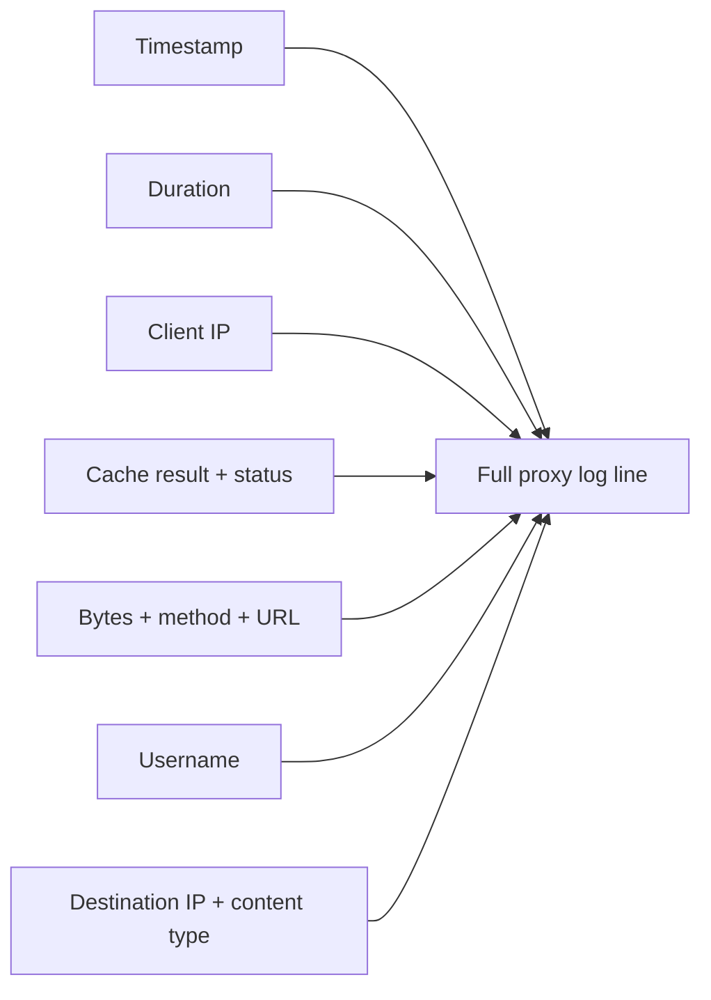
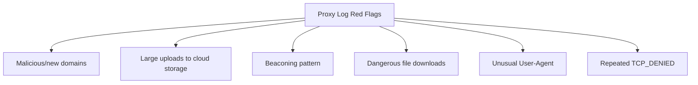
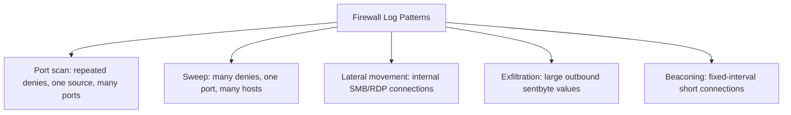
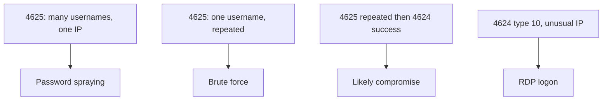
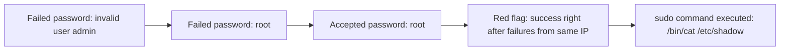
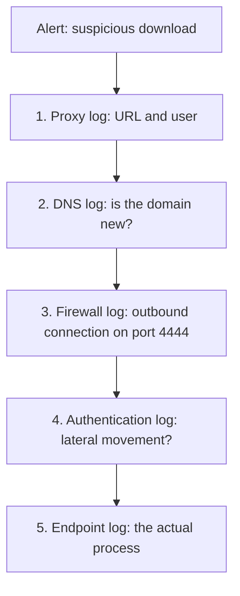

| Topic | Level | Reading Time | Prerequisites |
|---|---|---|---|
| Network and Authentication Logs | Intermediate | ~25 min | Core Log Types and Web Server Logs |

> **الهدف من الـ Section ده:**  
> هتفهم إزاي تقرا proxy logs وfirewall logs وWAF logs، وهتتعلم أهم Event IDs في Windows authentication logs، وإزاي تقرا SSH logs على Linux وVPN authentication logs، وأخيراً هتشوف إزاي الـ analyst بيربط كل دول مع بعض في تحقيق حقيقي.

## Learning Objectives

By the end of this section, you will be able to:

- Read a **Squid proxy log** field by field and list what an analyst looks for in it.
- Compare **proxy logs** and **web server logs** across position, direction, and typical use cases.
- Read a **firewall log** entry, including a Cisco ASA deny message, and list key patterns to watch.
- Explain what a **WAF log** confirms that a firewall log cannot.
- Interpret Windows **Event ID 4624/4625** authentication logs, including logon types and status codes.
- Read a Linux **SSH authentication log** and recognize a successful brute-force pattern.
- Read a **VPN authentication log** and explain why the assigned internal IP matters for correlation.
- Walk through a **mini-investigation** that stitches five different log sources into one story.

## Table of Contents

- [Learning Objectives](#learning-objectives)
- [Proxy Logs (Squid Example)](#proxy-logs-squid-example)
  - [What a Forward Proxy Does](#what-a-forward-proxy-does)
  - [Reading the Fields](#reading-the-fields)
  - [What the Analyst Looks For](#what-the-analyst-looks-for)
- [Proxy Log Versus Web Server Log](#proxy-log-versus-web-server-log)
- [Firewall Logs](#firewall-logs)
  - [A Basic Allow Entry](#a-basic-allow-entry)
  - [Cisco ASA Deny Example](#cisco-asa-deny-example)
  - [What to Look For](#what-to-look-for)
- [WAF Logs](#waf-logs)
- [Authentication Logs: Windows](#authentication-logs-windows)
  - [The Essential Event IDs](#the-essential-event-ids)
  - [A Failed Logon Event (4625) in Detail](#a-failed-logon-event-4625-in-detail)
- [Authentication Logs: Linux / SSH](#authentication-logs-linux--ssh)
- [VPN Authentication Log](#vpn-authentication-log)
- [DNS Logs, a Short Example](#dns-logs-a-short-example)
- [Putting Logs Together: A Mini-Investigation](#putting-logs-together-a-mini-investigation)
- [Career Path Connections](#career-path-connections)
- [Key Terms Glossary](#key-terms-glossary)
- [Summary](#summary)

## Proxy Logs (Squid Example)

### What a Forward Proxy Does

**Forward proxy** بيقعد بين المستخدمين الداخليين والإنترنت. طلبات الويب بتاعة المستخدمين بتعدي عليه، وهو يقدر يفلتر ويصادق ويسجّل.

```text
1759483200.123   245 10.1.5.23 TCP_MISS/200 15432 GET
http://news.example.com/index.html jsmith HIER_DIRECT/93.184.216.34 text/html

1759483230.789     0 10.1.5.23 TCP_DENIED/403 3890 GET http://gambling-
site.example/ jsmith HIER_NONE/- text/html
```

### Reading the Fields

| Field | Explanation |
|---|---|
| `1759483200.123` | Timestamp: الوقت بالظبط اللي الـ proxy عالج فيه الطلب، بصيغة Unix timestamp |
| `245` | مدة الطلب: 245 ملي ثانية للمعالجة |
| `10.1.5.23` | Client IP: العنوان الداخلي للجهاز اللي بعت الطلب |
| `TCP_MISS/200` | نتيجة الـ cache وHTTP status: `TCP_MISS` يعني المحتوى مش موجود في الـ cache، فـ Squid جابه من الوجهة؛ `200` يعني الطلب نجح |
| `15432` | Bytes sent للـ client |
| `GET` | HTTP method |
| `http://news.example.com/index.html` | الـ URL المطلوب |
| `jsmith` | Username: الهوية اللي Squid ربطها بالطلب عن طريق آلية authentication متظبطة (ممكن تكون عن طريق Active Directory) |
| `HIER_DIRECT/93.184.216.34` | مسار الاتصال والـ IP بتاع الوجهة: `HIER_DIRECT` يعني Squid اتصل مباشرة بالسيرفر بدل الـ cache |
| `text/html` | نوع المحتوى |



### What the Analyst Looks For

| Signal | Why It Matters |
|---|---|
| وصول لمواقع ضارة أو جديدة التسجيل | ممكن يدل على تواصل مع بنية تحتية مشبوهة |
| رفعات كبيرة غير معتادة لخدمات cloud storage | ممكن تدل على exfiltration |
| **Beaconing**: جهاز مخترق بيتصل بنفس الـ URL على فترات منتظمة (كل 60 ثانية مثلاً) | ممكن يدل على malware بيتواصل مع command-and-control server |
| تنزيل أنواع ملفات خطرة (`.exe`, `.ps1`, `.zip`) من مصادر مشبوهة | ممكن تحتوي malware |
| قيم User-Agent غير معتادة (`python-requests`, `curl`, أو فاضية) من workstation عادية | ممكن تدل على استخدام scripts أو أدوات سطر أوامر بدل browser عادي (رغم إنها ممكن تحصل في نشاط شرعي كمان) |
| `TCP_DENIED` متكرر من نفس المستخدم أو الجهاز | ممكن يدل على محاولات الوصول لوجهات ممنوعة |



## Proxy Log Versus Web Server Log

| | Proxy Log | Web Server Log |
|---|---|---|
| **Position** | بين المستخدمين الداخليين والإنترنت | قدام أو على الـ application بتاعتك |
| **Direction** | Outbound (موظفينك طالعين) | Inbound (العالم جاي لعندك) |
| **السؤال النموذجي** | موظفينا راحوا فين؟ | مين زار أو هاجم موقعنا؟ |
| **Client IP** | عنوان داخلي (10.x.x.x) | عنوان خارجي (زوار حقيقيين من الإنترنت) |
| **Username** | موجود غالباً (proxy authentication) | عادةً لأ، إلا لو الموقع عنده login خاص بيه |
| **الوجهة** | آلاف المواقع المختلفة | موقع واحد (موقعك) |
| **رؤية HTTPS** | الـ host:port بس، إلا لو فيه TLS inspection | المسار كامل، لأن السيرفر بيفك التشفير |
| **الاستخدامات** | تنزيل malware، ضغط على phishing، تسريب داتا، انتهاك سياسات | هجمات ويب (SQLi, XSS, scanning)، brute force، أخطاء تطبيق |

> [!TIP]
> Easy way to remember the difference: the proxy log watches your people going out, the web server log watches strangers coming in. A reverse proxy or load balancer is the opposite of a forward proxy, because it protects servers rather than users.

## Firewall Logs

### A Basic Allow Entry

الـ firewall بيفحص اتصالات الشبكة مقابل قواعده، وبيسجّل هل كل اتصال اتسمح بيه أو اتمنع.

```text
srcip=192.168.1.10 dstip=8.8.8.8 dstport=53 action=accept service=DNS
```

**القراءة:** جهاز بـ IP `192.168.1.10` بعت طلب لـ `8.8.8.8` على port 53 (DNS). الـ firewall سمح بالاتصال لأن الـ action كانت `accept`.

| Field | Meaning |
|---|---|
| `srcip` | الجهاز المصدر |
| `dstip` | الوجهة |
| `dstport` | الـ port المستهدف |
| `service` | الخدمة المعنية |
| `action` | هل الـ firewall سمح أو منع الاتصال |

### Cisco ASA Deny Example

```text
Oct 03 2026 09:31:05 FW1 : %ASA-4-106023: Deny tcp src outside:203.0.113.45/44312 dst inside:10.0.0.5/3389 by access-group
"OUTSIDE_IN" [0x0, 0x0]
```

**القراءة:** حد من الإنترنت حاول يوصل لـ RDP (port 3389) على سيرفر داخلي، والقاعدة `OUTSIDE_IN` منعته. `%ASA-4-106023` هو message ID قياسي، والرقم في النص هو الـ severity.

### What to Look For

| Pattern | Possible Meaning |
|---|---|
| Denies متكررة من مصدر واحد عبر ports كتيرة | **Port scan** |
| Denies كتيرة على port واحد عبر أجهزة كتيرة | **Sweep** لخدمة معينة |
| اتصالات outbound مسموحة لدول أو ports غريبة | نشاط مشبوه |
| أجهزة داخلية بتتصل ببعض على SMB (445) أو RDP (3389) | ممكن يدل على **lateral movement** |
| قيم `sentbyte` كبيرة لوجهات خارجية | ممكن تدل على exfiltration |
| **Beaconing**: نفس الاتصالات القصيرة على فترات ثابتة | إشارة C2 |



## WAF Logs

الـ **WAF logs** بتسجّل نوع الهجوم، الانتهاك، حالة الطلب (blocked أو alerted)، الـ support ID اللي بيتعرض للمستخدم على صفحة الـ block، والـ signature المطابقة.

```text
attack_type="SQL-Injection", violations="Attack signature detected",
request_status="blocked", support_id="1234567890123456789",
uri="/products", client_ip="198.51.100.77"
```

**ده أفضل مصدر تؤكد بيه شكل أي هجوم HTTP بالظبط.**

> [!NOTE]
> This connects directly to the WAF file from Defense in Depth and Evasion Techniques: a firewall log shows that a connection on port 443 was allowed, but only the WAF log reveals what was actually inside that HTTP request.

## Authentication Logs: Windows

### The Essential Event IDs

| Event ID | Meaning |
|---|---|
| **4624** | Logon ناجح |
| **4625** | Logon فاشل |

| Pattern | Likely Meaning |
|---|---|
| `4625` كتير بأسماء مستخدمين مختلفة من IP واحد | **Password spraying** أو **user enumeration** |
| `4625` كتير لمستخدم واحد | **Brute force** |
| `4625` متكررة ثم `4624` ناجحة من نفس المصدر | اختراق محتمل |
| `4624` بـ logon type `10` من IP غير معتاد | دخول عن طريق RDP |



### A Failed Logon Event (4625) in Detail

```text
EventID: 4625   Time: 2026-10-03 09:40:12
Account For Which Logon Failed: Account Name: administrator   Account Domain: CORP
Logon Type: 3
Failure Reason: Unknown user name or bad password
Status: 0xC000006D   Sub Status: 0xC000006A
Workstation Name: PC-FINANCE-07
Source Network Address: 10.1.8.50   Source Port: 51444
```

| Field | Meaning |
|---|---|
| **Logon Type** | `2` تفاعلي (على الكيبورد)، `3` شبكي (file share)، `4` batch، `5` service، `7` unlock، `10` RemoteInteractive (RDP)، `11` cached credentials |
| **Status** | `0xC000006D` فشل logon عام |
| **Sub Status** | `0xC000006A` password غلط؛ `0xC0000064` المستخدم مش موجود؛ `0xC0000234` locked out؛ `0xC0000072` حساب معطّل |
| **Source Network Address** | منين جاءت المحاولة |

## Authentication Logs: Linux / SSH

الملف: `/var/log/auth.log` (Debian/Ubuntu) أو `/var/log/secure` (RHEL/CentOS).

```text
Oct 3 09:45:01 srv01 sshd[2211]: Failed password for invalid user admin from 203.0.113.45 port
42122 ssh2
Oct 3 09:45:03 srv01 sshd[2213]: Failed password for root from 203.0.113.45 port 42130 ssh2
Oct 3 09:45:09 srv01 sshd[2217]: Accepted password for root from 203.0.113.45 port 42150 ssh2
Oct 3 09:46:00 srv01 sudo:   jsmith : TTY=pts/0 ; PWD=/home/jsmith ; USER=root ; COMMAND=/bin/cat
/etc/shadow
```

**القراءة:**

- `invalid user` معناها اسم المستخدم مش موجود أصلاً (المهاجم بيخمّن).
- الـ **`Accepted`** اللي جاية **مباشرة بعد** محاولات فاشلة من نفس IP هي **الـ red flag**.
- سطر الـ `sudo` بيوضح استخدام الصلاحيات والأمر بالظبط.



> [!WARNING]
> This exact log pattern, repeated failures followed immediately by a success from the same source, is one of the clearest brute-force success indicators across any authentication system, not just SSH. It connects directly to the credential-cracking concepts covered in the Password Cracking Techniques file.

## VPN Authentication Log

```text
2026-10-03 09:55:10 vpn-gw01 user=jsmith src=185.220.101.9 result=SUCCESS auth=RADIUS+MFA
assigned_ip=10.200.0.15 session_id=88421
2026-10-03 11:30:44 vpn-gw01 user=jsmith session_id=88421 event=DISCONNECT bytes_in=2.1GB
bytes_out=14MB
```

الـ VPN log بيدّيك: وقت الدخول، الـ public source IP، الـ internal IP المخصص (لازم للربط مع نشاط لاحق)، نتيجة الـ MFA، وحجم الداتا.

> [!TIP]
> The assigned internal IP is the critical pivot point: once you have it, you can search every other internal log (firewall, proxy, authentication) for that same internal IP to reconstruct exactly what the VPN session did inside the network.

## DNS Logs, a Short Example

```text
03-Oct-2026 10:01:02 queries: client @0x7f 10.1.5.23#52344 (www.microsoft.com): query:
www.microsoft.com IN A + (10.0.0.2)
```

الحقول: الوقت، الـ client IP، الاسم المطلوب، نوع الـ record (A, AAAA, MX, TXT)، والـ resolver.

**DNS logs بتوضح phishing domains، malware callbacks، DGA domains، وtunnels.**

> [!NOTE]
> Full detection detail for DNS-based exfiltration techniques is covered in the Data Exfiltration and DNS Tunneling file in the Data Loss Prevention and Exfiltration category.

## Putting Logs Together: A Mini-Investigation

**Alert:** المستخدم `jsmith` نزّل ملف مشبوه.

| # | Log | What It Reveals |
|---|---|---|
| 1 | **Proxy log** | `10.1.5.23 jsmith GET http://cdn-update.example/setup.exe TCP_MISS/200 2.1MB`، فبنعرف الـ URL والمستخدم |
| 2 | **DNS log** | بيوضح إمتى `cdn-update.example` اتحل أول مرة (عشان نشوف هل الـ domain جديد) |
| 3 | **Firewall log** | بيأكد اتصالات outbound لاحقة من `10.1.5.23` لـ IP مجهول على port 4444 |
| 4 | **Authentication log** | بيوضح هل الجهاز ده بعدين عمل login على أنظمة تانية (lateral movement) |
| 5 | **Endpoint log** | الـ process اللي عمل الاتصال |



> [!IMPORTANT]
> The lesson: each log is one piece of the puzzle. No single source, including this five-step example, can answer every part of the investigation alone. This is the practical, end-to-end demonstration of the correlation principle introduced at the start of this file.

## Career Path Connections

| Career Path | How This Topic Applies |
|---|---|
| SOC Analyst | This file's log types and the mini-investigation pattern represent core daily Tier 1/Tier 2 investigative work |
| Penetration Tester | Understanding which log source reveals which evidence helps plan engagements that stay under or deliberately trigger detection |
| GRC | Authentication log retention (4624/4625, SSH, VPN) is a direct, auditable compliance requirement |
| Cloud Security | Cloud-native firewall, proxy, and identity logs follow the same field logic, often correlated in a cloud-native SIEM |

## Key Terms Glossary

| Term | Definition |
|---|---|
| Forward Proxy | A system sitting between internal users and the internet, able to filter, authenticate, and log traffic |
| Beaconing | Regular, periodic communication from a compromised host to a command-and-control server |
| Reverse Proxy | A system that sits in front of servers to protect them, the opposite of a forward proxy |
| Port Scan | Repeated connection attempts across many ports from one source |
| Sweep | Repeated connection attempts to one port across many hosts |
| Lateral Movement | An attacker's movement from one compromised system to another inside the network |
| Logon Type | A Windows field indicating how a logon occurred (interactive, network, RDP, etc.) |
| Password Spraying | Trying one or a few common passwords against many different accounts |
| Assigned Internal IP | The internal network address a VPN gateway assigns to a connecting user, used for correlation |

## Summary

- **Proxy logs reveal outbound activity:** cache result، status، bytes، username، ومسار الاتصال، وبيكشفوا beaconing وexfiltration وmalware downloads.
- **Proxy and web server logs differ in direction and purpose:** proxy بيراقب موظفينك طالعين، web server بيراقب الغرباء داخلين.
- **Firewall logs reveal allow/deny decisions:** وأنماط زي port scans وsweeps وlateral movement.
- **WAF logs confirm what a firewall cannot see:** تفاصيل الهجوم الكاملة على مستوى HTTP.
- **Windows 4624/4625 events, with logon types and status codes, reveal brute force and compromise patterns.**
- **Linux SSH logs show the same brute-force pattern:** فشل متكرر ثم نجاح مباشر من نفس المصدر.
- **VPN logs provide the pivot point (assigned internal IP) for correlating later internal activity.**
- **DNS logs reveal phishing domains, malware callbacks, and tunneling attempts.**
- **No single log source answers a full investigation alone:** المثال الخماسي بيوضح إزاي خمس مصادر مختلفة بتبني قصة واحدة متكاملة.

