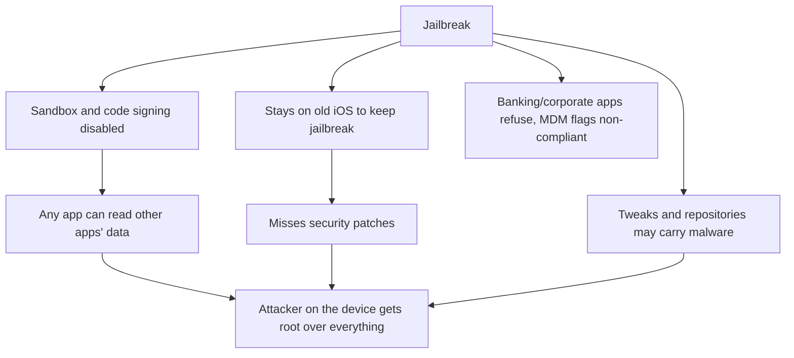
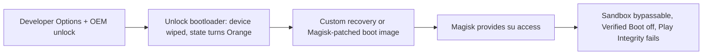
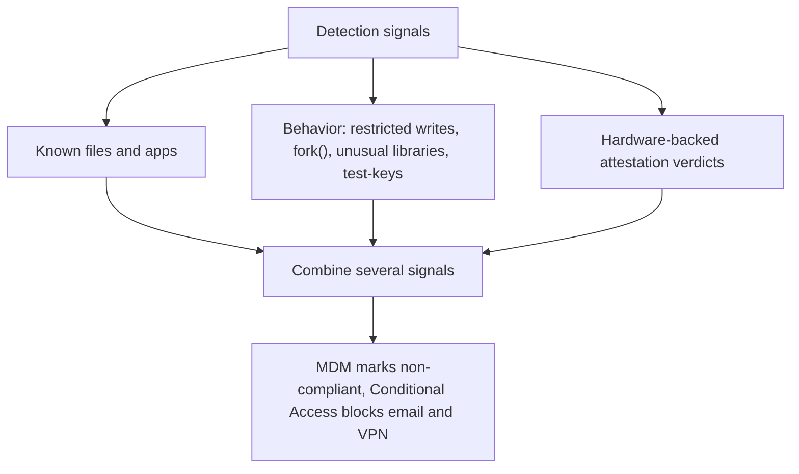
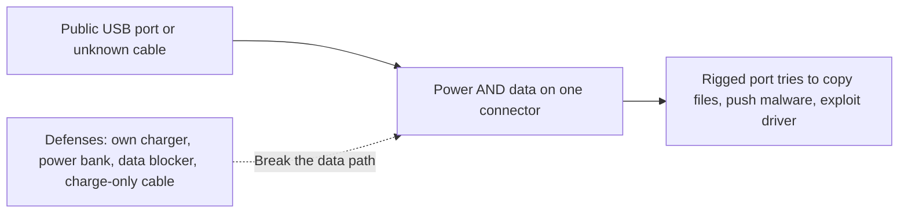
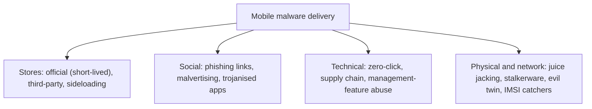

| Topic | Level | Reading Time | Prerequisites |
|---|---|---|---|
| Jailbreaking, Rooting, and Mobile Malware | Intermediate | ~20 min | Mobile Threats and Platform Security |

> **الهدف من الـ Section ده:**  
> هتفهم إيه معنى الـ jailbreak والـ root وليه بيكسروا حماية الموبايل من جذورها، وإزاي المؤسسات بتكتشفهم، وإيه هو الـ juice jacking وهل خطره حقيقي، وإزاي الـ malware بيوصل فعلاً للتليفون بخمس طرق أساسية وخمس طرق إضافية.

## Learning Objectives

By the end of this section, you will be able to:

- Define **jailbreaking** and list the four jailbreak types (tethered, semi-tethered, semi-untethered, untethered).
- Explain why jailbreaking is dangerous in terms of sandbox, patching, malware, and compliance.
- Describe **rooting** on Android at a high level, and explain why a custom hardened ROM like GrapheneOS shows that unlocking is not always bad.
- List the signals organizations use to detect jailbroken or rooted devices, and explain why detection is a cat-and-mouse game.
- Explain **juice jacking**, its history, and the practical defenses.
- List ten ways malware reaches a mobile device and the Android permissions most often abused.
- Apply the mobile security best-practices checklist.

## Table of Contents

- [Learning Objectives](#learning-objectives)
- [Jailbreaking (iOS)](#jailbreaking-ios)
  - [What It Is](#what-it-is)
  - [Jailbreak Types](#jailbreak-types)
  - [Why It Is Dangerous](#why-it-is-dangerous)
- [Rooting Android](#rooting-android)
  - [What It Is](#what-it-is-1)
  - [The Usual Steps](#the-usual-steps)
  - [Custom ROMs and the GrapheneOS Case](#custom-roms-and-the-grapheneos-case)
  - [Risks](#risks)
- [How Organizations Detect Jailbroken or Rooted Devices](#how-organizations-detect-jailbroken-or-rooted-devices)
- [Juice Jacking](#juice-jacking)
  - [How It Works](#how-it-works)
  - [History](#history)
  - [Defenses](#defenses)
- [How Malware Reaches a Mobile Device](#how-malware-reaches-a-mobile-device)
  - [Five Common Delivery Paths](#five-common-delivery-paths)
  - [Five More Delivery Paths](#five-more-delivery-paths)
  - [Android Permissions Attackers Love](#android-permissions-attackers-love)
- [Mobile Security Best Practices](#mobile-security-best-practices)
- [Career Path Connections](#career-path-connections)
- [Key Terms Glossary](#key-terms-glossary)
- [Summary](#summary)

## Jailbreaking (iOS)

### What It Is

**Jailbreaking** معناه استغلال ثغرات في iOS لإزالة قيود Apple والحصول على **root-level access**. بيسمح بتثبيت تطبيقات غير موقَّعة وtweaks ومتاجر بديلة (زي **Cydia** و**Sileo**)، وتخصيص النظام.

### Jailbreak Types

| Type | Behavior |
|---|---|
| **Tethered** | لازم يتوصل بكمبيوتر في كل boot، وإلا الجهاز مش هيشتغل |
| **Semi-tethered** | بيعمل boot عادي، لكن الـ jailbreak بيضيع لحد ما يتعاد تطبيقه من كمبيوتر |
| **Semi-untethered** | بيعمل boot عادي، والـ jailbreak بيتعاد تطبيقه من app على الجهاز نفسه |
| **Untethered** | بيفضل بعد إعادة التشغيل (نادر جداً النهاردة) |

أدوات معروفة (كأمثلة): **checkra1n, palera1n, unc0ver, Dopamine**.

### Why It Is Dangerous

- **بيعطّل حماية الـ sandbox والـ code signing**، فأي app يقدر يوصل لداتا التطبيقات التانية.
- المستخدمين غالباً **بيفضلوا على إصدارات iOS قديمة** عشان يحافظوا على الـ jailbreak، فبيفوّتوا الـ security patches.
- الـ tweaks والـ repositories ممكن تحتوي **malware** (spyware بيسرق credentials أو داتا).
- تطبيقات البنوك والشركات **بترفض تشتغل**، والـ MDM بيعلّم الجهاز إنه **non-compliant**.
- مشاكل الضمان والدعم.
- أي مهاجم يوصل لتليفون عليه jailbreak **بيحصل على root access لكل حاجة**.

## Rooting Android

### What It Is

**Rooting** بيدّي المستخدم (أو الـ malware) **superuser access** على Android.

### The Usual Steps

على مستوى عالٍ (للفهم فقط):

| # | Step |
|---|---|
| 1 | تفعيل Developer Options وOEM unlocking |
| 2 | فتح الـ bootloader. **ده بيمسح الجهاز وبيغيّر حالة الـ boot لـ Orange** |
| 3 | تثبيت custom recovery (زي **TWRP**)، أو عمل patch للـ boot image بـ **Magisk** وتثبيته |
| 4 | Magisk بيوفر `su` (superuser) access، مع manager app بيدّي root للتطبيقات |

### Custom ROMs and the GrapheneOS Case

**Custom ROMs** (زي **LineageOS** و**GrapheneOS**) بتستبدل الـ OS بالكامل. **GrapheneOS** حالة مثيرة: ROM **مُحصَّن ومركّز على الأمان**، وده بيوضح إن فتح الـ bootloader **مش دايماً سيئ**. الخطر الحقيقي في **تشغيل أنظمة غير موثوقة أو غير محدّثة**.

> [!IMPORTANT]
> Unlocking a bootloader is not automatically a security failure. What makes a rooted or modified device dangerous is running an untrusted, unpatched, or unverified system. A hardened custom ROM maintained and updated by a security-focused project can be more secure than a neglected stock device.

### Risks

- الـ app sandbox **ممكن يتخطى**.
- أي malware عنده root يقدر يعمل أي حاجة: يقرا التطبيقات التانية، يخبّي نفسه، يعترض الـ SMS والـ OTP.
- **Verified Boot مطفي.**
- **SafetyNet / Play Integrity بيفشل**، فتطبيقات البنوك والشغل ممكن ترفض تشتغل.
- التليفونات المعمولها root غالباً **قديمة**.

> [!WARNING]
> This section describes rooting at the level needed to understand why it is a risk and how it is detected. It is not a guide for rooting a device you manage for an organization. Corporate-managed devices should never be rooted, and doing so typically violates the acceptable-use policy and triggers a non-compliant status.

## How Organizations Detect Jailbroken or Rooted Devices

| Method | Detail |
|---|---|
| **MDM compliance checks** | بتدوّر على مؤشرات jailbreak، بتعلّم الجهاز non-compliant، وبتحجب الوصول للإيميل والـ VPN عن طريق **Conditional Access** |
| **File and app checks** | iOS: وجود Cydia وSileo و`/bin/bash` و`/usr/sbin/sshd`. Android: وجود `su` binary أو Magisk app |
| **Behavior checks** | القدرة على الكتابة في directories محظورة، القدرة على استدعاء `fork()` (بيتحجب في الـ sandbox)، libraries غير معتادة محمّلة في الـ app، وبناء `test-keys` على Android |
| **Hardware-backed attestation** | Apple **App Attest/DeviceCheck** وGoogle **Play Integrity** بيرجّعوا verdicts موقَّعة عن سلامة الجهاز |

**فحص الواقع:** الكشف لعبة **قط وفأر**، لأن فيه أدوات بتخبّي الـ root. فبتجمّع **عدة إشارات** مع بعض.

> [!TIP]
> In an interview, the strongest answer on root detection is not any single check but the principle: hiding tools exist, so no single check is trustworthy on its own. Hardware-backed attestation is the strongest signal because it is signed by the platform, not by software the attacker can modify.

## Juice Jacking

### How It Works

**Juice jacking** هجوم عن طريق **USB port شحن عام أو كابل**. محطات الشحن في المطارات والفنادق والكافيهات ومراكز المؤتمرات بتستخدم ports USB بتنقل **الطاقة والداتا على نفس الـ connector**. محطة خبيثة (أو كابل مفخخ) ممكن تحاول توصل لداتا التليفون أو تثبّت malware وهو بيشحن.

| # | Step |
|---|---|
| 1 | الضحية بتوصّل التليفون بالـ port أو الكابل |
| 2 | اتصال الـ USB بيفتح كمان **قناة داتا** |
| 3 | port أو كابل مفخخ بيحاول يكلّم التليفون: ينسخ ملفات، أو يدفع malware، أو يستغل ثغرة في USB driver |

### History

- المصطلح اتسك سنة **2011** من الباحث **Brian Krebs** بعد عرض في **DEF CON** (مشروع "Wall of Sheep") أثبت الخطر.
- باحثين لاحقاً أثبتوا proofs of concept لـ iPhone (شاحن **"Mactans"** من Georgia Tech سنة 2013).
- كابلات خبيثة زي **O.MG cable** شكلها كابل عادي لكن فيها **implant مخفي بيدعم Wi-Fi** ويقدر يحقن ضغطات مفاتيح (هجوم من نوع **badUSB**).
- الـ **FBI** والـ **FCC** أصدروا تحذيرات علنية. **الحالات الإجرامية المؤكدة نادرة**، فالخطر غالباً **نظري في الممارسة**، لكن **التقنية حقيقية**.
- بحث 2025 من **Graz University of Technology** اسمه **"ChoiceJacking"** أثبت إن المهاجمين يقدروا يتخطوا prompt "Allow data access?" عن طريق تزييف مدخلات المستخدم، فحتى **رسالة الأمان نفسها مش مطلقة**.

### Defenses

- استخدم **الشاحن الخاص بيك** ووصّله بـ wall outlet.
- شيل معاك **power bank**.
- استخدم **USB data blocker** ("USB condom") بيمرر pins الطاقة بس.
- استخدم **charge-only cables**.
- خلّي التليفون **مقفول ومحدّث**. ارفض أي prompt "Trust this computer?" أو "Allow data transfer?".
- تجنب المحطات العامة والكابلات المجهولة، **بما فيها كابلات "الهدايا" المجانية**.

**سؤال تعليمي:** إيه الفرق بين كابل شحن وكابل داتا؟ **الإجابة:** في كابل الداتا فيه **أسلاك داتا** جوه الكابل، والـ data blocker بيقطعها.

> [!NOTE]
> Juice jacking is a real technique with a modest real-world probability. The right way to present it is calibrated: the technology is real and demonstrated, confirmed criminal cases are rare, and the defenses are cheap, so following them costs almost nothing.

## How Malware Reaches a Mobile Device

### Five Common Delivery Paths

| # | Path | Detail |
|---|---|---|
| 1 | **Official app stores** | أحياناً تطبيقات خبيثة بتعدّي، غالباً app بريء بيتحول لخبيث بعد update أو فيه كود مخفي. بتتشال لما تتكتشف، فعمرها قصير. الطُعم الشائع: تطبيقات "نزّل فيديوهات من YouTube" |
| 2 | **Third-party app stores وsideloading** | بيأثر أساساً على Android وiOS المعمول له jailbreak. مفيش فحص من Google/Apple |
| 3 | **Phishing links وattachments** | عن طريق SMS وemail وWhatsApp/Telegram/social media وQR codes. اللينك بيودّي لموقع مزيف أو تطبيق أو profile خبيث |
| 4 | **Malicious websites وmalvertising** | drive-by downloads، وpop-ups تحديث مزيفة ("Your Chrome is outdated")، وscareware |
| 5 | **Trojanised legitimate apps** | نسخ مقلّدة من تطبيقات مشهورة (WhatsApp مزيف، تطبيق بنك مزيف) أو تطبيقات معدّلة |

### Five More Delivery Paths

| # | Path | Detail |
|---|---|---|
| 6 | **Zero-click exploits** | بتتوصّل برسالة أو مكالمة من غير تفاعل (Pegasus) |
| 7 | **Physical access** | juice jacking، كابلات خبيثة، stalkerware |
| 8 | **Rogue networks** | evil twin Wi-Fi، وأبراج محمول مزيفة (**IMSI catchers / "Stingrays"**) بتخفّض أو تعترض الاتصالات |
| 9 | **Supply chain** | malware مثبّت مسبقاً على أجهزة رخيصة، وSDKs مخترقة داخل التطبيقات |
| 10 | **Abuse of management features** | configuration profiles خبيثة، rogue MDM enrolment، شهادات enterprise |

### Android Permissions Attackers Love

على Android، **نموذج الصلاحيات هدف مفضّل**. التطبيقات بتطلب **"Accessibility service"** أو **"Device admin"** أو **"Draw over other apps"** أو **"Notification access"**، وبعد كده **بتتحكم في التليفون**.

> [!WARNING]
> An Android app asking for Accessibility service, Device admin, Draw over other apps, or Notification access is requesting far more power than almost any normal app needs. If a simple utility app asks for any of these, treat the request itself as the red flag.

## Mobile Security Best Practices

| # | Practice |
|---|---|
| 1 | حدّث الـ OS والتطبيقات |
| 2 | استخدم **passcode قوي** وbiometrics؛ فعّل تشفير الجهاز (مفعّل افتراضياً على التليفونات الحديثة) |
| 3 | ثبّت التطبيقات من **المتاجر الرسمية بس**، وافحص الصلاحيات |
| 4 | **متعملش jailbreak أو root** |
| 5 | استخدم **authenticator app أو security key** بدل SMS؛ واضبط carrier PIN |
| 6 | احذر من اللينكات في SMS والـ QR codes |
| 7 | استخدم **VPN على Wi-Fi غير الموثوق**، وعطّل auto-join للشبكات المفتوحة |
| 8 | اقفل Bluetooth/NFC لما مش محتاجهم |
| 9 | فعّل **Find My / remote wipe** |
| 10 | متستخدمش USB ports عامة؛ استخدم شاحنك |
| 11 | للمؤسسات: **انشر MDM** (الملف الجاي) |

## Career Path Connections

| Career Path | How This Topic Applies |
|---|---|
| SOC Analyst | Uses MDM compliance and device-integrity signals when triaging a sign-in or an endpoint alert |
| Penetration Tester | Assesses mobile attack surface in authorized scope, including rooted-device behavior and permission abuse |
| GRC | Policies must explicitly prohibit jailbreaking and rooting on corporate or BYOD-enrolled devices |
| Cloud Security | Device-integrity attestation (App Attest, Play Integrity) feeds conditional access for cloud apps |

## Key Terms Glossary

| Term | Definition |
|---|---|
| Jailbreaking | Exploiting iOS to remove Apple's restrictions and gain root-level access |
| Rooting | Gaining superuser access on Android |
| Magisk | A tool that patches the Android boot image to provide `su` access |
| Custom ROM | A replacement operating system image such as LineageOS or GrapheneOS |
| Play Integrity | Google's API letting apps verify a device is genuine and unmodified |
| App Attest / DeviceCheck | Apple's hardware-backed mechanisms for verifying app and device integrity |
| Juice Jacking | An attack through a public USB charging port or cable that carries both power and data |
| USB Data Blocker | An adapter passing only power pins so no data channel can open |
| badUSB | An attack where a USB device impersonates a keyboard to inject keystrokes |
| IMSI Catcher (Stingray) | A fake cell tower that intercepts or downgrades mobile connections |
| Sideloading | Installing an app from outside the official store |
| Malvertising | Malicious advertisements delivering drive-by downloads or fake prompts |

## Summary

- **Jailbreaking removes Apple's sandbox and code-signing protections:** والمستخدمين بيفضلوا على iOS قديم، فبيفوّتوا patches.
- **Four jailbreak types exist:** tethered، semi-tethered، semi-untethered، وuntethered.
- **Rooting follows a standard path on Android:** OEM unlock، bootloader unlock (حالة Orange)، recovery أو Magisk، وsu access.
- **Unlocking is not inherently bad:** GrapheneOS مثال على ROM محصّن، والخطر في الأنظمة غير الموثوقة أو غير المحدّثة.
- **Detection is cat-and-mouse:** ملفات وسلوك وattestation، وبتتجمّع عدة إشارات لأن أدوات التخبية موجودة.
- **Juice jacking is real technology with modest real-world probability:** ChoiceJacking بيوضح إن حتى prompt الأمان مش مطلق.
- **Malware reaches phones through ten paths:** stores، sideloading، phishing، malvertising، تطبيقات مقلّدة، zero-click، وصول فيزيائي، شبكات مزيفة، supply chain، وإساءة استخدام ميزات الإدارة.
- **Android permissions are a favourite target:** Accessibility وDevice admin وDraw over other apps وNotification access.
- **Best practices combine updates, strong passcodes, official stores, no jailbreaking, non-SMS MFA, careful links, VPN, and MDM for organizations.**

