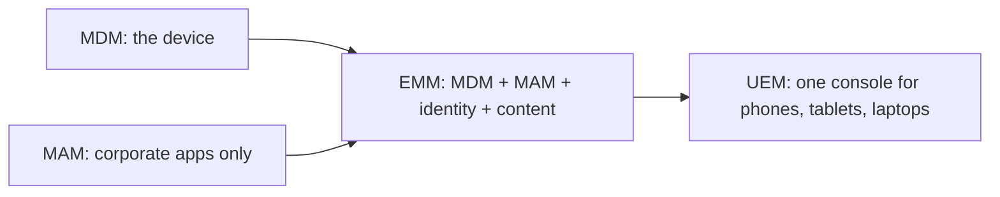
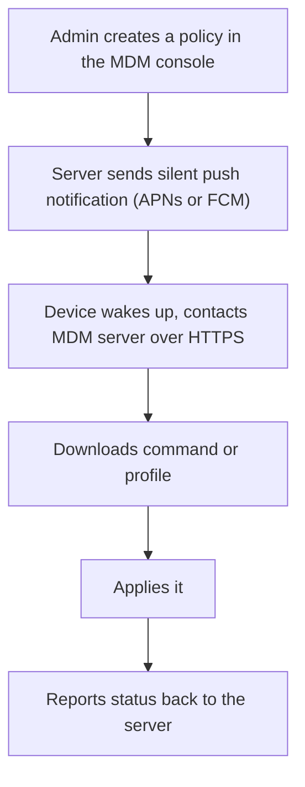
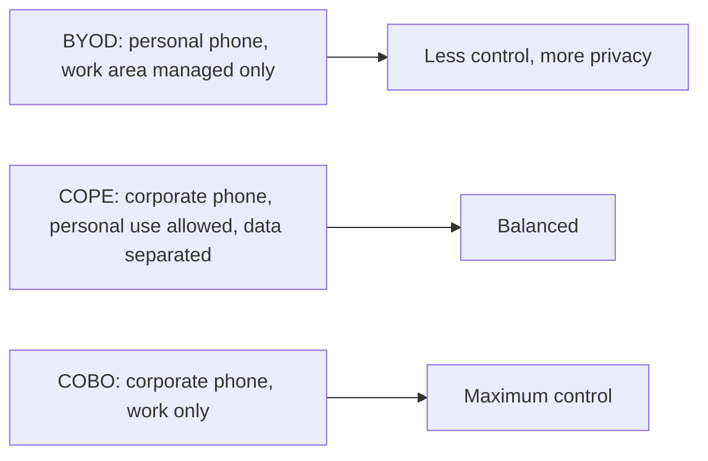
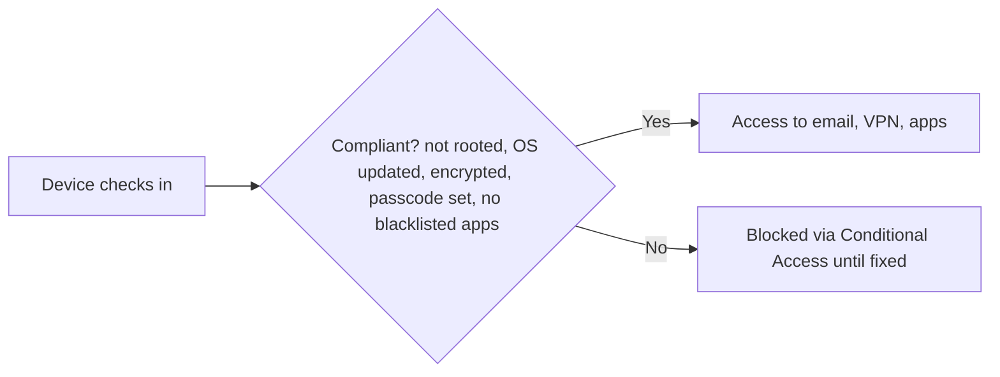
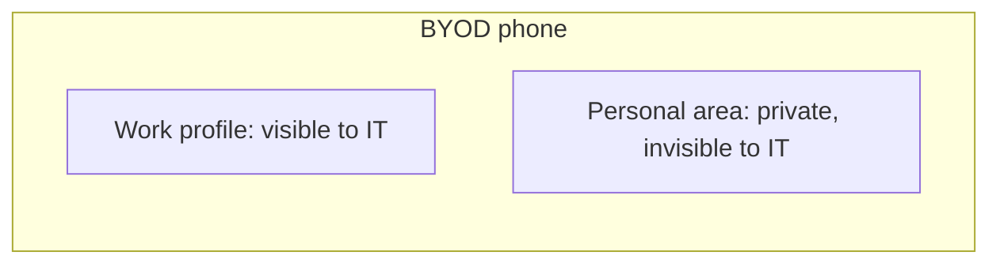
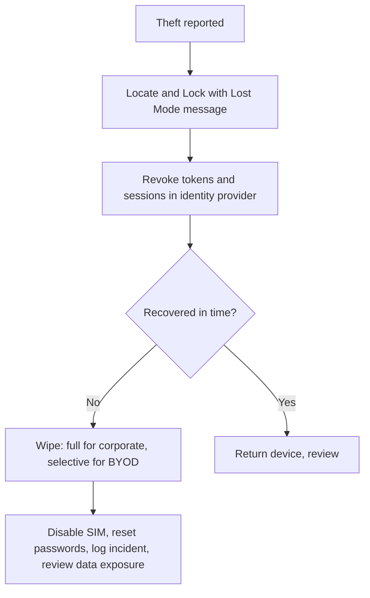
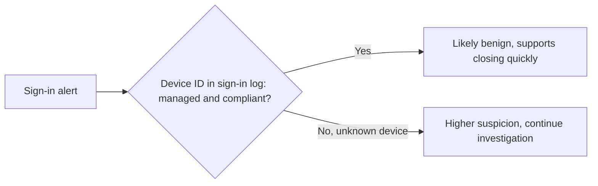
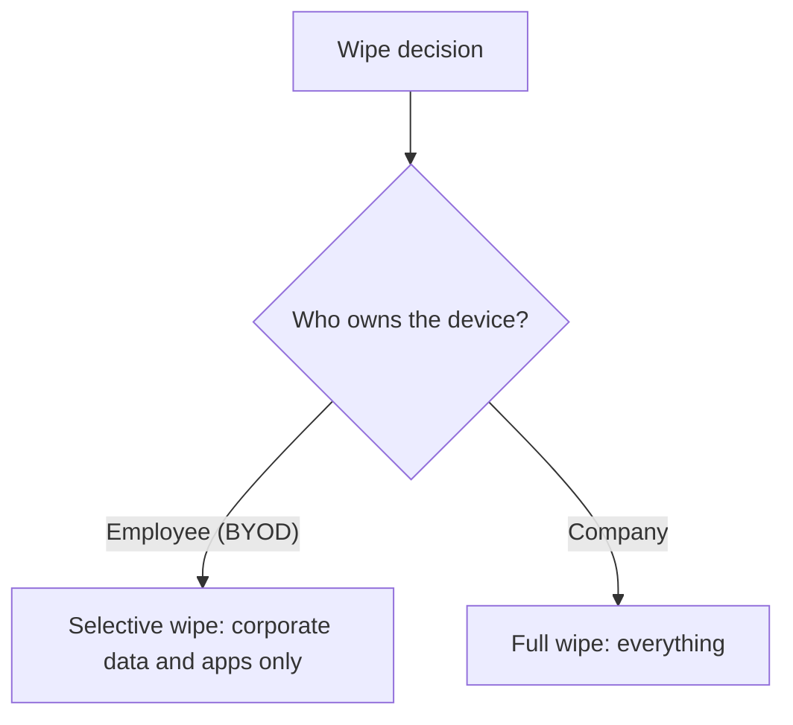

| Topic | Level | Reading Time | Prerequisites |
|---|---|---|---|
| Mobile Device Management (MDM) | Intermediate | ~25 min | Jailbreaking, Rooting, and Mobile Malware |

> **الهدف من الـ Section ده:**  
> هتفهم إزاي المؤسسات بتتحكم في التليفونات اللي بتدخل على داتاها عن طريق الـ MDM، وإيه الفرق بين BYOD وCOBO وCOPE، وإزاي الـ enrolment والـ compliance والـ remote wipe بيشتغلوا، وليه الـ MDM نفسه هدف عالي القيمة لازم يتأمن.

## Learning Objectives

By the end of this section, you will be able to:

- Define **MDM** and differentiate it from **MAM**, **EMM**, and **UEM**.
- Describe the six components of an MDM architecture and the simple flow from policy to device.
- Compare the **ownership models** (BYOD, COBO, COPE) and map them to Android Enterprise and iOS modes.
- List the main **enrolment methods** and explain why automated enrolment is preferred for corporate devices.
- Describe what MDM can do: configuration, security policies, compliance and conditional access, app management, remote actions, data protection, and network controls.
- Explain **containerisation** and what IT can and cannot see on a BYOD device.
- Walk through a **stolen phone** response, and explain how MDM data supports SOC investigations.
- Explain why MDM is a high-value target, and apply the twelve-point best-practice checklist.

## Table of Contents

- [Learning Objectives](#learning-objectives)
- [What Is MDM](#what-is-mdm)
  - [The Core Idea](#the-core-idea)
  - [Related Terms People Mix Up](#related-terms-people-mix-up)
- [How MDM Works: The Architecture](#how-mdm-works-the-architecture)
  - [The Six Components](#the-six-components)
  - [The Simple Flow](#the-simple-flow)
- [Ownership Models](#ownership-models)
- [Enrolment Methods](#enrolment-methods)
- [What MDM Can Do](#what-mdm-can-do)
  - [Device Configuration and Provisioning](#device-configuration-and-provisioning)
  - [Security Policy Enforcement](#security-policy-enforcement)
  - [Compliance Checking and Conditional Access](#compliance-checking-and-conditional-access)
  - [Application Management](#application-management)
  - [Remote Actions](#remote-actions)
  - [OS Update Management](#os-update-management)
  - [Data Protection, Inventory, and Network Security](#data-protection-inventory-and-network-security)
  - [Kiosk Mode and Security Tool Integration](#kiosk-mode-and-security-tool-integration)
- [Containerisation: Separating Work and Personal](#containerisation-separating-work-and-personal)
  - [The Three Approaches](#the-three-approaches)
  - [What IT Can and Cannot See on BYOD](#what-it-can-and-cannot-see-on-byod)
- [MDM in Action: A Stolen Phone Scenario](#mdm-in-action-a-stolen-phone-scenario)
- [MDM and the SOC](#mdm-and-the-soc)
- [Risks and Limitations of MDM](#risks-and-limitations-of-mdm)
- [MDM Best-Practice Checklist](#mdm-best-practice-checklist)
- [Review Questions](#review-questions)
- [Career Path Connections](#career-path-connections)
- [Key Terms Glossary](#key-terms-glossary)
- [Summary](#summary)

## What Is MDM

### The Core Idea

**Mobile Device Management (MDM)** هو تقنية ومجموعة سياسات بتسمح للمؤسسة **تضبط وتأمّن وتراقب وتتحكم مركزياً** في الأجهزة المحمولة (تليفونات، tablets، أحياناً laptops وأجهزة IoT) اللي بتدخل على داتا الشركة.

فكّر فيه زي **"الريموت كنترول بتاع قسم الـ IT لكل جهاز"**. من غير MDM، الشركة مش عارفة كام تليفون بيقرا إيميلها، ولا هل عليهم passcode، ولا هل متعمل لهم jailbreak، ولا إيه اللي بيحصل لو واحد اتسرق. مع MDM، الـ IT يقدر يفرض قواعد ويتخذ إجراءات **في ثواني، عن بُعد**.

### Related Terms People Mix Up

| Term | Meaning |
|---|---|
| **MDM** | بيدير **الجهاز نفسه** (الإعدادات، الأمان، الـ wipe) |
| **MAM** (Mobile Application Management) | بيدير **التطبيقات المؤسسية وداتاها بس**، مش الجهاز كله (مفيد للتليفونات الشخصية) |
| **EMM** (Enterprise Mobility Management) | MDM + MAM + إدارة الهوية والمحتوى |
| **UEM** (Unified Endpoint Management) | المصطلح الحديث. **console واحد** للتليفونات والـ tablets والـ laptops (Windows, macOS) وغيرهم |

## How MDM Works: The Architecture

### The Six Components

| # | Component | Detail |
|---|---|---|
| 1 | **MDM server/console** | (cloud أو on-premises) حيث الـ admins بيحددوا الـ policies. أمثلة: **Microsoft Intune، Jamf Pro، VMware Workspace ONE، Ivanti، Kandji، Hexnode، Samsung Knox Manage** |
| 2 | **Management channel على الجهاز** | iOS وmacOS: الـ **MDM framework** المدمج، بيستقبل الأوامر عن طريق **Apple Push Notification service (APNs)**. Android: **agent app / Device Policy Controller (DPC)** وإطار **Android Enterprise** من Google مع **Firebase Cloud Messaging (FCM)** للتنبيه |
| 3 | **Enrolment** | الجهاز لازم يتسجل في الـ MDM. المستخدم (أو provisioning تلقائي) بيثبّت management profile أو agent ويوافق عليه |
| 4 | **Configuration profiles والـ policies** | الإعدادات اللي السيرفر بيبعتها للجهاز |
| 5 | **Reporting** | الجهاز بيرجّع inventory وحالة compliance |
| 6 | **التكامل مع الهوية** (Entra ID، Okta) | حالة compliance الجهاز بتغذي قرارات **Conditional Access** |

### The Simple Flow

الـ admin بيعمل policy، السيرفر بيبعت **silent push notification**، الجهاز بيصحى ويتصل بسيرفر الـ MDM عبر HTTPS، بينزّل الأمر أو الـ profile، يطبّقه، ويرجّع تقرير.

## Ownership Models

**مين اللي مالك التليفون؟** ده بيحدد مستوى التحكم المناسب.

| Model | Description |
|---|---|
| **BYOD** (Bring Your Own Device) | تليفون الموظف الشخصي. تكلفة أقل، مخاوف خصوصية أعلى. الشركة عادةً بتدير **منطقة شغل بس** (work profile على Android، User Enrolment على iOS)، مش الجهاز كله |
| **COBO** (Corporate-Owned, Business Only) | جهاز الشركة للشغل فقط. **أقصى تحكم** |
| **COPE** (Corporate-Owned, Personally Enabled) | جهاز الشركة، والموظفين يقدروا يستخدموه شخصياً كمان، مع **فصل بين داتا الشغل والشخصية** |

**أوضاع Android Enterprise:** Work Profile (BYOD)، Fully Managed (corporate)، Fully Managed with Work Profile (COPE)، وDedicated devices (kiosks، scanners).

**على iOS:** **Supervised mode** (للأجهزة المؤسسية المشتراة عن طريق Apple Business Manager) بيفتح تحكم أعمق، و**User Enrolment** هو وضع BYOD الصديق للخصوصية.

## Enrolment Methods

| Method | Detail |
|---|---|
| **Manual enrolment** | المستخدم بيثبّت company portal app ويسجل دخول (BYOD النموذجي) |
| **Automated enrolment** للأجهزة المؤسسية | **Apple Automated Device Enrolment** (كان اسمه DEP) عن طريق **Apple Business Manager**، و**Android zero-touch enrolment**. الجهاز بيتخصص للشركة وقت الشراء. أول ما الموظف يشغّله، بيتسجل أوتوماتيك وبيثبّت الـ policies، **والمستخدم مايقدرش يتخطى ده** |
| **QR code أو token enrolment** | شائع على Android |
| **Bulk enrolment** | عن طريق resellers أو أداة provisioning |

> [!TIP]
> Automated enrolment is strongly preferred for corporate devices because the user cannot skip it. Manual enrolment depends on the user doing the right thing, which is acceptable for BYOD but weak for devices the company owns.

## What MDM Can Do

### Device Configuration and Provisioning

بيدفع إعدادات Wi-Fi، وVPN profiles، وحسابات الإيميل، والشهادات (لتوثيق Wi-Fi أو VPN)، وإعدادات الـ proxy، والـ wallpaper، والقيود.

### Security Policy Enforcement

- اشتراط **passcode** بحد أدنى للطول والتعقيد، وauto-lock timeout.
- اشتراط **تشفير الجهاز**.
- تحديد عدد محاولات passcode الفاشلة، وبعدها **wipe**.
- تعطيل ميزات خطرة: الكاميرا، screen capture، نقل ملفات USB، مشاركة Bluetooth، AirDrop، تثبيت تطبيقات من مصادر غير معروفة، backup لـ cloud شخصي.
- فرض **حد أدنى لإصدار OS**.

### Compliance Checking and Conditional Access

بيفحص باستمرار هل الجهاز بيستوفي الشروط: **مش jailbroken/rooted، OS محدّث، مشفّر، passcode مفعّل، مفيش تطبيقات blacklisted**. الأجهزة **غير المتوافقة بتتحجب** من إيميل الشركة والـ VPN والتطبيقات لحد ما تتصلّح.

### Application Management

دفع تطبيقات إلزامية؛ كتالوج تطبيقات خاص بالشركة؛ blacklist أو whitelist؛ تحديث التطبيقات بصمت؛ إزالة التطبيقات؛ إدارة إعدادات التطبيق و**per-app VPN**.

### Remote Actions

| Action | Effect |
|---|---|
| **Lock** | قفل فوري |
| **Locate** | عرض الموقع (lost mode على iOS) |
| **Ring / lost mode** | عرض رسالة برقم للتواصل |
| **Selective wipe** (enterprise wipe) | يشيل **داتا وتطبيقات الشركة بس**، ويسيب الداتا الشخصية (للـ BYOD أو لما موظف يسيب الشركة) |
| **Full wipe** (factory reset) | يمسح **كل حاجة** (جهاز مؤسسي مسروق) |
| **Reset/clear passcode** | إعادة ضبط الـ passcode |

### OS Update Management

التحكم في إصدارات iOS/Android المسموح بتثبيتها، تأجيل أو فرض التحديثات، وجدولتها.

### Data Protection, Inventory, and Network Security

| Area | Detail |
|---|---|
| **Data protection** (DLP على مستوى الموبايل) | حجب copy/paste من تطبيقات الشغل لتطبيقات شخصية؛ منع حفظ المرفقات في تخزين شخصي؛ تقييد "Open in" لتطبيقات معتمدة؛ تشفير داتا الشغل؛ containerisation |
| **Inventory وreporting** | قايمة بكل الأجهزة والموديلات وإصدارات OS والتطبيقات والمالك وآخر check-in وحالة compliance؛ تقارير وتنبيهات للـ audits |
| **Network security** | per-app VPN، always-on VPN، **certificate-based Wi-Fi (802.1X)**، content filtering، DNS filtering |

### Kiosk Mode and Security Tool Integration

- **Kiosk وdedicated device mode:** قفل الجهاز على app واحد (terminal تذاكر، tablet مستشفى).
- **التكامل مع أدوات الأمان:** تغذية compliance والمخاطر لـ **EDR** وأدوات **MTD (Mobile Threat Defence)** زي Lookout وZimperium وDefender for Endpoint، وللـ **SIEM**.

> [!NOTE]
> The mobile-level data protection here is the endpoint version of the DLP concepts from Data Loss Fundamentals and DLP Operations: block copy/paste, restrict where attachments can be saved, and encrypt work data, all aimed at stopping sensitive data from leaving through the phone.

## Containerisation: Separating Work and Personal

### The Three Approaches

لحماية الخصوصية مع تأمين داتا الشركة:

| Approach | How It Works |
|---|---|
| **Android Work Profile** | منطقة منفصلة ومشفّرة على التليفون بتطبيقاتها الخاصة (أيقونة الشنطة). الشركة بتدير المنطقة دي بس، **ومش بتشوف التطبيقات أو الصور الشخصية** |
| **iOS User Enrolment وmanaged apps** | تطبيقات وحسابات الشغل بتتدار (controls "managed open in" بتتحكم في حركة الداتا)، بينما الداتا الشخصية بتفضل خاصة |
| **Third-party containers أو MAM** | (Intune App Protection، BlackBerry): الحماية بتتطبق على **التطبيق نفسه** |

### What IT Can and Cannot See on BYOD

**ده قلق شائع عند الموظفين.**

| Device Type | What IT Typically Sees |
|---|---|
| **BYOD (متظبط صح)** | موديل الجهاز، إصدار OS، حالة compliance، وتطبيقات الشغل. **مايقدرش يقرا الرسائل الشخصية أو الصور أو تاريخ التصفح أو التطبيقات الشخصية** |
| **جهاز مؤسسي fully managed** | أكتر بكتير |

> [!IMPORTANT]
> A clear, written BYOD policy that states exactly what IT can and cannot see is just as important as the technical container. User resistance in BYOD usually comes from uncertainty about privacy, not from the technology itself.

## MDM in Action: A Stolen Phone Scenario

| # | Step |
|---|---|
| 1 | موظف بيبلّغ إن تليفونه اتسرق في تاكسي |
| 2 | الـ helpdesk بيفتح MDM console ويلاقي الجهاز |
| 3 | بيبعت **Lock و Lost Mode** مع رسالة للتواصل مع الشركة |
| 4 | بيفحص آخر موقع معروف |
| 5 | بيلغي **tokens وsessions** المستخدم في الـ identity provider عشان التليفون مايقدرش يفتح إيميل الشركة |
| 6 | لو التليفون ماترجعش في وقت محدد، بيبعت **Wipe**: full wipe للجهاز المؤسسي، selective wipe للـ BYOD |
| 7 | بيعطّل الـ SIM عند شركة المحمول، وبيعمل reset لـ passwords المستخدم |
| 8 | بيسجّل الحادث ويراجع هل كان فيه داتا حساسة على الجهاز |

**الـ wipe بيتنفذ أول ما التليفون يتصل بالإنترنت.** وبما إن الداتا مشفرة والـ passcode مطلوب، **السارق مابياخدش حاجة في الوقت ده**.

> [!NOTE]
> Step 5, revoking tokens and sessions at the identity provider, is the same containment action from the Impossible Travel investigation: the MDM controls the device, but the identity provider controls what that device can still reach.

## MDM and the SOC

- **بيانات compliance من الـ MDM هي إشارة:** الأجهزة غير المتوافقة (jailbroken، قديمة، من غير passcode) **بترفع الخطورة**.
- **Conditional access:** حجب الوصول لتطبيقات الـ cloud من الأجهزة غير المُدارة أو غير المتوافقة.
- **في تحقيق impossible travel:** الـ **device ID** في sign-in log بيوضح هل الدخول جه من جهاز **مُدار ومتوافق** أو جهاز مجهول، وده **غالباً بيحسم الحالة بسرعة**.
- **الـ MDM audit logs** بتوضح مين غيّر policies أو أصدر wipes؛ مهم لكشف إساءة الاستخدام.
- **تنبيهات Mobile Threat Defence** (تطبيق خبيث، phishing، هجوم شبكة) ممكن تتبعت للـ SIEM.

## Risks and Limitations of MDM

| Risk | Detail |
|---|---|
| **الـ MDM هدف عالي القيمة** | لو سيرفر MDM أو حساب admin اتخترق، المهاجم يقدر **يدفع malware، يثبّت profiles، أو يمسح كل الأجهزة مرة واحدة**. مثال حقيقي: ثغرات في منتجات **Ivanti (MobileIron)** اتستغلت، منها حملة 2023 ضد أنظمة حكومية نرويجية |
| **الخصوصية ومقاومة المستخدمين** | في BYOD، محتاج **سياسة مكتوبة واضحة** |
| **مايوقفش كل هجوم** | (zero-day، social engineering). لازم يتجمع مع Mobile Threat Defence وتدريب ووتحديثات |
| **كشف الـ jailbreak ممكن يتخطى** | |
| **Misconfiguration** | policies صارمة جداً بتعطّل الشغل، وفضفاضة جداً مابتحمي |
| **التكلفة** | تراخيص ووقت admin ودعم |

**الحماية:** حماية حسابات admin الـ MDM بـ **phishing-resistant MFA**، وrole-based access، ومراقبة.

> [!WARNING]
> An MDM console that can wipe or push software to every device is the most powerful account in the mobile estate. It deserves the same protection as a Domain Admin account, covered in the Privileged Access Management file: phishing-resistant MFA, least privilege, and logging of every administrative action.

## MDM Best-Practice Checklist

| # | Practice |
|---|---|
| 1 | اكتب **mobile security policy** واتفاقية استخدام مقبول / BYOD |
| 2 | اختار **ownership model** لكل مجموعة مستخدمين |
| 3 | استخدم **automated enrolment** للأجهزة المؤسسية |
| 4 | افرض **passcode وتشفير وحد أدنى لإصدار OS** |
| 5 | استخدم **compliance policies + Conditional Access**: "لا compliance، لا وصول" |
| 6 | **احجب الأجهزة المعمولها jailbreak/root** |
| 7 | **افصل داتا الشغل عن الشخصية** |
| 8 | **أدِر وافحص التطبيقات**؛ استخدم app catalogue |
| 9 | فعّل **remote lock وlocate وwipe**، **وجرّبهم** |
| 10 | **أمّن الـ MDM console نفسه** (MFA، least privilege، logging) |
| 11 | **راقب وابعت الـ logs للـ SIEM** |
| 12 | **راجع الـ policies بانتظام** ودرّب المستخدمين |

## Review Questions

**1. ليه موظف على تليفون معمول له root يتحجب من الشركة؟**

لأن الـ root بيعطّل الـ sandbox والـ Verified Boot ويفشّل Play Integrity، وأي malware على الجهاز عنده صلاحية على كل حاجة. الـ MDM بيعلّم الجهاز **non-compliant**، والـ Conditional Access بيحجب الإيميل والـ VPN والتطبيقات لحد ما الجهاز يرجع لحالة آمنة، حسب مبدأ "لا compliance، لا وصول".

**2. في تليفون BYOD، هتعمل wipe كامل ولا selective، وليه؟**

**Selective wipe.** الجهاز شخصي، والشركة ليها حق بس في داتا وتطبيقات الشغل. الـ full wipe كان هيمسح صور وبيانات الموظف الشخصية اللي الشركة مالهاش علاقة بيها، وده مشكلة خصوصية وقانونية. الـ full wipe بيتحجز للجهاز المؤسسي المسروق.

## Career Path Connections

| Career Path | How This Topic Applies |
|---|---|
| SOC Analyst | Uses MDM compliance status, device ID, and audit logs to speed up identity investigations and detect MDM abuse |
| Penetration Tester | Tests whether MDM policies, enrolment, and conditional access can be bypassed, within authorized scope |
| GRC | Owns the mobile security policy, BYOD agreement, ownership-model decisions, and policy reviews |
| Cloud Security | Integrates MDM compliance with identity providers such as Entra ID so device health drives access decisions |

## Key Terms Glossary

| Term | Definition |
|---|---|
| MDM | Mobile Device Management, central configuration, security, monitoring, and control of mobile devices |
| MAM | Mobile Application Management, managing only corporate apps and their data |
| EMM | Enterprise Mobility Management, MDM plus MAM plus identity and content management |
| UEM | Unified Endpoint Management, one console for phones, tablets, and laptops |
| APNs | Apple Push Notification service, used to wake iOS devices for MDM commands |
| DPC | Device Policy Controller, the Android agent that applies MDM policies |
| BYOD | Bring Your Own Device, an employee's personal phone used for work |
| COBO | Corporate-Owned, Business Only |
| COPE | Corporate-Owned, Personally Enabled |
| Supervised Mode | An iOS mode for corporate devices that unlocks deeper management controls |
| Selective Wipe | Removing only corporate data and apps from a device |
| Containerisation | Separating work and personal data into isolated areas on one device |
| MTD | Mobile Threat Defence, a tool detecting malicious apps, phishing, and network attacks on phones |
| Conditional Access | Access decisions based on conditions such as device compliance |

## Summary

- **MDM is the IT department's remote control for devices:** بيفرض قواعد ويتخذ إجراءات في ثواني، عن بُعد.
- **MDM, MAM, EMM, and UEM are related but different:** جهاز، تطبيقات، دمج مع هوية ومحتوى، وconsole موحّد لكل الأجهزة.
- **Architecture has six parts:** server، management channel، enrolment، profiles/policies، reporting، وتكامل مع الهوية.
- **Ownership model decides control level:** BYOD أقل تحكم وأعلى خصوصية، COBO أقصى تحكم، وCOPE بينهم.
- **Automated enrolment suits corporate devices because users cannot skip it.**
- **Compliance plus Conditional Access means no compliance, no access:** jailbroken أو قديم أو من غير passcode بيتحجب.
- **Remote actions differ by ownership:** selective wipe للـ BYOD، full wipe للجهاز المؤسسي المسروق.
- **Containerisation protects privacy:** IT بيشوف منطقة الشغل بس على BYOD.
- **MDM data accelerates SOC investigations:** الـ device ID في sign-in log غالباً بيحسم الحالة.
- **MDM itself is a high-value target:** لازم phishing-resistant MFA وleast privilege ومراقبة على الـ console.

