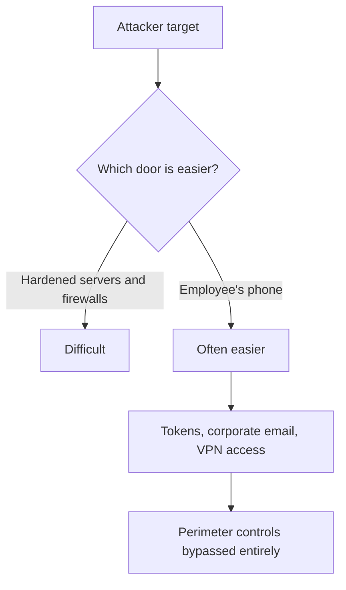
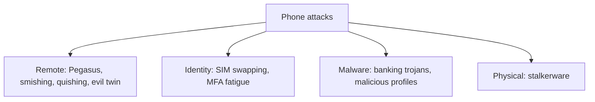
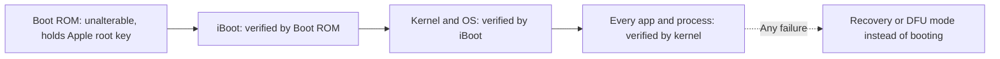
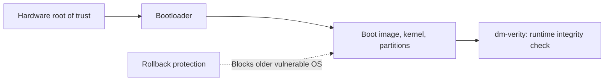

| Topic | Level | Reading Time | Prerequisites |
|---|---|---|---|
| Mobile Threats and Platform Security | Beginner | ~20 min | None |

> **الهدف من الـ Section ده:**  
> هتفهم ليه الموبايل بقى أسهل باب للمهاجم من السيرفرات المحصّنة، وإيه أشهر الهجمات اللي بتستهدف التليفونات، وإيه الفرق الأمني الحقيقي بين iOS وAndroid، وإزاي كل نظام بيحمي نفسه من أول لحظة تشغيل (boot security).

## Learning Objectives

By the end of this section, you will be able to:

- List the four things mobile security protects and explain why a phone is often the easiest door into an organization.
- Describe the main attacks that target phones: **Pegasus**, **SIM swapping**, **MFA fatigue**, **smishing and quishing**, **evil twin Wi-Fi**, **stalkerware**, **banking trojans**, and malicious iOS profiles.
- Compare **iOS** and **Android** across source model, hardware, updates, app sources, review, market share, and attacker interest.
- Walk through **Apple's secure boot chain** and name the other Apple protection layers.
- Explain **Android Verified Boot**, the four bootloader colour states, and Android's other protections and main weakness.

## Table of Contents

- [Learning Objectives](#learning-objectives)
- [Why Mobile Security Matters](#why-mobile-security-matters)
  - [What Mobile Security Protects](#what-mobile-security-protects)
  - [Why the Phone Is the Easier Door](#why-the-phone-is-the-easier-door)
- [Attacks That Target Phones](#attacks-that-target-phones)
  - [Pegasus Spyware](#pegasus-spyware)
  - [SIM Swapping](#sim-swapping)
  - [MFA Fatigue](#mfa-fatigue)
  - [Smishing and Quishing](#smishing-and-quishing)
  - [Evil Twin Wi-Fi](#evil-twin-wi-fi)
  - [Stalkerware](#stalkerware)
  - [Banking Trojans on Android](#banking-trojans-on-android)
  - [Malicious Profiles on iOS](#malicious-profiles-on-ios)
- [iOS Versus Android: The Big Picture](#ios-versus-android-the-big-picture)
- [Apple's Secure Boot Chain](#apples-secure-boot-chain)
  - [The Four Steps](#the-four-steps)
  - [Other Apple Protection Layers](#other-apple-protection-layers)
  - [The checkm8 Lesson](#the-checkm8-lesson)
- [Android Boot Security](#android-boot-security)
  - [Verified Boot](#verified-boot)
  - [The Four Bootloader States](#the-four-bootloader-states)
  - [Other Android Protections and the Fragmentation Weakness](#other-android-protections-and-the-fragmentation-weakness)
- [Career Path Connections](#career-path-connections)
- [Key Terms Glossary](#key-terms-glossary)
- [Summary](#summary)

## Why Mobile Security Matters

### What Mobile Security Protects

الـ **mobile security** بيحمي أربع حاجات: **الجهاز نفسه، الداتا اللي عليه، التطبيقات، والاتصال الشبكي**.

### Why the Phone Is the Easier Door

التليفون هو **أكتر جهاز شخصي وموثوق** عند الموظف:

- عليه الإيميل والشات والصور وجهات الاتصال والمستندات.
- عليه تطبيقات الـ MFA وبيستقبل أكواد الـ SMS، يعني **بيفتح باقي الحسابات**.
- بيُستخدم للـ VPN والـ password manager.
- **شغال دايماً، مع الشخص دايماً، ومتصل دايماً** (cellular، Wi-Fi، Bluetooth، NFC).
- فيه **كاميرا وميكروفون وGPS**، وده بيحوله لأداة مراقبة لو اتخترق.

بالنسبة للمهاجم، السيرفرات المحصّنة والـ firewalls صعبة. **تليفون الموظف غالباً هو الباب الأسهل.** اختراق تليفون واحد ممكن يدّي المهاجم tokens وإيميل الشركة ووصول VPN، **وبكده يتخطى الـ perimeter controls كلها**. ده السبب إن بعض المؤسسات بتدّي الموظفين عاليي القيمة (مديرين تنفيذيين، admins، صحفيين، دبلوماسيين) أجهزة مخصصة ومراقبة عن قرب.

> [!IMPORTANT]
> The phone is not just another endpoint. Because it holds the MFA app and receives SMS codes, compromising it can unlock every other account the person owns. This is why mobile security belongs in the same conversation as identity security, not only device security.

## Attacks That Target Phones

### Pegasus Spyware

**Pegasus** (من شركة NSO Group) هو spyware تجاري بيتباع للحكومات. استخدم **zero-click exploits**، يعني الضحية **مابتعملش أي حاجة**. مثال: الـ exploit اسمه **FORCEDENTRY** (2021) استغل ثغرة في طريقة معالجة iMessage للصور.

بعد التثبيت، يقدر يقرا الرسائل ويسجل المكالمات ويشغّل الميكروفون والكاميرا. اتلاقى على تليفونات صحفيين وناشطين ومسؤولين، وده السبب إن Apple عملت **Lockdown Mode**.

### SIM Swapping

المهاجم بيقنع شركة المحمول (أو بيرشي موظف) تنقل رقم تليفون الضحية لـ SIM بيتحكم فيه هو. بعد كده **كل أكواد الـ SMS بتروحله**، فيعمل reset للـ passwords ويسحب الفلوس من الحسابات.

**الدفاع:** متستخدمش SMS للـ MFA لو ممكن؛ استخدم authenticator app أو security key، واضبط **carrier PIN**.

### MFA Fatigue

المهاجم عنده الـ password، وبيطلق طلبات MFA push **مرات كتيرة ورا بعض** لحد ما المستخدم المنهك يدوس **Approve**. اختراق Uber سنة 2022 استخدم التقنية دي.

**الدفاع:** number matching، تقليل عدد الـ prompts، وتدريب المستخدمين.

### Smishing and Quishing

- **Smishing:** phishing عن طريق SMS.
- **Quishing:** phishing عن طريق QR codes ("scan to pay"، ستيكرات عدادات ركن مزيفة، QR codes في الإيميلات).

### Evil Twin Wi-Fi

hotspot مزيف اسمه شبه اسم Wi-Fi المطار أو الكافيه، عشان يلتقط الـ traffic أو الـ credentials.

### Stalkerware

spyware بيتثبّت من حد عنده **وصول فيزيائي** للتليفون (شريك غيور مثلاً) عشان يتتبع الموقع والرسائل.

### Banking Trojans on Android

كتير منها بيستغل صلاحية **Accessibility Service** عشان يقرا الشاشة ويدوس على الأزرار ويعترض الـ one-time passwords.

### Malicious Profiles on iOS

المهاجم بيقنع المستخدم يثبّت **configuration profile** أو تطبيق مُوقَّع بشهادة enterprise من **خارج الـ App Store**.

| Attack | Core Technique | Primary Defense |
|---|---|---|
| Pegasus | Zero-click exploit | Keep updated, Lockdown Mode for high-risk users |
| SIM swapping | Transfer number to attacker's SIM | No SMS MFA, carrier PIN |
| MFA fatigue | Repeated push prompts | Number matching, limit prompts, training |
| Smishing / quishing | Phishing via SMS or QR | Awareness, avoid unknown links and codes |
| Evil twin Wi-Fi | Fake hotspot | VPN on untrusted Wi-Fi, no auto-join |
| Stalkerware | Physical-access install | Device lock, regular app review |
| Banking trojans | Abuse Accessibility Service | Official stores only, review permissions |
| Malicious iOS profiles | Config profile or enterprise cert | Never install profiles from unknown sources |

> [!NOTE]
> MFA fatigue connects directly to the Impossible Travel investigation in the Log Analysis and Digital Forensics category, where repeated MFA prompts followed by a single approval are one of the signals checked in the authentication details.

## iOS Versus Android: The Big Picture

**Android** مفتوح المصدر (AOSP)، قابل للتخصيص بشدة، بتستخدمه شركات كتير (Samsung, Xiaomi, Google, Oppo...)، وحصته السوقية حوالي **70-80%** عالمياً. **iOS** مغلق، مبني من Apple لأجهزة Apple بس، وApple بتتحكم في الـ hardware والـ OS والـ App Store.

| | iOS | Android |
|---|---|---|
| **Source** | Closed | Open (AOSP) + طبقات الشركات المصنعة |
| **Hardware** | Apple فقط | شركات كتير |
| **Updates** | Apple بتدفعها لكل الأجهزة المدعومة مرة واحدة، لـ 5-7+ سنين | بتعتمد على الشركة المصنعة والـ carrier؛ fragmentation؛ بعض الأجهزة مابتتحدّثش خالص |
| **App sources** | App Store افتراضياً (sideloading في بعض المناطق بس) | Google Play + sideloading سهل ومتاجر بديلة |
| **App review** | صارم | تلقائي + Google Play Protect |
| **Market share** | أصغر | حوالي 80% عالمياً |
| **Attacker interest** | حجم أقل، لكن أهداف عالية القيمة | حجم malware أعلى |

**النقطة الأساسية:** حصة مستخدمين أكبر، مع fragmentation أكتر ونظام مفتوح، بتخلي Android **الهدف الأكبر للـ malware الشائع**، بينما نموذج iOS المغلق بيصعّب الاختراق الجماعي. **لكن مفيش نظام "محصّن تماماً"**: الهجمات المستهدفة (زي Pegasus) بتضرب الاتنين.

> [!WARNING]
> Do not read this comparison as "iOS is safe, Android is not." Higher malware volume on Android and higher-value targeted attacks on iOS are different risk profiles, not a winner and a loser. Both require patching, careful app choices, and awareness.

## Apple's Secure Boot Chain

### The Four Steps

**الـ boot** هو العملية من الضغط على زر التشغيل لحد ما الـ OS يشتغل. Apple بتتحقق من **كل خطوة** بتوقيع رقمي. لو أي خطوة فشلت في التحقق، **الجهاز بيرفض يكمّل**.

| # | Step | What Happens |
|---|---|---|
| 1 | **Boot ROM** | أول كود بيشتغل، محروق في الـ read-only memory بتاعة الـ chip وقت التصنيع. **مايتعدّلش.** فيه الـ Root CA public key بتاع Apple |
| 2 | **Boot ROM يتحقق من المرحلة التالية** | الـ Low-Level Bootloader (iBoot)، بفحص التوقيع مقابل مفتاح Apple |
| 3 | **iBoot يتحقق من الـ kernel والـ OS** | وعلى الأجهزة الأحدث، kernel extensions والـ firmware كمان |
| 4 | **الـ kernel يتحقق من توقيعات كل app وsystem process** | ده الـ code signing |

كل حلقة بتتحقق من اللي بعدها. دي **chain of trust** بتبدأ من hardware مايتعدّلش. لو حاجة اتعدّلت، الجهاز بيدخل **Recovery أو DFU mode** بدل ما يعمل boot.

### Other Apple Protection Layers

| Layer | Role |
|---|---|
| **Secure Enclave** | معالج منفصل ومعزول بيتعامل مع بيانات Face ID/Touch ID ومفاتيح التشفير. **حتى الـ OS الأساسي مايقدرش يقراها** |
| **Code signing** | بس الكود المعتمد من Apple أو الموقَّع من developer هو اللي بيشتغل |
| **App sandbox** | كل app في container معزول، من غير وصول لداتا التطبيقات التانية |
| **Hardware-based encryption** | الداتا مربوطة بـ passcode الجهاز ومفاتيحه. من غير الـ passcode، الداتا غير مقروءة |
| **Memory protections** | pointer authentication، kernel integrity protection |
| **Lockdown Mode** (اختياري) | وضع حماية قصوى بيقلل attack surface: بيحجب معظم مرفقات الرسائل، وبعض تقنيات الويب، والاتصالات السلكية وقت القفل |

### The checkm8 Lesson

سنة 2019 اتلاقت ثغرة اسمها **checkm8** في الـ Boot ROM بتاع iPhones كتير (شرائح A5 لـ A11). بما إن الـ Boot ROM **سيليكون read-only**، Apple **مش قادرة تصلحها**. ده بيوضح ليه الطبقة دي مهمة جداً وصعبة الإصلاح جداً.

> [!IMPORTANT]
> The chain of trust is only as strong as its first link. A flaw in the one component that cannot be updated (the Boot ROM) cannot be patched, only worked around. This is the hardware-level version of the lesson from the Defense in Depth Model: a single unpatchable weak point matters far more than many patchable ones.

## Android Boot Security

### Verified Boot

Android بيستخدم **Verified Boot (AVB)**:

| # | Step | What Happens |
|---|---|---|
| 1 | **Hardware root of trust** | في الـ chip، بيتحقق من الـ bootloader |
| 2 | **Bootloader** | بيتحقق من الـ boot image والـ kernel وباقي الـ partitions (بالتوقيعات) |
| 3 | **dm-verity** | بيفحص سلامة الـ system partition block بـ block **أثناء التشغيل**؛ الداتا المعدّلة بتسبب أخطاء |
| 4 | **Rollback protection** | بيمنع تثبيت إصدار OS أقدم وفيه ثغرات |

### The Four Bootloader States

الـ bootloader بيظهر حالة وقت التشغيل:

| Colour | Meaning |
|---|---|
| **Green** | bootloader مقفول، متحقق منه بالكامل بمفاتيح الشركة المصنعة |
| **Yellow** | مقفول، لكن متحقق منه بمفتاح المستخدم نفسه (بيظهر تحذير) |
| **Orange** | bootloader **مفتوح**، مفيش verification (بيظهر تحذير). ده اللي بيحصل لما التليفون يتعمله **root** أو بيشغّل custom ROM |
| **Red** | فشل التحقق، النظام تالف أو معدّل |

### Other Android Protections and the Fragmentation Weakness

**حمايات تانية في Android:** app sandbox (كل app بـ Linux user ID خاص)، SELinux في وضع enforcing، **hardware-backed Keystore** والـ **Trusted Execution Environment (TEE) / StrongBox secure element**، file-based encryption، **Google Play Protect** (بيفحص التطبيقات)، runtime permissions، و**Play Integrity API** (التطبيقات تقدر تتأكد إن الجهاز أصلي وغير معدّل).

**نقطة الضعف: الـ fragmentation.** تحديثات الأمان بتعتمد على الشركة المصنعة، فتليفونات كتير بتفضل **متأخرة شهور أو سنين** عن الـ patches. وكمان المستخدم يقدر يفتح الـ bootloader ويثبّت أي حاجة.

> [!TIP]
> A clean interview comparison: Apple controls the whole chain (hardware, OS, store), so patches reach everyone together. Android shares control across Google and many manufacturers, so protection is strong on paper but uneven in practice, depending on which phone and which vendor.

## Career Path Connections

| Career Path | How This Topic Applies |
|---|---|
| SOC Analyst | Recognizes mobile-origin signals such as MFA fatigue patterns, SIM-swap indicators, and unmanaged-device sign-ins |
| Penetration Tester | Assesses mobile attack surface, including app permissions, malicious profiles, and rogue network scenarios in authorized scope |
| GRC | Mobile security policy must address both iOS and Android differences, patch responsibility, and acceptable device states |
| Cloud Security | Mobile devices are a primary identity endpoint into cloud apps, so device state feeds conditional access decisions |

## Key Terms Glossary

| Term | Definition |
|---|---|
| Zero-Click Exploit | An attack that compromises a device without any user interaction |
| SIM Swapping | Moving a victim's phone number to an attacker-controlled SIM to intercept SMS codes |
| MFA Fatigue | Repeatedly triggering MFA prompts until a tired user approves one |
| Smishing | Phishing delivered by SMS |
| Quishing | Phishing delivered through QR codes |
| Evil Twin | A fake Wi-Fi hotspot imitating a legitimate one to capture traffic or credentials |
| Stalkerware | Spyware installed by someone with physical access to track a victim |
| Boot ROM | The first, unalterable code that runs on an Apple device, holding Apple's root key |
| Chain of Trust | A boot process where each stage cryptographically verifies the next |
| Secure Enclave | An isolated Apple processor handling biometric data and encryption keys |
| Verified Boot (AVB) | Android's boot-time and runtime verification of the OS |
| dm-verity | An Android feature checking system partition integrity block by block while running |
| Rollback Protection | A control preventing installation of an older, vulnerable OS version |
| Fragmentation | Uneven patch availability across many Android manufacturers and carriers |

## Summary

- **Mobile security protects four things:** الجهاز، الداتا، التطبيقات، والاتصال الشبكي.
- **The phone is often the easiest door:** بيحمل MFA وtokens ووصول VPN، وبيتخطى الـ perimeter controls.
- **Phone attacks span several types:** zero-click (Pegasus)، هوية (SIM swapping وMFA fatigue)، phishing (smishing وquishing)، شبكة (evil twin)، malware (banking trojans وprofiles خبيثة)، وphysical (stalkerware).
- **iOS and Android trade different risks:** Android حجم malware أعلى بسبب الانتشار والـ fragmentation، وiOS أهداف مستهدفة عالية القيمة.
- **Apple's boot chain starts in unalterable hardware:** Boot ROM ثم iBoot ثم kernel ثم code signing لكل app.
- **checkm8 shows why the first link matters:** ثغرة في silicon read-only مايتصلحش.
- **Android's Verified Boot adds runtime checks (dm-verity) and rollback protection:** وحالات bootloader الأربعة (Green, Yellow, Orange, Red) بتوصف مستوى الثقة.
- **Android's main weakness is fragmentation, not the design itself.**

