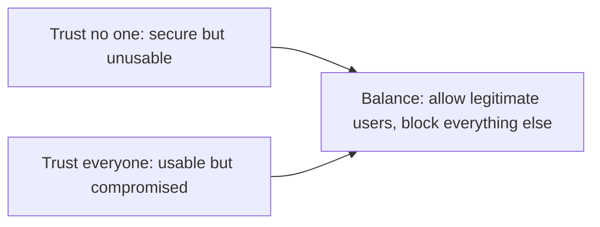
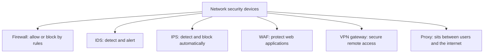
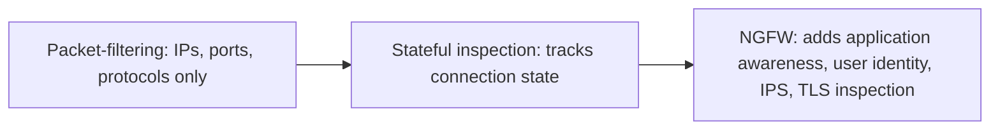
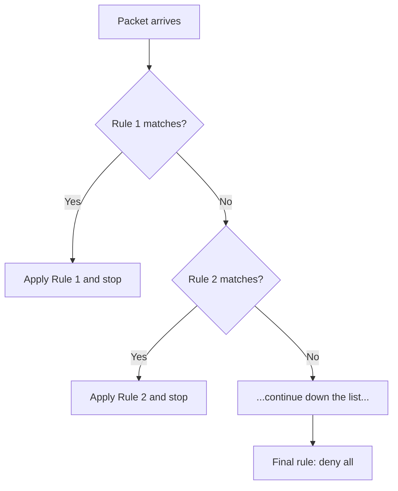
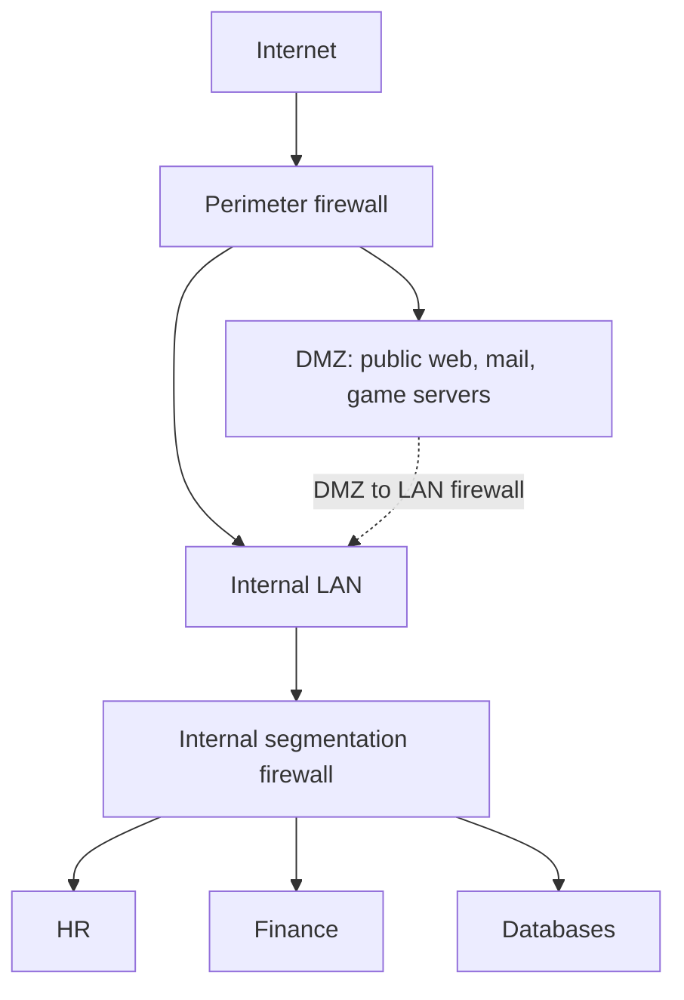
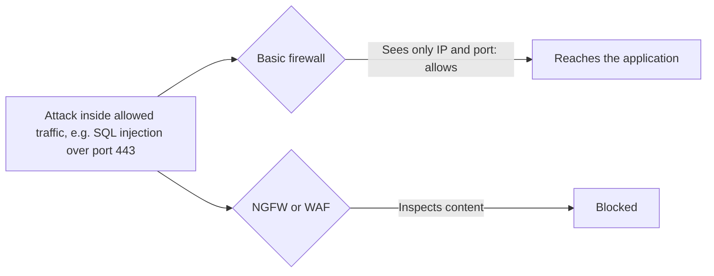

| Topic | Level | Reading Time | Prerequisites |
|---|---|---|---|
| Firewalls and Network Placement | Beginner | ~20 min | VLANs, Protocols, and Secure Topology Design |

> **الهدف من الـ Section ده:**  
> هتفهم ليه أمان الشبكة هو دايماً توازن بين الإتاحة والتقييد، وإيه الأجهزة الأمنية الأساسية، وإزاي الـ firewall بيشتغل وأنواعه التلاتة، وإيه الأماكن الخمسة اللي بيتحط فيها الـ firewall، وإيه اللي الـ firewall يقدر يعمله ومايقدرش يعمله.

## Learning Objectives

By the end of this section, you will be able to:

- Explain the **balance between trust and restriction** that every network security device tries to strike.
- List the six main network security devices and the one-line role of each.
- Differentiate between **packet-filtering**, **stateful inspection**, and **next-generation (NGFW)** firewalls.
- Explain **default deny** and why **rule order** matters.
- Describe the five firewall locations and the purpose of each, including the **DMZ**.
- List the benefits and the shortcomings of a firewall, including what it cannot stop.

## Table of Contents

- [Learning Objectives](#learning-objectives)
- [The Balance Between Trust and Restriction](#the-balance-between-trust-and-restriction)
- [The Main Network Security Devices](#the-main-network-security-devices)
- [Firewalls: How They Work](#firewalls-how-they-work)
  - [The Core Idea](#the-core-idea)
  - [Three Firewall Types](#three-firewall-types)
  - [Default Deny and Rule Order](#default-deny-and-rule-order)
- [Firewall Placement](#firewall-placement)
  - [Perimeter Firewall](#perimeter-firewall)
  - [DMZ Firewall](#dmz-firewall)
  - [Internal Segmentation Firewall](#internal-segmentation-firewall)
  - [Firewall Locations at a Glance](#firewall-locations-at-a-glance)
- [Firewall Benefits Versus Shortcomings](#firewall-benefits-versus-shortcomings)
- [Career Path Connections](#career-path-connections)
- [Key Terms Glossary](#key-terms-glossary)
- [Summary](#summary)

## The Balance Between Trust and Restriction

الشركات **محتاجة تكون متاحة عشان تكبر**: مواقع التسوق، بوابات البنوك، سيرفرات الألعاب.

**تشبيه المحل:** المحل بيعرض بضاعته عشان الزبون يشتري، لكن البضاعة **غير المحمية بتتسرق**.

| Approach | Result |
|---|---|
| **Trust no one** | آمن، لكن **مش قابل للاستخدام** |
| **Trust everyone** | قابل للاستخدام، لكن **مخترق** |

أجهزة أمان الشبكة بتسمح للمستخدمين الشرعيين بالدخول وبتحمي الأنظمة من الوصول غير المصرح بيه والهجمات. **الأمان هو إيجاد التوازن الصح.**

> [!NOTE]
> This is the same tension behind Zero Trust, covered in the Zero Trust Model file: instead of choosing between trusting everyone inside and trusting no one, every request is verified based on identity, device health, and context.

## The Main Network Security Devices

| Device | Role |
|---|---|
| **Firewall** | **أهم جهاز.** بيراقب الـ traffic الداخل والخارج ويسمح بيه أو يحجبه حسب قواعد |
| **IDS** (Intrusion Detection System) | بيكتشف الهجمات والنشاط المشبوه ويطلّع **alerts** |
| **IPS** (Intrusion Prevention System) | شغال زي الـ IDS لكن **بيقدر يحجب الهجمات أوتوماتيك** |
| **WAF** (Web Application Firewall) | بيحمي المواقع وتطبيقات الويب **تحديداً** |
| **VPN gateway** | بيسمح للمستخدمين البعيدين يتصلوا بالشبكة بأمان عن طريق التشفير |
| **Proxy** | بيقعد بين المستخدمين والإنترنت |

> [!TIP]
> The only difference between an IDS and an IPS is the reaction. An IDS tells you an attack happened, while an IPS can stop it in the moment, which is why an IPS is placed in-line with the traffic and an IDS can sit off to the side on a copy of it.

## Firewalls: How They Work

### The Core Idea

في أساسه، الـ firewall هو **routing device بيفحص الـ traffic وبيطبق rule set** عشان يسمح أو يمنع.

### Three Firewall Types

| Type | What It Does |
|---|---|
| **Packet-filtering** | بيفحص الـ IPs والـ ports والـ protocols **بس** (سريع، وأساسي) |
| **Stateful inspection** | بيتتبع **حالة الاتصال**، فيعرف هل الـ packet تابع لـ session **قائمة وشرعية** |
| **Next-Generation (NGFW)** | بيضيف **وعي بالـ application**، وهوية المستخدم، ومنع الاختراق (IPS)، وفحص الـ TLS |

> [!NOTE]
> The perimeter firewall described in Defense in Depth Model works at Layers 3 and 4, which matches the first two types. An NGFW is what reaches higher up the stack, which is why it can catch some things a basic firewall cannot, as the shortcomings section below explains.

### Default Deny and Rule Order

**أفضل ممارسة:** سياسة **default-deny**، يعني **أي حاجة مش مسموح بيها صراحةً بتتحجب.**

**ترتيب القواعد مهم**، لأن الـ firewalls عادةً **بتطابق أول rule بتناسب الاتصال.**

> [!WARNING]
> Because the first matching rule wins, a broad allow rule placed above a specific deny rule silently cancels the deny. The same ordering rule appears in the traffic policy matrix in VLANs, Protocols, and Secure Topology Design: specific rules first, default deny last.

## Firewall Placement

### Perimeter Firewall

بيقعد **بين الإنترنت والشبكة الداخلية**، وهو **أشهر مكان**. بيحجب المهاجمين من الإنترنت، ويسمح للمستخدمين بالوصول للإنترنت، ويتحكم في الـ traffic الداخل والخارج.

### DMZ Firewall

السيرفرات العامة (web وmail وgame) **ماتتحطش جوه الشبكة الداخلية**. **ليه DMZ؟** لو سيرفر عام اتهكر، **المهاجم لسه مايقدرش يوصل للشبكة الداخلية.**

### Internal Segmentation Firewall

بيفصل الأقسام، مثلاً **الـ HR مايقدرش يوصل لسيرفرات الـ Finance**، والمستخدمين **مايقدروش يوصلوا للـ databases مباشرة**. **بيحد من الـ lateral movement** لو مهاجم دخل.

### Firewall Locations at a Glance

| Firewall Location | Purpose |
|---|---|
| Internet ↔ LAN | حماية الشبكة الداخلية |
| Internet ↔ DMZ | حماية السيرفرات العامة |
| DMZ ↔ LAN | حماية الشبكة الداخلية من سيرفرات مخترقة |
| Inside LAN | Network segmentation |
| User ↔ Server | حماية السيرفرات الحرجة |

> [!NOTE]
> This table is the same design logic as the secure topology exercise in VLANs, Protocols, and Secure Topology Design: a perimeter router and firewall at the edge, a DMZ for public services, and separate VLANs with rules between them. That file also introduces east-west traffic, which is exactly what the internal segmentation firewall controls.

## Firewall Benefits Versus Shortcomings

| Benefits | Shortcomings |
|---|---|
| بيتحكم في الـ traffic عند حدود الشبكة وبيفرض السياسة مركزياً | **مايقدرش يوقف هجمات بتسافر جوه traffic مسموح** (زي SQL injection على port 443) إلا لو **NGFW** أو مقترن بـ **WAF** |
| بيحجب الوصول غير المصرح بيه ويقلل الـ attack surface | **مايقدرش يشوف جوه الـ traffic المشفر** من غير TLS inspection |
| بيوفر logging ورؤية للاتصالات | **مايقدرش يوقف insider threats** أو مستخدمين اتخدعوا بـ phishing |
| بيتيح segmentation | **rule غلط** (زي any-any) **بتشيل الحماية بصمت** |
| | محتاج **مراجعة دورية للقواعد**، لأن القواعد القديمة بتتراكم وبتعمل خطر |

> [!IMPORTANT]
> A firewall will happily allow port 443, and a WAF is what inspects what travels inside it. This is the exact layer distinction explained in the WAF file: the two are complementary, not interchangeable, and a missing WAF leaves a gap a perfect firewall configuration cannot close.

> [!TIP]
> For the full picture of how firewalls, IDS/IPS, proxies, WAF, SIEM, DLP, and NAC stack together, see Defense in Depth Model. This file and the next two cover the devices themselves; that file covers why they are layered.

## Career Path Connections

| Career Path | How This Topic Applies |
|---|---|
| SOC Analyst | Reads firewall logs and recognizes allow/deny patterns, as covered in Network and Authentication Logs |
| Penetration Tester | Tests whether firewall rules, DMZ isolation, and segmentation actually hold, including any-any style misconfigurations |
| GRC | Requires periodic firewall rule reviews and documented change control as an auditable control |
| Cloud Security | Cloud security groups and network ACLs are the cloud equivalent of firewall rules and follow the same default-deny logic |

## Key Terms Glossary

| Term | Definition |
|---|---|
| Firewall | A device that monitors traffic and allows or blocks it based on rules |
| IDS | Intrusion Detection System, detects attacks and raises alerts |
| IPS | Intrusion Prevention System, detects attacks and can block them automatically |
| VPN Gateway | A device that lets remote users connect securely through encryption |
| Packet-Filtering Firewall | A firewall checking only IPs, ports, and protocols |
| Stateful Inspection | Tracking connection state to know whether a packet belongs to a legitimate session |
| NGFW | Next-Generation Firewall, adding application awareness, user identity, IPS, and TLS inspection |
| Default Deny | A policy blocking everything not explicitly allowed |
| DMZ | A separate segment for public-facing servers, isolated from the internal network |
| Internal Segmentation Firewall | A firewall separating internal departments to limit lateral movement |
| Any-Any Rule | A rule allowing all sources to all destinations, silently removing protection |

## Summary

- **Network security is a balance:** trust no one فبقى غير قابل للاستخدام، trust everyone فبقى مخترق.
- **Six main devices exist:** firewall، IDS، IPS، WAF، VPN gateway، وproxy.
- **Three firewall types build on each other:** packet-filtering، stateful inspection، وNGFW.
- **Default deny with correct rule order is the baseline practice:** أول rule بتطابق هي اللي بتتنفذ.
- **Five placements serve five purposes:** perimeter، DMZ، DMZ-to-LAN، internal segmentation، وuser-to-server.
- **A DMZ means a hacked public server still cannot reach the internal network.**
- **A firewall cannot see inside allowed or encrypted traffic, or stop phishing and insiders:** وده بالظبط ليه الـ WAF وTLS inspection والتدريب بيكمّلوه.
- **Old rules accumulate into risk:** محتاج مراجعة دورية.
