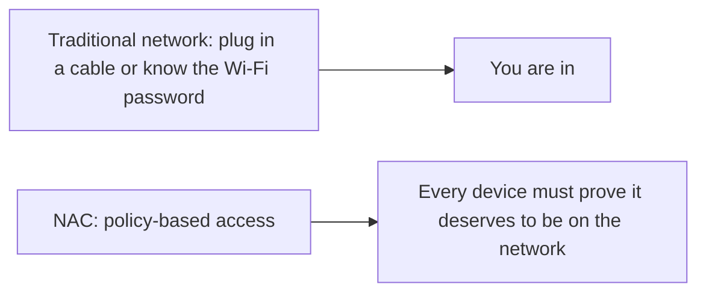
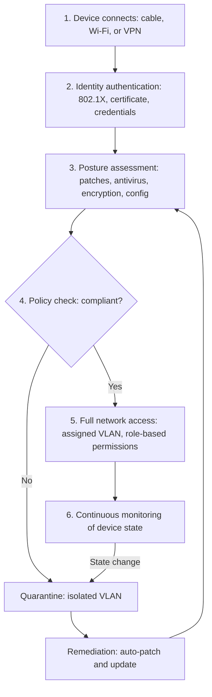
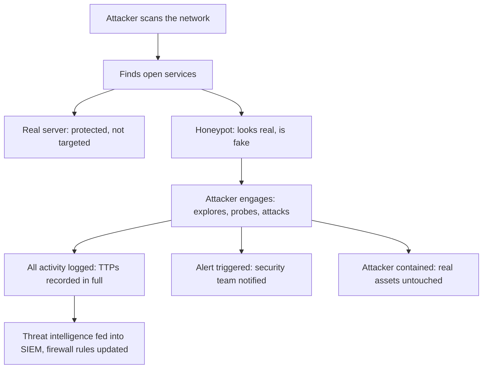
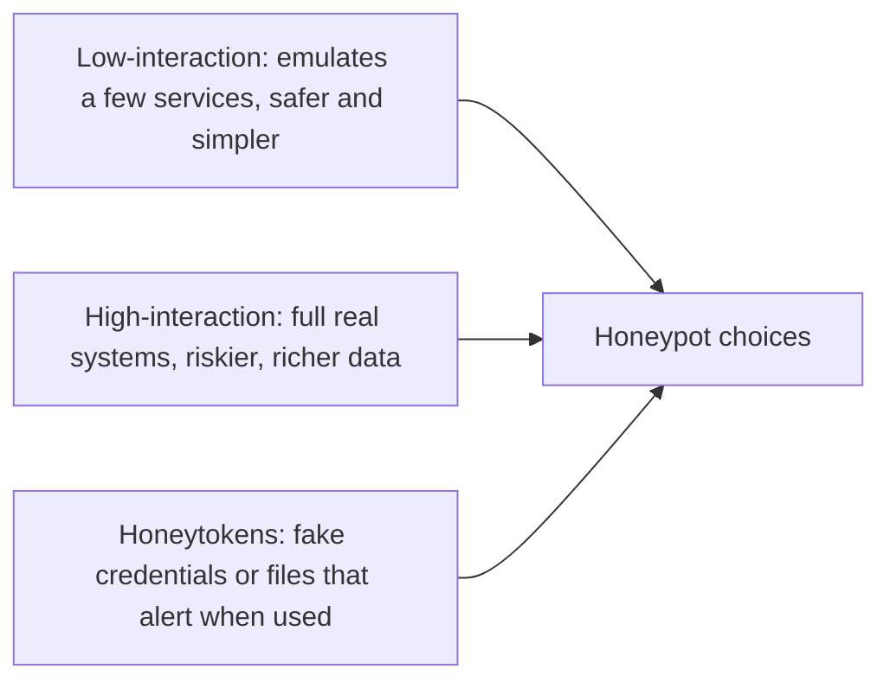

| Topic | Level | Reading Time | Prerequisites |
|---|---|---|---|
| Network Access Control and Honeypots | Intermediate | ~20 min | Firewalls and Network Placement |

> **الهدف من الـ Section ده:**  
> هتفهم إزاي الـ NAC بيخلي كل جهاز يثبت إنه يستاهل يدخل الشبكة بدل ما أي حد يوصّل كابل ويدخل، وإزاي الـ posture assessment بيحدد النتيجة (full access أو limited أو quarantine)، وإزاي الـ honeypot بيقلب اللعبة: بدل ما يحجب المهاجم، بيدعوه لبيئة وهمية ويسجل كل حركته.

## Learning Objectives

By the end of this section, you will be able to:

- Define **Network Access Control (NAC)** and explain why device health matters as much as identity.
- Explain the shift from **open networks** to **policy-based access**, and the role of **802.1X**.
- List what a **posture assessment** checks and the three possible outcomes.
- Walk through the six stages of a NAC flow, including the remediation loop and continuous monitoring.
- Define a **honeypot** and explain why its alerts are very high-fidelity.
- Compare **low-interaction** honeypots, **high-interaction** honeypots, and **honeytokens**.
- Explain why a honeypot must be isolated.

## Table of Contents

- [Learning Objectives](#learning-objectives)
- [Network Access Control (NAC)](#network-access-control-nac)
  - [What It Is](#what-it-is)
  - [Beyond Identity](#beyond-identity)
  - [From Open to Policy-Based](#from-open-to-policy-based)
- [NAC Posture Assessment and Outcomes](#nac-posture-assessment-and-outcomes)
  - [What NAC Checks](#what-nac-checks)
  - [The Three Outcomes](#the-three-outcomes)
  - [The Six-Stage Flow](#the-six-stage-flow)
- [Honeypots](#honeypots)
  - [The Core Idea](#the-core-idea)
  - [Why the Alerts Are High-Fidelity](#why-the-alerts-are-high-fidelity)
  - [Benefits](#benefits)
  - [How a Honeypot Works](#how-a-honeypot-works)
- [Honeypot Types and Cautions](#honeypot-types-and-cautions)
  - [Three Types](#three-types)
  - [The Isolation Caution](#the-isolation-caution)
- [Career Path Connections](#career-path-connections)
- [Key Terms Glossary](#key-terms-glossary)
- [Summary](#summary)

## Network Access Control (NAC)

### What It Is

الـ **NAC** هو حل بيتحكم **مين وإيه الأجهزة تقدر تتصل بالشبكة، وتقدر توصل لإيه بعد ما تتصل**.

### Beyond Identity

الموضوع **مش هوية بس**، هو كمان **صحة (health) وامتثال (compliance) الجهاز**. **username صحيح مالوش قيمة لو اللابتوب مش متحدّث أو مصاب.**

### From Open to Policy-Based

في الشبكات التقليدية، **توصّل كابل أو تعرف password الـ Wi-Fi وإنت جوه.** الـ NAC بيفرض **وصول مبني على policy**، فكل جهاز **لازم يثبت إنه يستاهل يكون على الشبكة.**

> [!NOTE]
> This is the NAC layer named in the Network Security Layer of Defense in Depth Model: only authorized, compliant devices can even join the network. The device-health idea is also the network-level cousin of the trust scoring in Zero Trust Model, where device state feeds the access decision.

## NAC Posture Assessment and Outcomes

### What NAC Checks

| Check | Question |
|---|---|
| Patch level | هل الـ OS محدّث؟ |
| Antivirus | هل مثبت ومحدّث؟ |
| Host firewall | هل مفعّل؟ |
| Disk encryption | هل شغّال؟ |
| Applications | هل فيه تطبيقات غير مصرح بيها شغالة؟ |
| Ownership | هل الجهاز domain-joined أو registered corporate asset؟ |
| Device type | نوعه إيه (laptop، phone، IoT، printer)؟ |

**بيتبني غالباً على authentication من نوع 802.1X.**

### The Three Outcomes

| Outcome | Meaning |
|---|---|
| **Full access** | الجهاز متوافق |
| **Limited access** | وصول مقيّد |
| **Quarantine VLAN** | **للأجهزة غير المتوافقة** |

### The Six-Stage Flow

| # | Stage | What Happens |
|---|---|---|
| 1 | **Connect** | الجهاز بيتصل (cable، Wi-Fi، أو VPN) |
| 2 | **Identify** | Identity authentication: 802.1X، certificate، أو credentials |
| 3 | **Assess** | Posture assessment: OS patches، antivirus، encryption، config |
| 4 | **Decide** | Policy check |
| 5 | **Access** | لو متوافق: **full network access** بـ VLAN مخصص وصلاحيات حسب الدور |
| 6 | **Monitor** | حالة الجهاز بتتفحص **طول الـ session** |

لو الجهاز **غير متوافق**، بيروح **Quarantine (isolated VLAN)** وبعدين **Remediation** (auto-patch وتحديث)، وبعدين **re-check**.

> [!IMPORTANT]
> NAC continuously re-evaluates device state, so access can be revoked mid-session. A device that was compliant at 9:00 and had its antivirus disabled at 11:00 can be moved to quarantine without the user logging in again. This is continuous verification applied to the network port.

> [!TIP]
> The quarantine VLAN is not a punishment, it is a waiting room: the device can usually still reach the update servers it needs to fix itself, and nothing else. That is why remediation loops back into the posture check.

## Honeypots

### The Core Idea

الـ **honeypot** هو **أداة خداع متعمدة**. بدل ما **تحجب** المهاجمين، **بتدعيهم لبيئة وهمية** مايقدروش يعملوا فيها ضرر حقيقي، وإنت **بتراقب كل حاجة بيعملوها.**

### Why the Alerts Are High-Fidelity

**الفكرة الجوهرية:** لو **مفيش مستخدم شرعي المفروض يلمس النظام ده**، فأي حد بيلمسه **تهديد بالتعريف.** وده بيخلي الـ alerts **عالية الدقة (high-fidelity)، وفيها false positives قليلة جداً.**

### Benefits

- **إنذار مبكر** بالاختراقات وبالـ scanning الداخلي.
- **جمع أدوات وتقنيات المهاجمين ومؤشرات الاختراق (IOCs).**
- **إلهاء المهاجمين** عن الـ assets الحقيقية.

### How a Honeypot Works

الـ attacker بيعمل network scan ويلاقي خدمات مفتوحة. **السيرفر الحقيقي محمي ومش مستهدف**، لكن الـ honeypot **شكله حقيقي وهو وهمي**. المهاجم يتفاعل معاه، فكل نشاطه بيتسجل، والـ alert بيتفعّل، وبيتحط في containment بينما الـ assets الحقيقية سليمة. والـ TTPs المسجّلة بتتحول لـ **threat intelligence** بتغذي الـ SIEM وبتحدّث قواعد الـ firewall.

> [!NOTE]
> Every action inside a honeypot is recorded while the attacker believes they are winning. The recorded TTPs are exactly the kind of data that feeds the MITRE ATT&CK mapping described in the MITRE ATT&CK file, and the IOCs feed the IP-based blocklists discussed in the DNS Sinkhole file.

## Honeypot Types and Cautions

### Three Types

| Type | Description |
|---|---|
| **Low-interaction** | بيحاكي **بعض الخدمات** بس. **أأمن وأبسط** في التشغيل |
| **High-interaction** | **أنظمة حقيقية كاملة**، وده **أخطر** |
| **Honeytokens** | **credentials أو ملفات وهمية** بتطلّع alert **لما تتستخدم** |

### The Isolation Caution

> [!WARNING]
> A honeypot must be isolated, or attackers could use it as a pivot. A high-interaction honeypot is a real system an attacker can fully compromise, so if it can reach the production network it becomes the attacker's best stepping stone. Place it in its own segment with strict rules in both directions.

> [!TIP]
> Honeytokens are the cheapest honeypot to start with: a fake "admin_backup" credential or a decoy spreadsheet named like payroll data costs nothing to run, carries no pivot risk, and alerts the moment anyone uses it. This is the same "nobody legitimate should touch this" logic, with no server to maintain.

## Career Path Connections

| Career Path | How This Topic Applies |
|---|---|
| SOC Analyst | Treats any honeypot or honeytoken alert as high-priority because legitimate use is essentially zero |
| Penetration Tester | Must recognize honeypots during an engagement, since touching one can alert the defenders and waste time |
| GRC | NAC posture policies and device-compliance requirements are direct, auditable access controls |
| Cloud Security | Cloud-native equivalents include device-compliance-based conditional access and decoy resources with alerting |

## Key Terms Glossary

| Term | Definition |
|---|---|
| NAC | Network Access Control, controlling which devices can connect and what they can access |
| 802.1X | A port-based authentication standard commonly used by NAC |
| Posture Assessment | Checking a device's health and compliance before granting access |
| Quarantine VLAN | An isolated VLAN for non-compliant devices |
| Remediation | Fixing a non-compliant device so it can pass the posture check |
| Honeypot | A deliberately deceptive system designed to attract and record attackers |
| High-Fidelity Alert | An alert with very few false positives |
| IOC | Indicator of Compromise, an artifact associated with malicious activity |
| Low-Interaction Honeypot | A honeypot emulating only a few services |
| High-Interaction Honeypot | A honeypot built from full real systems |
| Honeytoken | A fake credential or file that triggers an alert when used |
| Pivot | Using a compromised system as a stepping stone to reach others |

## Summary

- **NAC controls who and what can connect:** وبعدين توصل لإيه، مش هوية بس.
- **Device health matters as much as identity:** username صحيح على لابتوب مصاب مالوش قيمة.
- **Posture assessment checks seven things:** patches، antivirus، host firewall، encryption، applications، ownership، ونوع الجهاز.
- **Three outcomes exist:** full access، limited access، وquarantine VLAN.
- **The flow has six stages with a remediation loop:** connect، identify، assess، decide، access، monitor، والمراقبة المستمرة ممكن ترجّع الجهاز للـ quarantine.
- **A honeypot invites attackers instead of blocking them:** وكل حركتهم بتتسجل.
- **Honeypot alerts are high-fidelity:** لأن مفيش مستخدم شرعي المفروض يلمسه.
- **Three honeypot types:** low-interaction أأمن، high-interaction أغنى وأخطر، وhoneytokens أرخص.
- **A honeypot must be isolated:** وإلا بيتحول لنقطة ارتكاز للمهاجم.

