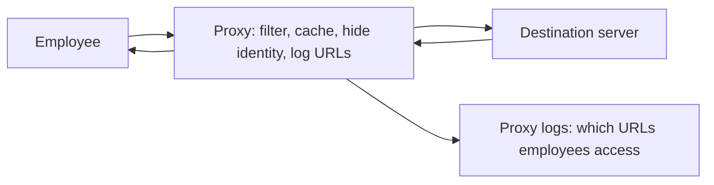
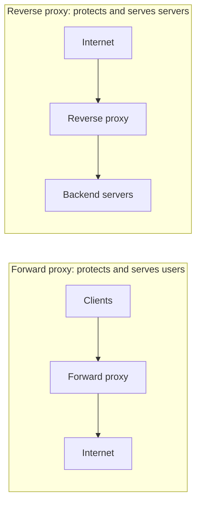
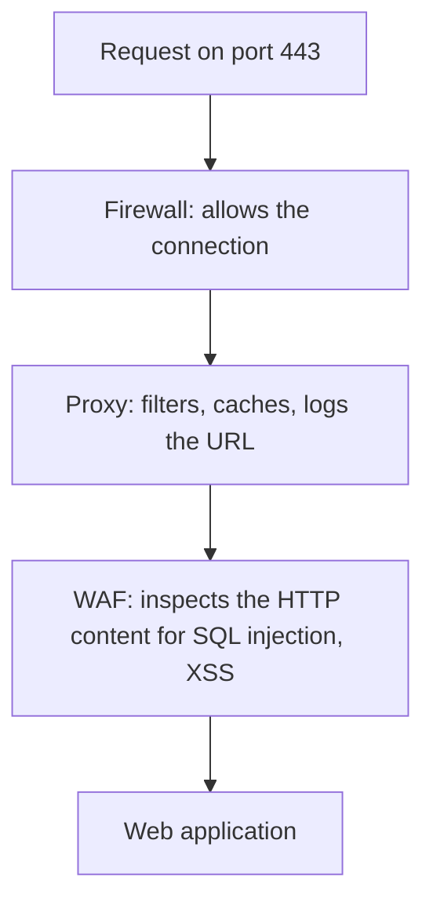
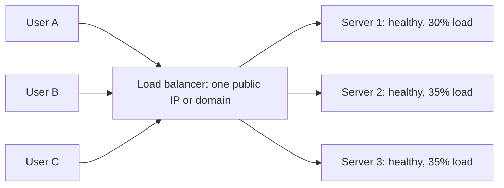
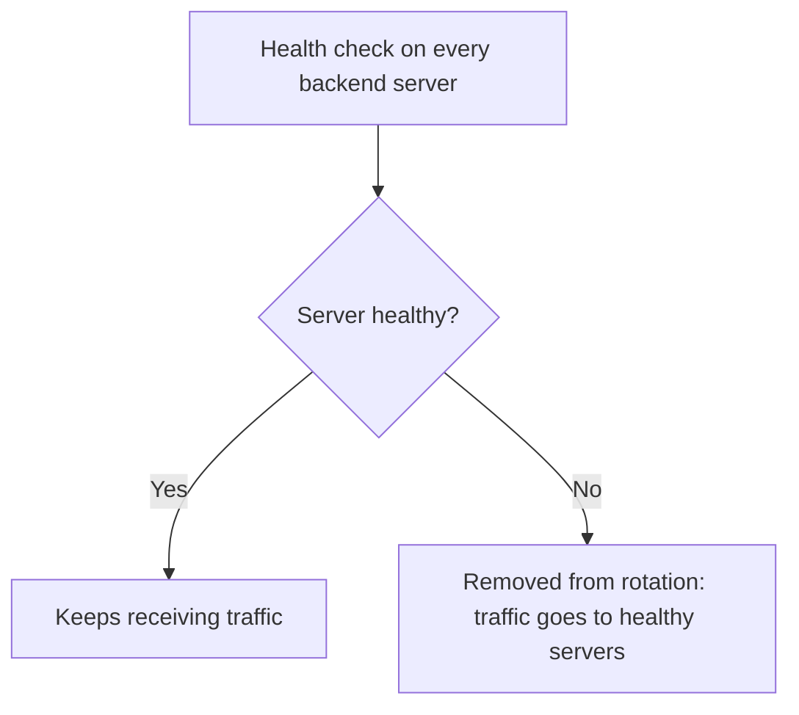

| Topic | Level | Reading Time | Prerequisites |
|---|---|---|---|
| Proxies and Load Balancers | Beginner | ~15 min | Firewalls and Network Placement |

> **الهدف من الـ Section ده:**  
>  هتفهم إيه هو الـ proxy وليه الشركات بتشتريه، وإيه الفرق بين forward وreverse proxy، وإزاي تفرّق بين الـ firewall والـ proxy والـ WAF، وإزاي الـ load balancer بيحل مشكلة الـ single point of failure وبيدي الـ availability والـ scalability والأمان في نفس الوقت.


## Learning Objectives

By the end of this section, you will be able to:

- Define a **proxy server** and list the four reasons companies deploy one.
- Differentiate between **forward**, **reverse**, **elite (high-anonymity)**, and **transparent** proxies.
- Compare a **firewall**, a **proxy**, and a **WAF** across layer, protection target, function, and visibility into web content.
- Explain the problem a **load balancer** solves and its three benefits: availability, scalability, and security.
- Name the common load balancing algorithms and explain how health checks work.
- Explain why a proxy or load balancer in front of a web server affects what the server logs show.

## Table of Contents

- [Learning Objectives](#learning-objectives)
- [Proxy Servers](#proxy-servers)
  - [What a Proxy Is](#what-a-proxy-is)
  - [Why Companies Buy Them](#why-companies-buy-them)
- [Types of Proxies](#types-of-proxies)
- [Proxy Versus Firewall Versus WAF](#proxy-versus-firewall-versus-waf)
- [Load Balancer](#load-balancer)
  - [The Problem It Solves](#the-problem-it-solves)
  - [How It Works](#how-it-works)
  - [Three Benefits](#three-benefits)
  - [Common Algorithms](#common-algorithms)
- [Logging Considerations](#logging-considerations)
- [Career Path Connections](#career-path-connections)
- [Key Terms Glossary](#key-terms-glossary)
- [Summary](#summary)

## Proxy Servers

### What a Proxy Is

الـ **proxy** هو **وسيط (intermediary)** بيقعد بين الـ client وسيرفر الوجهة.

```text
You  ->  Proxy  ->  Destination
```

والرد بيرجع **بنفس الطريقة**. بعض المتخصصين بيصنّفوه كنوع من الـ firewalls (وبيتسمى كمان **application gateway**).

### Why Companies Buy Them

| Reason | Detail |
|---|---|
| **Anonymity** | الوجهة بتشوف IP الـ proxy، مش IP بتاعك |
| **Access control** | حجب مواقع أو فئات محتوى معينة |
| **Caching** | تخزين المحتوى المطلوب كتير لتوفير bandwidth وتسريع الوصول |
| **Filtering and monitoring** | فحص الـ traffic لأغراض الأمان والامتثال |
| **Visibility** | الـ logs بتوضح أنهي URLs الموظفين بيدخلوا عليها، فالـ SOC يقدر **يكتشف نشاط ويب مشبوه** (زي اتصالات بـ domains ضارة أو جديدة التسجيل) |



> [!NOTE]
> The visibility point is exactly what Network and Authentication Logs uses in practice: a proxy log is how an analyst finds the URL and the user behind a suspicious download, which started the five-log mini-investigation in that file.

## Types of Proxies

| Type | Description |
|---|---|
| **Forward proxy** | بيقعد **قدام الـ client**. بيتستخدم للـ anonymity والـ filtering وتخطي القيود. **ده اللي معظم الناس بتقصده بكلمة "proxy"** |
| **Reverse proxy** | بيقعد **قدام الـ server**. الـ clients **مابيعرفوش أنهي backend بيوصلوله**. بيتستخدم لـ load balancing وSSL termination وcaching وحماية DDoS. أمثلة: **Nginx** و**HAProxy** |
| **Elite (high-anonymity) proxy** | بيخبّي IP بتاعك و**مابيكشفش إنه proxy أصلاً** |
| **Transparent proxy** | بيعترض الـ traffic **من غير ما الـ client يتظبط**، وبيتستخدم كتير للفلترة في المؤسسات وشبكات Wi-Fi العامة |



> [!TIP]
> Easy way to remember: a forward proxy hides and controls the clients, a reverse proxy hides and protects the servers. The same word, opposite sides of the connection.

## Proxy Versus Firewall Versus WAF

| | Firewall | Proxy | WAF |
|---|---|---|---|
| **Works at** | طبقات الشبكة والـ transport (IPs وports)؛ الـ NGFWs بتطلع أعلى | طبقة الـ application، **نيابة عن الـ clients أو الـ servers** | طبقة الـ application (HTTP/HTTPS) |
| **Protects** | الشبكة | المستخدمين (forward) أو السيرفرات (reverse) | تطبيقات الويب |
| **Typical function** | السماح بالاتصالات أو حجبها | فلترة، caching، إخفاء الهوية، تسجيل الـ URLs | حجب SQL injection وXSS وهجمات الويب التانية |
| **Sees web content?** | الـ firewalls الأساسية: **لأ** | **آه، لـ HTTP** | **آه، بعمق** |

**مكمّلين لبعض، مش بدائل.** الـ firewall هيسمح بـ port 443 بكل رضا، والـ **WAF هو اللي بيفحص اللي بيعدّي جواه.**



> [!IMPORTANT]
> This table restates, from the device point of view, the layer distinction first explained in Defense in Depth Model and covered in full in the WAF file. The key sentence is the same: the firewall decides whether the connection is allowed, the WAF decides whether the request inside it is safe.

## Load Balancer

### The Problem It Solves

**مع سيرفر واحد**، الـ traffic ممكن **يحمّل عليه زيادة** أو يخليه **single point of failure**.

### How It Works

الـ **load balancer** بيقعد **قدام عدة سيرفرات** وبيوزّع الـ traffic الوارد عليهم، بحيث **مفيش سيرفر واحد يتحمل فوق طاقته**. المستخدمين بيتصلوا بـ **IP عام واحد أو domain واحد**، والـ load balancer بيوزّع على السيرفرات الخلفية.

مثال على التوزيع: User A وB وC بيبعتوا requests للـ load balancer، وهو بيوزعها على Server 1 (حمل 30%) وServer 2 (35%) وServer 3 (35%)، وكلهم healthy.



> [!NOTE]
> Many load balancers, such as F5 BIG-IP, also offer WAF and traffic inspection features. A load balancer is therefore often both a traffic distributor and a security control, which is why it appears as one box in the defense-in-depth stack.

### Three Benefits

| Benefit | Detail |
|---|---|
| **Availability** | لو سيرفر فشل، الـ traffic بيروح للسيرفرات **السليمة** (عن طريق **health checks**) |
| **Scalability** | ضيف سيرفرات للتعامل مع النمو |
| **Security** | بيخبّي السيرفرات الخلفية، وبيعمل **SSL termination**، وبيمتص **DDoS traffic** |



### Common Algorithms

| Algorithm | How It Distributes |
|---|---|
| **Round robin** | الطلبات بتتوزع على السيرفرات **بالدور** |
| **Least connections** | الطلب الجديد بيروح للسيرفر **اللي عنده أقل اتصالات نشطة** |
| **IP hash** | الـ IP بتاع الـ client بيحدد السيرفر، فنفس الـ client بيوصل لنفس السيرفر |

> [!TIP]
> IP hash is the algorithm to remember when a question mentions keeping one user on one server, for example so a session is not lost. Round robin and least connections spread load but do not guarantee that.

## Logging Considerations

لما **reverse proxy أو load balancer** يكون قدام السيرفر، الـ web server log ممكن **يوري IP الـ proxy نفسه** كـ client، مش الزائر الحقيقي. الـ **SSL termination** كمان معناه إن فك التشفير بيحصل عند الـ proxy، وده ممكن يغيّر أنهي جهاز بيشوف المحتوى.

> [!WARNING]
> The real client IP is only recoverable if the X-Forwarded-For header is configured and logged. This is the same issue covered in Core Log Types and Web Server Logs, and it matters for security: blocking the "client IP" in a log that only shows the load balancer would block your own traffic.

> [!NOTE]
> SSL termination also connects to a limit from the WAF file: a WAF cannot inspect encrypted traffic unless it sits where traffic is decrypted. A reverse proxy or load balancer that terminates TLS is often exactly that place.

## Career Path Connections

| Career Path | How This Topic Applies |
|---|---|
| SOC Analyst | Uses proxy logs to trace user web activity, and must account for load balancers hiding the real client IP |
| Penetration Tester | Identifies reverse proxies and load balancers during reconnaissance, since they shape what is actually exposed |
| GRC | Web filtering and logging policies for employee browsing are common compliance and acceptable-use requirements |
| Cloud Security | Cloud load balancers and CDNs are managed reverse proxies, with the same availability, SSL termination, and DDoS benefits |

## Key Terms Glossary

| Term | Definition |
|---|---|
| Proxy | An intermediary between a client and a destination server |
| Application Gateway | Another name for a proxy classified as a type of firewall |
| Forward Proxy | A proxy in front of clients, used for anonymity, filtering, and bypassing restrictions |
| Reverse Proxy | A proxy in front of servers, hiding the backend and providing load balancing, SSL termination, caching, and DDoS protection |
| Elite Proxy | A high-anonymity proxy that hides the client IP and does not reveal that it is a proxy |
| Transparent Proxy | A proxy that intercepts traffic without client configuration |
| Load Balancer | A device distributing incoming traffic across multiple servers |
| Health Check | A periodic test used to detect failed servers and remove them from rotation |
| SSL Termination | Decrypting TLS traffic at an intermediary instead of at the backend server |
| Round Robin | A load balancing algorithm distributing requests in turn |
| Least Connections | A load balancing algorithm sending requests to the server with the fewest active connections |
| IP Hash | A load balancing algorithm choosing the server based on the client IP |

## Summary

- **A proxy is an intermediary between client and destination:** وبيتشترى لـ anonymity وaccess control وcaching وfiltering وvisibility.
- **Forward proxies sit in front of clients, reverse proxies in front of servers.**
- **Elite and transparent proxies are variations:** الأول بيخبّي إنه proxy، والتاني بيعترض من غير إعداد على الـ client.
- **Firewall, proxy, and WAF are complementary, not interchangeable:** firewall للاتصال، proxy للتحكم والتسجيل، وWAF لمحتوى الويب.
- **A load balancer removes the single point of failure:** بيوزّع على عدة سيرفرات من IP أو domain واحد.
- **It gives availability, scalability, and security:** health checks وإضافة سيرفرات وSSL termination وامتصاص DDoS.
- **Three algorithms to know:** round robin وleast connections وIP hash.
- **Proxies and load balancers change what logs show:** لازم X-Forwarded-For عشان تعرف الـ IP الحقيقي.

