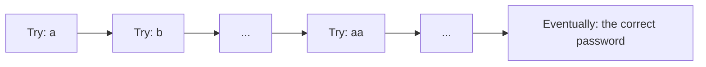
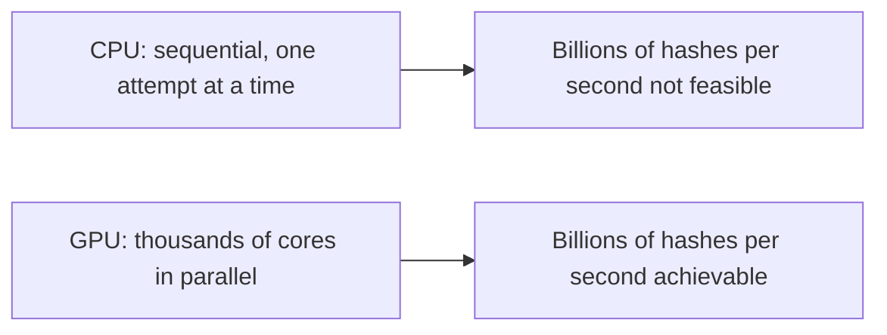
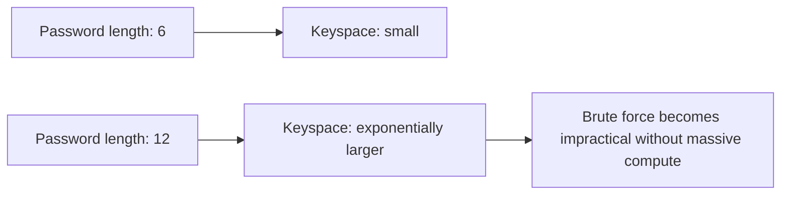
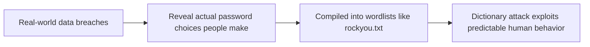
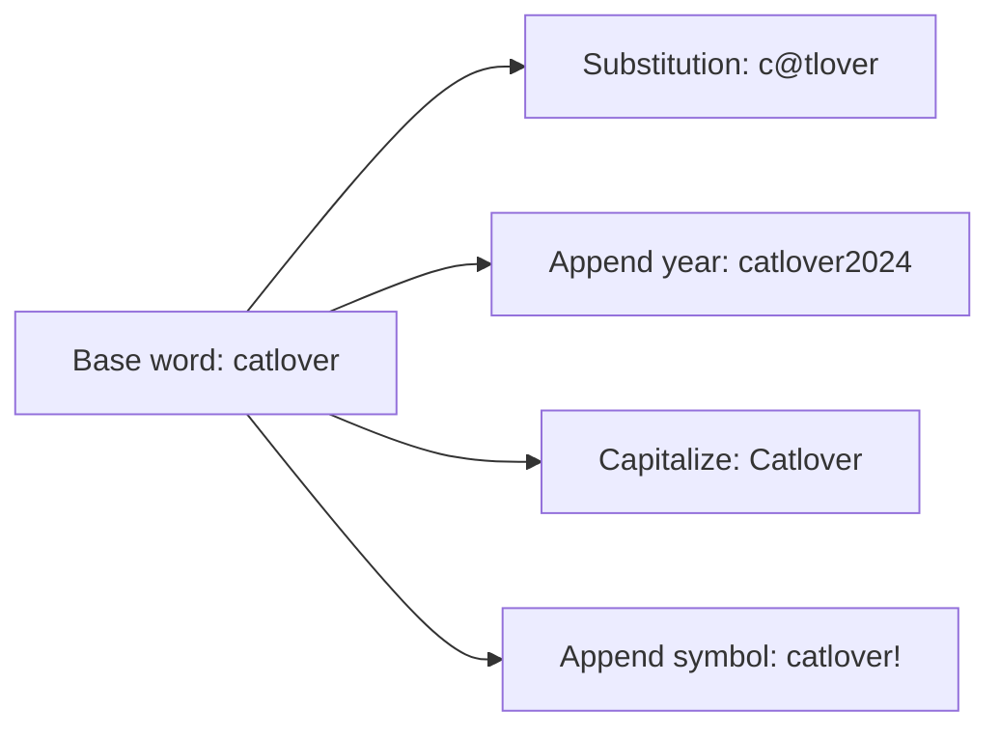
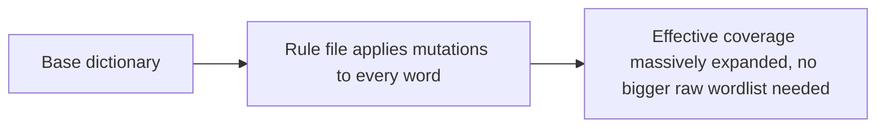
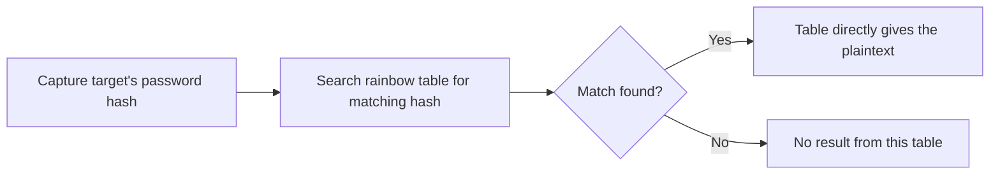
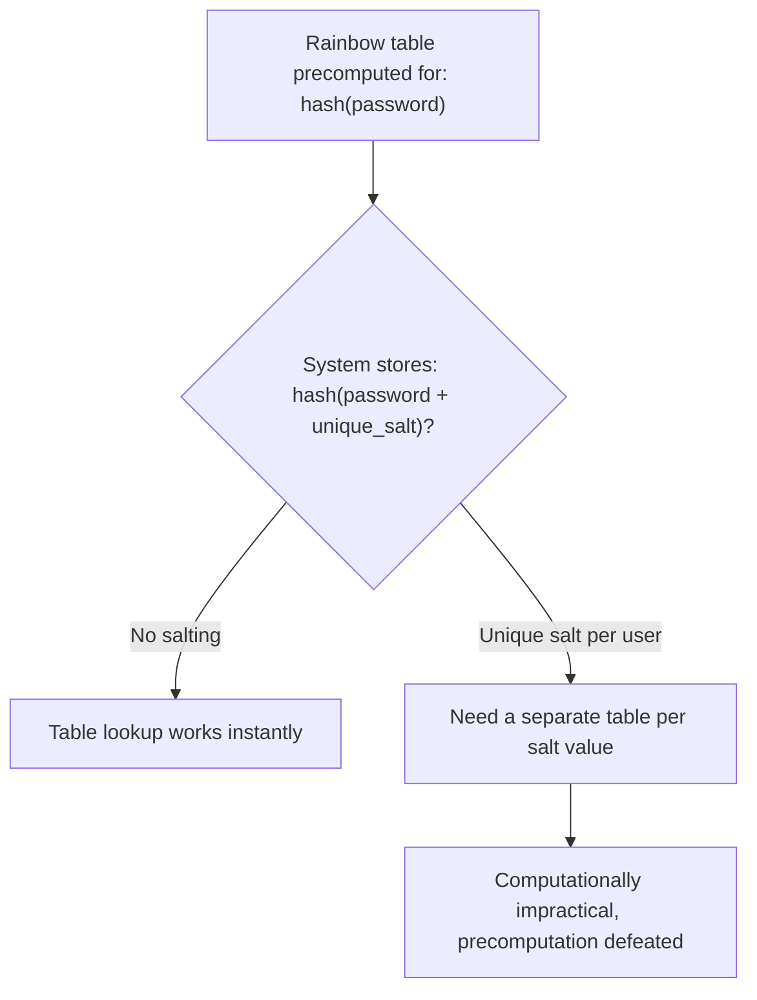
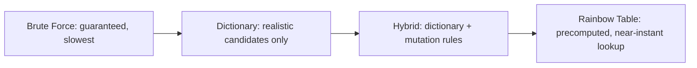

| Topic | Level | Reading Time | Prerequisites |
|---|---|---|---|
| Password Cracking Techniques | Intermediate | ~20 min | Password Hashing, Salting, and Peppering |

> **الهدف من الـ Section ده:**  
> هتفهم الأربع تقنيات الأساسية اللي المهاجمين بيستخدموها لكسر الـ passwords، وإيه اللي بيخلي كل واحدة فيهم أسرع أو أبطأ من التانية، وليه الـ GPU وquantum computing بيتذكروا دايماً في السياق ده.

## Learning Objectives

By the end of this section, you will be able to:

- Explain how **brute force attacks** work, and why they are mathematically guaranteed to succeed given unlimited time.
- Explain why **GPU acceleration** matters so much for password cracking, and how it differs structurally from CPU computation.
- Explain how **dictionary attacks** trade completeness for speed, and why wordlists like `rockyou.txt` remain relevant today.
- Explain how **hybrid attacks** combine dictionary words with rule-based mutations, and why they defeat the common "swap letters for symbols" habit.
- Explain how **rainbow tables** turn cracking into a lookup instead of a computation, and why salting defeats them completely.

## Table of Contents

- [Learning Objectives](#learning-objectives)
- [Brute Force Attack](#brute-force-attack)
  - [The Core Guarantee](#the-core-guarantee)
  - [Why GPUs Change Everything](#why-gpus-change-everything)
  - [The Quantum Computing Threat](#the-quantum-computing-threat)
  - [The Trade-Off](#the-trade-off)
- [Dictionary Attack](#dictionary-attack)
  - [The Core Idea](#the-core-idea)
  - [Popular Wordlists](#popular-wordlists)
  - [The Weak Point](#the-weak-point)
  - [The Real Vulnerability Is Human Behavior](#the-real-vulnerability-is-human-behavior)
- [Hybrid Attack](#hybrid-attack)
  - [How It Works](#how-it-works)
  - [Why Character Substitution Does Not Help](#why-character-substitution-does-not-help)
  - [Rule Files in Practice](#rule-files-in-practice)
- [Pre-Computed Attack: Rainbow Tables](#pre-computed-attack-rainbow-tables)
  - [The Time-Memory Trade-Off](#the-time-memory-trade-off)
  - [The Lookup Process](#the-lookup-process)
  - [Why Salting Defeats This Completely](#why-salting-defeats-this-completely)
- [Comparing the Four Techniques](#comparing-the-four-techniques)
- [Career Path Connections](#career-path-connections)
- [Key Terms Glossary](#key-terms-glossary)
- [Summary](#summary)

## Brute Force Attack

### The Core Guarantee

**Brute force** بيولّد ويجرّب **كل تركيبة ممكنة من الحروف بشكل منهجي**، لحد ما الـ password الصحيح يتلقى.

**نظراً لوقت غير محدود**، الـ brute force **مضمون رياضياً إنه ينجح**، مش مسألة "لو"، دي مسألة "إمتى بس".

### Why GPUs Change Everything

السرعة هنا هي **دالة مباشرة في قوة الحوسبة**. ده السبب في إن **GPU acceleration** مهم جداً: الـ GPUs فيها **آلاف من الـ cores الصغيرة** مصممة أصلاً للعمليات الحسابية المتوازية (originally لعرض الجرافيكس)، وده بيتطابق تماماً مع حساب الـ hash.

النتيجة: تقدر تحسب **مليارات من محاولات الـ hash في الثانية**، عن طريق **تقسيم الشغل عبر الـ cores** بدل ما تجرب password واحد في المرة بشكل تسلسلي على CPU.

| Hardware | Approach | Relative Speed |
|---|---|---|
| CPU | محاولة واحدة في المرة، تسلسلياً | أبطأ بكتير |
| GPU | آلاف المحاولات بالتوازي | أسرع بمراحل |

أدوات شائعة: **Hashcat**، **John the Ripper** (الاتنين بيدعموا GPU acceleration).

### The Quantum Computing Threat

خوارزميات زي **Grover's algorithm** ممكن نظرياً تدي **تسريع تربيعي (quadratic speedup)** لعملية الـ brute-forcing للـ symmetric keys والـ hashes، يعني مساحة بحث كانت هتاخد سنين تقليدياً، ممكن **تنكمش بشكل كبير**.

مع ذلك، **أجهزة quantum computing ذات علاقة حقيقية بالتشفير وبحجم كافٍ لسه مش موجودة عملياً** حتى الآن.

> [!NOTE]
> This is a forward-looking consideration, not a current practical threat. It is worth knowing the concept exists in security discussions, but it does not change today's password policy recommendations.

### The Trade-Off

الـ brute force هو **الطريقة الأبطأ لكل وحدة إضافية من قوة الـ password**. كل حرف إضافي **بيزود الـ keyspace (مساحة البحث) أسياً (exponentially)**، فرغم إنه مضمون، هو **غالباً غير عملي** ضد passwords معقدة من غير موارد حوسبة ضخمة.

## Dictionary Attack

### The Core Idea

بيستخدم **wordlist جاهز** (ملف نصي) فيه passwords شائعة، أو credentials مسربة، أو مرشّحات محتملة، وبيجرّب كل واحد **مباشرة** ضد الهدف.

ده **أسرع بكتير من الـ brute force**، لأنه **مش بيجرب الـ keyspace كامل**، بيجرب **المرشّحين الواقعيين بس**.

### Popular Wordlists

| Wordlist | Source |
|---|---|
| `rockyou.txt` | من **data breach حقيقي سنة 2009**، شائع جداً في الـ labs والـ CTFs |
| **SecLists** | مستودع GitHub ضخم فيه wordlists لأغراض كتير: passwords, usernames, fuzzing payloads، وغيرها |

### The Weak Point

الفعالية **كلها بتعتمد على جودة الـ wordlist**؛ مفيدة بس ضد passwords **موجودة فعلاً في القايمة**. عديم الفايدة ضد passwords **فريدة، عشوائية، أو طويلة بما يكفي** ومش موجودة في أي قايمة.

### The Real Vulnerability Is Human Behavior

الثغرة الحقيقية المستغلة هنا هي **سلوك البشر**. الناس بتعيد استخدام أنماط شائعة (`password123`، `qwerty`، أسماء الحيوانات الأليفة، فرق كرة القدم)، والـ wordlists دي **مبنية فعلياً من داتا اختراقات حقيقية** بتوضح إيه اللي الناس فعلاً بتختاره.

> [!IMPORTANT]
> A dictionary attack is not guessing in the mathematical sense; it is pattern-matching against documented human behavior. This is why password policies focused purely on complexity rules (one uppercase, one symbol) are less effective than they appear: predictable patterns still end up in these lists.

## Hybrid Attack

### How It Works

بيبدأ من **كلمة أساسية من dictionary** (مثلاً `catlover`)، وبيطبق **قواعد تحويل (transformation rules)**:

- استبدال الحروف (character substitution): `a→@`, `o→0`
- إضافة أرقام وسنوات: `catlover2024`
- تغييرات في حالة الحروف (capitalization): `Catlover`
- إضافة رموز: `catlover!`

### Why Character Substitution Does Not Help

الهجوم ده بيستهدف **الاعتقاد الشائع (والخاطئ)** إن استبدال الحروف بأرقام ورموز **بيقوّي الـ password بشكل معنوي**.

المهاجمين **أصلاً أتمتوا بالظبط أنماط الاستبدال دي**، لأنها **متوقعة جداً**.

> [!WARNING]
> Replacing "a" with "@" or "o" with "0" feels clever, but it follows a predictable pattern attackers have automated for years. A truly stronger password comes from length and genuine randomness, not from substitution patterns that are already well-known.

### Rule Files in Practice

أدوات زي **Hashcat** بتنفذ ده عن طريق **rule files** (`.rule`)، وهي ملفات بتحدد أنماط التحويل دي وتطبقها على **كل كلمة في الـ dictionary الأساسي**، وده بيوسّع التغطية الفعلية **بشكل هائل من غير الحاجة لـ wordlist خام أكبر**.

الهجوم ده **نقطة وسط**: أسرع من الـ brute force، وأشمل من الـ dictionary attack العادي.

## Pre-Computed Attack: Rainbow Tables

### The Time-Memory Trade-Off

بدل حساب الـ hashes أثناء الهجوم نفسه، hashes لمجموعات ضخمة من الـ passwords المحتملة **بتتحسب مسبقاً وتتخزن** في بنية بحث (lookup structure) اسمها **Rainbow Table**.

ده **time-memory trade-off**: الحساب الثقيل بيتم **مرة واحدة، مقدماً**، ومخزّن. النتيجة: الهجوم الفعلي بيبقى **lookup شبه فوري**، مش حساب حي.

### The Lookup Process

- المهاجم بيلتقط hash الـ password بتاع الهدف.
- بيدور في الـ rainbow table عن hash مطابق.
- لو لقى تطابق، الجدول **بيديه مباشرة النص الصريح** اللي أنتج الـ hash ده.

### Why Salting Defeats This Completely

**Salting بيلغي الهجوم ده تماماً**.

الـ **salt** هو داتا عشوائية بتتضاف للـ password **قبل الـ hashing**، فريدة لكل مستخدم. بما إن الـ rainbow table **اتحسبت مسبقاً لـ hashes من غير salt** (أو بـ salt مختلف)، الـ hash المخزّن **مش هيتطابق**.

المهاجم هيحتاج **يبني rainbow table منفصل تماماً لكل قيمة salt ممكنة**، وده **بيلغي الغرض الكامل من الحساب المسبق**.

> [!IMPORTANT]
> This is precisely why modern systems store `hash(password + unique_salt)` rather than `hash(password)` alone, a point covered in depth in the Password Hashing, Salting, and Peppering file. Rainbow tables and salting are the direct attack-and-defense pair that explains why salting became standard practice.

## Comparing the Four Techniques

| Technique | Coverage | Speed | Key Weakness It Exploits |
|---|---|---|---|
| Brute Force | كل تركيبة ممكنة | الأبطأ نسبياً | ضمان رياضي، لكن غير عملي ضد passwords معقدة |
| Dictionary | مرشّحات واقعية بس | أسرع من brute force | سلوك البشر المتوقع |
| Hybrid | dictionary + تحويلات | وسط | اعتقاد خاطئ إن substitution بيقوّي الـ password |
| Rainbow Table | hashes محسوبة مسبقاً | شبه فوري، لو الجدول موجود | غياب الـ salting |

> [!TIP]
> Notice the progression: each technique trades completeness for speed, except the rainbow table, which trades storage space for speed instead. Understanding which trade-off each defense targets (longer passwords defeat brute force and dictionary attacks, salting defeats rainbow tables) is more useful than memorizing the techniques in isolation.

## Career Path Connections

| Career Path | How This Topic Applies |
|---|---|
| SOC Analyst | Recognizes signs of offline cracking attempts and advises on password policy effectiveness against each technique |
| Penetration Tester | Directly applies these four techniques, using tools like Hashcat and John the Ripper, during authorized assessments |
| GRC | Password complexity and salting requirements in policy documents map directly to which attacks they actually mitigate |
| Cloud Security | Cloud identity providers apply salting and rate limiting natively, reducing exposure to all four techniques by default |

## Key Terms Glossary

| Term | Definition |
|---|---|
| Brute Force Attack | Systematically trying every possible character combination until the correct password is found |
| Keyspace | The total search space of possible password combinations |
| GPU Acceleration | Using a graphics processing unit's parallel cores to compute hashes far faster than a CPU |
| Dictionary Attack | Testing a prebuilt wordlist of likely passwords directly against a target |
| Hybrid Attack | Combining dictionary words with rule-based mutations such as substitutions and appended numbers |
| Rule File | A file defining mutation patterns applied to a base wordlist, used by tools like Hashcat |
| Rainbow Table | A precomputed lookup structure mapping hashes to the plaintext passwords that produced them |
| Time-Memory Trade-Off | Doing heavy computation once in advance and storing the result, to make the actual attack a fast lookup |
| Salt | A random value added to a password before hashing, unique per user, defeating rainbow tables |

## Summary

- **Brute force is guaranteed but slow:** هيحقق النجاح أكيد مع وقت غير محدود، لكن كل حرف إضافي بيزود مساحة البحث أسياً.
- **GPUs transform cracking speed:** آلاف الـ cores المتوازية بتخلي حساب مليارات الـ hashes في الثانية ممكناً.
- **Dictionary attacks exploit human predictability:** مش بتجرب الـ keyspace كامل، بتجرب أنماط واقعية مبنية من اختراقات حقيقية زي rockyou.txt.
- **Hybrid attacks defeat the "swap letters for symbols" myth:** المهاجمين أتمتوا بالظبط أنماط الاستبدال دي.
- **Rainbow tables turn cracking into a lookup:** حساب ثقيل مرة واحدة مقدماً، وبعدين استرجاع شبه فوري.
- **Salting is the direct counter to rainbow tables:** قيمة فريدة لكل مستخدم بتلغي فايدة الجدول المحسوب مسبقاً بالكامل.
- **Each technique trades a different resource:** الوقت، الدقة، أو التخزين، وفهم المقايضة دي أهم من حفظ التقنيات الأربعة لوحدها.

