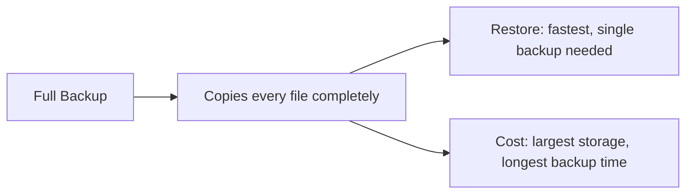
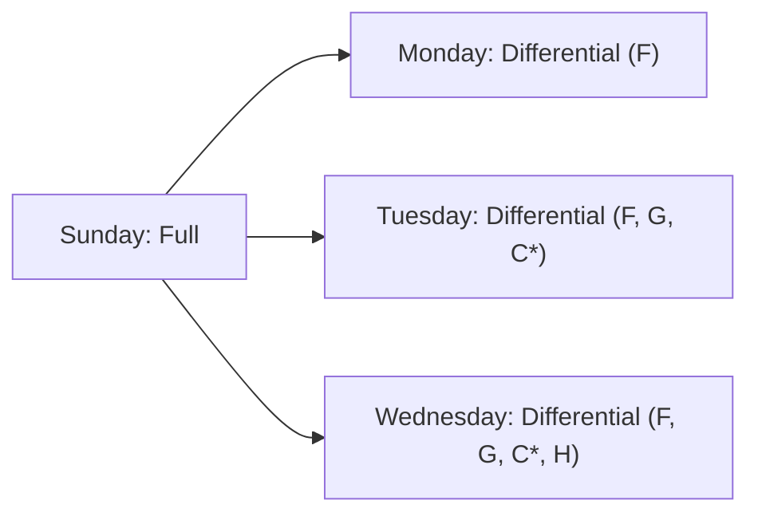
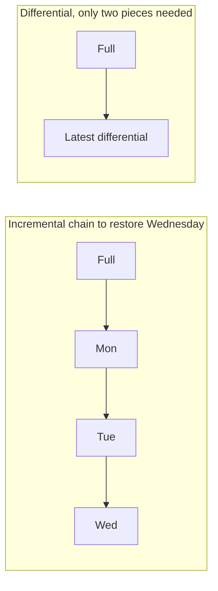
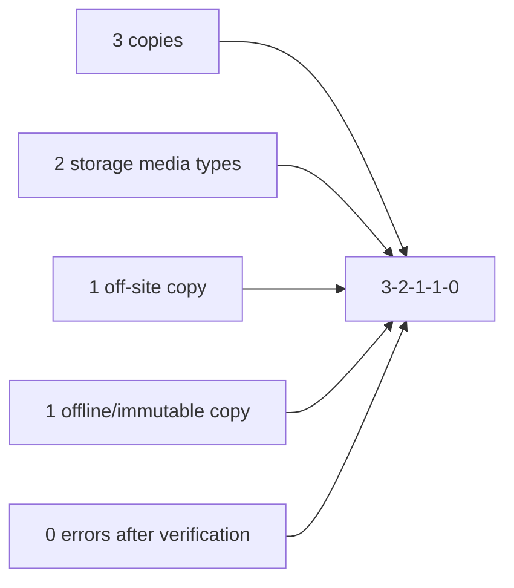
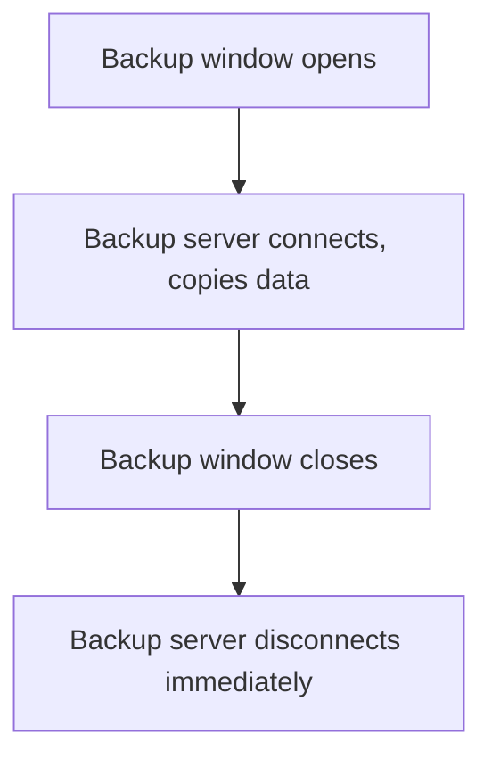
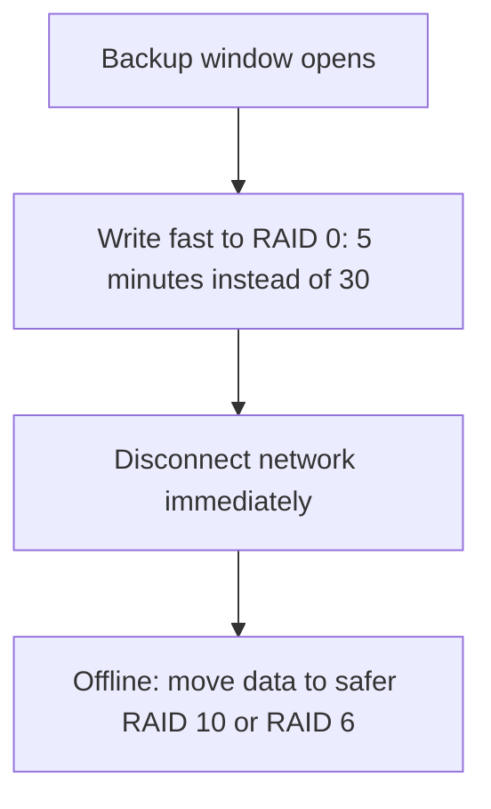
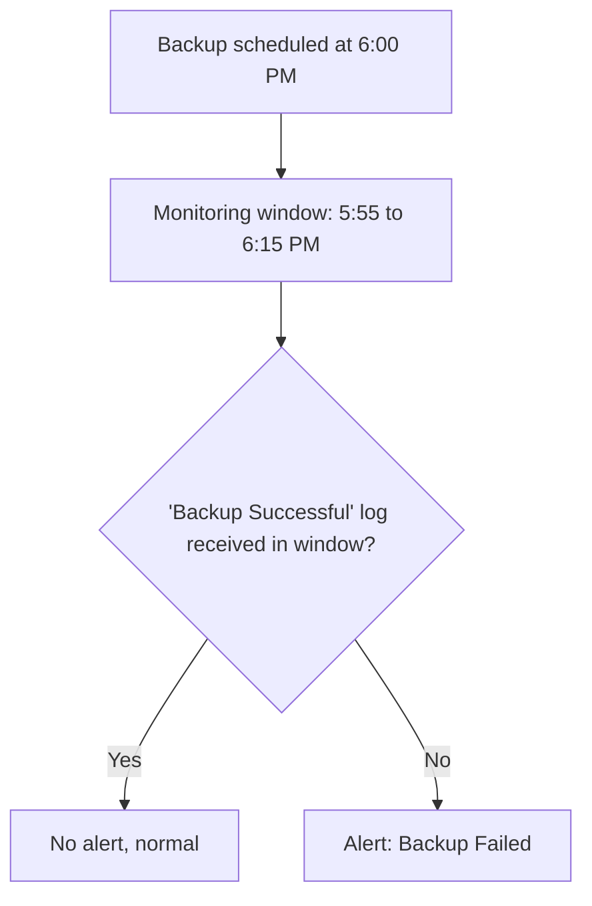
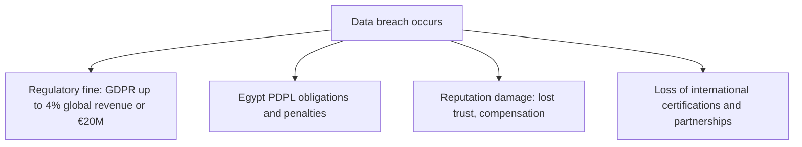

| Topic | Level | Reading Time | Prerequisites |
|---|---|---|---|
| Backup Strategies and Data Recovery | Intermediate | ~25 min | Redundancy, High Availability, and RAID |

> **الهدف من الـ Section ده:**  
> هتفهم أنواع الـ backups التلاتة وإزاي تقارن بينهم، هتتعلم قاعدة الـ 3-2-1 (والنسخة الحديثة 3-2-1-1-0) ومفاهيم RPO وRTO، وهتفهم ليه الـ backups لازم تكون معزولة عن الشبكة وإزاي تقلل نافذة التعرض، وهتعرف إزاي تتحقق إن الـ backup فعلاً اشتغل، وأخيراً هتفهم التكلفة القانونية والسمعية الحقيقية لفشل الحماية.


## Learning Objectives

By the end of this section, you will be able to:

- Define a **backup** and explain its purpose across deletion, theft, ransomware, corruption, and disaster scenarios.
- Compare **full**, **incremental**, and **differential** backups by speed, storage, and restore complexity.
- Apply the **3-2-1 rule** and its modern extension **3-2-1-1-0**, and define **RPO** and **RTO**.
- Explain why backups must be **isolated** from the network, and describe the connect-only-during-window solution.
- Describe a technique for **reducing the backup window** using fast RAID storage.
- Design a **SIEM rule** that detects a failed backup through the absence of an expected log.
- Explain the **regulatory and reputational cost** of a breach, including GDPR and Egypt's Personal Data Protection Law.

## Table of Contents

- [Learning Objectives](#learning-objectives)
- [What Is a Backup](#what-is-a-backup)
  - [Core Definition](#core-definition)
  - [Full Backup](#full-backup)
- [Incremental Backup](#incremental-backup)
  - [How It Works](#how-it-works)
  - [Advantages and Disadvantages](#advantages-and-disadvantages)
- [Differential Backup](#differential-backup)
  - [How It Works](#how-it-works-1)
  - [Advantages and Disadvantages](#advantages-and-disadvantages-1)
- [Full Versus Incremental Versus Differential](#full-versus-incremental-versus-differential)
- [Backup Best Practices: The 3-2-1 Rule](#backup-best-practices-the-3-2-1-rule)
  - [The Classic Rule](#the-classic-rule)
  - [The Modern Version: 3-2-1-1-0](#the-modern-version-3-2-1-1-0)
  - [RPO and RTO](#rpo-and-rto)
- [Backups Must Be Isolated](#backups-must-be-isolated)
  - [Why Isolation Matters](#why-isolation-matters)
  - [The Dilemma and Its Solution](#the-dilemma-and-its-solution)
  - [The Risk Window](#the-risk-window)
- [Reducing the Backup Window](#reducing-the-backup-window)
  - [The Two-Stage Technique](#the-two-stage-technique)
- [Verify That Backups Actually Work](#verify-that-backups-actually-work)
  - [The Scenario](#the-scenario)
  - [The Detection Steps](#the-detection-steps)
- [Encryption, Regulation, and Reputation](#encryption-regulation-and-reputation)
  - [Encrypt Data at Rest](#encrypt-data-at-rest)
  - [GDPR](#gdpr)
  - [Egypt's Personal Data Protection Law](#egypts-personal-data-protection-law)
  - [Reputation Damage](#reputation-damage)
- [Career Path Connections](#career-path-connections)
- [Key Terms Glossary](#key-terms-glossary)
- [Summary](#summary)

## What Is a Backup

### Core Definition

**Backup** هو نسخة من داتاك مخزّنة في مكان تاني، بحيث تقدر **تسترجعها** بعد الحذف، أو السرقة، أو التشفير بـ ransomware، أو الـ corruption، أو الكارثة.

### Full Backup

**Full backup (image backup)**: نسخة كاملة من كل حاجة، أو snapshot للنظام كله، شبيه بإزاي الـ virtual machine snapshot بيلتقط الجهاز بالظبط زي ما هو. لو استرجعت الـ image، بتاخد **نفس الكمبيوتر بكل داتاه**.

```text
Source: [File A][File B][File C][File D][File E]
Backup: [File A][File B][File C][File D][File E]  <- everything copied
```

| Aspect | Detail |
|---|---|
| ميزة | الأبسط والأسرع في الاسترجاع |
| عيب | محتاج أكتر مساحة ووقت، وتكلفته أعلى |



المؤسسات عادةً بتعمل full backups **للأنظمة الأكتر أهمية بس**، بسبب التكلفة ومساحة التخزين وقيود وقت الاسترجاع.

## Incremental Backup

### How It Works

**Incremental backup** بينسخ **بس اللي اتغيّر من آخر backup من أي نوع**.

| Day | Backup Type | What Is Stored |
|---|---|---|
| Sunday | Full | A, B, C, D, E |
| Monday | Incremental | F (ملف جديد) |
| Tuesday | Incremental | G (جديد)، C* (C معدّل) |
| Wednesday | Incremental | H (جديد) |


### Advantages and Disadvantages

| Aspect | Detail |
|---|---|
| ميزة | أسرع backup، وأصغر مساحة تخزين |
| عيب | أبطأ استرجاع. عشان تسترجع Wednesday، محتاج Sunday's full backup **بالإضافة** لـ Monday وTuesday وWednesday **بالترتيب**. لو أي حلقة من السلسلة ناقصة أو تالفة، السلسلة كلها بتنكسر |

> [!WARNING]
> If Tuesday's incremental backup is corrupted, the entire chain breaks from that point forward, meaning Wednesday cannot be restored either, even though Wednesday's own backup file is perfectly intact. This single weakness is the main reason many organizations choose differential backups despite the extra storage cost.

## Differential Backup

### How It Works

**Differential backup** بينسخ **كل حاجة اتغيّرت من آخر FULL backup**.

| Day | Backup Type | What Is Stored |
|---|---|---|
| Sunday | Full | A, B, C, D, E |
| Monday | Differential | F |
| Tuesday | Differential | F, G, C* |
| Wednesday | Differential | F, G, C*, H (تراكمي) |



### Advantages and Disadvantages

| Aspect | Detail |
|---|---|
| ميزة | استرجاع أسرع من الـ incremental. محتاج بس الـ full backup **بالإضافة** لآخر differential |
| عيب | حجم الـ backup **بيكبر كل يوم** مع مرور الأسبوع، فبياخد مساحة ووقت أكتر |

## Full Versus Incremental Versus Differential

| | Full | Incremental | Differential |
|---|---|---|---|
| **Backup speed** | الأبطأ | الأسرع | متوسط |
| **Storage** | الأكبر | الأصغر | متوسط |
| **Restore speed** | الأسرع | الأبطأ | متوسط |
| **Restore needs** | نسخة واحدة | Full + كل الـ incrementals | Full + آخر differential |



## Backup Best Practices: The 3-2-1 Rule

### The Classic Rule

| Component | Meaning |
|---|---|
| **3** | نسخ من داتاك (الأصلية + نسختين backup) |
| **2** | نوعين مختلفين من وسائط التخزين |
| **1** | نسخة واحدة مخزّنة بره الموقع (off-site)، أو في منطقة تانية |

### The Modern Version: 3-2-1-1-0

النسخة الحديثة: **3-2-1-1-0**:

- نسخة واحدة **offline أو immutable** (مش قابلة للتغيير أو الحذف، حتى من الـ administrator).
- **0 أخطاء** بعد التحقق من الـ backup (backup verification).



### RPO and RTO

| Term | Full Name | Meaning |
|---|---|---|
| **RPO** | Recovery Point Objective | أقصى كمية داتا تقدر تتحمل خسارتها، بالوقت. backup يومي يدّي RPO لحد 24 ساعة |
| **RTO** | Recovery Time Objective | أقصى وقت تقدر تتحمله وإنت واقف. بيحدد إزاي المفروض تسترجع بسرعة |


> [!NOTE]
> RPO and RTO are business decisions, not purely technical ones. A daily backup schedule implies the business has accepted up to 24 hours of potential data loss as tolerable; if that is not acceptable, the backup frequency itself must change.

## Backups Must Be Isolated

### Why Isolation Matters

الـ backups موجودة عشان تنقذك من الـ ransomware، لكن **ممكن تتدمر بيه هو نفسه**.

الـ ransomware بينتشر عبر الشبكة ويدوّر على الـ backups عشان **يشفّرها أو يمسحها الأول**. بعض المؤسسات المصرية **اتضربت بشدة** لأن سيرفرات الـ backup بتاعتها كانت **جوه نفس الشبكة المخترقة**.

**تخزين الـ backup لازم يكون في شبكة معزولة أو منفصلة.**

### The Dilemma and Its Solution

**المعضلة:** سيرفر الـ backup **لازم يتصل بالشبكة** عشان ينسخ الداتا. **الحل:** وصّله **بس وقت نافذة الـ backup المجدولة**، وبعدين افصله **فوراً**.

بعض البيئات شديدة الحساسية (عسكرية، منشآت نووية) بتفضل **مفصولة عن الإنترنت** إلا وقت ما تحتاج تستقبل تحديثات.



### The Risk Window

**الخطر أثناء الاتصال:** نافذة الـ backup هي **لحظة تعرّض**. مهاجمين ماهرين **استنوا جوه الشبكة** لحد ما نافذة اتصال الـ backup تفتح، وبعدين عدّوا الـ backup files. **راقب الشبكة بعناية أثناء النافذة دي**.

ترك الـ backup **متصل بشكل دائم** (اللي بعض المؤسسات بتعمله) **بيلغي معظم قيمته**.

> [!WARNING]
> A skilled attacker may wait days or weeks inside a network specifically for the backup connection window to open, then infect the backup files during that brief period. Network monitoring during the connection window is just as critical as the disconnect-after rule.

## Reducing the Backup Window

### The Two-Stage Technique

تقنية ذكية: استخدام **تخزين سريع** أثناء نافذة الـ backup.

- اكتب الـ backup الأول على إعداد **RAID سريع** (مثلاً RAID 0، اللي هو speed-only)، بحيث النسخ يخلص في **5 دقايق بدل 30**.
- **افصل الشبكة فوراً** بعد النسخ.
- بعد كده، **offline**، انقل الداتا لترتيب أأمن ومتكرر (مثلاً **RAID 10** أو **RAID 6**).



**كل ما قلّ وقت اتصال سيرفر الـ backup، قلّت فرصة استهدافه.**

> [!TIP]
> This is a great point to mention in an interview because it shows you understand both RAID and backup security together, not just one of them in isolation. For the full comparison of RAID levels and the RAID-is-not-a-backup distinction, see the Redundancy, High Availability, and RAID file.

## Verify That Backups Actually Work

**Backup فشل بصمت (silently) هو عديم الفايدة لحد ما تحتاجه.**

### The Scenario

الـ backup بيشتغل كل يوم الساعة 6:00 مساءً. فريق الـ backup مش شغال 24/7، لكن الـ **SOC شغال**. نظام الـ backup بيبعت log زي **"Backup Successful"**.

### The Detection Steps

- ابعت للـ **SIEM بس الـ logs اللازمة**. نظام الـ backup ممكن ينتج ملايين logs في الساعة، وبعت الكل هيغرق الـ SIEM.
- اعمل **rule مبنية على غياب log**: لو مفيش "Backup Successful" log وصل بين **5:55 و6:15 مساءً**، أطلق alert اسمه **"Backup Failed"**.
- خلّي النافذة تبدأ شوية بدري وتخلص شوية متأخر، عشان تستوعب أي فرق توقيت بسيط.



> [!TIP]
> This "expected event did NOT happen" type of rule is very useful in SOC work generally, not just for backups. It is a distinct detection pattern from the usual "a bad event DID happen" alert logic, and worth naming explicitly in an interview.

## Encryption, Regulation, and Reputation

### Encrypt Data at Rest

شفّر الداتا at rest. لو مهاجمين سرقوا ملفات مشفرة، **مش هيقدروا يقروها**.

### GDPR

ليه تصرف ملايين على الأمان والـ backups؟ **بسبب تكلفة الفشل**.

**GDPR** (لائحة حماية البيانات الأوروبية) بتسمح بغرامات **تصل لـ 4% من الإيراد السنوي العالمي للشركة** (أو **20 مليون يورو**، أيهما أعلى) على الانتهاكات الجسيمة. لشركة بتكسب مليارات، **ده غرامة ضخمة جداً**.

### Egypt's Personal Data Protection Law

**قانون حماية البيانات الشخصية المصري (القانون رقم 151 لسنة 2020)** كمان بيحدد **التزامات** على إزاي المؤسسات المفروض تحمي البيانات الشخصية.

### Reputation Damage

**الضرر السمعي ممكن يكلّف أكتر من الغرامة نفسها**. العملاء والبنوك والشركاء بيفقدوا الثقة، وبعض الشركات لازم تدفع تعويضات. المؤسسات الكبيرة كمان محتاجة **شهادات دولية** عشان تشتغل مع شركاء عالميين، والشهادات دي بتتطلب **controls أمنية قوية**.



**ببساطة: ميزانية الأمان صغيرة مقارنة بتكلفة الاختراق.**

> [!IMPORTANT]
> This connects directly back to the legal dimension of double extortion covered in Ransomware and the LockBit Case Study: a ransomware group publishing stolen customer data is not just a technical incident, it is the trigger that converts a breach into regulatory fines, compensation claims, and lost certifications all at once.

## Career Path Connections

| Career Path | How This Topic Applies |
|---|---|
| SOC Analyst | Builds and monitors "expected event did not happen" alert rules for backup failures as part of daily operations |
| Penetration Tester | Testing whether backup servers are genuinely isolated is a standard objective in internal ransomware-resilience assessments |
| GRC | RPO/RTO definitions, the 3-2-1-1-0 rule, and regulatory compliance (GDPR, Egypt PDPL) are core GRC responsibilities |
| Cloud Security | Cloud-native backup services implement immutable storage and geographic distribution as built-in features |

## Key Terms Glossary

| Term | Definition |
|---|---|
| Backup | A copy of data stored elsewhere, enabling restoration after loss |
| Full Backup | A complete copy of all data, fastest to restore but largest and slowest to create |
| Incremental Backup | A backup of only what changed since the last backup of any type |
| Differential Backup | A backup of everything changed since the last full backup, growing daily |
| 3-2-1 Rule | Three copies of data, on two media types, with one copy off-site |
| 3-2-1-1-0 | The modern extension adding one offline/immutable copy and zero verification errors |
| RPO | Recovery Point Objective, the maximum tolerable data loss, measured in time |
| RTO | Recovery Time Objective, the maximum tolerable downtime |
| Immutable Backup | A backup that cannot be altered or deleted, even by an administrator |
| GDPR | The European Union's General Data Protection Regulation |
| Egypt PDPL | Egypt's Personal Data Protection Law, Law No. 151 of 2020 |

## Summary

- **A backup restores data lost to deletion, theft, ransomware, corruption, or disaster.**
- **Full backups are simplest to restore but costliest to create:** بيستخدموا بس للأنظمة الأكتر أهمية غالباً.
- **Incremental backups are fastest to make but slowest and most fragile to restore:** سلسلة كاملة لازم تكون سليمة.
- **Differential backups balance speed and restore simplicity:** لكن حجمهم بيكبر كل يوم.
- **The 3-2-1 rule, extended to 3-2-1-1-0, adds immutability and verification:** نسخة offline محصّنة وصفر أخطاء.
- **RPO and RTO translate backup strategy into business tolerance for loss and downtime.**
- **Backups must be isolated, connected only during the scheduled window:** الترك الدائم بيلغي قيمتهم كطبقة حماية مستقلة.
- **Fast RAID can shrink the exposure window, then data moves offline to safer storage.**
- **Silent backup failure is as dangerous as no backup:** "expected event did not happen" rules بتحل المشكلة دي.
- **The real cost of a breach is regulatory, reputational, and contractual, not just technical:** GDPR، Egypt PDPL، وفقدان الثقة والشهادات الدولية.

