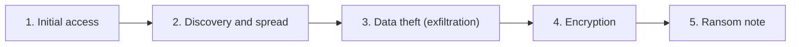
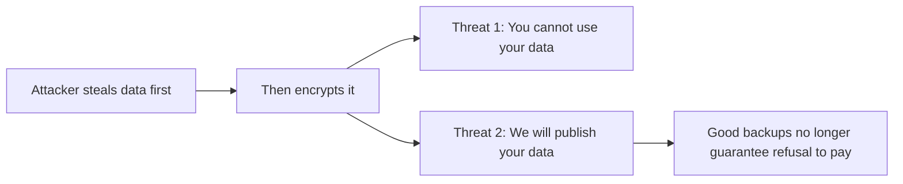
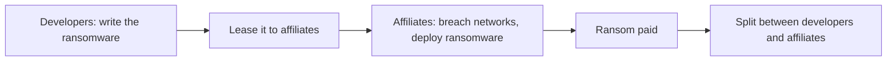
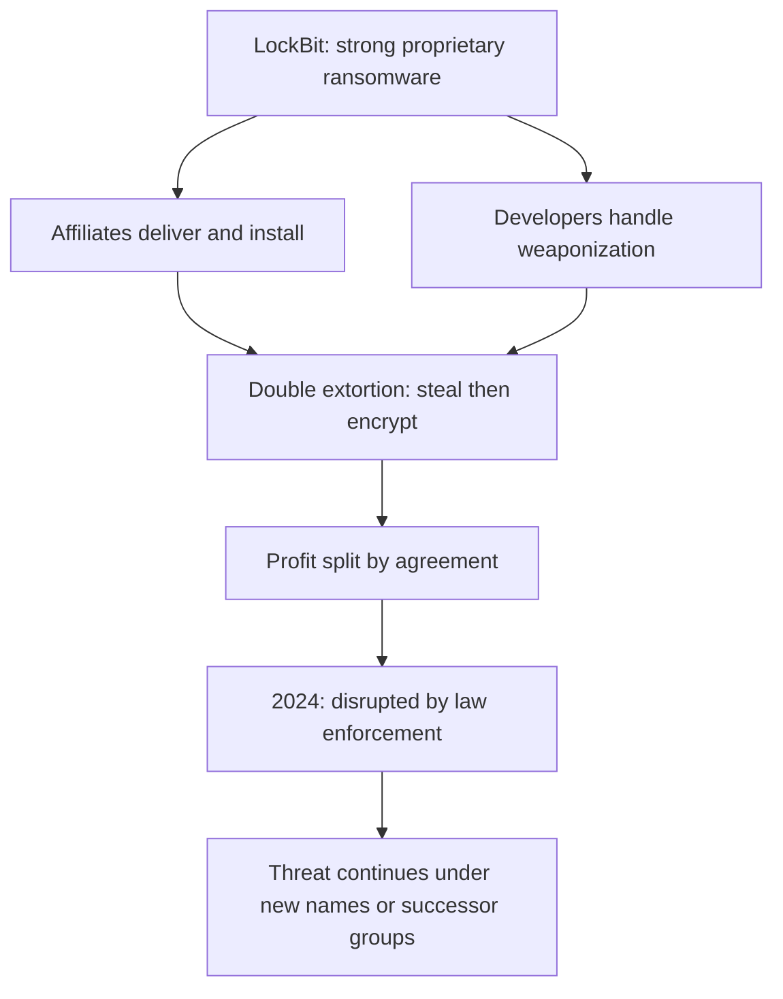
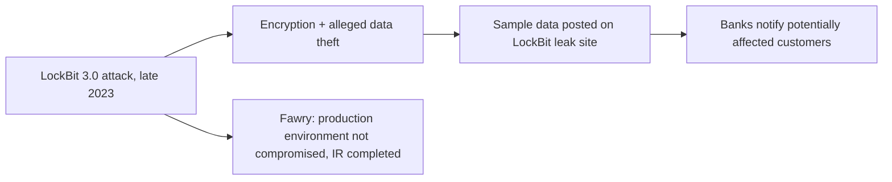
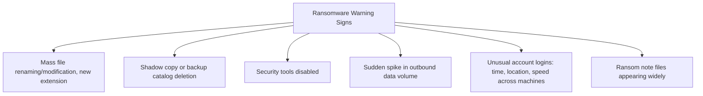

| Topic | Level | Reading Time | Prerequisites |
|---|---|---|---|
| Ransomware and the LockBit Case Study | Intermediate | ~20 min | Data Loss Fundamentals and DLP Operations |

> **الهدف من الـ Section ده:**  
> هتفهم إزاي هجوم الـ ransomware بيتطور مرحلة بمرحلة، وإيه الفرق بين الـ single والـ double extortion، وهتتعرف على نموذج عمل Ransomware-as-a-Service من خلال دراسة حالة حقيقية لمجموعة LockBit وضحيتها المصرية Fawry، وهتعرف العلامات التحذيرية اللي الـ SOC analyst لازم يراقبها.

## Learning Objectives

By the end of this section, you will be able to:

- Define **ransomware** and list the five typical stages of a ransomware attack, in order.
- Differentiate between **single extortion** and **double extortion**, and explain why the latter defeats good backups.
- Define **Ransomware-as-a-Service (RaaS)** and explain the role split between developers and affiliates.
- Describe **LockBit** as a concrete example: its technical strength, its double extortion model, and why victims trusted it.
- Summarize the **LockBit and Fawry** case study and extract its lessons about incident transparency.
- List five other well-known ransomware groups and what each is known for.
- Identify concrete **warning signs of ransomware** a SOC analyst should watch for in logs and alerts.

## Table of Contents

- [Learning Objectives](#learning-objectives)
- [What Is Ransomware](#what-is-ransomware)
  - [Core Definition](#core-definition)
  - [Typical Stages of an Attack](#typical-stages-of-an-attack)
- [Single Versus Double Extortion](#single-versus-double-extortion)
  - [Single Extortion](#single-extortion)
  - [Double Extortion](#double-extortion)
  - [The Legal Dimension](#the-legal-dimension)
- [Ransomware-as-a-Service (RaaS)](#ransomware-as-a-service-raas)
  - [The Business Model](#the-business-model)
  - [The Cloud Analogy](#the-cloud-analogy)
- [LockBit](#lockbit)
  - [Technical Strength](#technical-strength)
  - [Affiliates and the Cyber Kill Chain](#affiliates-and-the-cyber-kill-chain)
  - [Double Extortion in Practice](#double-extortion-in-practice)
  - [Profit Sharing](#profit-sharing)
  - [Law Enforcement Disruption](#law-enforcement-disruption)
- [Why Victims Trusted LockBit](#why-victims-trusted-lockbit)
  - [Reliable Criminals](#reliable-criminals)
  - [Why This Reputation Mattered](#why-this-reputation-mattered)
- [Case Study: LockBit and Fawry (Egypt)](#case-study-lockbit-and-fawry-egypt)
  - [What Happened](#what-happened)
  - [Lessons](#lessons)
- [Other Well-Known Attacks and Groups](#other-well-known-attacks-and-groups)
- [Warning Signs of Ransomware for SOC Analysts](#warning-signs-of-ransomware-for-soc-analysts)
- [Career Path Connections](#career-path-connections)
- [Key Terms Glossary](#key-terms-glossary)
- [Summary](#summary)

## What Is Ransomware

### Core Definition

**Ransomware** هو malware بيشفّر ملفات الضحية بحيث **مايقدرش يستخدمها**، وبعدين بيطلب دفع (غالباً بعملات رقمية زي **Bitcoin**) مقابل مفتاح فك التشفير.

### Typical Stages of an Attack

| # | Stage | What Happens |
|---|---|---|
| 1 | **Initial access** | Phishing، passwords مسروقة، أو ثغرة غير محدّثة |
| 2 | **Discovery and spread** | المهاجم بيستكشف الشبكة ويسيطر على حسابات أكتر |
| 3 | **Data theft (exfiltration)** | الملفات القيّمة بتتنسخ لبرّه |
| 4 | **Encryption** | الملفات بتتقفل، والـ backups غالباً بتتمسح الأول |
| 5 | **Ransom note** | الضحية بتتبلّغ بإزاي تدفع، أحياناً بـ countdown وتهديد |

> [!IMPORTANT]
> Notice that exfiltration (stage 3) happens before encryption (stage 4). This ordering is deliberate and is exactly what makes double extortion possible: the attacker secures a copy of the data before the victim even knows anything is wrong.

## Single Versus Double Extortion

### Single Extortion

المهاجم **بيشفّر بس**. لو عند الضحية **backups كويسة**، تقدر تسترجع وترفض تدفع.

### Double Extortion

المهاجم **بيسرق الداتا الأول، وبعدين يشفّرها**. دلوقتي فيه **تهديدين منفصلين**:

- مش هتقدر تستخدم داتاك.
- هننشرها.

رسالة المهاجمين عملياً: **"شفّرنا داتاك، وعندنا نسخة منها."**

حتى ضحية عندها **backups ممتازة** ممكن تدفع عشان تمنع تسريب عام.

### The Legal Dimension

الـ double extortion كمان بيحط الضحية في **مشاكل قانونية**، لأن تسريب بيانات عملاء ممكن يعني **غرامات من الجهات التنظيمية** (شوف ملف Backup Strategies and Data Recovery لتفاصيل GDPR).

> [!NOTE]
> This legal consequence is why ransomware defense cannot stop at backup resilience alone. It must also include exfiltration detection, covered in the Data Exfiltration and DNS Tunneling file, since preventing the leak itself is now a separate, independent goal.

## Ransomware-as-a-Service (RaaS)

### The Business Model

**Ransomware-as-a-Service (RaaS)** هو **نموذج عمل إجرامي**: المطورين بيكتبوا الـ ransomware ويؤجروه لـ **affiliates**، واللي بينفذوا الهجمات فعلياً. الفدية بتتقسم بينهم.

- المطورين غالباً **ماهرين في كتابة الكود**.
- الـ affiliates غالباً **ماهرين في اختراق الشبكات**.

**مثال: LockBit.**

### The Cloud Analogy

كلمة **"as a service"** شائعة في عالم الـ cloud (**SaaS, IaaS**): بتستلم خدمة جاهزة بدل ما تبنيها إنت بنفسك. الـ **RaaS هي نفس الفكرة مطبّقة على الجريمة**.

## LockBit

**LockBit** كانت من **أكتر مجموعات الـ ransomware نشاطاً ونجاحاً مالياً** في السنوات الأخيرة.

### Technical Strength

هما طوّروا الـ ransomware **من الصفر**، وده صعب. معظم الـ ransomware الهاوي مكتوب بشكل سيء و**مايقدرش يفك التشفير بعد الدفع**. أداة LockBit كانت **قوية وموثوقة**.

### Affiliates and the Cyber Kill Chain

هما اشتغلوا مع **affiliates** بيوصّلوا الـ ransomware لشبكات الضحايا. في **cyber kill chain**:

| Phase | Who Handles It |
|---|---|
| Delivery وInstallation | Affiliates |
| Weaponization (تجهيز الكود الضار) | Developers |

### Double Extortion in Practice

استخدموا الـ **double extortion**: سرقة أولاً، وبعدين تشفير. رسالتهم للضحايا عملياً: **"متثقش بس إننا شفرناها؛ إحنا كمان ماسكين داتاكم."**

### Profit Sharing

الأرباح بتتقسم **بالاتفاق**. مثلاً لو شركة دفعت **10 مليون دولار**، المطورين والـ affiliates بيقسموها **بنسب متفق عليها**.

### Law Enforcement Disruption

اتقبضوا و**اتعطلوا من جهات إنفاذ القانون في 2024**. مع ذلك، **مجموعات الـ ransomware غالباً بترجع بأسماء جديدة أو بتستبدلها مجموعات تانية**، فالتهديد **مستمر**.

## Why Victims Trusted LockBit

### Reliable Criminals

LockBit كان عنده **سمعة غريبة إنهم مجرمين موثوقين**:

- لما الضحية تدفع، LockBit **فعلاً بيدي مفتاح فك التشفير**.
- كانوا بيسمحوا للضحايا **يجربوا فك تشفير عينة ملف** عشان يثبتوا إنها شغالة.
- كان عندهم **فريق دعم عملاء وchat**، وصفه بعض الضحايا بإنه **أحسن من دعم شركة التليفونات بتاعتهم**.

### Why This Reputation Mattered

المصداقية دي **زودت عدد الضحايا المستعدين يدفعوا**، وده خلّى المجموعة **أغنى**.

> [!IMPORTANT]
> This "customer service" reputation is counterintuitive but structurally important: it was not a side effect, it was a deliberate business strategy. A ransomware group that reliably delivers decryption after payment increases its own revenue, because victims who believe payment "works" are far more likely to pay.

> [!TIP]
> This knowledge is directly useful in interviews. If asked "What is the most well-known ransomware group you have heard of?", describe LockBit: its RaaS model, and its double extortion technique.

## Case Study: LockBit and Fawry (Egypt)

### What Happened

في **أواخر 2023**، مجموعة **LockBit 3.0** شفّرت ملفات وسرقت، بحسب تقارير، بعض الداتا من **Fawry**، منصة مدفوعات رقمية مصرية.

- عيّنات من داتا شخصية مسروقة **اتنشرت على leak site بتاع LockBit**.
- بنوك نصحت بعض العملاء إن معلوماتهم ممكن تكون **اتأثرت**.
- Fawry صرّحت إن **بيئة الإنتاج (production environment) مالهاش دخل بالاختراق**، وأكملوا الاستجابة للحادث والتنظيف مع خبراء أمن سيبراني.

### Lessons

- **المهاجمين غالباً بينشروا عينات كدليل عشان يزودوا الضغط.**
- **الشركات أحياناً بتنكر أو تقلل من الحادث، لكن leak site يقدر يناقضها.** إخفاء الحادث غالباً **بيزود الضرر السمعي**.
- **لما شركة مصرية معروفة تتضرب، كل مؤسسة في المنطقة بتقلق من نفس المجموعة.**

> [!WARNING]
> Companies sometimes minimize incidents publicly, but a ransomware group's leak site is independent evidence that can directly contradict a company's official statement. This gap between the public narrative and the leak site is itself a reputational risk, separate from the technical breach.

## Other Well-Known Attacks and Groups

| Name | What It Is | Why It Matters |
|---|---|---|
| **WannaCry (2017)** | Ransomware worm مستغل ثغرة SMB | انتشر عالمياً في ساعات، ضرب مستشفيات |
| **NotPetya (2017)** | Wiper متنكر في شكل ransomware | دمّر داتا، كلّف Maersk مئات الملايين |
| **REvil (Sodinokibi)** | مجموعة RaaS | هاجمت سلاسل توريد software (مثال: Kaseya) |
| **Conti** | مجموعة RaaS | ضربت مستشفيات وحكومات |
| **Clop** | مجموعة ابتزاز | سرقة داتا جماعية عن طريق ثغرات software نقل الملفات |

> [!NOTE]
> NotPetya is the same attack covered in the Maersk case study in Data Loss Fundamentals and DLP Operations. Notice it is classified here as a wiper disguised as ransomware: its goal was destruction, not profit, which is why no reliable decryption was ever possible, unlike LockBit.

## Warning Signs of Ransomware for SOC Analysts

دوّر على العلامات دي في الـ logs والـ alerts:

- **ملفات كتير اتسمت أسماء جديدة أو اتعدّلت في وقت قصير**، غالباً بامتداد جديد.
- **حذف shadow copies أو backup catalogs.**
- **أدوات أمنية بتتعطل.**
- **زيادة مفاجئة في حجم الداتا الصادرة (exfiltration).**
- **Logins من حسابات غير معتادة، في ساعات غير معتادة، أو لعدة أجهزة بسرعة.**
- **ملفات ransom note** (زي `README.txt`) **بتظهر على أجهزة كتير.**

> [!IMPORTANT]
> The earlier you catch the first signs, data theft or lateral movement, the more damage you prevent. By the time ransom note files appear across many machines, encryption has already completed; the real opportunity to limit damage is detecting stages 2 and 3 of the attack chain, not stage 4.

## Career Path Connections

| Career Path | How This Topic Applies |
|---|---|
| SOC Analyst | The warning signs list above represents core daily detection responsibilities for ransomware-in-progress |
| Penetration Tester | Understanding RaaS, affiliate roles, and extortion models informs realistic ransomware simulation during authorized engagements |
| GRC | Incident transparency (the Fawry lesson) and legal exposure from double extortion are direct governance and regulatory concerns |
| Cloud Security | Cloud environments face the same extortion dynamics, with cloud storage often becoming both the target and the exfiltration channel |

## Key Terms Glossary

| Term | Definition |
|---|---|
| Ransomware | Malware that encrypts a victim's files and demands payment for the decryption key |
| Single Extortion | A ransomware model where only encryption is used, defeated by good backups |
| Double Extortion | A ransomware model combining data theft with encryption, threatening both unusability and public leak |
| RaaS | Ransomware-as-a-Service, a criminal business model splitting development and deployment between developers and affiliates |
| Affiliate | The party in a RaaS model who breaches networks and deploys the ransomware |
| Cyber Kill Chain | A framework describing the stages of an attack, including weaponization, delivery, and installation |
| Leak Site | A website operated by a ransomware group to publish stolen data as pressure or proof |
| Shadow Copy | A Windows feature that can hold recoverable file versions, often deleted by ransomware to prevent easy recovery |

## Summary

- **Ransomware follows five predictable stages:** initial access، discovery/spread، data theft، encryption، وransom note، وexfiltration بتحصل قبل التشفير عمداً.
- **Double extortion defeats "just restore from backup":** تهديدين مستقلين بيضغطوا على الضحية حتى مع backups ممتازة.
- **RaaS mirrors the cloud "as a service" model, applied to crime:** developers بيكتبوا، affiliates بينفذوا، والأرباح بتتقسم.
- **LockBit combined strong technical execution with a trustworthy criminal reputation:** فك تشفير موثوق وsupport chat فعلي زودوا معدل الدفع.
- **The Fawry case shows the gap between official statements and leak-site evidence:** إخفاء الحادث غالباً بيزود الضرر السمعي.
- **Other major groups illustrate different motives:** WannaCry (انتشار سريع)، NotPetya (تدمير متنكر)، REvil/Conti (RaaS)، وClop (سرقة جماعية).
- **Early detection targets stages 2 and 3, not stage 4:** بحلول ظهور ransom notes، التشفير أصلاً اكتمل.

