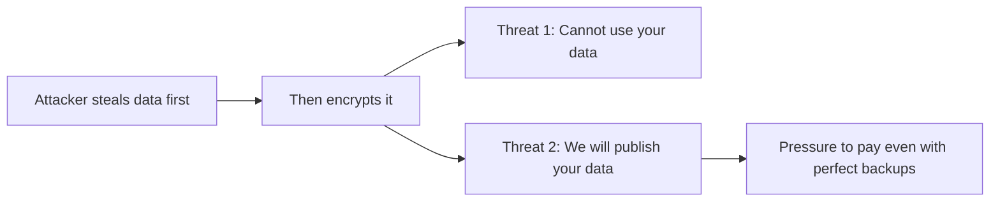
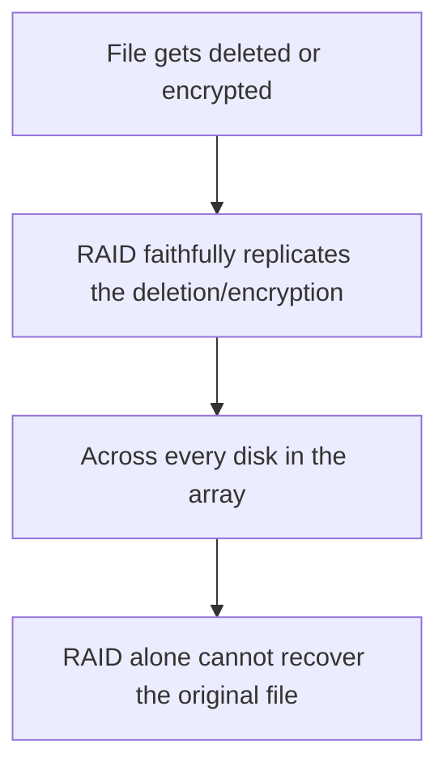
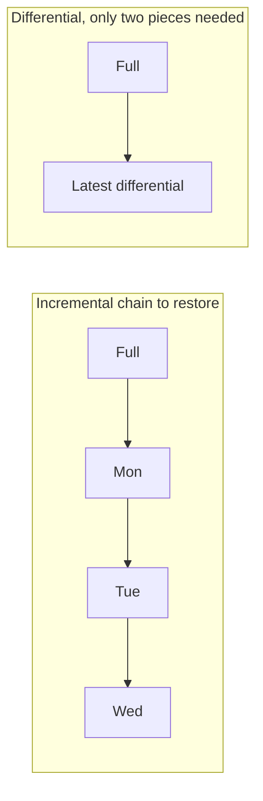
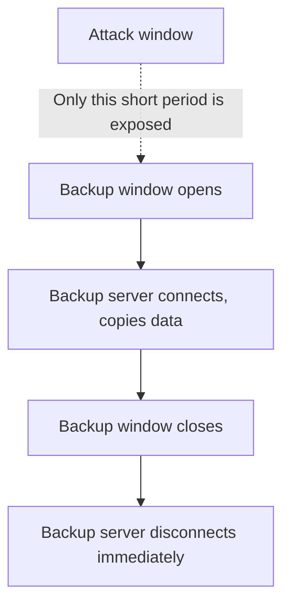
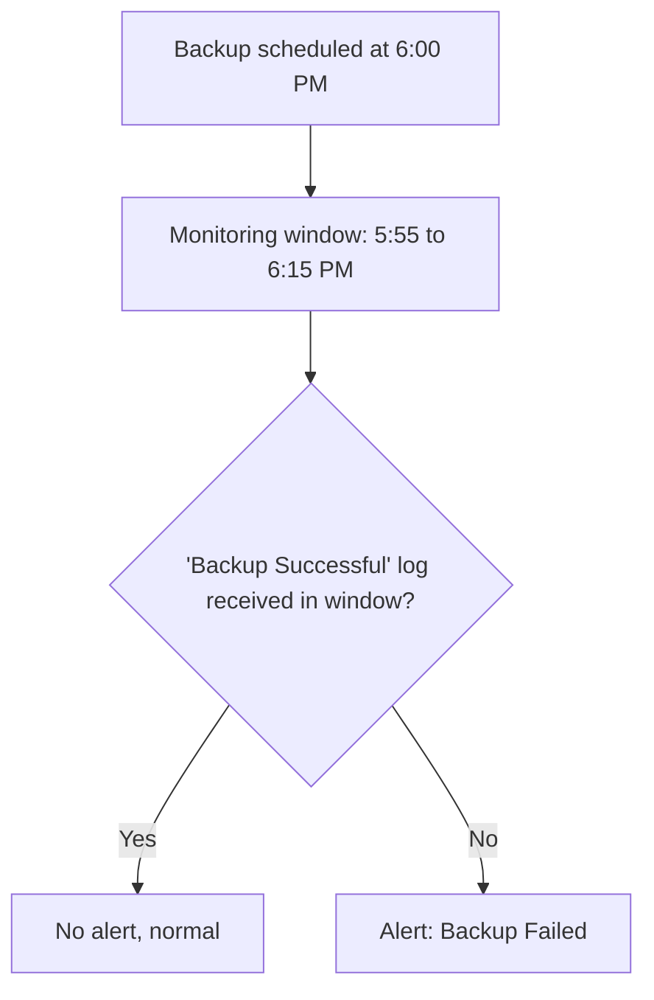

| Topic | Level | Reading Time | Prerequisites |
|---|---|---|---|
| Interview Questions Review: Ransomware and Backup Resilience | Intermediate | ~15 min | Ransomware and the LockBit Case Study, Redundancy High Availability and RAID, Backup Strategies and Data Recovery |

> **الهدف من الـ Section ده:**  
> مراجعة سريعة بصيغة أسئلة وأجوبة لأهم النقط اللي ممكن تتسأل عنها في interview عن الـ ransomware والـ RAID والـ backups، كتلخيص عملي للمفاهيم اللي اتشرحت بالتفصيل في ملفات الكاتيجوري دي.

## Learning Objectives

By the end of this section, you will be able to:

- Answer, in your own words, the most common interview questions about ransomware business models and backup resilience.
- Explain the reasoning behind each answer, not just recite it, so you can adapt to follow-up questions.
- Identify which file in this category to revisit for deeper detail on any question you found difficult.

## Table of Contents

- [Learning Objectives](#learning-objectives)
- [Question 1: What Is Ransomware-as-a-Service](#question-1-what-is-ransomware-as-a-service)
- [Question 2: Why Is Double Extortion So Dangerous](#question-2-why-is-double-extortion-so-dangerous)
- [Question 3: RAID 5 Versus RAID 6, and Why RAID Is Not a Backup](#question-3-raid-5-versus-raid-6-and-why-raid-is-not-a-backup)
- [Question 4: Comparing Full, Incremental, and Differential Backups](#question-4-comparing-full-incremental-and-differential-backups)
- [Question 5: Why Backups Must Be Isolated, and the Dilemma](#question-5-why-backups-must-be-isolated-and-the-dilemma)
- [Question 6: How Would You Know If Last Night's Backup Failed](#question-6-how-would-you-know-if-last-nights-backup-failed)
- [Quick Reference Table](#quick-reference-table)
- [Career Path Connections](#career-path-connections)
- [Summary](#summary)

## Question 1: What Is Ransomware-as-a-Service

**السؤال: إيه هو Ransomware-as-a-Service (RaaS)؟ ديلي مثال.**

**الإجابة النموذجية:**

**RaaS** هو **نموذج عمل إجرامي** بيقوم على إن مطورين بيكتبوا الـ ransomware ويؤجروه لـ **affiliates**، واللي هما اللي بينفذوا الهجمات فعلياً. الفدية بتتقسم بينهم.

- المطورين غالباً **ماهرين في كتابة الكود**.
- الـ affiliates غالباً **ماهرين في اختراق الشبكات**.

**مثال: LockBit.**

> [!TIP]
> If asked to connect this to familiar terms, point out that "as a service" is the same idea as SaaS or IaaS in the cloud world: you receive a ready-made product instead of building it yourself. RaaS applies that exact business model to crime.

للتفصيل الكامل، شوف ملف **Ransomware and the LockBit Case Study**.

## Question 2: Why Is Double Extortion So Dangerous

**السؤال: ليه الـ double extortion خطير جداً؟**

**الإجابة النموذجية:**

- **Single extortion**: المهاجم بيشفّر بس. لو عند الضحية backups كويسة، تقدر تسترجع وترفض تدفع.
- **Double extortion**: المهاجم **بيسرق الداتا الأول، وبعدين يشفّرها**. دلوقتي فيه **تهديدين منفصلين**: إنت مش هتقدر تستخدم داتاك، وهما هينشروها.

حتى ضحية عندها **backups ممتازة** ممكن تدفع عشان تمنع تسريب عام. والتسريب كمان ممكن يحطها في **مشاكل قانونية**، لأن كشف بيانات عملاء ممكن يعني غرامات من الجهات التنظيمية (زي GDPR).

> [!IMPORTANT]
> This single fact, that good backups alone no longer guarantee a ransomware victim can refuse payment, is why modern ransomware defense combines backup resilience with data-exfiltration detection, not either one alone.

للتفصيل الكامل، شوف ملف **Ransomware and the LockBit Case Study**.

## Question 3: RAID 5 Versus RAID 6, and Why RAID Is Not a Backup

**السؤال: إيه الفرق بين RAID 5 وRAID 6؟ وليه الـ RAID مش backup؟**

**الإجابة النموذجية:**

| Aspect | RAID 5 | RAID 6 |
|---|---|---|
| Method | Striping + parity واحد | Striping + double parity |
| Minimum disks | 3 | 4 |
| Disk failures survived | 1 | 2 |
| Typical use | شائع جداً في سيرفرات الشركات | داتا مالهاش تحمل للخطأ خالص |

**ليه RAID مش backup:**

RAID بيحميك من **فشل disk فيزيائي**، مش من **الحذف أو الـ ransomware أو الحريق**. لو ملف اتمسح أو اتشفر، الـ RAID **بينسخ المسح أو التشفير ده بأمانة على كل الأقراص**. محتاج backups حقيقية منفصلة.

> [!TIP]
> A clean way to phrase this in an interview: "RAID protects against hardware failure; backups protect against data loss events. They solve two completely different problems, and you need both."

للتفصيل الكامل، شوف ملف **Redundancy, High Availability, and RAID**.

## Question 4: Comparing Full, Incremental, and Differential Backups

**السؤال: قارن بين الـ full backup والـ incremental والـ differential.**

**الإجابة النموذجية:**

| Aspect | Full | Incremental | Differential |
|---|---|---|---|
| Backup speed | الأبطأ | الأسرع | متوسط |
| Storage | الأكبر | الأصغر | متوسط |
| Restore speed | الأسرع | الأبطأ | متوسط |
| Restore needs | نسخة واحدة | Full + كل الـ incrementals بالترتيب | Full + آخر differential بس |

- **Full**: نسخة كاملة من كل حاجة.
- **Incremental**: بس اللي اتغيّر من **آخر backup من أي نوع**.
- **Differential**: كل اللي اتغيّر من **آخر full backup**، فبيكبر يوم عن يوم.

> [!WARNING]
> The classic follow-up question: "what happens if Tuesday's incremental backup is corrupted?" The answer is that the entire incremental chain breaks from that point forward, meaning you cannot restore Wednesday either. This single weakness is why many organizations prefer differential backups despite the extra storage cost.

للتفصيل الكامل، شوف ملف **Backup Strategies and Data Recovery**.

## Question 5: Why Backups Must Be Isolated, and the Dilemma

**السؤال: ليه الـ backups لازم تكون معزولة؟ وإيه هي المعضلة (dilemma)؟**

**الإجابة النموذجية:**

الـ ransomware بينتشر عبر الشبكة وبيدور على الـ backups **عشان يشفّرها أو يمسحها الأول**. لو سيرفر الـ backup على نفس الشبكة المخترقة، **بيضيع معاها**.

**المعضلة:** سيرفر الـ backup **لازم يتصل بالشبكة** عشان ينسخ الداتا، لكن الاتصال الدائم ده **بيلغي قيمته** كطبقة حماية مستقلة.

**الحل:** وصّله **بس وقت نافذة الـ backup المجدولة**، وبعدين افصله **فوراً**.

> [!WARNING]
> A skilled attacker can wait inside a network specifically for the backup connection to open, then infect the backup files during that window. Monitoring the network carefully during the connection window is just as important as the disconnect-after rule itself.

للتفصيل الكامل، شوف ملف **Backup Strategies and Data Recovery**.

## Question 6: How Would You Know If Last Night's Backup Failed

**السؤال: إزاي هتعرف إن الـ backup بتاع إمبارح بالليل فشل؟**

**الإجابة النموذجية (سيناريو عملي):**

السيناريو: الـ backup بيشتغل كل يوم الساعة 6:00 مساءً. فريق الـ backup مش شغال 24/7، لكن الـ SOC شغال. نظام الـ backup بيبعت log زي "Backup Successful".

**الخطوات:**

- ابعت للـ SIEM بس الـ logs اللازمة (مش كل حاجة، نظام الـ backup ممكن ينتج ملايين logs في الساعة).
- اعمل rule مبنية على **غياب log**: لو مفيش "Backup Successful" log وصل بين 5:55 و6:15 مساءً، أطلق alert اسمه "Backup Failed".
- خلّي النافذة تبدأ شوية بدري وتخلص شوية متأخر، عشان تستوعب أي فرق توقيت بسيط.

> [!TIP]
> This kind of rule, "an expected event did NOT happen", is a distinct and very useful SOC detection pattern, different from the usual "a bad event DID happen" alert logic. It is worth naming explicitly in an interview as a technique you understand.

للتفصيل الكامل، شوف ملف **Backup Strategies and Data Recovery**.

## Quick Reference Table

| # | Question | One-Line Answer |
|---|---|---|
| 1 | What is RaaS? | A criminal business model: developers lease ransomware to affiliates, profits split; example: LockBit |
| 2 | Why is double extortion dangerous? | Two independent threats (data unusable + public leak) defeat even good backups |
| 3 | RAID 5 vs RAID 6, and RAID vs backup | RAID 6 survives two disk failures vs one; RAID protects against hardware failure only, not deletion or ransomware |
| 4 | Full vs incremental vs differential | Trade-off between backup speed, storage, and restore speed/complexity |
| 5 | Why isolate backups? | Ransomware targets backups on the same network; the fix is connect-only-during-window, then disconnect |
| 6 | Detecting a failed backup | Alert on the absence of an expected "Backup Successful" log within a defined time window |

## Career Path Connections

| Career Path | How This Topic Applies |
|---|---|
| SOC Analyst | These exact questions reflect real incident response and monitoring scenarios for ransomware and backup health |
| Penetration Tester | Understanding RaaS and extortion models informs realistic ransomware simulation during authorized red team engagements |
| GRC | Backup isolation and verification policies are standard, auditable business continuity requirements |
| Cloud Security | Cloud-native backup and redundancy services implement the same 3-2-1 and isolation principles |

## Summary

- **RaaS is a criminal business model, mirroring SaaS/IaaS:** developers write, affiliates deploy, profits split.
- **Double extortion defeats "just restore from backup":** تهديدين مستقلين بيضغطوا على الضحية حتى مع backups ممتازة.
- **RAID and backups solve different problems entirely:** RAID لفشل الـ hardware، backups لفقدان الداتا نفسها.
- **Each backup type trades speed, storage, and restore complexity differently:** incremental أسرع في الأخذ وأبطأ في الاسترجاع، differential عكس كده نسبياً.
- **Backup isolation requires a deliberate connect-disconnect cycle:** الاتصال الدائم بيلغي قيمة العزل.
- **"Expected event did not happen" is a distinct, valuable detection pattern:** مفيد جداً لمراقبة أي عملية مجدولة، مش بس الـ backups.

