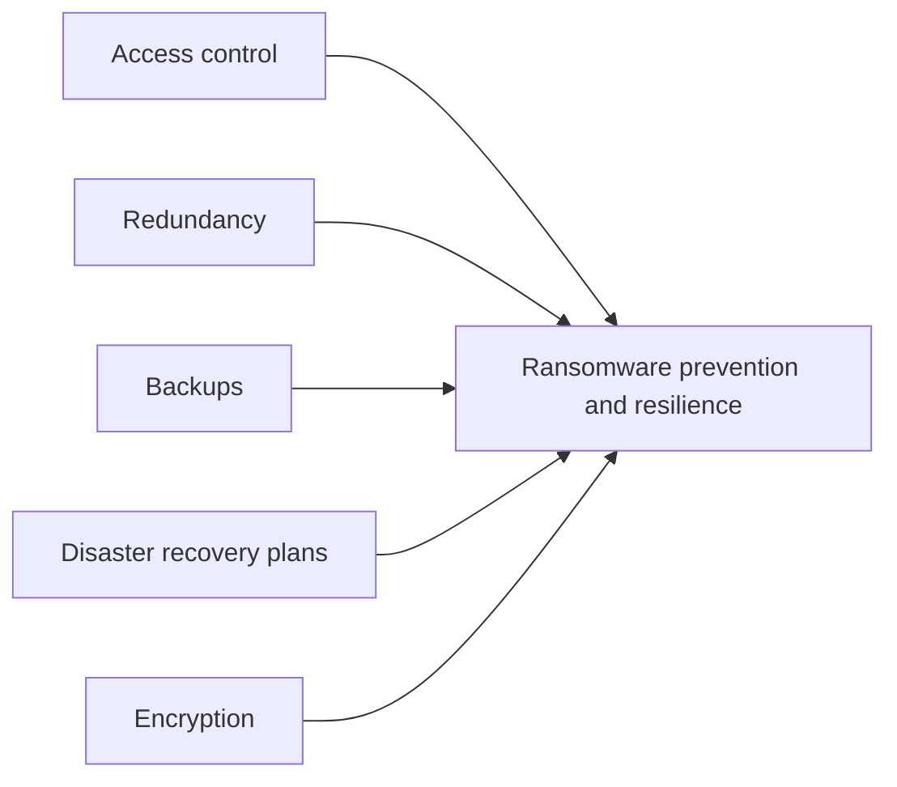
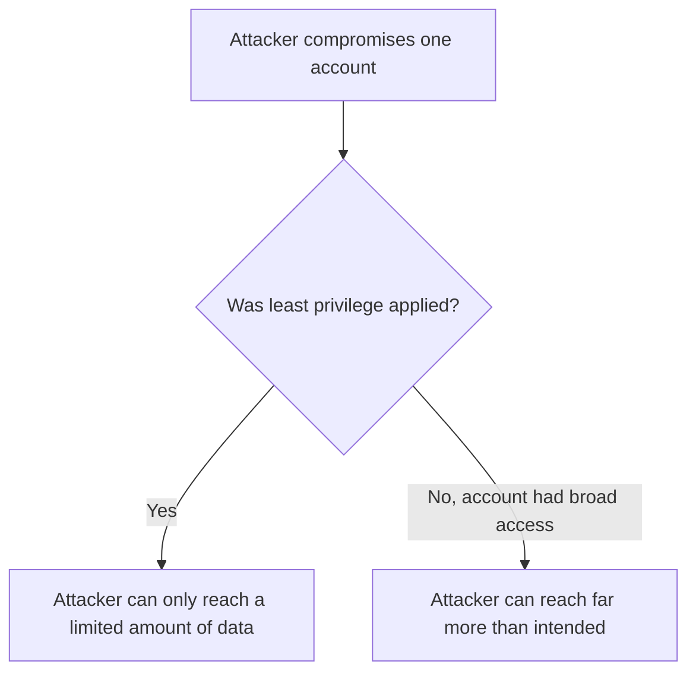
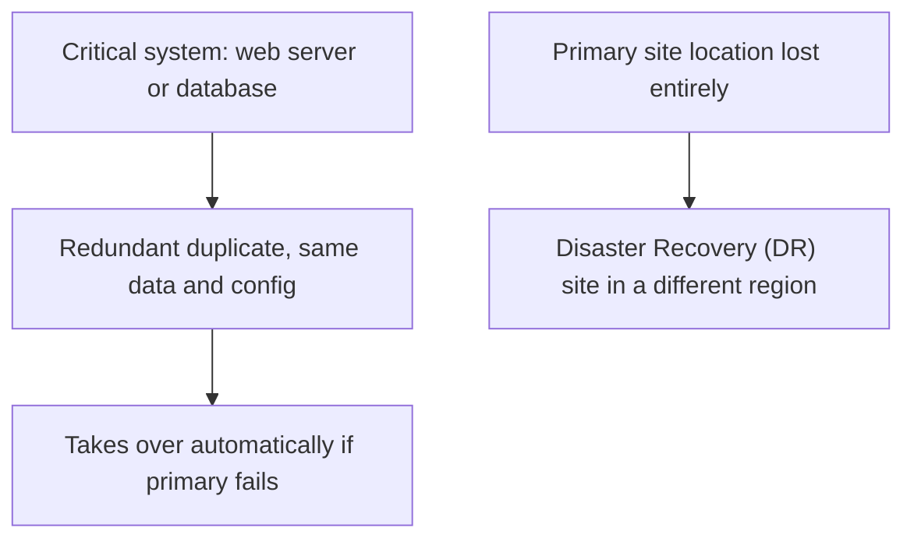
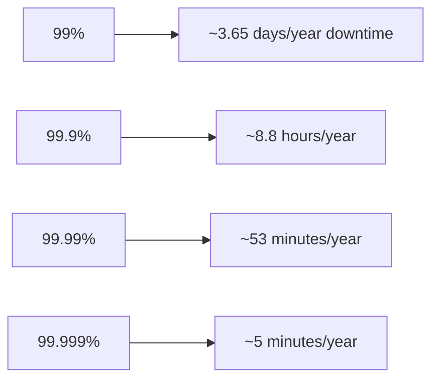
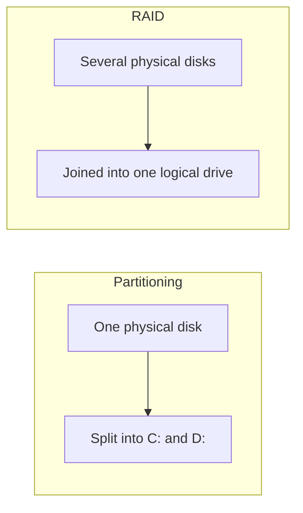
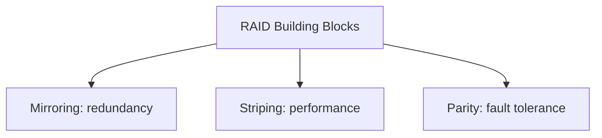
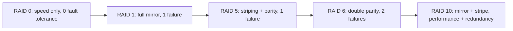
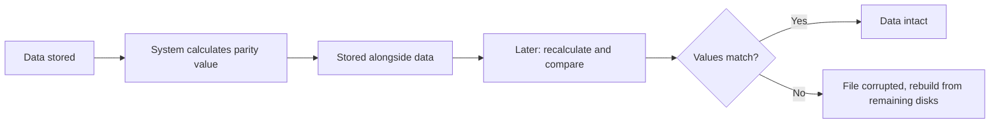
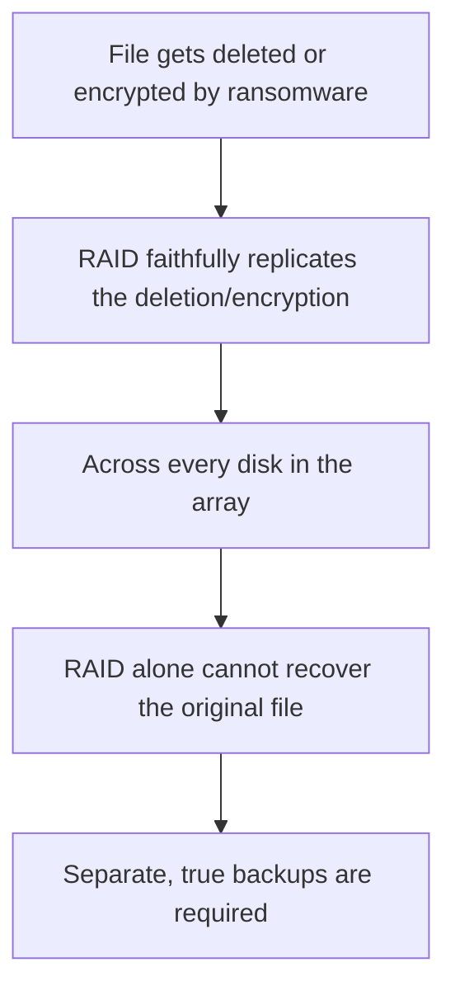

| Topic | Level | Reading Time | Prerequisites |
|---|---|---|---|
| Redundancy, High Availability, and RAID | Intermediate | ~20 min | Ransomware and the LockBit Case Study |

> **الهدف من الـ Section ده:**  
> هتعرف الخمس وسائل الأساسية لمنع والتعافي من هجوم الـ ransomware، وهتفهم الفرق بين الـ redundancy والـ disaster recovery، وهتتعلم معنى "الـ nines" في قياس الـ availability، وهتفهم الـ RAID بالتفصيل: مكوناته، مستوياته، وليه هو مش بديل عن الـ backup أبداً.

## Learning Objectives

By the end of this section, you will be able to:

- List the five core **preventive and recovery measures** against ransomware and data loss.
- Explain **least privilege**, **need-to-know**, and **separation of duties** as applied specifically to limiting ransomware damage.
- Explain **defense in depth**, **network segmentation**, and the **multiple-vendor** strategy, including its cost trade-off.
- Differentiate between **system redundancy** and a **disaster recovery (DR) site**, and explain why geographic distribution matters.
- Read an **availability table ("the nines")** and explain why even minutes of downtime matter for certain industries.
- Define **RAID** and its three building blocks: mirroring, striping, and parity.
- Compare the common **RAID levels** (0, 1, 5, 6, 10) by minimum disks, fault tolerance, and typical use.
- Explain, with a concrete reason, why **RAID is not a backup**.

## Table of Contents

- [Learning Objectives](#learning-objectives)
- [Overview of Preventive Measures](#overview-of-preventive-measures)
- [Access Control and Least Privilege](#access-control-and-least-privilege)
  - [Why Access Control Matters So Much](#why-access-control-matters-so-much)
  - [Four Core Practices](#four-core-practices)
- [Defense in Depth, Segmentation, and Multiple Vendors](#defense-in-depth-segmentation-and-multiple-vendors)
  - [Defense in Depth](#defense-in-depth)
  - [Network Segmentation](#network-segmentation)
  - [Multiple Vendors](#multiple-vendors)
- [Redundancy and Disaster Recovery](#redundancy-and-disaster-recovery)
  - [System Redundancy](#system-redundancy)
  - [Disaster Recovery (DR) Site](#disaster-recovery-dr-site)
  - [Geographic Distribution](#geographic-distribution)
- [High Availability: The Nines](#high-availability-the-nines)
  - [The Availability Table](#the-availability-table)
  - [Why This Matters](#why-this-matters)
- [RAID: What Is It](#raid-what-is-it)
  - [Core Definition](#core-definition)
  - [RAID Versus Partitioning](#raid-versus-partitioning)
  - [Who Manages RAID, and Why a SOC Analyst Should Care](#who-manages-raid-and-why-a-soc-analyst-should-care)
  - [Three Building Blocks](#three-building-blocks)
- [RAID Levels](#raid-levels)
- [Read/Write Performance, Parity, and Fault Tolerance](#readwrite-performance-parity-and-fault-tolerance)
  - [Read and Write, and How Striping Helps](#read-and-write-and-how-striping-helps)
  - [Parity Check](#parity-check)
  - [RAID 6's Double Parity](#raid-6s-double-parity)
  - [RAID 10's Trade-Off](#raid-10s-trade-off)
  - [Why RAID Is Not a Backup](#why-raid-is-not-a-backup)
- [Career Path Connections](#career-path-connections)
- [Key Terms Glossary](#key-terms-glossary)
- [Summary](#summary)

## Overview of Preventive Measures

الوسائل الأساسية للوقاية والتعافي من الـ ransomware وفقدان الداتا:

| # | Measure | Core Idea |
|---|---|---|
| 1 | **Access control** | تقييد مين يقدر يوصل للداتا |
| 2 | **Redundancy** | تكرار الأنظمة بحيث فشل واحد مايوقفش العمل |
| 3 | **Backups** | الاحتفاظ بنسخ للاسترجاع منها |
| 4 | **Disaster recovery plans** | معرفة بالظبط إيه المفروض تعمله لما كارثة تحصل |
| 5 | **Encryption** | خلي الداتا المسروقة غير قابلة للقراءة |

> [!TIP]
> In interviews, if asked "how do you prevent ransomware?", start with this five-point list. This file covers the first two in depth (access control and redundancy, including RAID); backups and encryption are covered in full in the Backup Strategies and Data Recovery file.

## Access Control and Least Privilege

### Why Access Control Matters So Much

الـ **access control** من أهم الـ mitigations الأمنية. لو اتطبق كويس، بيقلل **فقدان الداتا والوصول غير المصرح بيه بشكل كبير**.

### Four Core Practices

| Practice | What It Means |
|---|---|
| **Least privilege** | كل شخص ياخد الحد الأدنى من الوصول اللي شغله محتاجه، مش أكتر |
| **Need-to-know** | الوصول لمجموعة داتا معينة بيتاح بس للناس اللي فعلياً بتستخدمها |
| **Separation of duties** | محدش لوحده يقدر يكمّل action حرج |
| **Regular reviews** | إزالة الوصول لما حد يغيّر دوره أو يسيب الشركة |

> [!IMPORTANT]
> Least privilege limits the damage of a compromised account, which is why it is one of the best defenses against ransomware specifically. A stolen credential with narrow access simply cannot reach, encrypt, or exfiltrate as much data.

> [!NOTE]
> This connects directly to the full treatment of least privilege, need-to-know, and separation of duties in the Access Control Models file from the Zero Trust and Access Management category. Here, the same principles are applied specifically as a ransomware mitigation.

## Defense in Depth, Segmentation, and Multiple Vendors

### Defense in Depth

استخدام **عدة طبقات حماية**، بحيث لو واحدة فشلت، طبقة تانية تمسك الهجوم.

> [!NOTE]
> The full model, with its five core layers (Perimeter, Network, Host, Application, Data), is covered in depth in the Defense in Depth Model file from the Defense in Depth and Evasion Techniques category.

### Network Segmentation

تقسيم الشبكة لـ **zones**، بحيث الـ malware **مايقدرش ينتشر بحرية** من zone لتانية.

### Multiple Vendors

استخدام controls من **شركات مختلفة**. لو منتج معين فوّت هجوم أو فيه ثغرة مخفية، منتج تاني ممكن يوقفه.

مثال: منتج أمان إيميل من شركة معينة ممكن يسمح لإيميل ضار يعدي، بينما منتج تاني يوقفه. المؤسسات الكبيرة ممكن تشغّل **firewalls أو backup systems من شركتين مختلفتين** لنفس السبب ده.

**المقايضة: التكلفة.** الأسلوب ده شائع في المؤسسات اللي تقدر تتحمله، زي البنوك والمؤسسات الكبيرة.

> [!TIP]
> This is the practical, real-world extension of defense in depth's "independent layers" principle: using different vendors makes the layers genuinely independent, since two products from the same vendor often share the same blind spots.

## Redundancy and Disaster Recovery

### System Redundancy

الاحتفاظ بنسخة **duplicate** من نظام حرج (مثلاً web server أو SQL database) بنفس الداتا والـ configuration، **جاهزة تاخد المسؤولية** لو الأساسي فشل.

### Disaster Recovery (DR) Site

موقع تاني يقدر العمل يشتغل منه لو الموقع الرئيسي **اتفقد بالكامل**.

### Geographic Distribution

**متحتفظش بكل النسخ في مدينة واحدة.** لو كارثة ضربت القاهرة، **كل نسخة في القاهرة بتضيع**. احتفظ بنسخ في **مناطق مختلفة**، زي ما عملت Maersk.

> [!NOTE]
> This is the same lesson drawn from the Maersk/NotPetya case study covered in Data Loss Fundamentals and DLP Operations: the only surviving data copy existed purely by geographic accident. Deliberate geographic distribution turns that accident into a designed-in guarantee.

## High Availability: The Nines

### The Availability Table

| Availability | Downtime per Year |
|---|---|
| 99% | حوالي 3.65 يوم |
| 99.9% | حوالي 8.8 ساعة |
| 99.99% | حوالي 53 دقيقة |
| 99.999% ("five nines") | حوالي 5 دقايق |

### Why This Matters

لبورصة الأسهم، أو بنك، أو call center، **حتى تلات دقايق توقف ممكن تكلّف ملايين**، فهما بيستثمروا بكثافة في الـ redundancy.

> [!IMPORTANT]
> Each additional "nine" represents an exponentially harder (and more expensive) engineering target. Moving from 99.9% to 99.99% is not a small improvement; it typically requires fundamentally different architecture, not just better maintenance.

## RAID: What Is It

### Core Definition

**RAID** معناها **Redundant Array of Independent Disks**.

هي تقنية تخزين بتجمع عدة **physical disks** في **logical disk واحد**، ونظام التشغيل بيشوفه كـ **drive واحد**.

### RAID Versus Partitioning

**RAID هو عكس الـ partitioning**: الـ partitioning بيقسم disk واحد لعدة drives (`C:`, `D:`)، بينما **RAID بيضم عدة disks في واحد**.

### Who Manages RAID, and Why a SOC Analyst Should Care

الـ RAID عادةً بيديره **فريق الـ storage**، لكن **الـ SOC analyst لازم يفهمه**، لأنه بيظهر في الـ logs وفي الـ interviews.

### Three Building Blocks

| Block | What It Does | Purpose |
|---|---|---|
| **Mirroring** | نفس الداتا بتتكتب على أكتر من disk | Redundancy |
| **Striping** | الداتا بتتقسم لقطع موزعة عبر الـ disks | Performance (قراءة وكتابة أسرع) |
| **Parity** | معلومات محسوبة إضافية بتسمح للنظام يكتشف الـ corruption ويعيد بناء الداتا المفقودة | Fault tolerance |

## RAID Levels

| Level | Method | Min Disks | Failures Survived | Main Benefit | Typical Use |
|---|---|---|---|---|---|
| **RAID 0** | Striping only | 2 | 0 | أقصى سرعة | داتا مؤقتة أو غير حرجة محتاجة سرعة |
| **RAID 1** | Mirroring | 2 | 1 | نسخة كاملة من الداتا | أنظمة حرجة صغيرة |
| **RAID 5** | Striping + parity | 3 | 1 | توازن بين السرعة والسعة والأمان | شائع جداً في سيرفرات الشركات |
| **RAID 6** | Striping + double parity | 4 | 2 | تحمل أخطاء أعلى | داتا مالهاش تحمل للفقدان خالص |
| **RAID 10** | Mirror + stripe | 4 | 1 لكل زوج mirrored | سرعة وredundancy مع بعض | قواعد بيانات، أحمال عمل ثقيلة |

**الرقم بعد كلمة RAID بيقولك أنهي implementation بيتستخدم.**

> [!WARNING]
> RAID 0 has zero fault tolerance despite being part of the "RAID" family. It is pure performance striping with no redundancy at all: losing any single disk in a RAID 0 array loses the entire array's data.

## Read/Write Performance, Parity, and Fault Tolerance

### Read and Write, and How Striping Helps

**Read** معناها جلب داتا من الـ disk. **Write** معناها حفظ داتا جديدة عليه. الـ striping بيحسّن الاتنين، لأن **عدة disks بتشتغل في نفس الوقت**.

### Parity Check

النظام بيحسب **قيمة من الداتا المخزّنة** ويخزّنها. بعدين بيعيد حسابها ويقارنها. لو القيم **مش متطابقة**، الملف **اتضرر (corrupted)**.

بوجود الـ parity، الـ RAID يقدر **يكتشف ملف تالف، يمسح النسخة السيئة، ويعيد بناءها صح من الـ disks الباقية**.

### RAID 6's Double Parity

**RAID 6 بيستخدم double parity**، فبيفحص **مرتين**. مصمم للداتا اللي **مفيش فيها تسامح مع الأخطاء خالص**، زي ما تتحقق من **بطاقة هوية الشخص وجواز سفره مع بعض**.

### RAID 10's Trade-Off

**RAID 10 بيجمع mirroring وstriping** للأداء والـ redundancy مع بعض، لكنه **محتاج disks أكتر، وبالتالي أغلى**.

### Why RAID Is Not a Backup

> [!IMPORTANT]
> Important interview point: RAID is NOT a backup. RAID protects against a disk failure. It does not protect against deletion, ransomware, or a fire: if a file is deleted or encrypted, RAID faithfully copies the deletion or encryption to every disk. You still need real backups.

> [!TIP]
> A clean way to phrase this distinction: RAID protects against hardware failure, backups protect against data loss events. They solve two completely different problems, and a resilient organization needs both. For the full treatment of actual backup strategy, see the Backup Strategies and Data Recovery file.

## Career Path Connections

| Career Path | How This Topic Applies |
|---|---|
| SOC Analyst | Must recognize RAID references in storage logs and understand which failures RAID does and does not protect against |
| Penetration Tester | Understanding redundancy and multi-vendor defenses helps assess realistic detection gaps during authorized engagements |
| GRC | Disaster recovery planning and high-availability targets are standard business continuity audit requirements |
| Cloud Security | Cloud providers implement redundancy, multi-region distribution, and RAID-equivalent storage resilience natively |

## Key Terms Glossary

| Term | Definition |
|---|---|
| Least Privilege | Granting only the minimum access required to perform a job |
| Need-to-Know | Restricting access to a data set to only those who actually use it |
| Separation of Duties | Ensuring no single person can complete a critical action alone |
| Defense in Depth | Using multiple layers of protection so one failure does not expose everything |
| Network Segmentation | Dividing a network into zones to limit malware spread |
| Multiple Vendors | Using security controls from different vendors to avoid shared blind spots |
| System Redundancy | Keeping a duplicate of a critical system ready to take over on failure |
| Disaster Recovery (DR) Site | A second location from which business can operate if the main site is lost |
| High Availability | A system's ability to remain operational, measured in "nines" of uptime percentage |
| RAID | Redundant Array of Independent Disks, combining multiple physical disks into one logical disk |
| Mirroring | Writing the same data to more than one disk for redundancy |
| Striping | Splitting data across multiple disks for performance |
| Parity | Calculated extra information enabling corruption detection and data rebuilding |

## Summary

- **Five measures form the core of ransomware prevention and resilience:** access control، redundancy، backups، disaster recovery plans، وencryption.
- **Least privilege limits the blast radius of a compromised account:** جزء من ليه هو أحد أفضل دفاعات الـ ransomware تحديداً.
- **Multiple vendors create genuinely independent defense layers:** بتكلفة إضافية، شائعة في المؤسسات الكبيرة.
- **Redundancy and DR solve different scopes of failure:** نظام واحد فشل مقابل الموقع كله اتفقد، والتوزيع الجغرافي ضروري للاتنين.
- **Each additional "nine" of availability is exponentially harder to achieve:** وحتى دقايق توقف ممكن تكلّف ملايين لأنظمة حرجة.
- **RAID has three building blocks:** mirroring للـ redundancy، striping للأداء، وparity لـ fault tolerance.
- **RAID levels trade off disks, fault tolerance, and use case:** من RAID 0 (سرعة بس) لـ RAID 10 (سرعة وredundancy بتكلفة أعلى).
- **RAID is definitively not a backup:** بيحميك من فشل الـ hardware بس، مش من الحذف أو الـ ransomware أو الحريق.

