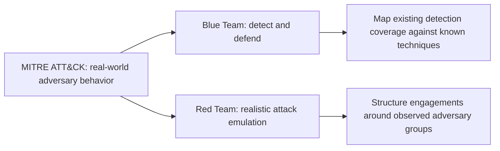
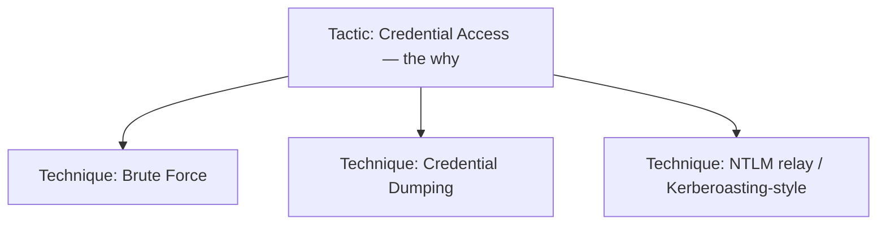
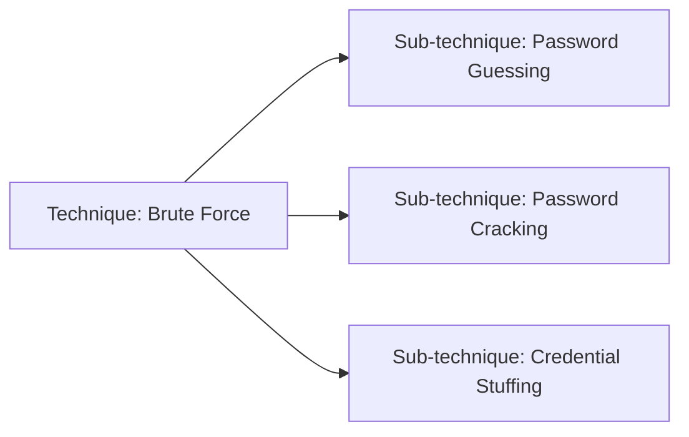
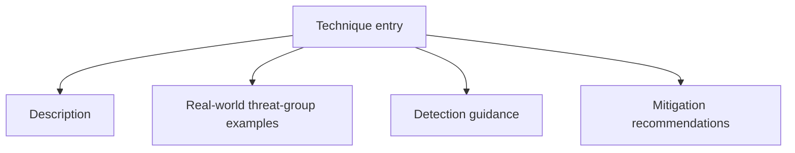
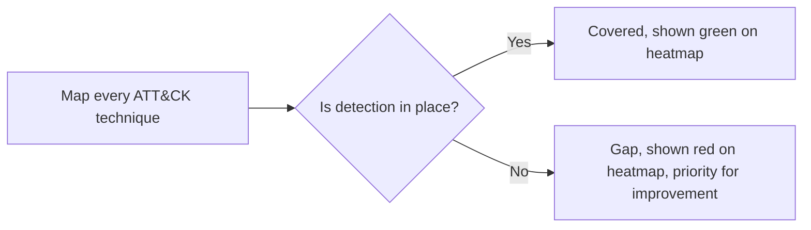
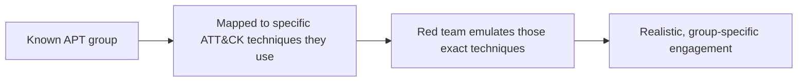

| Topic | Level | Reading Time | Prerequisites |
|---|---|---|---|
| MITRE ATT&CK Framework | Intermediate | ~15 min | None |

> **الهدف من الـ Section ده:**  
> هتفهم إيه هو إطار MITRE ATT&CK، وإزاي بيوصف سلوك المهاجمين الحقيقي بدل السيناريوهات النظرية، وإزاي فرق الدفاع والهجوم الاتنين بيستخدموه في شغلهم اليومي.

## Learning Objectives

By the end of this section, you will be able to:

- Define **MITRE ATT&CK** and explain who maintains it and why it is built from real-world observed behavior, not theory.
- Explain how **Blue Teams** and **Red Teams** each use the framework differently.
- Describe the structure of the **ATT&CK Matrix**: Tactics as columns, Techniques as rows, and sub-techniques beneath them.
- Explain what each technique entry documents, and how a technique ID (like T1110) is used in practice.
- Explain three concrete practical uses of ATT&CK: detection coverage heatmaps, standardized threat intelligence reporting, and red team engagement planning.

## Table of Contents

- [Learning Objectives](#learning-objectives)
- [What Is MITRE ATT&CK](#what-is-mitre-attck)
  - [Who Maintains It](#who-maintains-it)
  - [The Full Name and Core Definition](#the-full-name-and-core-definition)
  - [Blue Team Versus Red Team Usage](#blue-team-versus-red-team-usage)
- [Structure: The ATT&CK Matrix](#structure-the-attck-matrix)
  - [Tactics: The Columns](#tactics-the-columns)
  - [Techniques: The Rows](#techniques-the-rows)
  - [Sub-Techniques](#sub-techniques)
  - [What Each Technique Entry Documents](#what-each-technique-entry-documents)
- [Why It Matters in Practice](#why-it-matters-in-practice)
  - [Bridging Abstract Concepts and Real Behavior](#bridging-abstract-concepts-and-real-behavior)
  - [Detection Coverage Heatmaps](#detection-coverage-heatmaps)
  - [Standardizing Threat Intelligence Reporting](#standardizing-threat-intelligence-reporting)
  - [Planning Red Team Engagements](#planning-red-team-engagements)
- [Career Path Connections](#career-path-connections)
- [Key Terms Glossary](#key-terms-glossary)
- [Summary](#summary)

## What Is MITRE ATT&CK

### Who Maintains It

**MITRE ATT&CK** بتتصون من **MITRE Corporation**، وهي **منظمة غير ربحية (non-profit)** بتدير مراكز بحثية **ممولة فيدرالياً (federally funded)**.

### The Full Name and Core Definition

الاسم الكامل: **Adversarial Tactics, Techniques, and Common Knowledge**.

هي **قاعدة معرفة (knowledge base) متاحة للعامة ومحدّثة باستمرار**، بتوثق **سلوك المهاجمين الحقيقي** اللي اتلاحظ في **هجمات واختراقات فعلية**.

> [!IMPORTANT]
> ATT&CK is built from actual incident and threat intelligence reporting, not theoretical scenarios. This is the single most important distinction between ATT&CK and a generic security awareness list: every technique documented has been observed in the real world.

### Blue Team Versus Red Team Usage

الفريقين الاتنين بيستخدموا ATT&CK، لكن بأهداف مختلفة:

| Team | How They Use ATT&CK |
|---|---|
| **Blue Team (Defenders)** | بيستخدموا الإطار عشان يفهموا إيه التقنيات اللي لازم يكتشفوها ويدافعوا ضدها، وعشان **يقارنوا تغطية الكشف الحالية (existing detection coverage)** مقابل سلوك المهاجمين المعروف |
| **Red Team (Attackers/Pentesters)** | بيستخدموا الإطار كـ **مرجع لمحاكاة تقنيات هجوم واقعية (realistic attack-technique emulation)**، وبيبنوا الـ engagements حول سلوك مهاجمين حقيقي تم ملاحظته فعلياً |

> [!NOTE]
> This same Blue Team / Red Team framing connects directly to the SOC Analyst and Penetration Tester career paths referenced throughout this series. ATT&CK is one of the few resources genuinely shared, in daily practice, by both sides.

## Structure: The ATT&CK Matrix

الإطار بيتنظم بصرياً كـ **matrix**.

### Tactics: The Columns

الأعمدة = **Tactics**، وهي **هدف المهاجم** في مرحلة معينة (الـ **why**):

| Tactic | Attacker's Goal |
|---|---|
| Initial Access | الدخول الأول للبيئة |
| Execution | تشغيل كود ضار |
| Persistence | البقاء متصل بعد إعادة التشغيل أو تغيير الحسابات |
| Privilege Escalation | الحصول على صلاحيات أعلى |
| Defense Evasion | تجنب الاكتشاف |
| Credential Access | سرقة أسماء مستخدمين وpasswords |
| Lateral Movement | التحرك عبر الشبكة |
| Collection | تجميع الداتا المستهدفة |
| Exfiltration | إخراج الداتا من الشبكة |
| Impact | التلاعب بالأنظمة أو تعطيلها أو تدميرها |

### Techniques: The Rows

الصفوف تحت كل tactic = **Techniques**، وهي **الطرق المحددة** المستخدمة لتحقيق الهدف ده (الـ **how**).

مثال: تحت **Credential Access**:

- **Brute Force**
- **Credential Dumping**
- تقنيات على طراز **NTLM relay / Kerberoasting**

> [!NOTE]
> Every technique listed under Credential Access in this example was covered in detail earlier in this series: brute force in Password Cracking Techniques, credential dumping from NTDS.dit in Group Policy and Credential Storage, and NTLM relay in Windows Authentication Hashes. ATT&CK is the framework that organizes exactly this kind of knowledge into one structured reference.

### Sub-Techniques

كتير من التقنيات ليها **sub-techniques**. مثال: تحت **Brute Force**:

- **Password Guessing**
- **Password Cracking**
- **Credential Stuffing**

### What Each Technique Entry Documents

كل entry تقنية في ATT&CK بيوثق:

- **وصف (description)** للتقنية.
- **أمثلة واقعية لمجموعات تهديد (real-world threat-group examples)** استخدمتها.
- **إرشادات الكشف (detection guidance)**.
- **توصيات التخفيف (mitigation recommendations)**.

## Why It Matters in Practice

### Bridging Abstract Concepts and Real Behavior

ATT&CK بيسد الفجوة بين **المفاهيم الأمنية المجردة** و**سلوك المهاجمين الملموس الملاحظ فعلياً**، لأنه **مبني من تقارير حوادث حقيقية واستخبارات تهديدات فعلية**، مش سيناريوهات نظرية.

### Detection Coverage Heatmaps

يُستخدم لبناء **خرائط حرارية لتغطية الكشف (detection coverage heatmaps)**: أنهي تقنيات مكتشفة فعلاً، وأنهي فيها **فجوات (gaps)**.

### Standardizing Threat Intelligence Reporting

يُستخدم **لتوحيد تقارير استخبارات التهديدات (threat intelligence reporting)**، عن طريق الإشارة لمعرّفات تقنية محددة زي **T1110** للـ Brute Force.

> [!TIP]
> بدل ما تقول "المهاجم جرب passwords كتير"، التقرير الاحترافي بيشير لـ **T1110** مباشرة. ده بيخلي التقارير قابلة للمقارنة والربط الآلي عبر مؤسسات ومصادر مختلفة.

### Planning Red Team Engagements

يُستخدم لتخطيط **red team engagements** اللي بتحاكي **مجموعات مهاجمين حقيقية محددة**؛ مجموعات **APT (Advanced Persistent Threat)** غالباً بتتربط (mapped) بالتقنيات المعروف إنها بتستخدمها.

> [!IMPORTANT]
> This is what separates ATT&CK-driven red teaming from generic penetration testing: the engagement is designed to emulate a specific, real adversary's known playbook, not a generalized list of common attacks.

## Career Path Connections

| Career Path | How This Topic Applies |
|---|---|
| SOC Analyst | Maps detection rules to specific ATT&CK technique IDs and identifies coverage gaps |
| Penetration Tester | Structures red team engagements around specific techniques and APT group emulation |
| GRC | References ATT&CK coverage as part of risk assessments and security program maturity reporting |
| Cloud Security | Cloud-specific ATT&CK matrices exist for mapping adversary behavior against cloud platforms specifically |

## Key Terms Glossary

| Term | Definition |
|---|---|
| MITRE ATT&CK | A publicly accessible knowledge base of real-world adversary tactics and techniques, maintained by MITRE Corporation |
| Tactic | The adversary's goal at a given stage of an attack (the why) |
| Technique | The specific method used to achieve a tactic's goal (the how) |
| Sub-Technique | A more specific variant of a broader technique |
| Technique ID | A standardized identifier (e.g., T1110) used to reference a specific technique in reports and tools |
| Detection Coverage Heatmap | A visual map showing which ATT&CK techniques an organization can detect, and where gaps exist |
| APT | Advanced Persistent Threat, a sophisticated, often state-sponsored or well-resourced threat actor group |

## Summary

- **MITRE ATT&CK is maintained by a non-profit, federally funded organization:** مبني من سلوك مهاجمين حقيقي، مش سيناريوهات نظرية.
- **Both Blue Team and Red Team use it, for different purposes:** الدفاع بيستخدمه للكشف وقياس التغطية، والهجوم بيستخدمه لمحاكاة واقعية.
- **The matrix structure is Tactics (columns, the why) and Techniques (rows, the how):** مع sub-techniques أدق تحت كتير من التقنيات.
- **Every technique entry is fully documented:** وصف، أمثلة واقعية، إرشادات كشف، وتوصيات تخفيف.
- **Three concrete practical uses stand out:** خرائط تغطية الكشف، توحيد تقارير استخبارات التهديدات بمعرّفات زي T1110، وتخطيط red team engagements حول مجموعات APT حقيقية.

