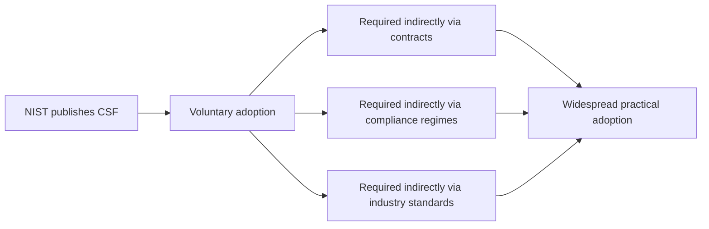
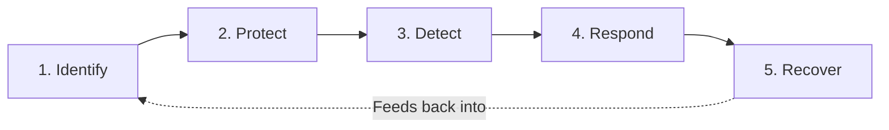

| Topic | Level | Reading Time | Prerequisites |
|---|---|---|---|
| NIST Cybersecurity Framework (CSF) | Beginner | ~10 min | None |

> **الهدف من الـ Section ده:**  
> هتفهم إيه هو الـ NIST Cybersecurity Framework، وليه مؤسسات كتير بتتبناه رغم إنه مش قانون، وإيه هي الخمس وظائف الأساسية اللي بتنظم دورة حياة إدارة المخاطر السيبرانية.

## Learning Objectives

By the end of this section, you will be able to:

- Define **NIST** and explain the nature of the **Cybersecurity Framework (CSF)** it publishes.
- Explain why a **voluntary** framework becomes functionally required in practice, through contracts and compliance regimes.
- List the **five Core Functions** of the NIST CSF and describe what each one covers in the risk-management lifecycle.
- Explain how the five functions relate to each other as a continuous cycle, not a one-time checklist.

## Table of Contents

- [Learning Objectives](#learning-objectives)
- [What Is NIST](#what-is-nist)
  - [The Organization](#the-organization)
  - [The Cybersecurity Framework (CSF)](#the-cybersecurity-framework-csf)
  - [Voluntary, Yet Widely Required](#voluntary-yet-widely-required)
- [The Core Functions of the NIST CSF](#the-core-functions-of-the-nist-csf)
  - [Identify](#identify)
  - [Protect](#protect)
  - [Detect](#detect)
  - [Respond](#respond)
  - [Recover](#recover)
  - [The Functions as a Continuous Cycle](#the-functions-as-a-continuous-cycle)
- [Career Path Connections](#career-path-connections)
- [Key Terms Glossary](#key-terms-glossary)
- [Summary](#summary)

## What Is NIST

### The Organization

**NIST (National Institute of Standards and Technology)** هو **وكالة حكومية أمريكية**. سبق التعرض لمنشورات NIST في ملفات سابقة من السلسلة دي (زي AAL في IAM، وSP 800-63B في موضوع الـ hashing)، لكن هنا هنركز على منشور مختلف ومحدد: **الـ Cybersecurity Framework** نفسه.

### The Cybersecurity Framework (CSF)

NIST بينشر **NIST Cybersecurity Framework (CSF)**: مجموعة **منظمة وطوعية (voluntary)** من الإرشادات وأفضل الممارسات والمعايير، **لإدارة وتقليل المخاطر السيبرانية**.

> [!NOTE]
> The CSF is not a technical standard like a specific encryption algorithm or protocol. It is a management framework: a structured way of thinking about and organizing cybersecurity work across an entire organization.

### Voluntary, Yet Widely Required

الـ CSF **مش قانون في حد ذاته**، لكنه **منتشر الاعتماد بشكل واسع**، غالباً **بشكل غير مباشر** عن طريق:

- **العقود (contracts)**.
- **أنظمة الامتثال (compliance regimes)**.
- **معايير الصناعة (industry standards)**.

السبب: الـ CSF بيدي المؤسسات **لغة مشتركة**، بدل كل مؤسسة تخترع ممارساتها الخاصة بشكل عشوائي (**ad-hoc**).

> [!IMPORTANT]
> This is the same pattern covered in the IAM file regarding NIST's AAL guidelines: voluntary on paper, but functionally mandatory for organizations that need partners, regulators, or customers to trust them. A framework does not need legal force to shape real-world practice.

## The Core Functions of the NIST CSF

الإطار منظم حول **core functions** بتوصف **دورة حياة إدارة المخاطر السيبرانية**:

| # | Function | What It Covers |
|---|---|---|
| 1 | **Identify** | فهم أصول المؤسسة، والأنظمة، والداتا، والمخاطر (إيه اللي محتاج حماية) |
| 2 | **Protect** | تنفيذ الضمانات (access control، التدريب، أمان الداتا) للحد من الحوادث أو احتوائها |
| 3 | **Detect** | تنفيذ المراقبة عشان تحدد الأحداث السيبرانية وقت حدوثها |
| 4 | **Respond** | اتخاذ إجراء بمجرد اكتشاف حادث (containment، التواصل، التخفيف) |
| 5 | **Recover** | استعادة الخدمات المتأثرة وتحسين المرونة (resilience) للمستقبل |

### Identify

الخطوة الأولى: **فهم** إيه اللي عندك. ده بيشمل الأصول، الأنظمة، الداتا، والمخاطر المرتبطة بيها. ده إيه المفروض تحميه بالظبط.

> [!NOTE]
> This connects directly to the Asset Awareness file from Network Security Foundations. "Identify" in the CSF is the same discipline as asset inventory and criticality tiering, framed as the first stage of a formal risk-management cycle.

### Protect

تنفيذ **ضمانات (safeguards)** زي access control، تدريب الموظفين، وأمان الداتا، عشان **تحد أو تحتوي** الحوادث.

### Detect

تنفيذ **مراقبة** عشان تحدد الأحداث السيبرانية **وقت حدوثها فعلياً**، مش بعد فوات الأوان.

> [!NOTE]
> Detect maps directly to the traffic baselining concept from the Asset Awareness file, and to the SIEM function covered in the Defense in Depth Model file: monitoring only has value if you know what normal looks like first.

### Respond

اتخاذ إجراء **بمجرد ما حادث يتكشف**: containment (احتواء)، communication (تواصل)، وmitigation (تخفيف).

### Recover

استعادة الخدمات المتأثرة، و**تحسين المرونة (resilience)** للمستقبل، مش بس إرجاع الوضع لما كان عليه.

### The Functions as a Continuous Cycle

مهم تفهم إن الخمس وظائف دول **مش خطوات تتعمل مرة واحدة وخلاص**. الدورة **مستمرة**: دروس الـ Recover بتغذي الـ Identify من جديد، والمخاطر الجديدة المكتشفة بتحدّث الـ Protect وDetect، وهكذا.

> [!TIP]
> A simple way to remember the five functions in order: before an incident (Identify, Protect), during detection and response (Detect, Respond), and after (Recover). This chronological framing helps when mapping a real incident back to the framework in an interview or an audit.

## Career Path Connections

| Career Path | How This Topic Applies |
|---|---|
| SOC Analyst | Directly operates within Detect and Respond, using monitoring tools and incident response procedures |
| Penetration Tester | Engagements often test the effectiveness of Protect and Detect controls against realistic attack scenarios |
| GRC | Primary owner of CSF adoption, mapping organizational controls to each of the five functions for audits and compliance |
| Cloud Security | Cloud-native tools (asset inventories, IAM, monitoring, automated response) implement each CSF function in a cloud context |

## Key Terms Glossary

| Term | Definition |
|---|---|
| NIST | National Institute of Standards and Technology, a U.S. government agency |
| NIST CSF | A voluntary, structured set of guidelines for managing and reducing cybersecurity risk |
| Identify | The CSF function covering understanding of assets, systems, data, and risk |
| Protect | The CSF function covering safeguards that limit or contain incidents |
| Detect | The CSF function covering monitoring to identify cybersecurity events as they occur |
| Respond | The CSF function covering action taken once an incident is detected |
| Recover | The CSF function covering restoration of services and improved future resilience |

## Summary

- **NIST publishes the CSF as a voluntary framework:** مش قانون، لكن منتشر بشكل واسع عن طريق العقود وأنظمة الامتثال ومعايير الصناعة.
- **The CSF gives organizations a common language:** بديل عن الممارسات العشوائية (ad-hoc) اللي بتختلف من مؤسسة لتانية.
- **Five Core Functions structure the risk-management lifecycle:** Identify، Protect، Detect، Respond، وRecover.
- **The functions form a continuous cycle, not a checklist:** دروس الـ Recover بتغذي الـ Identify من جديد باستمرار.
- **Each function connects to concrete practices covered earlier in this series:** Identify ≈ asset inventory، Detect ≈ baselining وSIEM، وهكذا.

