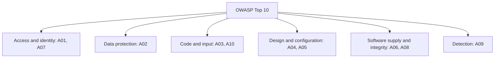
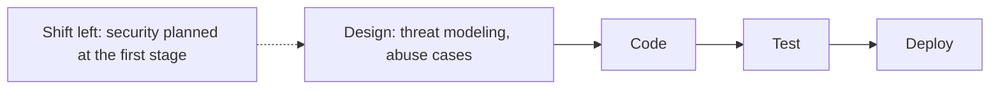
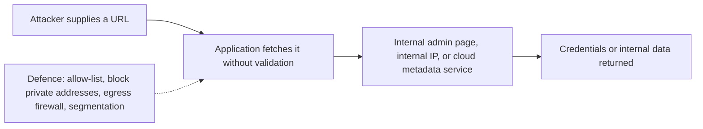
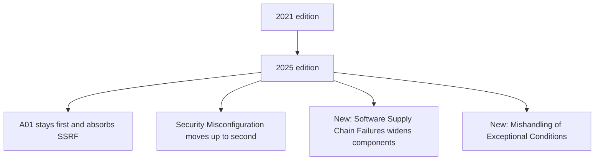
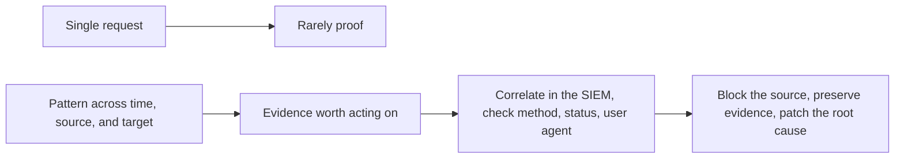

| Topic | Level | Reading Time | Prerequisites |
|---|---|---|---|
| OWASP Top 10 | Intermediate | ~30 min | Input Attacks Fundamentals, HTTP Requests, Responses, and Headers |

> **الهدف من الـ Section ده:**  
> هتفهم إيه هي قايمة الـ OWASP Top 10 وليه بتعتبر اللغة المشتركة بين المطورين والـ pentesters والـ SOC، وهتعدّي على الـ 10 مخاطر واحد واحد (إيه هو، أمثلة، دفاع، ونقطة مفتاحية)، وهتعرف إيه اللي اتغير في نسخة 2025، وفي الآخر هتلاقي جدول "هجوم، سبب، دفاع" وقايمة اللي الـ SOC analyst يراقبه، اللي بتربط كل اللي اتشرح في كاتيجوريات هجمات المدخلات وأساسيات الويب.

## Learning Objectives

By the end of this section, you will be able to:

- Explain what the **OWASP Top 10** is, who publishes it, and how it is used as a common language.
- Describe each of the ten risks of the **2021 edition**: what it is, examples, prevention, and its key point.
- Explain why **hiding a button is not access control** and why **authentication is not authorization**.
- Explain **SSRF** and why a cloud metadata service makes it dangerous.
- Summarize what changed in the **2025 edition**, and why numbering should be checked against the official site.
- Map each OWASP category to the files in this series that cover it.
- Use the **attack, cause, and defence** table and the SOC watch-list to connect everything.

## Table of Contents

- [Learning Objectives](#learning-objectives)
- [What Is the OWASP Top 10](#what-is-the-owasp-top-10)
- [A01: Broken Access Control](#a01-broken-access-control)
- [A02: Cryptographic Failures](#a02-cryptographic-failures)
- [A03: Injection](#a03-injection)
- [A04: Insecure Design](#a04-insecure-design)
- [A05: Security Misconfiguration](#a05-security-misconfiguration)
- [A06: Vulnerable and Outdated Components](#a06-vulnerable-and-outdated-components)
- [A07: Identification and Authentication Failures](#a07-identification-and-authentication-failures)
- [A08: Software and Data Integrity Failures](#a08-software-and-data-integrity-failures)
- [A09: Security Logging and Monitoring Failures](#a09-security-logging-and-monitoring-failures)
- [A10: Server-Side Request Forgery (SSRF)](#a10-server-side-request-forgery-ssrf)
- [What Changed in the 2025 Edition](#what-changed-in-the-2025-edition)
- [Mapping OWASP to This Series](#mapping-owasp-to-this-series)
- [How the Attacks Connect](#how-the-attacks-connect)
  - [Attack, Cause, and Defence at a Glance](#attack-cause-and-defence-at-a-glance)
  - [What a SOC Analyst Should Watch For](#what-a-soc-analyst-should-watch-for)
  - [Seven Key Points to Remember](#seven-key-points-to-remember)
- [Career Path Connections](#career-path-connections)
- [Key Terms Glossary](#key-terms-glossary)
- [Summary](#summary)

## What Is the OWASP Top 10

الـ **OWASP (Open Worldwide Application Security Project)** هي **مجتمع غير ربحي** بينشر **مصادر أمنية مجانية.**

الـ **Top 10** هي **وثيقة توعية** بترتّب **أخطر مخاطر تطبيقات الويب**، بناءً على **داتا ثغرات حقيقية واستبيانات المجتمع**، وبتتحدّث **كل كام سنة.**

هي **اللغة المشتركة** بين **المطورين والمختبرين والـ SOC analysts**، و**baseline** للـ secure coding والامتثال.

القايمة المعروضة هنا هي **نسخة 2021** الأكتر تدريساً، وفي آخرها تحديث 2025.

| ID | Risk |
|---|---|
| A01 | Broken Access Control |
| A02 | Cryptographic Failures |
| A03 | Injection |
| A04 | Insecure Design |
| A05 | Security Misconfiguration |
| A06 | Vulnerable and Outdated Components |
| A07 | Identification and Authentication Failures |
| A08 | Software and Data Integrity Failures |
| A09 | Security Logging and Monitoring Failures |
| A10 | Server-Side Request Forgery (SSRF) |

> [!NOTE]
> The grouping in the diagram is a study aid and is not part of the official list. It is a useful way to remember the ten items, and it shows that detection (A09) is a risk category of its own, which is what makes the SOC's work possible.

## A01: Broken Access Control

| What It Is | Examples | Prevention |
|---|---|---|
| المستخدمين **بيتصرفوا بره صلاحياتهم المقصودة.** السيرفر **مابيفرضش مين يشوف أو يعمل إيه.** **أكتر عيب ويب خطير شيوعاً** | **IDOR:** تغيير `/account?id=1001` لـ `id=1002` بيعرض داتا مستخدم تاني. **Privilege escalation:** مستخدم عادي بيفتح `/admin` مباشرة. تعديل role cookie أو hidden field، وفحوصات ناقصة على API methods | **Deny by default.** فحوصات على السيرفر **لكل request، مش في الـ UI بس.** فحص ملكية الـ object. RBAC وlog لفشل الوصول |

**Key point:** **إخفاء زرار مش access control.** الـ **authentication بيثبت إنت مين؛ الـ authorization بيحدد مسموحلك تعمل إيه.**

> [!NOTE]
> This is the same authentication-versus-authorization split from Identity and Access Management and the role and attribute models from Access Control Models. IDOR is also why a sequence of incrementing IDs in a log, covered in the SOC watch-list below, is such a clear signal.

## A02: Cryptographic Failures

| What It Is | Examples | Prevention |
|---|---|---|
| الداتا الحساسة **مش محمية صح**، في النقل أو التخزين، لأن التشفير **ناقص أو ضعيف أو مستخدم غلط.** كان اسمها **"Sensitive Data Exposure"** | login على HTTP عادي. passwords مخزنة plaintext أو بـ **MD5 أو SHA-1 من غير salt.** hard-coded keys، وciphers ضعيفة، وإصدارات TLS قديمة، وأرقام عشوائية متوقعة | **TLS 1.2 أو 1.3 في كل مكان مع HSTS.** hash للـ passwords بـ **bcrypt أو scrypt أو Argon2.** خوارزميات قوية زي **AES-256.** إدارة مفاتيح آمنة، **ومتخزنش داتا مش محتاجها** |

**Key point:** **متخترعش تشفير بتاعك أبداً.** استخدم libraries ومعايير اتراجعت كويس.

> [!NOTE]
> Both main preventions were covered in depth earlier: TLS and Secure Communication for transit, and Password Hashing, Salting, and Peppering for stored passwords. The LM and NTLM hashes in Windows Authentication Hashes are a historical case of exactly this failure: weak, unsalted hashing.

## A03: Injection

| What It Is | Examples | Prevention |
|---|---|---|
| **مدخل غير موثوق بيتبعت لـ interpreter كجزء من command أو query**، والـ interpreter **بينفذ داتا المهاجم كـ code.** الفئة دي **فيها XSS** في نسخة 2021 | **SQL injection:** `' OR '1'='1`. **OS command injection:** `; cat /etc/passwd`. **XSS**، وكمان LDAP وNoSQL وXPath injection | **Parameterized queries وsafe APIs.** validation على السيرفر بـ allow-lists. **context-aware output encoding.** حسابات database بأقل صلاحيات. تجنب shell calls بداتا المستخدم |

**Key point:** **السبب الجذري دايماً خلط الـ code بالـ data.** افصلهم.

> [!NOTE]
> This single OWASP entry is the subject of an entire category in this series: Input Attacks Fundamentals, OS Command Injection, SQL Injection Basics and In-Band Attacks, Blind and Advanced SQL Injection with Defences, and Cross-Site Scripting (XSS). Buffer overflow, though a memory-level cousin, is covered in Buffer Overflow.

## A04: Insecure Design

| What It Is | Examples | Prevention |
|---|---|---|
| عيوب في **المعمارية أو الـ business logic، مش في الكود.** **تنفيذ مثالي لتصميم سيء لسه معرّض**، لأن الـ controls ماتصمموش من الأول | password reset مبني على security questions سهلة. **مفيش rate limit** على login أو coupon codes، فبيسمح بـ brute force وabuse. booking flow بيسمح للمستخدم يحجز مقاعد غير محدودة من غير دفع | **Threat modeling بدري.** secure design patterns وreference architectures. حدد **abuse cases جنب use cases.** حدد استهلاك الموارد لكل مستخدم واختبر الـ business logic |

**Key point:** الأمان لازم **"يتحرك لليسار" (shifted left)**، يتخطط **قبل أول سطر كود.**

## A05: Security Misconfiguration

| What It Is | Examples | Prevention |
|---|---|---|
| أنظمة أو frameworks أو خدمات cloud أو سيرفرات **متظبطة بشكل غير آمن أو متسابة على defaults خطرة.** **من أسهل نقاط الضعف على المهاجم يلاقيها** | **default admin passwords** ماتغيرتش. رسايل أخطاء مفصلة وstack traces للمستخدمين. directory listing مفعّل، **cloud storage buckets مفتوحة**، ports وخدمات مش لازمة، وsecurity headers ناقصة | **hardening process متكرر وsecure baselines.** شيل features وsample apps الزايدة. غيّر الـ defaults. رسايل أخطاء عامة. ضيف security headers. راجع cloud permissions وافحص الـ configurations بانتظام |

**Key point:** الـ secure configuration لازم **يتأتمت ويكون نفسه في development وtest وproduction.**

> [!NOTE]
> The missing security headers named here are the response headers listed in HTTP Requests, Responses, and Headers, and verbose error messages are the information leak that makes error-based SQL injection possible in SQL Injection Basics and In-Band Attacks. Default and exposed systems are also what Attack Surface Management is designed to find, as covered in Pentest Types, Phases, and Attack Surface Management.

## A06: Vulnerable and Outdated Components

| What It Is | Examples | Prevention |
|---|---|---|
| التطبيق بيستخدم **libraries أو frameworks أو plugins أو سيرفرات فيها ثغرات معروفة**، أو **مش مدعومة تاني.** المهاجم **محتاج public exploit بس** | **Log4Shell (Log4j)** سمح بـ RCE عن طريق logging library. اختراق **Equifax** جه من **Apache Struts** غير محدّث. plugins CMS قديمة وpackages متروكة | **احتفظ بـ inventory للـ components (SBOM).** افحص الـ dependencies لـ CVEs معروفة. patch بجدول. شيل الـ dependencies الزايدة. استخدم مصادر موثوقة ومصانة بس |

**Key point:** **مينفعش تعمل patch لحاجة مش عارف إنك بتشغلها.** تتبّع كل dependency.

> [!NOTE]
> The full case study is Log4Shell Case Study, and the inventory and scoring side is Vulnerability Assessment and Risk Scoring, where the CISA KEV catalog helps decide which outdated component to fix first.

## A07: Identification and Authentication Failures

| What It Is | Examples | Prevention |
|---|---|---|
| ضعف في **تأكيد هوية المستخدم** أو في إدارة الـ logins والـ sessions بيسمح للمهاجمين **باستيلاء على حسابات أو انتحال هويات** | **credential stuffing وbrute force من غير lockout.** passwords ضعيفة أو default، ومفيش MFA. **session IDs في الـ URL**، أو مش بتتغير بعد login، أو مش بتتلغي عند logout | **Multi-factor authentication.** افحص الـ passwords مقابل قوائم الاختراقات. **rate limiting وlockouts.** إدارة session آمنة بـ **IDs جديدة عند login.** رسايل خطأ عامة في login |

**Key point:** ممارسات **الـ cookies والـ sessions** تتطبق هنا مباشرة.

> [!NOTE]
> The session part of this item is Cookies and Session Security, MFA and its fatigue attack are in Identity and Access Management and Mobile Threats and Platform Security, and credential guessing is covered in Password Cracking Techniques.

## A08: Software and Data Integrity Failures

| What It Is | Examples | Prevention |
|---|---|---|
| الكود والداتا **بيتوثق فيهم من غير التحقق من سلامتهم.** المهاجمين **بيعدّلوا updates أو libraries أو داتا serialized** والتطبيق بيقبلها | **supply chain attack:** update خبيث، زي **SolarWinds.** **insecure deserialization** لـ objects غير موثوقة، وده ممكن يوصل لـ code execution. سكربتات متحمّلة من CDN من غير integrity check، وauto-updates غير موقّعة | **توقيعات رقمية وchecksums.** **Subresource Integrity (SRI)** للسكربتات الخارجية. **متعملش deserialize لداتا غير موثوقة.** أمّن **CI/CD pipeline** وراجع تغييرات الكود |

**Key point:** **"Trust, but verify."** كل برنامج أو داتا بتستوردها لازم تتوثّق.

> [!NOTE]
> SolarWinds is also cited in Privileged Access Management as the case where attackers escalated into privileged accounts, which shows how one incident can sit in two categories: a supply chain compromise to get in, and privilege escalation to go further.

## A09: Security Logging and Monitoring Failures

| What It Is | Examples | Prevention |
|---|---|---|
| الهجمات **بتعدّي من غير ما حد يلاحظ** لأن الأحداث **مش متسجلة، أو الـ logs مش متراقبة، أو محدش بيتنبّه.** الاختراقات **بتفضل مخفية شهور** | **فشل الـ logins وفشل access-control مش مسجّلين.** الـ logs موجودة **على السيرفر المحلي بس**، فالمهاجم يقدر يمسحها. **مفيش alerts** على أخطاء متكررة أو scanning أو traffic غير معتاد | سجّل **الـ logins والفشل والإجراءات عالية القيمة** بسياق كافي. **ابعت الـ logs لـ SIEM مركزي.** اعمل alerts وخطة incident response. **احمي سلامة الـ logs ومتسجّلش secrets أبداً** |

**Key point:** **دي الفئة اللي بتخلي شغل الـ SOC analyst ممكن.** من غير logs مفيش detection ولا forensics.

> [!IMPORTANT]
> This is the category the entire Log Analysis and Digital Forensics category exists to support. Notice the two prevention items most often missed: shipping logs off the server so an attacker cannot delete them, and never logging secrets, since a log that contains passwords or tokens becomes a target of its own.

## A10: Server-Side Request Forgery (SSRF)

| What It Is | Examples | Prevention |
|---|---|---|
| التطبيق **بيجيب URL المستخدم دخّله من غير ما يتحقق منه.** المهاجم **بيخلي السيرفر يبعت requests لأماكن المهاجم مايقدرش يوصلها مباشرة** | ميزة **"import image from URL"** موجّهة لـ `http://localhost/admin` أو IP داخلي. الوصول لـ **cloud metadata service (`169.254.169.254`)** لسرقة credentials، زي اختراق **Capital One** | **Allow-list للـ domains والـ schemes المسموحة.** احجب العناوين الخاصة والـ loopback. عطّل الـ redirects. **segment الشبكة واستخدم egress firewalls.** متردش الـ responses الخام للمستخدم |

**Key point:** السيرفر **بيشتغل كـ proxy للمهاجم، جوه الشبكة الموثوقة.**

> [!NOTE]
> The egress-firewall defence is the same control recommended against direct-IP bypasses in the DNS Sinkhole file and against out-of-band SQL injection in Blind and Advanced SQL Injection with Defences. Restricting what a server can reach outward is one of the few controls that helps against several unrelated attack classes at once.

## What Changed in the 2025 Edition

| Change | Detail |
|---|---|
| **Broken Access Control stays #1** | وبقت **تستوعب SSRF**، فالـ SSRF **مابقاش فئة منفصلة** |
| **Security Misconfiguration is #2** | **طلعت من المركز الخامس** مع زيادة مشاكل cloud والـ configuration |
| **New: Software Supply Chain Failures** | **بتوسّع Vulnerable Components** لتشمل dependencies وbuild systems والتوزيع |
| **New: Mishandling of Exceptional Conditions** | **معالجة أخطاء سيئة**، زي الـ failing open أو تسريب تفاصيل لما حاجة تفشل |

> [!WARNING]
> Check the official OWASP site (owasp.org/Top10) for the exact numbering and wording. Details can change between releases, and an interview or audit may use either edition, so know the 2021 list and the 2025 differences. The A01 to A10 numbering in this file follows the 2021 edition.

## Mapping OWASP to This Series

| OWASP Risk | Where It Is Covered |
|---|---|
| A01 Broken Access Control | Access Control Models, Identity and Access Management, HTTP Requests, Responses, and Headers |
| A02 Cryptographic Failures | TLS and Secure Communication, Password Hashing, Salting, and Peppering, Windows Authentication Hashes |
| A03 Injection | Input Attacks Fundamentals, OS Command Injection, SQL Injection Basics and In-Band Attacks, Blind and Advanced SQL Injection with Defences, Cross-Site Scripting (XSS) |
| A04 Insecure Design | Defense in Depth Model, Zero Trust Model |
| A05 Security Misconfiguration | HTTP Requests, Responses, and Headers, Pentest Types, Phases, and Attack Surface Management |
| A06 Vulnerable and Outdated Components | Log4Shell Case Study, Vulnerability Assessment and Risk Scoring |
| A07 Identification and Authentication Failures | Cookies and Session Security, Identity and Access Management, Password Cracking Techniques |
| A08 Software and Data Integrity Failures | Privileged Access Management (SolarWinds), Log4Shell Case Study (SBOM) |
| A09 Security Logging and Monitoring Failures | Core Log Types and Web Server Logs, Network and Authentication Logs, DLP Tools and SIEM Integration |
| A10 SSRF | DNS Sinkhole (egress filtering), VLANs, Protocols, and Secure Topology Design (segmentation) |

## How the Attacks Connect

### Attack, Cause, and Defence at a Glance

| Attack | Root Cause | Main Defence |
|---|---|---|
| **OS command injection** | مدخل المستخدم بيوصل لـ system shell | تجنب shell calls، استخدم safe APIs، allow-list للمدخلات |
| **Buffer overflow** | الكتابة بعد حدود الـ buffer | bounds checking، لغات memory-safe، ASLR، stack canaries، DEP |
| **SQL injection** | مدخل بيتلزق في queries | parameterized queries، least privilege، validation |
| **XSS** | مدخل غير موثوق بيتعرض كـ script | output encoding، CSP، HttpOnly cookies، sanitization |
| **Session hijacking, CSRF** | session cookies مسروقة أو بتتبعت أوتوماتيك | cookie flags، SameSite، anti-CSRF tokens، session regeneration |
| **Sniffing, MITM** | traffic بيتبعت من غير تشفير | TLS 1.2 أو 1.3، شهادات صالحة، HSTS |
| **Broken access control** | فحوصات صلاحيات ناقصة على السيرفر | deny by default، فحص الملكية في كل request |

### What a SOC Analyst Should Watch For

| Category | Signs |
|---|---|
| **Injection signs** | علامات تنصيص، و`UNION SELECT`، و`SLEEP()`، وsemicolons وpipes وscript tags في الـ URLs والـ parameters والـ POST bodies. **ارتفاعات في 500 errors** |
| **Access and login signs** | **طلبات IDs متسلسلة**، وكتير من **401 و403**، ومحاولات login فاشلة متكررة، و**session مستخدمة من موقعين** |
| **Transport and config signs** | logins على HTTP عادي، وتحذيرات شهادات، وإصدارات TLS قديمة، وصفحات admin مكشوفة، وأخطاء مفصلة |
| **Response basics** | **اربط الـ logs في الـ SIEM**، افحص الـ HTTP method وstatus code وuser agent، احجب المصدر، **احفظ الأدلة** وصلّح السبب الجذري |

**افتكر:** **request واحد نادراً بيكون دليل.** دوّر على **أنماط عبر الوقت والمصدر والهدف.**

### Seven Key Points to Remember

| # | Point |
|---|---|
| 1 | **متثقش في مدخل المستخدم أبداً.** اعمل validate على السيرفر وعامل كل المدخلات كعدائية |
| 2 | **الـ injection بيحصل لما الداتا بتتخلط بالـ code.** parameterize وencode وافصل |
| 3 | **الـ buffer overflow بيفسد الذاكرة.** استخدم bounds checks ولغات آمنة وحمايات OS |
| 4 | **الـ XSS بيشغّل سكربت المهاجم في متصفح الضحية.** اعمل encode للـ output واستخدم CSP وHttpOnly |
| 5 | **HTTP stateless.** الـ cookies بتشيل الـ sessions، فاحميها بـ flags وrotation وtimeouts |
| 6 | **TLS بيدّي تشفير وسلامة وتوثيق.** استخدم TLS 1.2 أو 1.3 في كل مكان |
| 7 | **الـ OWASP Top 10 هي الـ checklist بتاعتك**، والـ logging والـ monitoring بيخلوك تكتشف اللي بيفلت |

> [!IMPORTANT]
> Defense in depth: no single control is enough. Layer prevention, detection, and response. Every row in the attack table has a primary defence, but the SOC watch-list exists because some attacks will get through, which is the same principle behind the layered model in Defense in Depth Model.

## Career Path Connections

| Career Path | How This Topic Applies |
|---|---|
| SOC Analyst | Uses the ten categories and the watch-list as a mental checklist when classifying web alerts, and relies on A09 for the logs to exist at all |
| Penetration Tester | Structures web assessments around the Top 10, and reports findings using its categories so clients can map them to standards |
| GRC | Cites the Top 10 as a secure-coding baseline in policies, and checks compliance requirements that reference it |
| Cloud Security | A05, A08, and A10 map strongly to cloud risks: misconfigured storage, supply chain, and metadata-service abuse through SSRF |

## Key Terms Glossary

| Term | Definition |
|---|---|
| OWASP | Open Worldwide Application Security Project, a nonprofit publishing free security resources |
| OWASP Top 10 | An awareness document ranking the most critical web application security risks |
| IDOR | Insecure Direct Object Reference, accessing another user's data by changing an identifier |
| Deny by Default | An access policy where anything not explicitly allowed is refused |
| Shift Left | Moving security planning to the earliest stage of development |
| Threat Modeling | Systematically identifying threats to a design before building it |
| Abuse Case | A scenario describing how a feature could be misused, written beside use cases |
| SBOM | Software Bill of Materials, an inventory of the components inside software |
| Insecure Deserialization | Rebuilding objects from untrusted data, which can lead to code execution |
| SRI | Subresource Integrity, a check that an external script has not been altered |
| SSRF | Server-Side Request Forgery, making a server send requests on the attacker's behalf |
| Cloud Metadata Service | A cloud-internal endpoint, at `169.254.169.254`, that provides instance information and credentials |

## Summary

- **The OWASP Top 10 is an awareness document and a common language:** مبني على داتا حقيقية، وبيتحدّث كل كام سنة.
- **A01 Broken Access Control is the most common serious flaw:** إخفاء زرار مش access control، والـ authentication غير الـ authorization.
- **A02 Cryptographic Failures means weak or missing protection:** TLS 1.2/1.3 وbcrypt/scrypt/Argon2 ومتخترعش تشفير بتاعك.
- **A03 Injection always mixes code and data:** parameterize وencode وافصل.
- **A04 Insecure Design is a flaw in the plan, not the code:** threat modeling وabuse cases، وshift left.
- **A05 Security Misconfiguration is easy for attackers to find:** أتمت الـ hardening وخلّيه نفسه في كل البيئات.
- **A06 Vulnerable Components needs an inventory:** SBOM وفحص CVEs، لأنك مش هتعمل patch لحاجة مش عارف إنك بتشغلها.
- **A07 Authentication Failures covers logins and sessions:** MFA وlockouts وID جديد عند login.
- **A08 Integrity Failures means trusting without verifying:** توقيعات وSRI وتأمين الـ CI/CD.
- **A09 Logging Failures makes detection impossible:** SIEM مركزي، وحماية الـ logs، ومتسجّلش secrets.
- **A10 SSRF turns the server into the attacker's proxy:** allow-list وegress firewall وsegmentation.
- **The 2025 edition merges SSRF into A01, moves Misconfiguration to second, and adds Supply Chain and Exceptional Conditions:** وتأكد من الأرقام من owasp.org/Top10.
- **One request is rarely proof:** دوّر على أنماط عبر الوقت والمصدر والهدف.

