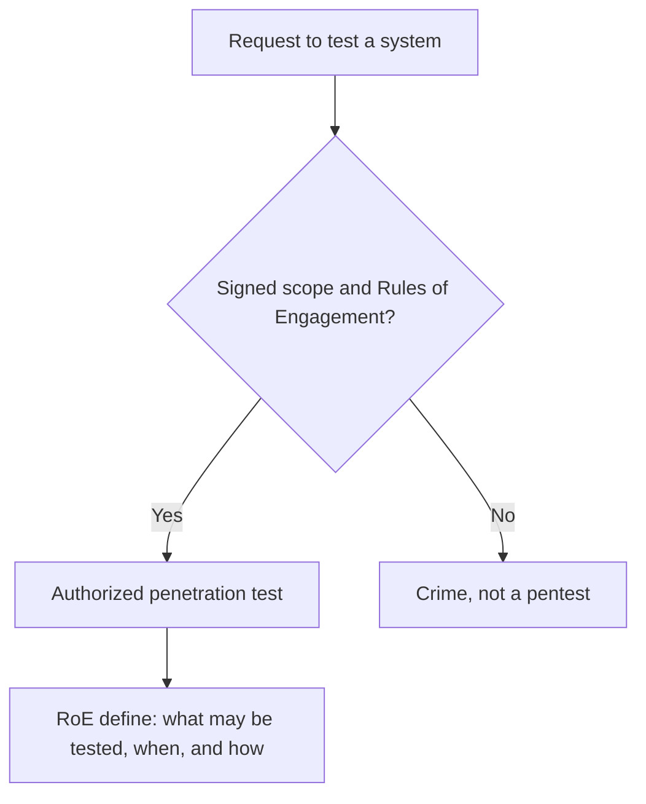
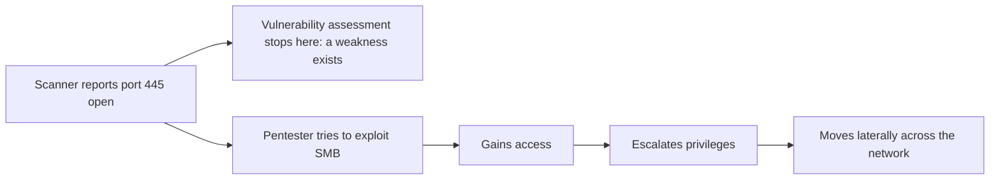
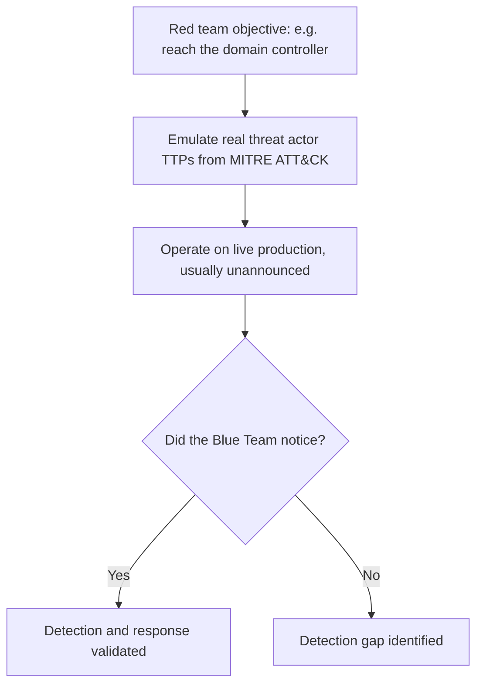
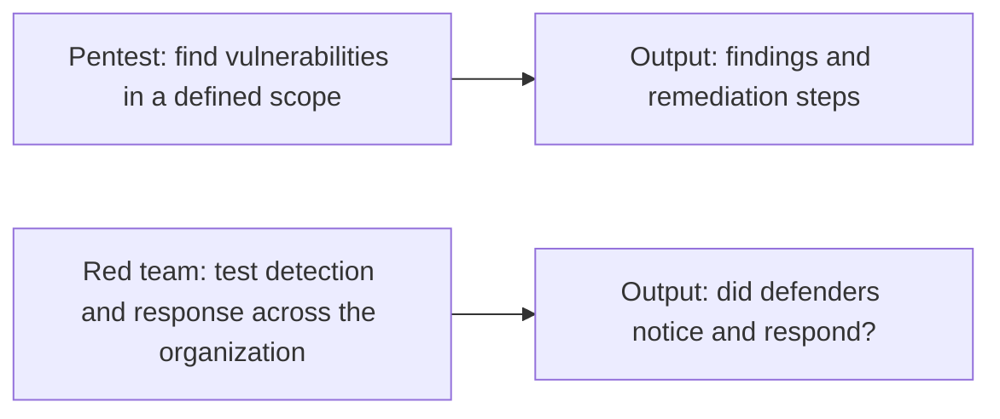
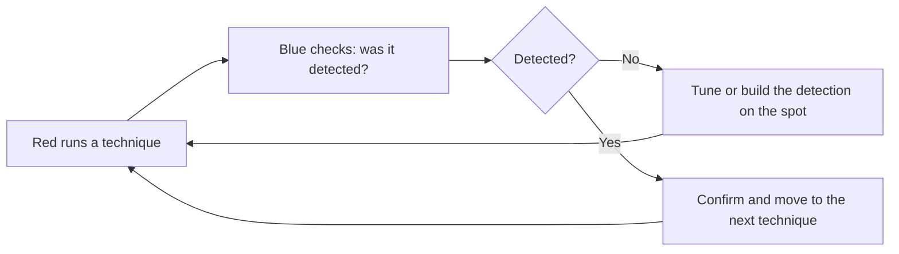

| Topic | Level | Reading Time | Prerequisites |
|---|---|---|---|
| Penetration Testing, Red Teaming, and Purple Teaming | Beginner | ~20 min | Vulnerability Assessment and Risk Scoring |

> **الهدف من الـ Section ده:**  
> هتفهم إيه هو الـ penetration test بالظبط وليه الإذن المكتوب هو اللي بيفرّق بينه وبين الجريمة، وإيه الفرق الحقيقي بين الـ vulnerability assessment والـ pentest، وبين الـ pentest والـ red team، وإزاي الـ blue وpurple وwhite teams بيكمّلوا الصورة.

## Learning Objectives

By the end of this section, you will be able to:

- Define a **penetration test** and list its goals, its mindset, and the role of **Rules of Engagement (RoE)**.
- Compare a **vulnerability assessment** and a **penetration test** across method, question answered, exploitation, and breadth versus depth.
- Define **red teaming** and explain how it uses **TTPs** and how success is measured.
- Compare **penetration testing** and **red teaming** across goal, scope, duration, focus, awareness, and techniques.
- Describe the roles of the **blue**, **purple**, and **white** teams, and explain why purple teaming improves detection coverage fastest.

## Table of Contents

- [Learning Objectives](#learning-objectives)
- [Penetration Testing](#penetration-testing)
  - [Definition](#definition)
  - [Goals](#goals)
  - [Mindset](#mindset)
  - [Authorization Comes First](#authorization-comes-first)
- [Vulnerability Assessment Versus Penetration Testing](#vulnerability-assessment-versus-penetration-testing)
- [Red Teaming](#red-teaming)
  - [Definition and TTPs](#definition-and-ttps)
  - [Live and Unannounced](#live-and-unannounced)
  - [What It Tests and How Success Is Measured](#what-it-tests-and-how-success-is-measured)
- [Red Teaming Versus Penetration Testing](#red-teaming-versus-penetration-testing)
  - [Two Different Goals](#two-different-goals)
  - [Side by Side](#side-by-side)
- [Blue, Purple, and White Teams](#blue-purple-and-white-teams)
  - [Blue Team](#blue-team)
  - [Purple Team](#purple-team)
  - [White Team](#white-team)
  - [Why Purple Teaming Works](#why-purple-teaming-works)
- [Career Path Connections](#career-path-connections)
- [Key Terms Glossary](#key-terms-glossary)
- [Summary](#summary)

## Penetration Testing

### Definition

الـ **penetration test (pentest)** هو **هجوم سيبراني محاكى، مُتحكَّم فيه، ومُصرَّح بيه** ضد نظام أو شبكة أو application أو مؤسسة.

### Goals

- **اكتشاف الثغرات قبل المهاجمين الحقيقيين.**
- **إثبات إزاي ممكن تتستغل وإيه الأثر.**
- **استيفاء متطلبات الامتثال** (PCI DSS وISO 27001 وما شابه).

### Mindset

الـ tester **بيفكر وبيتصرف زي المهاجم**، و**بيحاول فعلاً يستغل** نقاط الضعف، بدل ما يكتفي باكتشافها.

### Authorization Comes First

**Scope موقّع وRules of Engagement (RoE)** بيحددوا إيه المسموح يتختبر، وإمتى، وإزاي. **من غير إذن مكتوب، ده جريمة، مش pentest.**

> [!WARNING]
> Written authorization is not paperwork; it is the legal line between a security professional and a criminal. Testing a system you do not own without a signed scope is illegal even if your intentions are good, and even if you "only looked".

## Vulnerability Assessment Versus Penetration Testing

| Aspect | Vulnerability Assessment | Penetration Test |
|---|---|---|
| **Method** | غالباً automated scanning | يدوي، إبداعي، قايم على الاستغلال |
| **Question answered** | إيه نقاط الضعف الموجودة؟ | المهاجم يقدر **فعلاً** يعمل إيه بيها؟ |
| **Exploitation** | لأ | آه |
| **Breadth vs depth** | تغطية واسعة | عمق على أهداف مختارة |

**مثال:** scanner بيبلّغ إن port 445 مفتوح. الـ pentester هيحاول يستغل SMB، ويحصل على وصول، ويرفع صلاحياته، ويتحرك أفقياً عبر الشبكة.

في الـ engagements الحقيقية، **الاتنين بيتسلّموا في تقرير** فيه الـ findings والإصلاحات.

> [!NOTE]
> This is the boundary introduced in Vulnerability Assessment and Risk Scoring: an assessment must expose risk without exploiting it. The pentest picks up exactly where the assessment stops and answers the follow-up question, "so what?".

## Red Teaming

### Definition and TTPs

الـ **red teaming** هو **محاكاة كاملة لمهاجم** بتقلّد إزاي مهاجم حقيقي هيستهدف المؤسسة. بتقلّد الـ **TTPs (Tactics, Techniques, and Procedures)** بتاعة threat actors حقيقيين، زي ما هي مصنّفة في **MITRE ATT&CK**.

### Live and Unannounced

بيشتغل على **بنية production حية**، وغالباً **من غير علم الـ Blue Team** مسبقاً.

### What It Tests and How Success Is Measured

| Aspect | Detail |
|---|---|
| **بيختبر إيه** | التكنولوجيا، **الناس**، وقدرة الـ **detection** |
| **قياس النجاح** | بـ **أهداف (objectives)**، مثلاً: الوصول للـ domain controller أو سحب قاعدة بيانات عملاء وهمية، **وهل المدافعين لاحظوا** |

> [!NOTE]
> This is the engagement-planning use of ATT&CK described in the MITRE ATT&CK file: a known threat group is mapped to the techniques it uses, and the red team emulates exactly that playbook. The point is not just whether the attackers get in, but whether anyone sees them.

## Red Teaming Versus Penetration Testing

### Two Different Goals

| | Penetration Test | Red Team |
|---|---|---|
| **Goal** | اكتشاف ثغرات تقنية في **scope محدد ومحدود** (web أو internal أو external). فريق الأمن **غالباً عارف** إن ده بيحصل | اختبار **الوضع الأمني الكلي** عبر scope أوسع بكتير: ناس وتكنولوجيا وقدرات detection |
| **Example** | بنك بيستأجر pentesters يختبروا تطبيق الـ online banking، فيلاقوا SQL injection وbroken authentication وmisconfigurations، موثّقين مع خطوات الإصلاح | phishing emails بتختبر وعي الموظفين **وهل الـ phishing اتكشف**. المهم مش اكتشاف bugs، المهم **هل الـ Blue Team يقدر يكتشف ويرد** |

### Side by Side

| Aspect | Penetration Testing | Red Teaming |
|---|---|---|
| **Goal** | اكتشاف الثغرات | محاكاة مهاجم حقيقي |
| **Scope** | أنظمة محددة | المؤسسة كلها |
| **Duration** | أيام لأسابيع | أسابيع لشهور |
| **Focus** | عيوب تقنية | الـ detection والـ response |
| **Awareness** | غالباً معروف للمدافعين | غالباً غير معروف |
| **Techniques** | استغلال | social engineering وphishing وlateral movement |

**الفرق هو الهدف.** الـ pentest بيلاقي ثغرات؛ الـ red team بيختبر **قدرة المؤسسة على الكشف والرد**.

> [!IMPORTANT]
> A red team engagement can "fail" technically, for example the attackers never reach the objective, and still be a success if the Blue Team caught them early. The reverse also holds: attackers reaching the objective unseen is the most valuable finding, because it shows a detection gap no vulnerability scan would reveal.

## Blue, Purple, and White Teams

### Blue Team

الـ **Blue Team** هما **المدافعين**: الـ SOC، والـ incident response، والـ hardening.

### Purple Team

الـ **Purple Team** هو إن **الـ Red والـ Blue يشتغلوا مع بعض، بشكل علني**. الـ Red بيشغّل technique، والـ Blue بيفحص **هل اتكشفت**، وبيضبطوا الـ detections **في نفس اللحظة**. **عكس تمارين الـ red team العمياء، الكل عارف إيه اللي بيحصل.**

### White Team

الـ **White Team** هما **الحكام**: بيحددوا القواعد، ويشرفوا على التمرين، ويحلوا النزاعات.

### Why Purple Teaming Works

الـ purple teaming هو **أسرع طريقة لتحسين تغطية الـ detection**، لأن **كل attack technique بتتحول فوراً لتحسين في الـ detection**.

| Team | Role | Awareness |
|---|---|---|
| Red | يهاجم ويحاكي مهاجمين حقيقيين | يعرف الخطة |
| Blue | يدافع ويكشف ويرد | في الـ red team: غالباً **لا يعرف**. في الـ purple: **يعرف** |
| Purple | تعاون علني بين الاتنين لضبط الـ detections | الكل يعرف |
| White | حكام يحددوا القواعد ويحلوا النزاعات | يعرف الإطار الكامل |

> [!TIP]
> A clean way to explain purple teaming in an interview: a red team tests whether defenders notice, while a purple team makes sure they will notice next time. This connects to the detection coverage heatmap idea in the MITRE ATT&CK file: every technique tested in a purple exercise either turns a gap green or proves it was already covered.

## Career Path Connections

| Career Path | How This Topic Applies |
|---|---|
| SOC Analyst | Blue team work: detections are tested and improved directly through purple team exercises |
| Penetration Tester | Core role: authorized, exploit-driven testing within a defined scope and Rules of Engagement |
| GRC | Owns the legal and compliance side: scope, authorization, and compliance-driven testing requirements |
| Cloud Security | Cloud testing follows the same models, with the added requirement to follow each provider's testing policy |

## Key Terms Glossary

| Term | Definition |
|---|---|
| Penetration Test | A controlled, authorized, simulated attack against a system, network, application, or organization |
| Rules of Engagement (RoE) | The signed agreement defining what may be tested, when, and how |
| Scope | The set of systems and activities a test is authorized to cover |
| Red Teaming | A full adversary simulation testing technology, people, and detection capability |
| TTPs | Tactics, Techniques, and Procedures, the behavior patterns of real threat actors |
| Blue Team | The defenders: SOC, incident response, and hardening |
| Purple Team | Red and Blue working together openly to improve detections in real time |
| White Team | The referees who define rules and oversee an exercise |
| Lateral Movement | Moving from one compromised system to others inside the network |

## Summary

- **A pentest is a controlled, authorized, simulated attack:** هدفها اكتشاف الثغرات وإثبات الأثر واستيفاء الامتثال.
- **Written authorization is the line between a pentest and a crime:** scope موقّع وRoE.
- **An assessment asks what exists; a pentest asks what an attacker can do:** الأول automated وبدون استغلال، والتاني يدوي وبالاستغلال.
- **A red team simulates a real adversary across the whole organization:** بـ TTPs من MITRE ATT&CK، على production، غالباً من غير علم المدافعين.
- **Pentest versus red team is a difference of goal:** اكتشاف الثغرات مقابل اختبار قدرة الكشف والرد.
- **Success in a red team is measured by objectives and by whether defenders noticed.**
- **Blue defends, purple collaborates, white referees.**
- **Purple teaming is the fastest route to better detection coverage:** كل technique بتتحول فوراً لتحسين في الـ detection.

