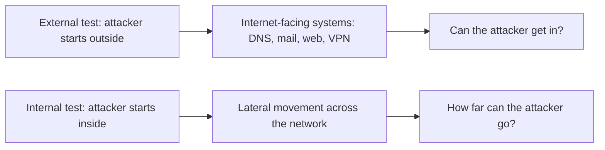
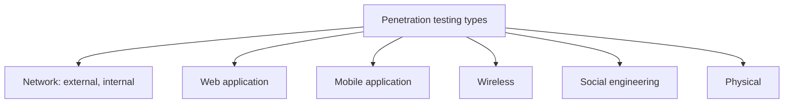
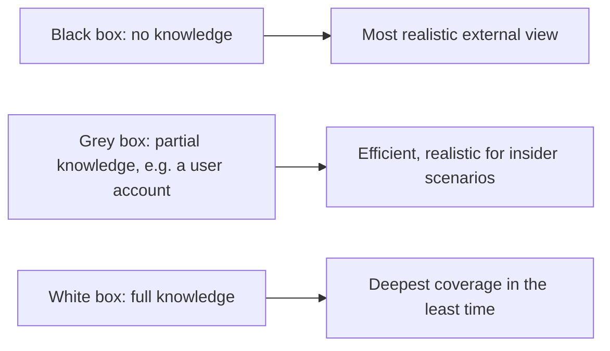
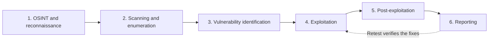
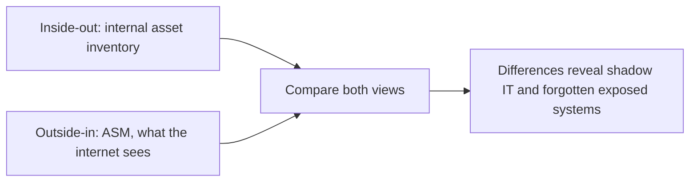
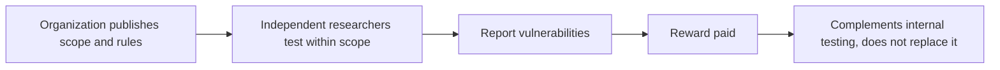

| Topic | Level | Reading Time | Prerequisites |
|---|---|---|---|
| Pentest Types, Phases, and Attack Surface Management | Beginner | ~20 min | Penetration Testing, Red Teaming, and Purple Teaming |

> **الهدف من الـ Section ده:**  
> هتعرف أنواع الـ penetration testing المختلفة (network وweb وmobile وwireless وhuman وphysical)، ومستويات المعرفة الثلاثة (black وgrey وwhite box)، والمراحل الست لأي pentest من الـ OSINT لحد التقرير، وإزاي الـ Attack Surface Management بيشوف المؤسسة من وجهة نظر المهاجم، وإيه مكان الـ bug bounty في البرنامج الأمني.

## Learning Objectives

By the end of this section, you will be able to:

- Differentiate between **external** and **internal** network penetration tests.
- List the main types of penetration testing: web application, mobile, wireless, social engineering, and physical.
- Compare **black box**, **grey box**, and **white box** testing.
- Describe the six phases of a penetration test, in order, and what each delivers.
- Define **Attack Surface Management (ASM)** and contrast the outside-in view with the inside-out asset inventory.
- List practical ways to **reduce the attack surface**.
- Explain how **bug bounty programs** work and where they fit in a security program.

## Table of Contents

- [Learning Objectives](#learning-objectives)
- [Types of Penetration Testing: Network](#types-of-penetration-testing-network)
  - [External Network Test](#external-network-test)
  - [Internal Network Test](#internal-network-test)
- [Types of Penetration Testing: Application and Human](#types-of-penetration-testing-application-and-human)
- [Testing Knowledge Levels](#testing-knowledge-levels)
- [Penetration Testing Phases](#penetration-testing-phases)
  - [The Six Phases](#the-six-phases)
  - [Reporting Is the Real Deliverable](#reporting-is-the-real-deliverable)
- [Attack Surface Management (ASM)](#attack-surface-management-asm)
  - [Definition](#definition)
  - [Typical Assets](#typical-assets)
- [ASM: The Attacker's View](#asm-the-attackers-view)
  - [Outside-In Versus Inside-Out](#outside-in-versus-inside-out)
  - [Ways to Reduce the Attack Surface](#ways-to-reduce-the-attack-surface)
- [Bug Bounty Programs](#bug-bounty-programs)
- [Career Path Connections](#career-path-connections)
- [Key Terms Glossary](#key-terms-glossary)
- [Summary](#summary)

## Types of Penetration Testing: Network

### External Network Test

بيتعامل معاه كـ **black box**: من غير معرفة مسبقة، **زي المهاجم الحقيقي بالظبط**.

- بيستهدف الأنظمة **المتاحة من الإنترنت**: DNS وmail وweb servers وVPNs.
- بيعتمد بشدة على **OSINT (Open-Source Intelligence)** والـ scanning.
- ممكن يشمل **phishing** كطريقة دخول تانية.

### Internal Network Test

بيحاكي مهاجم **عنده بالفعل وصول داخلي**، زي **insider خبيث** أو حد **اشترى الوصول الأولي من الـ dark web**.

- **الهدف:** المهاجم يقدر يعمل إيه بعد الـ foothold الأولي، وهيتحرك أفقياً (lateral movement) لحد فين؟
- **مناطق التركيز:** الـ firewalls والـ routers والـ VPN والسيرفرات المتاحة للجمهور (الـ **DMZ**).

| Aspect | External | Internal |
|---|---|---|
| Starting point | من بره، من غير أي وصول | من جوه، بعد foothold أولي |
| Knowledge | Black box | وصول داخلي موجود مسبقاً |
| Question | المهاجم يقدر يدخل منين؟ | بعد ما دخل، يقدر يوصل لحد فين؟ |
| Focus | DNS وmail وweb وVPN | Lateral movement وfirewalls وrouters وDMZ |

> [!NOTE]
> The internal test is the practical check of the segmentation covered in VLANs, Protocols, and Secure Topology Design. If VLANs, firewall rules between zones, and a properly isolated DMZ are working, an internal tester should find lateral movement hard. If not, this is where it shows up.

## Types of Penetration Testing: Application and Human

| Type | Focus |
|---|---|
| **Web application** | تطبيقات الويب وقواعد البيانات: SQL injection، Cross-Site Scripting (XSS)، authentication bypass، file upload flaws، session hijacking. **OWASP Top 10** هي قايمة المرجع القياسية |
| **Mobile application** | تطبيقات iOS وAndroid: عيوب authentication، insecure storage، وreverse engineering |
| **Wireless** | أمان Wi-Fi: encryption ضعيف، rogue access points، وWPA cracking |
| **Social engineering** | بيستهدف **نقاط ضعف البشر**، باستخدام phishing emails وUSB drop attacks |
| **Physical** | بيختبر الـ controls الفيزيائية: أنظمة access control، badge cloning، وtailgating جوه المباني |

> [!NOTE]
> Each of these types maps to a topic covered elsewhere in this series: web application testing to the Input Attacks and Injection category, mobile testing to Mobile Security and Device Management, and the phishing side of social engineering to the Mobile Threats and Platform Security file.

## Testing Knowledge Levels

| Level | What the Tester Knows | Why Use It |
|---|---|---|
| **Black box** | **مفيش حاجة** | أكتر عرض واقعي من الخارج |
| **Grey box** | **معرفة جزئية**، زي حساب مستخدم عادي | **فعّال وواقعي** لسيناريوهات insider-threat |
| **White box** | **معرفة كاملة** (source code، architecture، credentials) | **أعمق تغطية في أقل وقت** |

> [!TIP]
> There is a trade-off hidden in this table: the less the tester knows, the more realistic the view but the more time is spent just discovering things. White box spends that time testing instead. Choose the level based on what question the client actually needs answered.

## Penetration Testing Phases

### The Six Phases

| # | Phase | What Happens |
|---|---|---|
| 1 | **OSINT and reconnaissance** | جمع المعلومات العامة (domains، موظفين، تقنيات، credentials مسرّبة) |
| 2 | **Scanning and enumeration** | تحديد الـ hosts الشغالة والـ ports المفتوحة والخدمات وإصداراتها، واستخراج تفاصيل زي usernames وshares |
| 3 | **Vulnerability identification** | مطابقة الخدمات المكتشفة مع نقاط ضعف معروفة وmisconfigurations |
| 4 | **Exploitation** | استخدام نقاط الضعف للحصول على وصول |
| 5 | **Post-exploitation** | رفع الصلاحيات، lateral movement، persistence، **وقياس الأثر التجاري الحقيقي** (إيه الداتا اللي ممكن توصلها؟) |
| 6 | **Reporting** | ملخص تنفيذي، findings تقنية مع أدلة، تقييم مخاطر، وخطوات إصلاح |

### Reporting Is the Real Deliverable

**التقرير هو الـ deliverable الفعلي** اللي العميل بيدفع مقابله. **Retest** بعد كده بيتحقق إن الإصلاحات اشتغلت.

> [!IMPORTANT]
> A technically brilliant pentest with a weak report is a failed engagement, because the client cannot act on findings they cannot understand. The executive summary lets leadership decide, and the technical findings with evidence let engineers fix.

> [!NOTE]
> Phase 2 is the offensive twin of the Nmap-style discovery that defenders try to detect, and phase 1 (OSINT) is why leaked credentials found by dark web monitoring, covered in Asset Awareness and Traffic Flow, matter so much: attackers start from the same public data.

## Attack Surface Management (ASM)

### Definition

الـ **Attack Surface Management** هو **العملية المستمرة لاكتشاف ومراقبة وتأمين كل الـ assets المعرّضة للمهاجمين.** بيجاوب على سؤال: **إيه اللي مؤسستي بتعرّضه للإنترنت وممكن المهاجمين يشوفوه ويستهدفوه؟**

الـ **attack surface** هو **إجمالي عدد نقاط الدخول** اللي ممكن مهاجم يستخدمها.

### Typical Assets

| Category | Examples |
|---|---|
| Names and addresses | Domains، subdomains، public IP addresses |
| Infrastructure | Cloud resources، open ports |
| Certificates | شهادات منتهية أو متظبطة غلط |
| Hidden systems | Forgotten systems (**shadow IT**) |

## ASM: The Attacker's View

### Outside-In Versus Inside-Out

| View | What It Is |
|---|---|
| **ASM: outside-in** | بيبص على المؤسسة **من جهة المهاجم**، ويشوف **اللي الإنترنت شايفه** |
| **Asset inventory: inside-out** | **القايمة الداخلية** بالحاجات اللي المؤسسة بتملكها |

**الاتنين بيكمّلوا بعض.**

> [!IMPORTANT]
> The most valuable output of ASM is the difference between the two lists. A system visible from the internet but absent from the inventory is shadow IT by definition, and it is exactly the kind of system that goes unscanned and unpatched, as described in Vulnerability Assessment and Risk Scoring.

### Ways to Reduce the Attack Surface

| Action | Effect |
|---|---|
| **Close unused ports** | يقلل نقاط الدخول |
| **Decommission old systems** | يشيل أنظمة مش بتتحدّث |
| **Enforce MFA** | يصعّب استخدام credentials مسروقة |
| **Patch exposed services quickly** | يقفل الثغرات على اللي المهاجم يقدر يوصله |

## Bug Bounty Programs

| Aspect | Detail |
|---|---|
| **How it works** | المؤسسات بتدعو باحثين مستقلين يبلّغوا عن الثغرات **مقابل مكافآت** |
| **Platforms and scope** | بتشتغل عن طريق منصات زي **HackerOne** و**Bugcrowd**، مع **scope وقواعد منشورة بوضوح** |
| **Role in a security program** | **بيكمّل ولا بيستبدل** الاختبار الداخلي: بيجيب اختبار **مستمر ومتنوع على نطاق واسع** |

> [!WARNING]
> A bug bounty only authorizes testing inside the published scope and rules. Researchers who test outside the scope, or on a program that does not exist, lose the legal protection the program provides. The same rule from the previous file applies: authorization defines what is legal.

## Career Path Connections

| Career Path | How This Topic Applies |
|---|---|
| SOC Analyst | Recognizes the reconnaissance and scanning phases in logs, and uses ASM findings to know what is exposed |
| Penetration Tester | Core workflow: choose test type and knowledge level, then follow the six phases to a clear report |
| GRC | Chooses test types and frequency to satisfy compliance, and tracks remediation from the report |
| Cloud Security | ASM is especially important for cloud, where new internet-facing resources can appear in minutes |

## Key Terms Glossary

| Term | Definition |
|---|---|
| External Test | A penetration test from outside the network, targeting internet-facing systems |
| Internal Test | A penetration test assuming the attacker already has internal access |
| OSINT | Open-Source Intelligence, information collected from public sources |
| Black Box | Testing with no prior knowledge of the target |
| Grey Box | Testing with partial knowledge, such as a normal user account |
| White Box | Testing with full knowledge, including source code and credentials |
| Enumeration | Extracting details such as usernames and shares from discovered services |
| Post-Exploitation | Activity after gaining access: privilege escalation, lateral movement, persistence, impact measurement |
| Retest | A later test verifying that reported issues were actually fixed |
| Attack Surface | The total number of entry points an attacker could use |
| ASM | Attack Surface Management, continuous discovery and monitoring of exposed assets |
| Bug Bounty | A program rewarding independent researchers for reporting vulnerabilities within a stated scope |

## Summary

- **External tests start outside, internal tests start inside:** الأول بيسأل المهاجم يدخل منين، والتاني بيسأل يوصل لحد فين بعد الدخول.
- **Five more test types exist:** web، mobile، wireless، social engineering، وphysical.
- **Knowledge level trades realism for efficiency:** black box الأكتر واقعية، white box الأعمق في أقل وقت، وgrey box بينهم.
- **A pentest follows six phases:** OSINT، scanning، vulnerability identification، exploitation، post-exploitation، وreporting.
- **The report is the deliverable:** ملخص تنفيذي، findings تقنية بأدلة، تقييم مخاطر، وخطوات إصلاح، وretest يتحقق منها.
- **ASM sees the organization the way an attacker does:** بيكمّل الـ inventory الداخلي، والفرق بينهم هو اللي بيكشف الـ shadow IT.
- **Reducing the attack surface is concrete:** اقفل ports، احذف أنظمة قديمة، فعّل MFA، وصلّح الخدمات المكشوفة بسرعة.
- **Bug bounties complement internal testing at scale, inside a published scope.**

