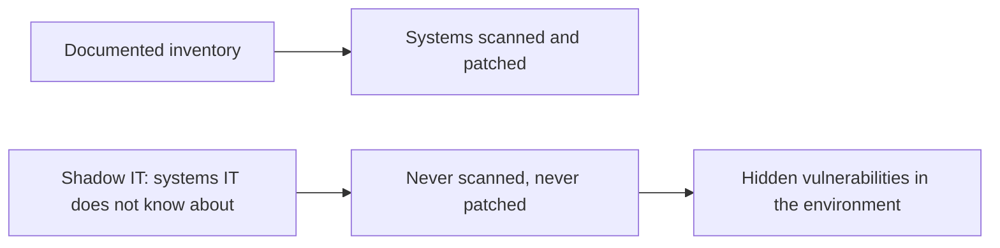
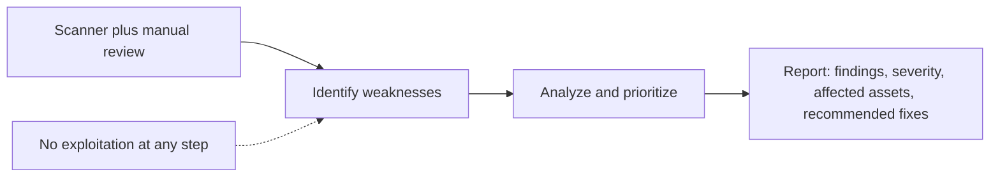
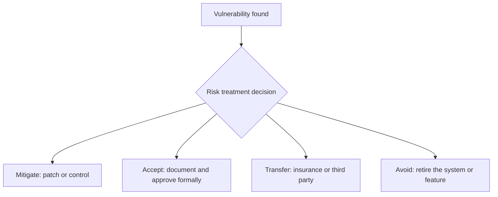
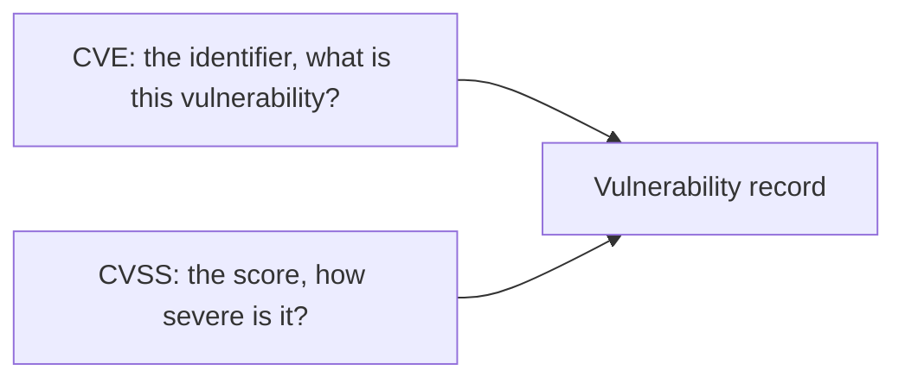
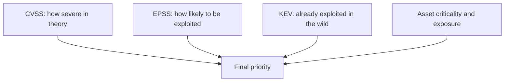
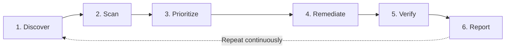

| Topic | Level | Reading Time | Prerequisites |
|---|---|---|---|
| Vulnerability Assessment and Risk Scoring | Beginner | ~20 min | Asset Awareness and Traffic Flow |

> **الهدف من الـ Section ده:**  
> هتفهم ليه الـ asset inventory هو أول خطوة في أي برنامج vulnerability management، وإيه الفرق بين الـ assessment والاستغلال الفعلي، وإزاي الـ CISO بيقرر يقبل ثغرة معينة بدل ما يصلحها، وإزاي بتتقيّم خطورة الثغرات بـ CVE وCVSS، وإزاي الدورة كلها بتتكرر باستمرار.

## Learning Objectives

By the end of this section, you will be able to:

- Explain why an **asset inventory** must exist before any other security control, and what threatens its accuracy.
- Define a **vulnerability assessment** and explain why it must never exploit the weaknesses it finds.
- List the four **risk treatment options** and the factors a CISO weighs when accepting a risk.
- Differentiate between **CVE** and **CVSS**, and read the four CVSS severity bands.
- Explain why a CVSS score alone is not enough, and how **EPSS** and the **CISA KEV catalog** add context.
- Describe the six stages of the **vulnerability management lifecycle** and explain why it is a cycle, not a project.

## Table of Contents

- [Learning Objectives](#learning-objectives)
- [Why Asset Inventory Comes First](#why-asset-inventory-comes-first)
  - [You Cannot Protect What You Do Not Know You Have](#you-cannot-protect-what-you-do-not-know-you-have)
  - [What an Asset Inventory Contains](#what-an-asset-inventory-contains)
  - [Shadow IT](#shadow-it)
- [What Is a Vulnerability Assessment](#what-is-a-vulnerability-assessment)
  - [Definition and Method](#definition-and-method)
  - [No Exploitation](#no-exploitation)
  - [The Output](#the-output)
- [Risk Acceptance Is a Business Decision](#risk-acceptance-is-a-business-decision)
  - [The Four Risk Treatment Options](#the-four-risk-treatment-options)
  - [What Drives the Accept-or-Deny Decision](#what-drives-the-accept-or-deny-decision)
  - [Why Frameworks and Compliance Matter](#why-frameworks-and-compliance-matter)
- [Scoring Vulnerabilities: CVE and CVSS](#scoring-vulnerabilities-cve-and-cvss)
  - [CVE](#cve)
  - [CVSS](#cvss)
  - [Severity Bands](#severity-bands)
- [Beyond the Score](#beyond-the-score)
  - [What Goes Into a CVSS Score](#what-goes-into-a-cvss-score)
  - [Not Every Weakness Has a Score](#not-every-weakness-has-a-score)
  - [Modern Prioritization: EPSS and KEV](#modern-prioritization-epss-and-kev)
- [The Vulnerability Management Lifecycle](#the-vulnerability-management-lifecycle)
- [Career Path Connections](#career-path-connections)
- [Key Terms Glossary](#key-terms-glossary)
- [Summary](#summary)

## Why Asset Inventory Comes First

### You Cannot Protect What You Do Not Know You Have

المؤسسات الكبيرة بتشغّل **آلاف الأنظمة**، فالحفاظ على رؤية كاملة لكل asset وموقعه صعب جداً. حتى جوه الـ SOC، الفرق بتفضل **تكتشف أنظمة محدش كان يعرف إنها موجودة** كل ما البيئة تكبر. وكتير من المؤسسات **ماعملتش inventory موثّق من البداية**، وده خطر أمني حقيقي.

القاعدة هنا بسيطة: **مينفعش تحمي اللي مش عارف إنه عندك.** كل control أمني تاني بيعتمد على inventory دقيق.

> [!NOTE]
> This is the same principle introduced in Asset Awareness and Traffic Flow from Network Security Foundations, where the CMDB helps an analyst judge how serious an alert is. Here the same inventory plays a different role: it defines what must be scanned for vulnerabilities in the first place.

### What an Asset Inventory Contains

الـ **asset inventory** هو قايمة منظمة ومحدّثة بكل حاجة المؤسسة بتملكها أو بتشغّلها وليها قيمة، خصوصاً من منظور الأمان.

| Aspect | Detail |
|---|---|
| **ليه مهم** | بيخلي فريق الأمن يحدد كل نظام، ويفهم غرضه، ويديره بشكل مناسب |
| **أمثلة على الـ assets** | Servers، laptops، phones، network devices، IoT devices، applications، databases، cloud resources، domains، certificates، وdata |
| **حقول مفيدة لكل asset** | المالك، الموقع، الغرض، الـ criticality، نظام التشغيل وإصداره، البرامج المثبتة، وحالة الـ patches |

### Shadow IT

الـ **Shadow IT** هو أنظمة اتنشرت **من غير علم قسم الـ IT**. وهو **أكبر تهديد لدقة الـ inventory**.

> [!WARNING]
> A vulnerability scanner can only assess what it is pointed at. A system missing from the inventory is a system missing from every scan, which makes shadow IT one of the most common reasons a known vulnerability stays open for years.

## What Is a Vulnerability Assessment

### Definition and Method

الـ **vulnerability assessment** هو عملية منهجية بتحدد وتحلل وتصنّف أولويات **نقاط الضعف الأمنية** في الأنظمة والشبكات والتطبيقات.

بيتم عادةً بـ **automated scanners** زي **Nessus** و**OpenVAS** و**Qualys**، مع **مراجعة يدوية**.

### No Exploitation

لازم الـ assessment **يكشف الخطر من غير ما يستغله**: هو بيبلّغ إن الضعف **موجود**، مش إنه **اتستغل**.

### The Output

قايمة **مرتبة حسب الأولوية** من الـ findings، فيها الـ severity والـ assets المتأثرة والإصلاحات الموصى بيها.

> [!IMPORTANT]
> The "no exploitation" rule is the defining boundary between a vulnerability assessment and a penetration test. An assessment answers "what weaknesses exist"; a penetration test answers "what can an attacker actually do with them". That difference is covered in the Penetration Testing, Red Teaming, and Purple Teaming file.

## Risk Acceptance Is a Business Decision

متتفاجأش لو الـ **CISO** قَبِل رسمياً بعض المخاطر أو الثغرات. القبول معقول لما **تكلفة الإصلاح، والأثر التشغيلي، وتعطيل الشغل** بيفوقوا **احتمال واثر الاستغلال**.

والقبول صالح **بس لو اتوثق واتوافق عليه رسمياً**، مش لو اتتجاهل.

### The Four Risk Treatment Options

| Option | Meaning |
|---|---|
| **Mitigate** | طبّق patch أو control |
| **Accept** | وثّقه وعيش معاه |
| **Transfer** | استخدم cyber insurance أو طرف تالت |
| **Avoid** | اسحب النظام أو الميزة المعرّضة للخطر |

### What Drives the Accept-or-Deny Decision

| Factor | What the CISO Weighs |
|---|---|
| **Likelihood of exploitation** | هل فيه public exploit؟ هل النظام متاح من الإنترنت؟ |
| **Impact if exploited** | فقدان داتا، توقف، ضرر مالي أو سمعي |
| **Cost of remediation** | فلوس، ووقت فريق، ومجهود اختبار |
| **Regulatory consequences** | غرامات أو إجراءات قانونية (GDPR، PCI DSS، HIPAA وما شابه) |
| **Operational downtime** | تحديث نظام production ممكن يعني توقف |

### Why Frameworks and Compliance Matter

لما **العواقب التنظيمية تغيب**، المؤسسات ممكن **تقلل أولوية** بعض الـ controls، زي حماية داتا العملاء. ده السبب إن الـ **security frameworks ومتطلبات الامتثال** مهمة: هي بتفرض **حد أدنى متسق** من المعايير.

> [!NOTE]
> This connects directly to the NIST CSF file in the Security Frameworks category. The CSF's Identify function is the formal home of asset inventory and risk assessment, and risk acceptance is one of the decisions the framework expects an organization to document.

## Scoring Vulnerabilities: CVE and CVSS

### CVE

الـ **CVE (Common Vulnerabilities and Exposures)** هو **ID عام وفريد** لثغرة معروفة، زي `CVE-2021-44228`.

### CVSS

الـ **CVSS (Common Vulnerability Scoring System)** هو **درجة من 0.0 لـ 10.0** مبنية على قابلية الاستغلال والأثر.

### Severity Bands

| Score | Severity |
|---|---|
| 0.1 – 3.9 | Low |
| 4.0 – 6.9 | Medium |
| 7.0 – 8.9 | High |
| 9.0 – 10.0 | Critical |

> [!TIP]
> Easy way to remember the difference: the CVE is the name tag, the CVSS is the severity rating on it. In an interview, say both together: "CVE-2021-44228 is Log4Shell, and it scored a CVSS of 10.0".

## Beyond the Score

### What Goes Into a CVSS Score

| Group | Includes |
|---|---|
| **Exploitability factors** | الـ attack vector (network أو local)، التعقيد، الصلاحيات المطلوبة، وتفاعل المستخدم |
| **Impact factors** | الأثر على الـ confidentiality والـ integrity والـ availability |

### Not Every Weakness Has a Score

النظام ممكن يكون معرّض للخطر بسبب **configuration سيئة**، زي default passwords، أو shares مفتوحة، أو صلاحيات زايدة. المهاجمين بيستغلوها **بأدوات شرعية**، ومفيش لها CVE ولا score.

### Modern Prioritization: EPSS and KEV

الفرق بتستخدم كمان سياق إضافي:

| Source | What It Tells You |
|---|---|
| **EPSS** | احتمال استغلال الثغرة فعلياً |
| **CISA KEV catalog** | ثغرات **معروف إنها بتتستغل فعلاً** في الواقع (in the wild) |

> [!IMPORTANT]
> A Critical CVSS on a lab server nobody can reach may matter less than a Medium on an internet-facing payment system that appears in the KEV catalog. Severity describes the vulnerability; priority describes the vulnerability on a specific asset in a specific environment.

## The Vulnerability Management Lifecycle

دورة **مستمرة**، مش مشروع بيخلص.

| # | Stage | What Happens |
|---|---|---|
| 1 | **Discover** | ابني واحتفظ بالـ asset inventory |
| 2 | **Scan** | شغّل scans **authenticated وunauthenticated** بجدول منتظم |
| 3 | **Prioritize** | اجمع CVSS مع criticality الـ asset وthreat intelligence |
| 4 | **Remediate** | patch، أو reconfigure، أو طبّق compensating control (زي WAF rule أو segmentation) |
| 5 | **Verify** | اعمل rescan للتأكد إن الإصلاح اشتغل |
| 6 | **Report** | تتبع metrics زي time-to-remediate وعدد الـ critical findings المفتوحة |

> [!NOTE]
> A compensating control such as a WAF rule is the same idea as virtual patching covered in the WAF file: it closes the exploit path at the edge while the real fix waits for a maintenance window. It reduces risk, but the vulnerability itself is still there until it is patched.

## Career Path Connections

| Career Path | How This Topic Applies |
|---|---|
| SOC Analyst | Uses scan findings and KEV context to judge whether an alert touches a known-exploited weakness |
| Penetration Tester | Starts from the same inventory and findings, then goes further by exploiting weaknesses to prove real impact |
| GRC | Owns risk acceptance documentation, remediation metrics, and compliance evidence |
| Cloud Security | Cloud resources are assets too, and ephemeral workloads make continuous discovery even more important |

## Key Terms Glossary

| Term | Definition |
|---|---|
| Asset Inventory | A structured, up-to-date list of everything an organization owns or operates that has value |
| Shadow IT | Systems deployed without the IT department's knowledge |
| Vulnerability Assessment | A systematic process of identifying, analyzing, and prioritizing weaknesses without exploiting them |
| Risk Acceptance | A formally documented and approved decision to live with a risk |
| Risk Transfer | Shifting risk to another party, for example through cyber insurance |
| CVE | Common Vulnerabilities and Exposures, a unique public ID for a known vulnerability |
| CVSS | Common Vulnerability Scoring System, a 0.0 to 10.0 severity score |
| EPSS | Exploit Prediction Scoring System, the probability that a vulnerability will be exploited |
| KEV | CISA's Known Exploited Vulnerabilities catalog |
| Authenticated Scan | A scan run with valid credentials, able to see inside the system |
| Compensating Control | A control that reduces risk when the vulnerability cannot be patched immediately |
| Time-to-Remediate | The time between discovering a vulnerability and fixing it |

## Summary

- **Inventory comes first:** كل control أمني بيعتمد على inventory دقيق، والـ shadow IT هو أكبر تهديد لدقته.
- **A vulnerability assessment finds weaknesses without exploiting them:** scanners زي Nessus وOpenVAS وQualys مع مراجعة يدوية، والمخرج قايمة مرتبة بالأولوية.
- **Risk acceptance is a legitimate business decision:** بشرط التوثيق والموافقة الرسمية، مش التجاهل.
- **Four treatments exist:** mitigate، accept، transfer، avoid.
- **The CISO weighs five factors:** احتمال الاستغلال، الأثر، تكلفة الإصلاح، العواقب التنظيمية، والتوقف التشغيلي.
- **CVE names the vulnerability, CVSS rates it:** من 0.0 لـ 10.0 في أربع bands.
- **A score is not a priority:** misconfigurations مالهاش score، وEPSS وKEV بيضيفوا سياق واقعي.
- **The lifecycle is a continuous cycle:** discover، scan، prioritize، remediate، verify، report، وبعدين من الأول.

