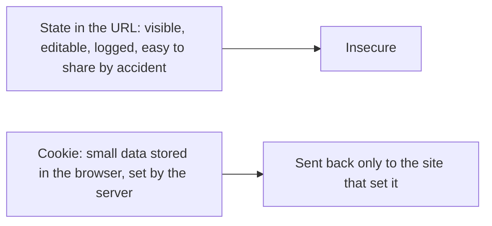
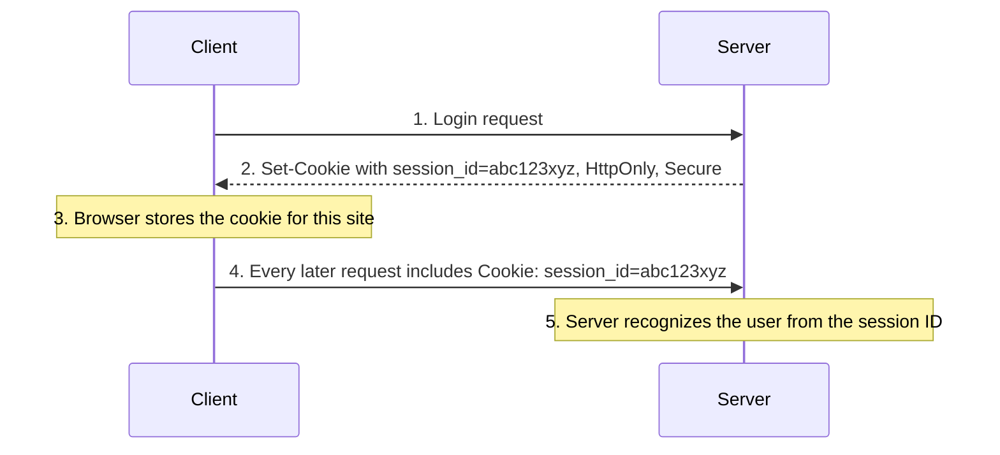
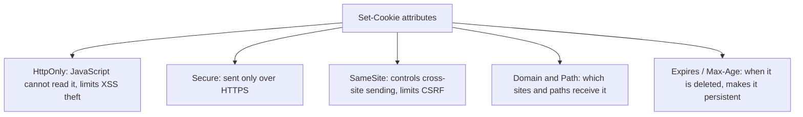
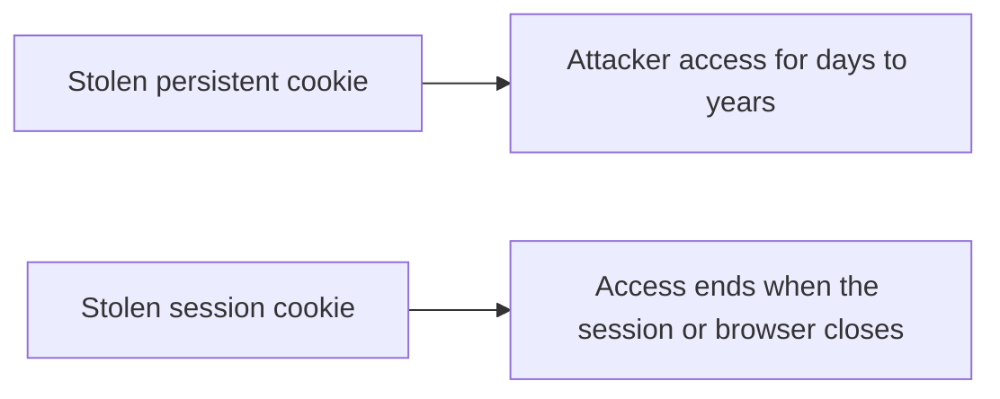
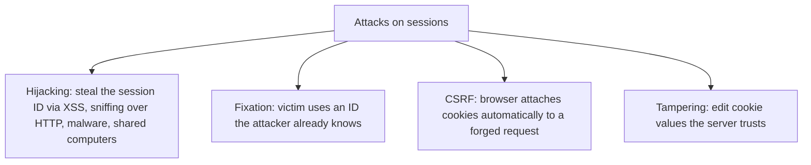
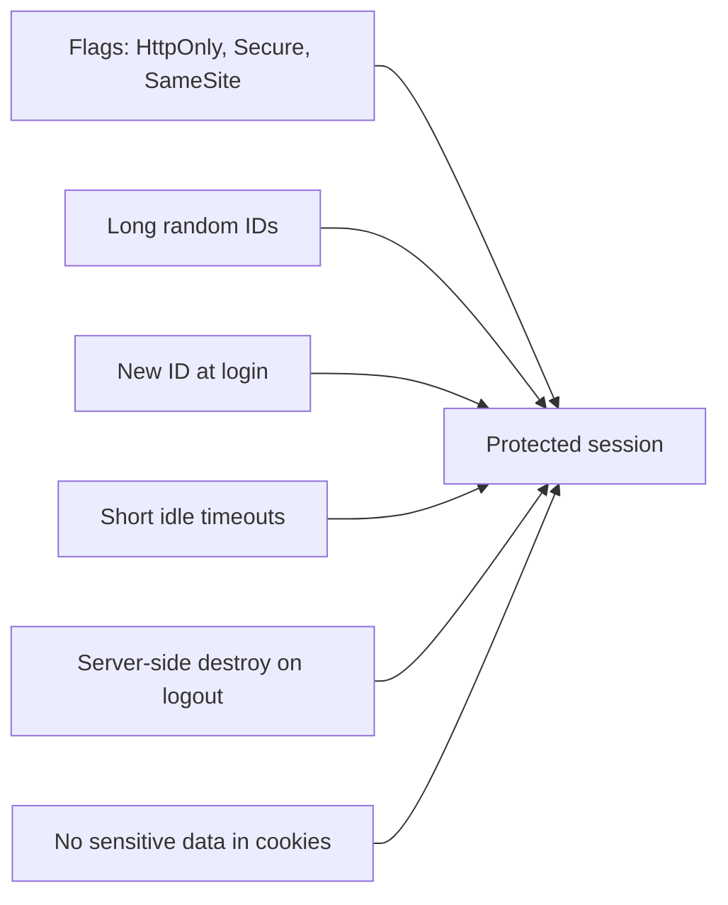

| Topic | Level | Reading Time | Prerequisites |
|---|---|---|---|
| Cookies and Session Security | Beginner | ~15 min | HTTP Requests, Responses, and Headers |

> **الهدف من الـ Section ده:**  
> هتفهم ليه الـ cookies اتخلقت أصلاً (لأن HTTP مابيفتكرش حاجة)، وإزاي الـ session بتتبني خطوة بخطوة بـ Set-Cookie وCookie، وإيه معنى كل attribute أمني، والفرق بين persistent وsession cookies، وإيه الهجمات الأربعة على الـ sessions (hijacking وfixation وCSRF وtampering)، وإيه أفضل الممارسات لحماية الـ session.

## Learning Objectives

By the end of this section, you will be able to:

- Explain why cookies exist and why putting state in the **URL** is insecure.
- Walk through the five-step **session workflow** using `Set-Cookie` and `Cookie`.
- Describe each cookie attribute: **HttpOnly**, **Secure**, **SameSite**, **Domain and Path**, and **Expires / Max-Age**.
- Compare **persistent** and **non-persistent (session)** cookies and the security implication of each.
- Describe four attacks: **session hijacking**, **session fixation**, **CSRF**, and **cookie tampering**.
- Apply the six best practices for protecting sessions.

## Table of Contents

- [Learning Objectives](#learning-objectives)
- [Why Cookies Exist](#why-cookies-exist)
  - [The Early Solution: State in the URL](#the-early-solution-state-in-the-url)
  - [The Better Solution: Cookies](#the-better-solution-cookies)
- [How Cookies Work](#how-cookies-work)
  - [The Session Workflow](#the-session-workflow)
  - [Cookie Attributes](#cookie-attributes)
- [Persistent Versus Non-Persistent Cookies](#persistent-versus-non-persistent-cookies)
- [Attacks on Cookies and Sessions](#attacks-on-cookies-and-sessions)
  - [Session Hijacking and Cookie Theft](#session-hijacking-and-cookie-theft)
  - [Session Fixation](#session-fixation)
  - [CSRF](#csrf)
  - [Cookie Tampering](#cookie-tampering)
- [Protecting Sessions: Best Practices](#protecting-sessions-best-practices)
- [Career Path Connections](#career-path-connections)
- [Key Terms Glossary](#key-terms-glossary)
- [Summary](#summary)

## Why Cookies Exist

**HTTP stateless**، فالسيرفر **مايقدرش يربط أوتوماتيك** عدة requests بنفس المستخدم. لكن الـ sessions **محتاجة state**: سلة الشراء مثلاً محتاجة السيرفر **يفتكر الحاجات اللي اتضافت قبل كده.**

### The Early Solution: State in the URL

```text
http://www.sample[.]org/shopping/cart.cgi?acctno=182727338363&itemno1=12877&itemno2=92762
```

**غير آمن:** رقم الحساب والعناصر **ظاهرين وقابلين للتعديل**، **بيتحفظوا في الـ logs والـ history**، و**سهل يتشاركوا بالغلط.**

### The Better Solution: Cookies

الـ **cookie** هو **قطعة داتا صغيرة بتتخزن في المتصفح** وبيحددها السيرفر **لتتبع المستخدم والحفاظ على الـ state بين الـ requests.** المتصفح **بيخزن الـ cookies لكل domain**، و**بيبعت كل cookie لنفس الموقع اللي حدّدها بس.**



> [!NOTE]
> Statelessness, covered in HTTP Requests, Responses, and Headers, is the root cause: the protocol has no memory, so every login system has to build one. The cookie is that memory, which is exactly why it becomes the target.

## How Cookies Work

### The Session Workflow

| # | Step |
|---|---|
| 1 | العميل بيبعت **login request** |
| 2 | السيرفر بيرد بـ cookie في الـ response: `Set-Cookie: session_id=abc123xyz; HttpOnly; Secure` |
| 3 | المتصفح **بيخزن الـ cookie** للموقع ده |
| 4 | **كل request لاحق لنفس الموقع بيشمله أوتوماتيك**: `Cookie: session_id=abc123xyz` |
| 5 | السيرفر **بيتعرف على المستخدم من الـ session ID** |



### Cookie Attributes

| Attribute | What It Does |
|---|---|
| **HttpOnly** | **JavaScript مايقدرش يقرا الـ cookie** (بيحد من سرقة الـ XSS) |
| **Secure** | **بيتبعت بس عبر HTTPS** |
| **SameSite** (Strict وLax وNone) | **بيتحكم في الإرسال عبر المواقع** (بيحد من CSRF) |
| **Domain and Path** | أنهي مواقع ومسارات **بتستقبل** الـ cookie |
| **Expires / Max-Age** | **إمتى بيتمسح**، وده اللي **بيخليه persistent** |



> [!TIP]
> A one-line way to remember the three security flags: HttpOnly protects the cookie from scripts, Secure protects it on the wire, and SameSite protects it from being sent by other sites. Each one maps to a different attack in the sections below.

## Persistent Versus Non-Persistent Cookies

| | Persistent Cookies | Non-Persistent (Session) Cookies |
|---|---|---|
| **Storage** | على الـ **hard drive** | في الـ **memory** |
| **Survives browser close and reboot?** | **آه** | **لأ** |
| **Duration** | فترة طويلة (أيام لسنين) | فترة قصيرة |
| **Used for** | تتبع نشاط المستخدم و"remember me" | login sessions مؤقتة |
| **Concern** | **مخاوف خصوصية** | ممكن تحتاج re-authentication لأن معلومات المستخدم مش متفتكرة |

**Security implication:** **الـ persistent cookie المسروق بيدّي المهاجم وصول لفترة طويلة.** التطبيقات الحساسة لازم تستخدم **lifetimes قصيرة وsession expiry على السيرفر وre-authentication للإجراءات الحرجة.**



## Attacks on Cookies and Sessions

### Session Hijacking and Cookie Theft

المهاجم اللي **بيحصل على الـ session ID** **بيبعت requests بالـ cookie ده وبينتحل شخصية الضحية، من غير password.** بيتسرق عن طريق **XSS وsniffing على HTTP وmalware وأجهزة مشتركة.**

### Session Fixation

المهاجم **بيخلي الضحية تستخدم session ID هو عارفه أصلاً**، وبعدين **بيستنى الـ login.** **الإصلاح:** **أصدر session ID جديد عند الـ login.**

### CSRF

**(Cross-Site Request Forgery)**: المتصفحات **بتلزق الـ cookies أوتوماتيك**، فـ **موقع خبيث** يقدر **يخلي متصفح الضحية يبعت request للموقع الهدف.** **الدفاعات:** SameSite cookies وanti-CSRF tokens وOrigin checks.

### Cookie Tampering

تعديل قيم الـ cookie (`role=user` لـ `role=admin`) **بينجح لما السيرفر بيثق في داتا الـ client-side.**

| Attack | Mechanism | Main Defence |
|---|---|---|
| **Session hijacking** | سرقة session ID واستخدامه | HttpOnly وSecure وتقصير الـ lifetime |
| **Session fixation** | إجبار الضحية على session ID معروف للمهاجم | session ID جديد عند الـ login |
| **CSRF** | موقع خبيث يستغل إن المتصفح بيبعت الـ cookies أوتوماتيك | SameSite وanti-CSRF tokens وOrigin checks |
| **Cookie tampering** | تعديل قيم الـ cookie | **ماتثقش في داتا الـ client؛ احتفظ بالـ state على السيرفر** |



> [!IMPORTANT]
> Session hijacking is the identity-side consequence of XSS. A script that reads the session cookie, as described in Cross-Site Scripting (XSS), gives the attacker the user's login without the password or the MFA. When that stolen session is replayed from another country, it is what the Impossible Travel and VPN Detection file teaches you to spot, and revoking sessions and tokens is the first containment step there.

> [!WARNING]
> CSRF works because of a feature, not a bug: the browser attaches cookies automatically to every request to a site, including requests triggered by a different site. That is why the SameSite attribute exists, and why reading anti-CSRF tokens is one of the things an XSS attacker aims for, since XSS defeats token-based CSRF protection.

## Protecting Sessions: Best Practices

| # | Practice | Detail |
|---|---|---|
| 1 | **Cookie flags** | اضبط **HttpOnly وSecure وSameSite** على كل session cookie |
| 2 | **Random IDs** | استخدم session IDs **طويلة وعشوائية** مايتخمنش |
| 3 | **Regenerate at login** | أصدر **session ID جديد** عند تسجيل الدخول، وده بيوقف session fixation |
| 4 | **Short timeouts** | **انهِ الـ sessions الخاملة بسرعة** وطلب re-authentication للإجراءات الحرجة |
| 5 | **Invalidate on logout** | **دمّر الـ session على السيرفر**، مش في المتصفح بس |
| 6 | **No sensitive data** | **متخزنش passwords أو داتا شخصية في الـ cookies أبداً** |

**افتكر:** **اللي ماسك الـ session ID بيتعامل معاه كأنه المستخدم**، فلازم **يتحمي زي الـ password.**



> [!TIP]
> Practices 5 and 6 are the ones most often forgotten. Deleting the cookie in the browser on logout does nothing if the server still accepts that ID, and a cookie holding role or price data is cookie tampering waiting to happen. Keep the state on the server and let the cookie be only a random reference to it.

## Career Path Connections

| Career Path | How This Topic Applies |
|---|---|
| SOC Analyst | Treats a session or refresh token used from a new location or device as likely token theft, and revokes sessions during containment |
| Penetration Tester | Checks cookie flags, session ID randomness, fixation at login, logout invalidation, and CSRF protection |
| GRC | Session timeout and cookie security settings are common, auditable web application controls |
| Cloud Security | Cloud identity providers issue session and refresh tokens, so token lifetime and revocation are core cloud security settings |

## Key Terms Glossary

| Term | Definition |
|---|---|
| Cookie | A small piece of data stored in the browser and set by the server to maintain state |
| Session ID | A value identifying a user's session, sent in a cookie with each request |
| HttpOnly | A cookie attribute preventing JavaScript from reading the cookie |
| Secure | A cookie attribute restricting the cookie to HTTPS |
| SameSite | A cookie attribute controlling whether the cookie is sent on cross-site requests |
| Persistent Cookie | A cookie stored on disk that survives closing the browser |
| Session Cookie | A cookie held in memory that disappears when the browser closes |
| Session Hijacking | Using a stolen session ID to impersonate a user |
| Session Fixation | Forcing a victim to use a session ID the attacker already knows |
| CSRF | Cross-Site Request Forgery, making a victim's browser send an unwanted request using their cookies |
| Cookie Tampering | Editing cookie values the server trusts |

## Summary

- **Cookies exist because HTTP is stateless:** والـ state في الـ URL غير آمن.
- **The session workflow has five steps:** login وSet-Cookie وتخزين في المتصفح وCookie مع كل request وتعرّف السيرفر على الـ session ID.
- **Five attributes control cookie behavior:** HttpOnly وSecure وSameSite وDomain/Path وExpires/Max-Age.
- **Persistent cookies trade convenience for risk:** سرقة واحدة بتدّي وصول لفترة طويلة.
- **Four attacks target sessions:** hijacking وfixation وCSRF وtampering.
- **Hijacking is the identity-side result of XSS or sniffing.**
- **Six practices protect sessions:** flags وrandom IDs وID جديد عند login وtimeouts قصيرة وdestroy على السيرفر وبدون داتا حساسة.
- **Whoever holds the session ID is treated as the user:** فلازم يتحمي زي الـ password.


