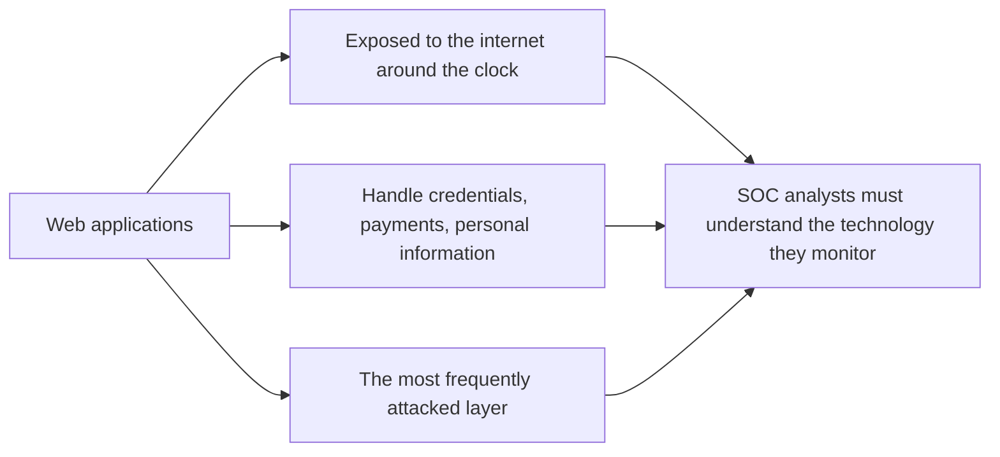
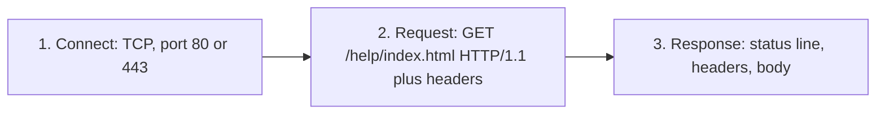
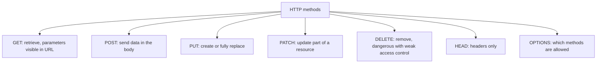
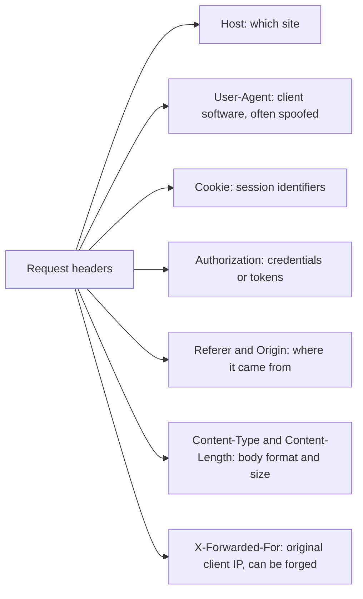
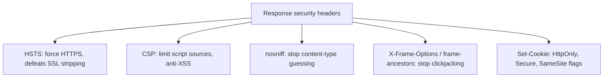
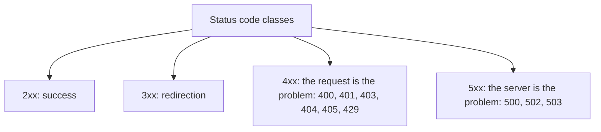
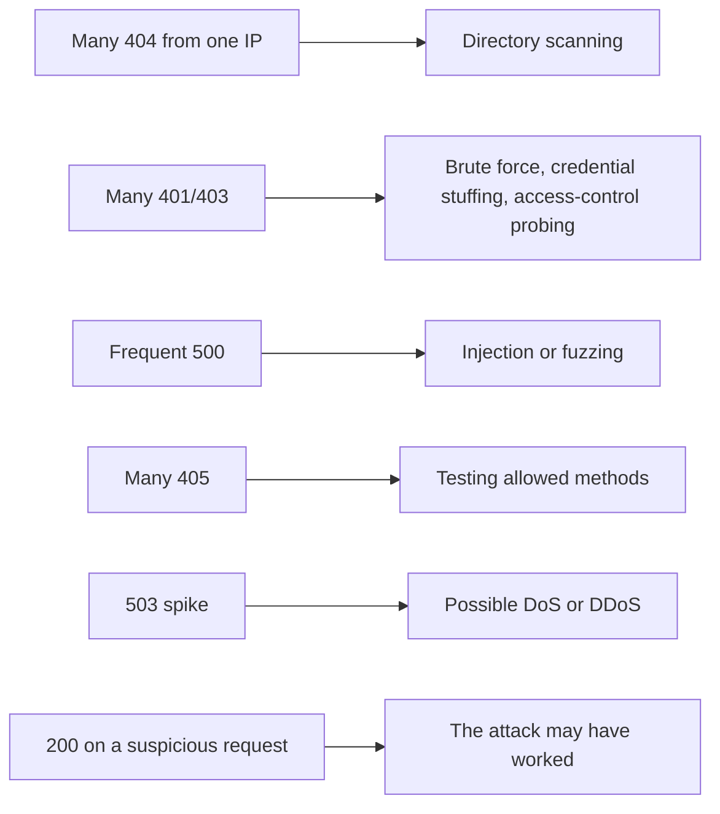

| Topic | Level | Reading Time | Prerequisites |
|---|---|---|---|
| HTTP Requests, Responses, and Headers | Beginner | ~25 min | Core Log Types and Web Server Logs |

> **الهدف من الـ Section ده:**  
> هتفهم إزاي الويب بيشتغل من أول الاتصال لحد الرد، وليه الـ HTTP stateless، وإيه الـ methods الأساسية وأيهم خطر لو الـ access control ضعيف، وأهم الـ request headers والـ security headers، وإزاي تقرا status codes كـ SOC analyst وتحوّل أنماطها لمعنى أمني.


## Learning Objectives

By the end of this section, you will be able to:

- Explain why web application security matters and why a SOC analyst must understand how the web works.
- Walk through the three steps of web communication: **connect**, **request**, **response**.
- Explain that **HTTP is stateless** and what **virtual hosting** adds.
- Compare the HTTP methods **GET**, **POST**, **PUT**, **PATCH**, **DELETE**, **HEAD**, and **OPTIONS**, with their security implications.
- Describe the important **request headers** and the **response security headers**.
- Read the five **status code classes** and the specific 4xx and 5xx codes.
- Map **patterns of status codes** in logs to likely attacks.

## Table of Contents

- [Learning Objectives](#learning-objectives)
- [Why Web Application Security Matters](#why-web-application-security-matters)
- [How Web Communication Works](#how-web-communication-works)
  - [Three Steps](#three-steps)
  - [HTTP Is Stateless](#http-is-stateless)
  - [Virtual Hosting](#virtual-hosting)
- [HTTP Request Methods](#http-request-methods)
  - [GET and POST](#get-and-post)
  - [PUT, PATCH, and DELETE](#put-patch-and-delete)
  - [HEAD and OPTIONS](#head-and-options)
  - [A SOC Tip: Know What Is Normal](#a-soc-tip-know-what-is-normal)
- [Important HTTP Request Headers](#important-http-request-headers)
- [Response Security Headers](#response-security-headers)
- [Responses and Status Code Classes](#responses-and-status-code-classes)
  - [Response Structure](#response-structure)
  - [4xx Client Errors](#4xx-client-errors)
  - [5xx Server Errors](#5xx-server-errors)
  - [What Patterns Mean to a SOC Analyst](#what-patterns-mean-to-a-soc-analyst)
- [Career Path Connections](#career-path-connections)
- [Key Terms Glossary](#key-terms-glossary)
- [Summary](#summary)

## Why Web Application Security Matters

ده من **أهم المواضيع اللي لازم تفهمها كويس.** **قبل ما تأمّن حاجة، لازم تفهم هي بتشتغل إزاي وفين نقط ضعفها.**

كـ **SOC analyst** هتراقب هجمات ويب، فلازم يكون عندك فهم قوي للتكنولوجيا اللي بتراقبها.

تطبيقات الويب **معرّضة للإنترنت 24 ساعة، وبتتعامل مع داتا حساسة** (credentials ومدفوعات ومعلومات شخصية)، وهي **أكتر طبقة بتتهاجم.**



## How Web Communication Works

### Three Steps

| # | Step | What Happens |
|---|---|---|
| 1 | **Connect** | اتصال TCP بالسيرفر: **port 80 لـ HTTP، port 443 لـ HTTPS** |
| 2 | **Request** | العميل بيبعت `GET /help/index.html HTTP/1.1` مع headers (Host وUser-Agent وCookie) |
| 3 | **Response** | السيرفر بيرجّع status line وHTTP headers ومحتوى الـ HTML (الـ body) |



### HTTP Is Stateless

كل request **مستقل**، والسيرفر **مابيفتكرش الطلبات السابقة.** من غير آلية إضافية زي الـ **cookies**، السيرفر **مايقدرش يعرف إن طلبين جايين من نفس المستخدم.** المواقع لازم **تفتكر المستخدمين المسجلين وسلات الشراء والـ sessions.**

### Virtual Hosting

**سيرفر ويب واحد بـ IP واحد ممكن يستضيف دومينات كتير.** الـ **Host header** بيقول أنهي موقع مطلوب.

> [!NOTE]
> Statelessness is the reason cookies and sessions exist, covered in Cookies and Session Security, and the Host header is the same mechanism that makes a direct-IP bypass unreliable, as explained in the DNS Sinkhole file. Both come straight from the three-step model above.

## HTTP Request Methods

### GET and POST

| Method | Purpose | Detail |
|---|---|---|
| **GET** | استرجاع داتا | بيتستخدم لفتح صفحة وجلب صور وبيانات API. **الـ parameters ظاهرة في الـ URL**، فبتتحفظ في **history المتصفح وproxy logs وserver logs**، وسهل المهاجم يعدّل فيها. **متبعتش passwords أو tokens في GET parameters أبداً** |
| **POST** | إرسال داتا للسيرفر | login forms وuploads. **الداتا في الـ body، مش الـ URL**، وده مناسب للداتا الحساسة، **لكنه مش security control** |

```text
GET /account?id=123 HTTP/1.1
Host: example.com
```

```text
POST /login HTTP/1.1
Host: example.com
Content-Type: application/x-www-form-urlencoded

username=admin&password=1234
```

> [!IMPORTANT]
> Security note: POST bodies are where SQL injection and command injection payloads are commonly sent. Moving data from the URL to the body hides it from browser history and many logs, but it does nothing to make the data safe, because the attacker controls the body just as much as the URL.

### PUT, PATCH, and DELETE

| Method | Purpose |
|---|---|
| **PUT** | **ينشئ أو يستبدل مورد بالكامل.** لو user 10 موجود وعايزين نحدّث كل معلوماته، `/api/users/10` هو المورد اللي بيتستبدل |
| **PATCH** | **يحدّث جزء** من المورد. **PUT بيستبدل كل حاجة، PATCH بيغيّر الحقول اللي بتبعتها بس** |
| **DELETE** | **يحذف مورد**، مثلاً `DELETE /users/10`. **خطير جداً لو الـ access control ضعيف** |

```text
PUT /api/users/10 HTTP/1.1
Host: example.com
Content-Type: application/json

{"name": "Ahmed Hassan",
 "email": "ahmed@example.com",
 "role": "analyst"}
```

### HEAD and OPTIONS

| Method | Purpose |
|---|---|
| **HEAD** | زي GET، لكنه **بيرجّع الـ headers بس، من غير الـ body.** بيتستخدم لفحص وجود مورد وفحص الـ metadata |
| **OPTIONS** | **بيسأل السيرفر أنهي methods مسموحة.** الرد شكله `Allow: GET, POST, PUT` |



### A SOC Tip: Know What Is Normal

**افهم تشريح موقع مؤسستك** وراقب الـ requests العادية والسلوك المتوقع. **ابني detection use cases للنشاط الشاذ.**

**مثال:** لو الموقع **مايسمحش للمستخدمين يحدّثوا معلوماتهم أونلاين ويتطلب زيارة المكتب**، فمراقبة **PUT requests** بتساعد تكتشف سلوك غير طبيعي.

> [!TIP]
> This is the same baselining idea from Asset Awareness and Traffic Flow, applied at the HTTP-method level. A method the site never legitimately uses is a near-perfect detection rule: any PUT or DELETE against a read-only site is worth looking at, with almost no false positives.

## Important HTTP Request Headers

| Header | Meaning |
|---|---|
| **Host** | الدومين المستهدف. مع virtual hosting **بيحدد أنهي موقع على السيرفر** |
| **User-Agent** | برنامج العميل. **بيتزوّر كتير، وأدوات الهجوم ليها قيم معروفة** |
| **Cookie** | **معرّفات الـ session**، بتتبعت أوتوماتيك مع كل request للموقع |
| **Authorization** | **credentials أو tokens** (Bearer وBasic) لتوثيق الـ request |
| **Referer and Origin** | **الـ request جاي منين.** بيتستخدموا في فحوصات CSRF |
| **Content-Type and Content-Length** | **صيغة وحجم** الـ request body |
| **X-Forwarded-For** | **الـ IP الأصلي للعميل** ورا الـ proxies والـ load balancers. **ممكن يتزوّر، فمتثقش فيه بشكل أعمى** |



> [!WARNING]
> Every header is attacker-controlled input. User-Agent and X-Forwarded-For can be forged freely, and they flow into logs and databases, which is why they appear as injection points throughout the Input Attacks and Injection category. X-Forwarded-For is also how the real client IP is recovered behind a load balancer, as covered in Proxies and Load Balancers, so it must be trusted only when it is set by your own infrastructure.

## Response Security Headers

| Header | What It Does |
|---|---|
| **Strict-Transport-Security (HSTS)** | **يجبر المتصفحات تستخدم HTTPS** وبيهزم SSL stripping |
| **Content-Security-Policy** | **يحدد أنهي أماكن السكربتات تتحمّل منها** (ضد XSS) |
| **X-Content-Type-Options: nosniff** | **يمنع المتصفح من تخمين (sniffing) نوع المحتوى** |
| **X-Frame-Options / frame-ancestors** | **يمنع الصفحة من إنها تتحط في frame من مواقع تانية** (clickjacking) |
| **Set-Cookie** | بيضبط الـ cookies **وflags الأمان بتاعتها** (`HttpOnly` وSecure وSameSite) |

**ليه مهم:** **غياب الـ security headers من أشهر الـ findings تحت Security Misconfiguration.**



> [!NOTE]
> Each header here is the delivery mechanism for a defence covered elsewhere: CSP is one of the XSS damage limiters in Cross-Site Scripting (XSS), the cookie flags are covered in Cookies and Session Security, and HSTS is part of TLS and Secure Communication. Missing headers are an easy-to-check, easy-to-fix finding, which is why they appear so often in assessments.

## Responses and Status Code Classes

### Response Structure

```text
HTTP/1.1 200 OK
Content-Type: text/html
Content-Length: 1024

<html>...</html>
```

بعد استلام الـ request، السيرفر بيرجّع response مكوّن من **status code وheaders وbody.**

| Class | Meaning | Examples |
|---|---|---|
| **1xx** | Informational | نادراً الاستخدام |
| **2xx** | Success | `200 OK`، `201 Created`، `204 No Content` (نجاح من غير body) |
| **3xx** | Redirection | `301 Moved Permanently`، `302 Found` (مؤقت)، `304 Not Modified` |
| **4xx** | Client errors | **الـ request هو المشكلة** |
| **5xx** | Server errors | **السيرفر هو المشكلة** |

### 4xx Client Errors

| Code | Meaning |
|---|---|
| **400 Bad Request** | السيرفر **مايقدرش يعالج الـ request** لأنه مشوّه أو غير صالح |
| **401 Unauthorized** | **الـ authentication مطلوب** لكن المستخدم ماقدمش credentials صالحة |
| **403 Forbidden** | السيرفر **فاهم الـ request** لكن المستخدم **مالوش صلاحية** للوصول للمورد |
| **404 Not Found** | المورد المطلوب **مش موجود** |
| **405 Method Not Allowed** | المورد موجود لكنه **مابيقبلش الـ HTTP method ده** |
| **429 Too Many Requests** | **Rate limiting**: العميل بعت طلبات كتير في وقت معين |

**401 مقابل 403:** 401 معناها **الـ authentication ناقص أو غير صالح.** 403 معناها **الـ request اتفهم لكن الوصول غير مسموح.**

### 5xx Server Errors

| Code | Meaning |
|---|---|
| **500 Internal Server Error** | حصل خطأ والسيرفر **مايقدرش يقول إيه هو**: خطأ في كود التطبيق أو فشل قاعدة بيانات |
| **502 Bad Gateway** | gateway أو proxy **استلم رد غير صالح من سيرفر upstream** |
| **503 Service Unavailable** | **مؤقتاً مايقدرش يعالج requests**: ضغط أو صيانة أو استنزاف موارد. ممكن يبعت `Retry-After: 120` |



### What Patterns Mean to a SOC Analyst

| Pattern in the Logs | What It May Mean |
|---|---|
| **Frequent 500 errors** | **Injection أو fuzzing**: مدخل غير متوقع اتبعت عشان يكسر التطبيق |
| **Many 401 / 403** | **Brute force أو credential stuffing أو access-control probing** |
| **Many 404 from one IP** | **Directory and file scanning** (forced browsing) |
| **Many 405** | حد **بيختبر أنهي methods مسموحة** |
| **Spike of 503** | **DoS أو DDoS** محتمل |
| **A 200 on a suspicious request** | **الخطير:** **الهجوم ممكن يكون نجح** |



> [!IMPORTANT]
> The last row is the most important one to remember. Errors mean an attack was blocked or failed; a 200 on a request that looks malicious means the application accepted it. This is the same attempt-versus-success reasoning applied to the SQL injection and brute-force examples in Core Log Types and Web Server Logs, where a 200 with an unusual response size was the warning sign.

## Career Path Connections

| Career Path | How This Topic Applies |
|---|---|
| SOC Analyst | Builds detection use cases from normal method and status-code patterns, and reads status-code patterns as attack indicators |
| Penetration Tester | Enumerates allowed methods with OPTIONS, tests weak access control on PUT and DELETE, and checks for missing security headers |
| GRC | Security headers and HTTPS enforcement are common, easy-to-audit web application requirements |
| Cloud Security | API gateways and CDNs set many of these headers, so verifying them at the edge is part of cloud web hardening |

## Key Terms Glossary

| Term | Definition |
|---|---|
| HTTP | The protocol used to request and deliver web content |
| Stateless | A property where each request is independent and the server remembers nothing between requests |
| Virtual Hosting | One web server and IP address hosting many domains, distinguished by the Host header |
| GET / POST | Methods to retrieve data and to send data in the request body |
| PUT / PATCH / DELETE | Methods to replace, partially update, and remove a resource |
| HEAD / OPTIONS | Methods returning only headers, and listing which methods are allowed |
| Referer / Origin | Headers showing where a request came from, used in CSRF checks |
| HSTS | HTTP Strict Transport Security, forcing browsers to use HTTPS |
| Clickjacking | Tricking a user into clicking something by framing a page inside another site |
| Status Code | A three-digit code in a response indicating the result of the request |
| Forced Browsing | Requesting many guessed paths to find hidden files and directories |
| Credential Stuffing | Trying leaked username and password pairs against other sites |

## Summary

- **Web applications are the most attacked layer:** معرّضة 24 ساعة وبتتعامل مع داتا حساسة.
- **Web communication has three steps:** connect وrequest وresponse.
- **HTTP is stateless:** ولهذا الـ cookies والـ sessions موجودين.
- **Methods have different security implications:** GET بيعرض parameters في الـ URL، POST في الـ body (مش security control)، وDELETE خطر لو الـ access control ضعيف.
- **Know your site's normal methods:** PUT على موقع read-only هو detection use case ممتاز.
- **Headers are attacker-controlled input:** User-Agent وX-Forwarded-For ممكن يتزوّروا.
- **Response security headers deliver defences:** HSTS وCSP وnosniff وframe protection وflags الـ cookies.
- **Status codes classify as 1xx to 5xx:** و401 مقابل 403 فرق مهم.
- **Patterns map to attacks:** 500 = injection/fuzzing، 401/403 = brute force، 404 = scanning، 405 = testing methods، 503 = DoS، و200 على request مشبوه = الهجوم ممكن نجح.

