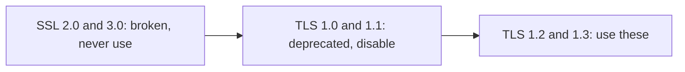
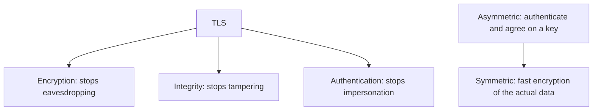
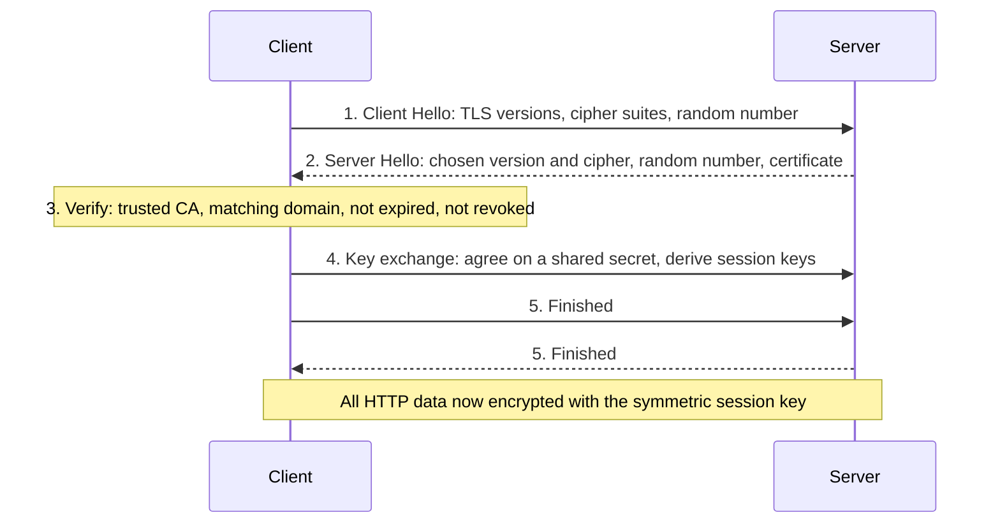
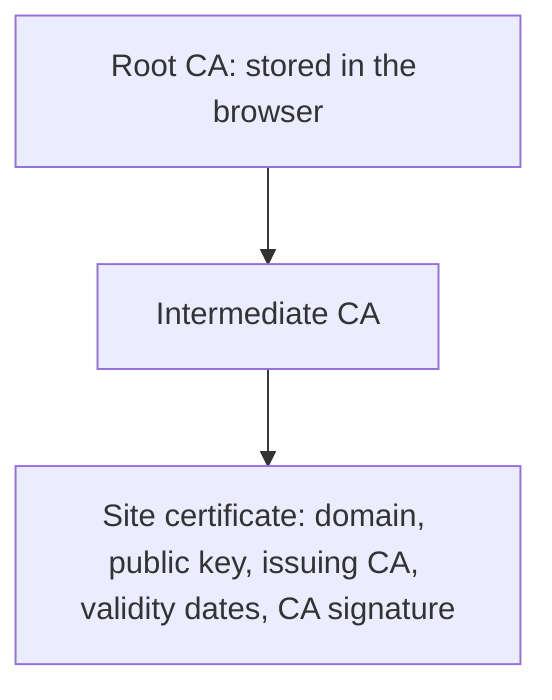
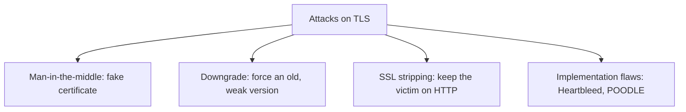

| Topic | Level | Reading Time | Prerequisites |
|---|---|---|---|
| TLS and Secure Communication | Beginner | ~15 min | HTTP Requests, Responses, and Headers |

> **الهدف من الـ Section ده:**  
> هتفهم إيه الفرق بين SSL وTLS وأنهي إصدارات تستخدمها، وإيه الحاجات التلاتة اللي TLS بيوفرها (تشفير وسلامة وتوثيق)، وإزاي الـ handshake بيتم خطوة بخطوة، وإزاي الشهادات والـ chain of trust بيشتغلوا، وإيه أشهر الهجمات على TLS وإزاي تتجنبها.

## Learning Objectives

By the end of this section, you will be able to:

- Explain what **SSL** and **TLS** are, why "HTTPS" means HTTP plus TLS, and which versions to use, deprecate, and never use.
- List the three things TLS provides: **encryption**, **integrity**, and **authentication**, and the threat each one stops.
- Explain how **asymmetric** and **symmetric** cryptography work together in TLS.
- Walk through the five steps of the **TLS handshake**.
- Describe what a **certificate** contains and how the **chain of trust** works.
- Explain what **TLS 1.3** improves, and list the main attacks on TLS.
- Apply the analyst guidance on certificate warnings, **HSTS**, and old protocol versions.

## Table of Contents

- [Learning Objectives](#learning-objectives)
- [What Are SSL and TLS](#what-are-ssl-and-tls)
  - [Definition](#definition)
  - [Which Version](#which-version)
- [The Three Things TLS Provides](#the-three-things-tls-provides)
  - [Encryption, Integrity, Authentication](#encryption-integrity-authentication)
  - [Two Kinds of Cryptography Working Together](#two-kinds-of-cryptography-working-together)
- [The TLS Handshake Step by Step](#the-tls-handshake-step-by-step)
- [Certificates, TLS 1.3, and Attacks on TLS](#certificates-tls-13-and-attacks-on-tls)
  - [Certificates and the Chain of Trust](#certificates-and-the-chain-of-trust)
  - [TLS 1.3](#tls-13)
  - [Attacks on TLS](#attacks-on-tls)
  - [Analyst Guidance](#analyst-guidance)
- [Career Path Connections](#career-path-connections)
- [Key Terms Glossary](#key-terms-glossary)
- [Summary](#summary)

## What Are SSL and TLS

### Definition

**SSL (Secure Sockets Layer)** و**TLS (Transport Layer Security)** هما **بروتوكولات تشفير بتأمّن الاتصال بين client وserver**، وبتحمي **الداتا أثناء النقل (data in transit).**

بتخلي الداتا **غير مقروءة لو اتعترضت.** الداتا المحمية بتشمل **passwords وcookies ومعلومات كروت الائتمان.**

**من غير TLS**، أي حد بيعمل **packet sniffing** (على Wi-Fi عام أو router مخترق أو ISP) **يقدر يقرا كل حاجة.**

**HTTP + TLS = HTTPS.** الناس لسه بتقول "SSL certificate"، لكن المقصود **TLS certificate.**

### Which Version

| Version | Status |
|---|---|
| **SSL 2.0 and 3.0** | **مكسورة. متستخدمهاش أبداً** |
| **TLS 1.0 and 1.1** | **Deprecated. عطّلها** |
| **TLS 1.2 and TLS 1.3** | **استخدمهم** |

> [!NOTE]
> This is the data-in-transit protection from the Data Security Layer of the Defense in Depth Model and from Data Loss Fundamentals and DLP Operations. It is also the answer to the router sniffing risk in Router and Switch Attacks: a sniffer on a compromised router sees only ciphertext when TLS is in use.

## The Three Things TLS Provides

### Encryption, Integrity, Authentication

| Property | What It Means | What It Stops |
|---|---|---|
| **1. Encryption** | **Confidentiality.** الداتا بتتشوّش بـ **shared session key**، فالـ sniffer **مابيشوفش غير ciphertext مش مقروء** | **Eavesdropping** |
| **2. Integrity** | كل رسالة معاها **authentication code**، فأي تغيير في الطريق **بيتكتشف والرسالة بتترفض** | **Tampering** |
| **3. Authentication** | السيرفر **بيثبت هويته بشهادة موقّعة من authority موثوقة**، فإنت عارف إنك وصلت للموقع الحقيقي | **Impersonation** |

### Two Kinds of Cryptography Working Together

نوعين من التشفير بيشتغلوا مع بعض: **asymmetric** (مفاتيح عامة وخاصة) **للتوثيق والاتفاق على مفتاح**، وبعدين **symmetric سريع** للداتا الفعلية.

> [!TIP]
> Easy way to remember why both kinds of cryptography are used: asymmetric is slow but solves the "how do we agree on a secret over an open network" problem, and symmetric is fast but needs a shared secret first. TLS uses each for what it does best.

## The TLS Handshake Step by Step

| # | Name | What Happens |
|---|---|---|
| 1 | **Client Hello** | العميل بيبعت **إصدارات TLS وcipher suites المدعومة ورقم عشوائي** |
| 2 | **Server Hello** | السيرفر **بيختار الإصدار والـ cipher suite، وبيبعت رقمه العشوائي وشهادته** |
| 3 | **Verification** | العميل **بيفحص الشهادة**: CA موثوقة، واسم الـ domain مطابق، ومش منتهية، ومش ملغاة (revoked) |
| 4 | **Key exchange** | الطرفين **بيستخدموا public-key cryptography للاتفاق على shared secret**، وبيتشتق منه الـ session keys |
| 5 | **Finished** | الطرفين **بيأكدوا الـ handshake.** من دلوقتي **كل داتا HTTP بتتشفر بالـ symmetric session key السريع** |

**الفكرة الأساسية:** **الـ session key مابيتبعتش على الشبكة أبداً بشكل يقدر المتنصت يستخدمه.**

> [!NOTE]
> Step 3 includes "matching domain name", which is the exact check that makes a direct-IP connection fail in the DNS Sinkhole file: a certificate is issued to a domain name, not to an IP address, so connecting by IP produces a mismatch warning. The same step is what a certificate error is reporting when the browser stops you.

## Certificates, TLS 1.3, and Attacks on TLS

### Certificates and the Chain of Trust

الشهادة **بتربط domain بـ public key.** فيها: **الـ domain والـ public key والـ Certificate Authority (CA) المُصدِرة وتواريخ الصلاحية وتوقيع الـ CA.**

المتصفحات **بتثق في chain**: **site certificate ثم intermediate CA ثم root CA** المخزّن في المتصفح.

### TLS 1.3

| Improvement | Detail |
|---|---|
| **Faster** | الـ handshake محتاج **round trip واحد** |
| **Safer** | الـ **ciphers والخوارزميات الضعيفة اتشالت**، و**forward secrecy إجباري**، فـ **مفتاح السيرفر المسروق مايقدرش يفك تشفير traffic قديم** |

### Attacks on TLS

| Attack | Description |
|---|---|
| **Man-in-the-middle with a fake certificate** | المهاجم يقدم شهادة مزيفة |
| **Downgrade** | **إجبار الاتصال على إصدار قديم وضعيف** |
| **SSL stripping** | **بيخلي الضحية على HTTP** |
| **Flaws such as Heartbleed and POODLE** | ثغرات في تنفيذ أو تصميم البروتوكول |

### Analyst Guidance

**نصيحة للـ analyst:** **متدوسش على تحذير شهادة أبداً** (منتهية أو self-signed أو domain غلط). **فعّل HSTS وعطّل إصدارات البروتوكول القديمة.**

| Attack | Primary Defence |
|---|---|
| Fake-certificate man-in-the-middle | **ماتتخطاش تحذيرات الشهادة**؛ الشهادة المزيفة هي اللي بتظهر كتحذير |
| Downgrade | **عطّل SSL وTLS 1.0 وTLS 1.1** عند السيرفر |
| SSL stripping | **HSTS**، اللي بيجبر المتصفح على HTTPS |
| Heartbleed / POODLE style flaws | **تحديث المكتبات**، واستخدام TLS 1.2 أو 1.3 |

> [!WARNING]
> A certificate warning is the browser telling you that one of the handshake checks in step 3 failed: expired, wrong domain, or untrusted issuer. Clicking through it removes the authentication property of TLS, which is exactly the property that stops a man-in-the-middle, so a user who accepts the warning gets encryption to the attacker.

> [!IMPORTANT]
> TLS protects data in transit only. It does not protect against a vulnerable application, so an SQL injection or XSS payload sent over HTTPS arrives just as intact as one sent over HTTP. HTTPS also makes inspection harder for defenders, which is why the WAF file notes that a WAF must sit where traffic is decrypted.

> [!NOTE]
> HSTS, the defence against SSL stripping, is delivered as a response header, covered in HTTP Requests, Responses, and Headers. Heartbleed also appears in Buffer Overflow as an over-read: it was a memory-safety flaw in a TLS library, which links this protocol topic back to the input attacks category.

## Career Path Connections

| Career Path | How This Topic Applies |
|---|---|
| SOC Analyst | Treats certificate errors, old TLS versions, and downgrade indicators as signs of interception or misconfiguration |
| Penetration Tester | Tests supported protocol versions, cipher suites, certificate validity, and HSTS presence on every exposed service |
| GRC | TLS version and certificate management requirements are common in compliance standards such as PCI DSS |
| Cloud Security | Cloud load balancers and CDNs terminate TLS, so certificate lifecycle and minimum TLS version are core cloud settings |

## Key Terms Glossary

| Term | Definition |
|---|---|
| SSL | Secure Sockets Layer, the older, broken predecessor of TLS |
| TLS | Transport Layer Security, the protocol securing client-server communication |
| HTTPS | HTTP carried inside a TLS-protected session |
| Cipher Suite | The set of algorithms used for key exchange, encryption, and integrity in a TLS session |
| Session Key | The shared symmetric key used to encrypt data after the handshake |
| Asymmetric Cryptography | Cryptography using a public and private key pair |
| Symmetric Cryptography | Cryptography using one shared key, fast for bulk data |
| Certificate | A document binding a domain to a public key, signed by a Certificate Authority |
| Certificate Authority (CA) | A trusted organization that issues and signs certificates |
| Chain of Trust | The path from a site certificate through intermediate CAs to a root CA trusted by the browser |
| Forward Secrecy | A property ensuring a stolen server key cannot decrypt past traffic |
| SSL Stripping | An attack that keeps a victim on HTTP instead of HTTPS |
| Downgrade Attack | Forcing a connection to use an older, weaker protocol version |
| HSTS | HTTP Strict Transport Security, forcing browsers to use HTTPS |

## Summary

- **TLS secures data in transit:** و HTTP + TLS = HTTPS، والـ "SSL certificate" هي فعلاً TLS certificate.
- **Use TLS 1.2 or 1.3:** SSL مكسور، وTLS 1.0 و1.1 deprecated.
- **TLS provides three properties:** encryption ضد eavesdropping، وintegrity ضد tampering، وauthentication ضد impersonation.
- **Asymmetric and symmetric cryptography work together:** الأول للتوثيق والاتفاق على مفتاح، والتاني للداتا الفعلية.
- **The handshake has five steps:** Client Hello وServer Hello وVerification وKey exchange وFinished.
- **The session key never crosses the network in a usable form.**
- **Certificates bind a domain to a public key through a chain of trust:** site certificate ثم intermediate CA ثم root CA.
- **TLS 1.3 is faster and safer:** round trip واحد، وبدون ciphers ضعيفة، وforward secrecy إجباري.
- **Main attacks are fake-certificate MITM, downgrade, SSL stripping, and implementation flaws.**
- **Never click through a certificate warning, enable HSTS, and disable old versions.**

